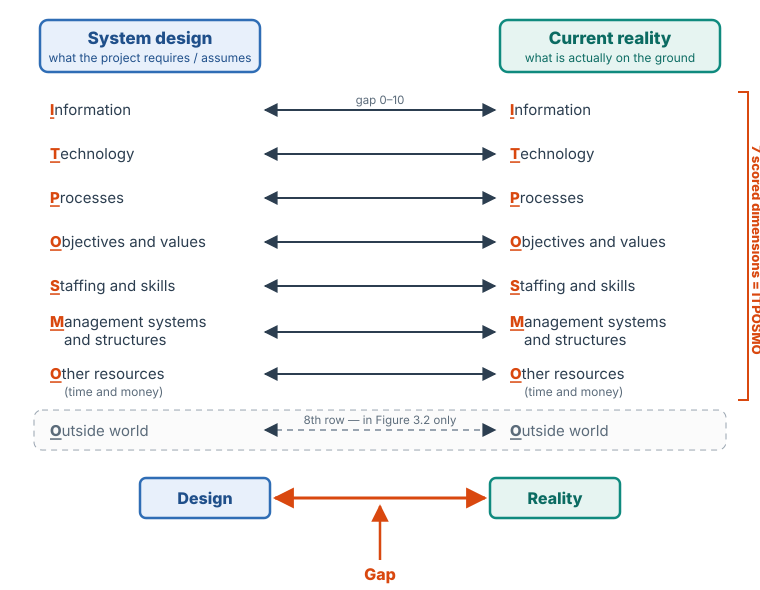
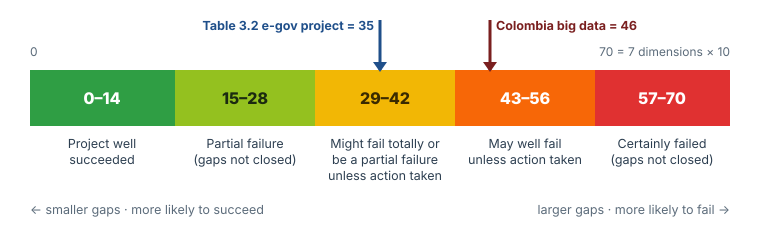
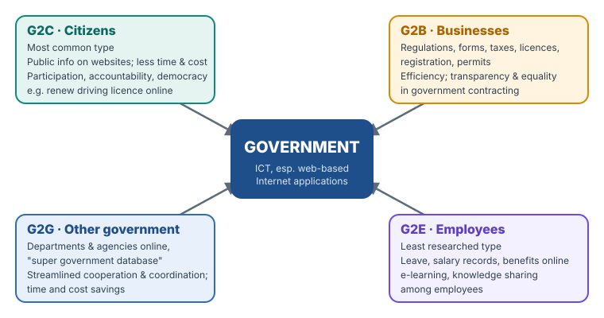
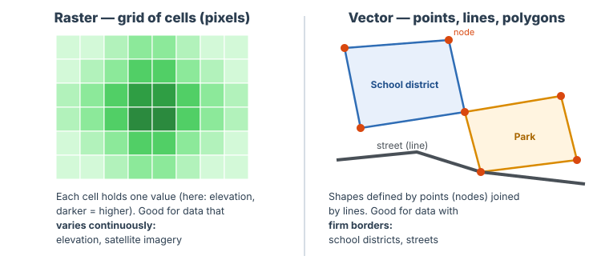
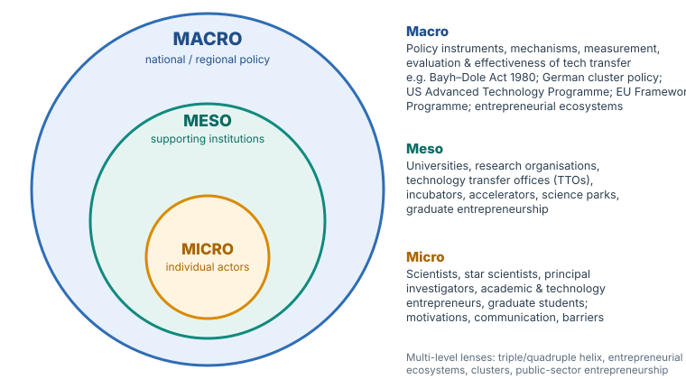
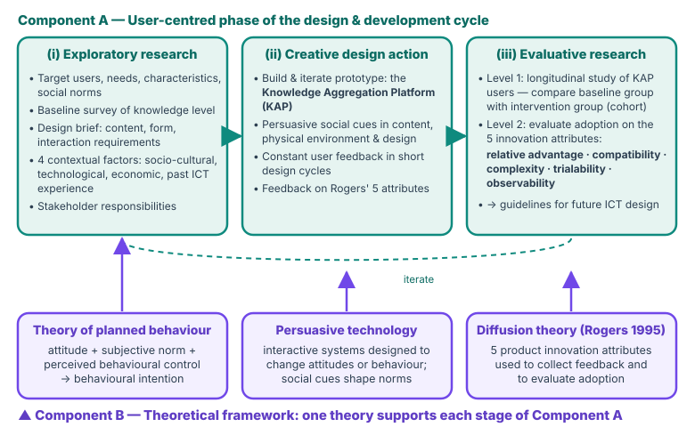

# Crash course

The whole of CSC 584 on one page, for the last days before the exam. Everything **visible** is what you must know. Each **collapsed box** holds the explanation, an example or a model paragraph; open it only when a point is unclear.

- For **how** to answer (time plan, command words, the I-A-J-A method, questions whose counts don't match the PDF), see [Exam technique](exam-technique.md).
- For depth, follow the § links to the unit pages.
- Nothing here goes beyond the courseware except boxes marked "Beyond the notes" and the examples.

---

## The course in five big ideas

Almost every essay answer is stronger if it touches one of these threads.

| # | Big idea | Where it appears |
|---|---|---|
| 1 | **The environment matters as much as the technology.** The social, economic and regulatory environment can decide a project's success. | [Home](../index.md#3-the-environment-matters-as-much-as-the-technology) · Unit 1 §1.14 · Unit 6 §6.2.2 · Unit 7 §7.7 |
| 2 | **No silver bullet: pragmatic realism.** ICT is a *potential* mechanism, not a guarantee; ICTs are "simply tools". | Home · Unit 1 §1.7 i · Unit 4 §4.6.2 (no technological determinism) |
| 3 | **Projects fail when design and reality don't match.** Measure the gap, then close the biggest gaps. | Unit 3 (DRG) · Unit 4 (barriers to big data) · Unit 7 §7.7 (rural India) |
| 4 | **Design *with* users, not *for* them.** | Unit 5 (participatory design, post-colonial computing) · Unit 6 (co-design in e-Health) · Unit 7 (UCD framework) |
| 5 | **Technology is not neutral.** Data is power; artifacts can embody power and authority. | Unit 4 (Bangalore) · Unit 5 §5.3 · Unit 6 §6.3.6 (standards embody values) · Unit 7 §7.2–7.3 |

??? note "Why these five, and how to use them"
    They are the course's recurring arguments. In a "discuss" question, ending with one of them shows the examiner you see the bigger picture. For example: "This shows that, as the courseware stresses, the environment in which an ICT project takes place can be as important as the ICTs themselves." Ideas 3–5 are also what makes part (c) scenarios work: identify the gap (3), propose involving users (4), and point out who gains or loses power (5).

---

## Practical frameworks toolkit

These frameworks drive the applied and scenario questions. For each one, learn the items **and** how to apply them.

### DRG: the design–reality gap model (Unit 3)

**What it is:** an ICT4D framework that measures the gap between a project's **design requirements or assumptions** and the **current reality**. Use it to predict, steer or explain success and failure. [§3.1](../unit-3-design-reality-gap.md#31-design-reality-gap)

**ITPOSMO (the 7 scoring dimensions):**

| Letter | Dimension | Ask of the scenario |
|---|---|---|
| **I** | Information | Does the data the system needs exist, in usable (digitised) form? |
| **T** | Technology | Do the computers, network, software and power exist? |
| **P** | Processes | Do the work routines exist, or must people change how they work? |
| **O** | Objectives and values | Do stakeholders actually *want* what the system does? (corruption, resistance) |
| **S** | Staffing and skills | Enough staff, with the right skills? |
| **M** | Management systems and structures | ICT department, permanent posts, clear roles? |
| **O** | Other resources | Enough time and money? |
| (+) | *Outside world* | Only if asked for **8** dimensions (Figure 3.2): politics, economy, laws, donors |

**Scoring:** rate each dimension **0** (no gap / no change) → **5** (some change) → **10** (complete change). Add them up to a total out of **70**.

| Total | Table 3.1 says |
|---|---|
| **0–14** | The project well succeeded |
| **15–28** | Partial failure, as actions are not taken to close gaps |
| **29–42** | Might fail totally, or might well be a partial failure unless action is taken |
| **43–56** | May well fail unless action is taken |
| **57–70** | Certainly failed, as actions are not taken |

!!! danger "Traps"
    - **Higher score = bigger gap = more likely failure.** Don't read it like an exam mark.
    - **Score 7 dimensions, not 8.** 70 = 7 × 10.
    - The table was made for **pre-hoc** (predictive) use, before implementation, although its wording is in the past tense.
    - Band edges: **14 / 28 / 42 / 56 / 70**. A total of 42 is still in 29–42.

**Data collection:** primary data; **structured interviews** built on the model's constructs, with questions given **two days in advance**; **group discussion**. [§3.2](../unit-3-design-reality-gap.md#32-design-reality-gap-data-collection)

**Steps to use it:** thematic analysis by ITPOSMO → rate each dimension 0–10 → add up → interpret with Table 3.1 → act on the largest gaps. [§3.4](../unit-3-design-reality-gap.md#34-how-to-use-the-model-presentation-and-analysis-of-data)

**Three ways to turn the gaps around** (Colombia big-data case):

1. greater use of **existing datasets**;
2. investment in **data-capture technologies**;
3. prioritise **value-generation** over **data-generation**.

**Why it matters to e-government managers (3):**

1. It **focuses attention** on the gaps.
2. It digs **beyond technical issues** to human and organisational ones.
3. It gives a **systematic, credible basis** for reporting.

**Causes of failure (3):** design–reality gaps; long-term **sustainability** problems; lack of **commitment** by political leaders and public managers.

??? example "Applied example: scoring a scenario in two minutes"
    A state digitises its land registry. There are scanned deeds in only 2 of 20 offices (**I = 6**). Broadband reaches half the offices (**T = 4**). Staff still route files by hand (**P = 5**). Registry clerks earn informal fees from delays (**O = 8**). There are three IT officers for 20 offices (**S = 7**). There is no ICT unit and the IT staff are on contract (**M = 6**). The budget is approved but delayed (**Or = 4**).

    **Total = 6 + 4 + 5 + 8 + 7 + 6 + 4 = 40 → band 29–42**: "might fail totally, or might well be a partial failure unless action is taken".

    **Largest gaps:**

    - **Objectives and values (8):** introduce transparency measures and change management. This is a long-term cultural change, as in the courseware's e-government case.
    - **Staffing and skills (7):** recruit staff and create **permanent** IT posts.

    Note that the technology gap (4) is *not* the main risk. Buying more computers won't save this project.

??? note "The two courseware cases in one breath"
    - **Colombia (big data readiness):**
        - gaps of 7 for Information, Processes, Objectives and values, Skills and knowledge, and Management;
        - 6 for Technology;
        - 5 for Other resources.

        Summary: "**foundations present, specific big-data components absent**". This gave the three actions above.
    - **e-Government case (used mid-implementation):**
        - Large gaps: management (no ICT department, no permanent IT staff); staffing (5 of 9 posts filled, under-qualified); objectives and values (corruption); information (missing module, no digitised documents).
        - Small gaps (champions; process redesign done first; stable information) explain the **partial success**.
        - Action plan: an ICT department, more staff and permanent posts first, *then* the missing module and scanning.
        - DRG proved a **valuable mid-implementation tool**.
    - **Table 3.2 worked example:** total **35** (band 29–42). Largest gap: Management system and structure (**8**), then Staffing and skills and Objectives and values (**7** each).

    [Unit 3 in full](../unit-3-design-reality-gap.md)

### Big data for development (Unit 4)

**The two-fold core of big data** (what big data *is*):

1. **New data sources:** digital footprints act as low-cost, real-time **proxy indicators** that replace surveys. Example: Google's 50 million search terms as a proxy for flu.
2. **Analytics to inform intelligent decisions:** the point is the analysis, **whatever the scale**, not the size of the data.

**Five characteristics: U-R-B-F-E.** Learn one example for each.

| | Characteristic | One-line meaning | Example to quote |
|---|---|---|---|
| **U** | Universal sampling | n = N: capture everyone instead of sampling | Mobile phones (95% penetration); poverty predicted with **80–85%** accuracy; Kenya malaria travel patterns |
| **R** | Real-time (shadow) | Data available *now* | Haiti cholera tweets **two weeks** ahead of official statistics; Estonia border statistics; rainfall measured from phone-tower signals |
| **B** | Digital footprint as **by-product** | Produced anyway, at low cost, almost inevitably | Social network analysis of ties; the Obama 2012 campaign |
| **F** | Data **fusion** | Messy data fixed by redundancy across sources | HDI uses 4 indicators vs TRMI's 18,000+ indices |
| **E** | **End of theory** | Pattern detection replaces theory | Google Translate (no linguists, 100 languages); Facebook Likes predict personality better than friends do (r = 0.56 vs 0.49) |

**The ultimate limitation:** **all data is from the past.**

- Google Flu Trends drifted out of sync with real flu over time, because search behaviour changed.
- The best analytics can do is **nowcasting**.
- Analytics works for **stationary** systems. When the system changes, it is "at best limited, if not deceiving".
- The same argument has three names, **all from 1976**: the **Lucas critique** (economics), **Goodhart's law** (finance) and **Campbell's law** (education).

**The two goals of ICT4D** (why the limitation bites):

1. to create a future **significantly different from the past**;
2. to **change the modus operandi** of the system.

"A developing Africa is not simply an extrapolated version of Europe's past."

**Four challenges:**

1. **Access:** n ≠ N. Twitter users are not all people. Rwanda (2–20% penetration) gave an unrepresentative sample; Latin America (60–80%) matched the census. The **bandwidth divide** keeps the divide evolving.
2. **Skills:** shortages of analysts and data managers; poor training is a main cause of failure.
3. **Institutional and cultural:** privacy, discrimination, weak institutions; the need for new evidence-based decision processes.
4. **Fostering ICT in ICT4D:** design privacy-respecting information systems; use **theory-driven** models to avoid the Lucas trap.

!!! danger "Traps"
    - The two-fold core (**what big data is**) is not the same as the goals of ICT4D (**what development wants**). Students often swap them.
    - **No technological determinism.** In Bangalore, 20 million land records were digitised for 7 million farmers, but large players exploited them and **existing inequalities were perpetuated**. "Data is power, and power benefits from data."
    - "End of theory" is a **characteristic** the courseware describes, then **qualifies**: the challenges call for theory-driven models.

??? note "Explain: why development and big data are in tension"
    Big data predicts well when tomorrow looks like yesterday. Development deliberately tries to make tomorrow **different** from yesterday. The more an intervention succeeds in changing a system, the less the old data can describe the new one. That is the Lucas critique applied to ICT4D. It is why the courseware's opportunity is **e-science**: combining big data with **agent-based models**, in the space between top-down theory and ad hoc econometrics. [§4.6](../unit-4-development-informatics.md#46-opportunities-and-challenges-for-development)

??? example "Applied example: the n vs N trap"
    A state ministry wants to target cash transfers using mobile-money data. Phone penetration in the poorest LGAs is low, and phones there are mostly owned by traders. Identify the **access challenge (n ≠ N)**. Cite **Rwanda**, where phones were owned by the "privileged strata". Recommend using the data **alongside** a household survey (data fusion), not instead of it. Also warn that once people learn the rule, they will change their top-up behaviour: the **Lucas critique / Goodhart's law**.

### Design methodologies and participatory design (Unit 5)

**The five design methodologies:**

| Methodology | Key point |
|---|---|
| **Waterfall** | Sequential stages, scope fixed in paperwork; change is costly; risks outdated products |
| **Agile** | Self-organised cross-functional teams; sprints reviewed with the customer; "tames the change" |
| **Lean Startup** | Prioritise essential features; build the **MVP** (Minimum Viable Product) first |
| **Design Sprint** | Find → sketch → decide → prototype → test, **within a week**. No test, no sprint |
| **Concierge testing** | Feedback on **made-up** products in everyday settings. It sparks creativity, unlike Wizard-of-Oz testing, which tests theories |

**Participatory design (PD)** lets real-world users take part in the design process alongside professional designers. Other names: cooperative design, community design, co-design, co-creation. It began in Germany, became popular in **Scandinavia in the 1980s**, and Extreme Programming (XP) boosted it in the 2000s. Microsoft Office, IKEA and Airbnb have used it.

| List | Items |
|---|---|
| **6 principles: FM EISR** | **F**ocus on the user · **M**utual learning · **E**mpowerment · **I**nclusiveness · **S**tages (iterations) · **R**espect |
| **4 pros** | Innovation · cost-effectiveness (catch errors early) · engagement (belonging, LTV, word of mouth) · better inclusion |
| **4 downsides** | Time · sample size · structure · quality |
| **3 types** | **User-centred** (feedback after each iteration) · **co-design** (equal rights, but **the designer makes the final decision**) · **user-created** (gather → specify → design → evaluate) |
| **5 implementation steps** | Recruit participants → define goals → set up a structure → leverage divergence and convergence → follow up |
| **Running a session** | Time management · facilitators · recording |
| **Remote tools** | Surveys · interviews · online questionnaires · video conferencing |

!!! danger "Traps"
    - In **co-design**, users can "own the product", but **the final decision belongs to the designer**.
    - **When *not* to use PD:** when the **buyer is not the user** (B2B, the K-12 schools example). The vendor can sell without user feedback, but it is exposed to a competitor with better usability.
    - The courseware's "user-centred design" is a **type of PD** (Unit 5). Unit 7's **UCD framework** is a separate, three-stage framework.

**Post-colonial computing:** computing "is – or at least should be considered as – a **colonial phenomenon**". You understand it through the **genealogy of modernity** and the world system that began with European expansion in **1492**.

- **Colonisation** (Latin *colere*, "to inhabit") is the **ongoing process** of control by which a central power dominates surrounding lands and "resources".
- **Colonialism** is the **establishment, exploitation, maintenance, acquisition and expansion** of a colony **by a political power from another territory**.

??? example "Applied example: choosing a methodology"
    A university's IT unit must build a hostel-allocation portal in six weeks. The requirements will change as students react. **Recommend agile**, with PD sessions: recruit students from each hall, hold design sprints, and follow up after each release. **Waterfall** fixes scope early, so late changes would be costly. That is the opposite of what this case needs.

??? note "Explain: post-colonial computing in one paragraph"
    The objection is that empires are over, so how can computing be colonial? The courseware's answer is to look at the history of modernity and today's world system. Political empires ended, but **centre–periphery patterns** continue. Technology is designed and controlled at the centre and imposed on the periphery, while data and value flow back to the centre. Quote the two definitions, then explain. [§5.3](../unit-5-design-methodologies.md#53-post-colonial-computing)

### e-Health (Unit 6)

**The four WHO terms:**

- **e-Health:** ICT in support of health.
- **m-Health:** mobile wireless technologies for health.
- **Digital health:** the **umbrella** term, covering e-Health (which includes m-Health) plus big data, genomics and AI.
- **Telehealth:** care delivered **outside traditional healthcare facilities**.

Two further points:

- Eric Topol's three disruption areas are **telemedicine, apps, and sensors and wearables**.
- The **smartphone** is the key m-Health tool; about 80% of adults in high-income countries use one to access the internet.

**The seven barriers** (EU e-Health Action Plan 2012–2020): **A-I-E-L-L-C-R**

1. **A**wareness of, and confidence in, e-Health solutions is lacking.
2. **I**nteroperability between solutions is lacking.
3. **E**vidence of cost-effectiveness at large scale is limited.
4. **L**egal clarity is lacking for health apps, and there is little transparency about their data.
5. **L**egal frameworks are inadequate or fragmented, including a lack of reimbursement schemes.
6. **C**osts of starting up are high.
7. **R**egional differences in access to ICT; access is limited in deprived areas.

**The ESC's responses:** patient education · **co-design** with patients · financial support · workflow redesign · EU-wide legislation.

??? example "Applied example: matching barriers to remedies"
    A Nigerian state's antenatal telemedicine app is rarely used. Rural women have basic phones and low health literacy (**regional access, awareness** → education and financial support). Clinic EHRs can't import the app's data (**interoperability** → standards and legislation). Doctors aren't paid for video consultations (**reimbursement / legal frameworks**). Women weren't consulted (→ **co-design**). [§6.1.9](../unit-6-technologies.md#619-barriers-to-the-implementation-of-e-health)

### e-Government (Unit 6)

**Definition and aims:** using ICT, especially web-based internet applications, to give citizens, businesses and government employees **convenient access** to government information and services, to **improve the quality** of services, and to **enhance democratic participation**.

| Type | Serves | Remember |
|---|---|---|
| **G2C** | Citizens | The **most common** type (e.g. NIS passport portal, JAMB e-registration) |
| **G2B** | Businesses | Forms, taxes, licences, permits, registration; transparency in government contracting (e.g. CAC registration) |
| **G2G** | Other government bodies | A **"super government database"**; inter-agency coordination (e.g. IPPIS) |
| **G2E** | Government employees | The **least researched** type; leave, salary records, e-learning |

**The four factors affecting e-Government:**

1. national context;
2. political and institutional factors;
3. socio-economic and cultural factors;
4. technical infrastructure (hardware, software, telecommunications and **human resources**).

??? note "Explain: link to DRG"
    The four factors map roughly onto ITPOSMO:

    - technical infrastructure ≈ Technology + Staffing;
    - political and institutional ≈ Management;
    - socio-economic and cultural ≈ Objectives and values;
    - national context ≈ Outside world.

    In an e-government scenario you can use the four factors to **diagnose** the problem and DRG to **score** it. [§6.2](../unit-6-technologies.md#62-e-government)

### Information infrastructures, standards, GIS and archiving (Unit 6)

**Information infrastructure (II) properties:**

- **embedded**;
- **transparent** (taken for granted);
- has **reach and scope** (spatial and temporal);
- **built on an installed base** (it "does not grow" from nothing);
- **visible upon breakdown**.

**Working definition:** an II is open (no fixed "user"), interconnected, a dynamically evolving portfolio of systems, shaped by its installed base, and stretched across space and time. IIs "**do not exist but occur**".

**Infrastructuring** is the ongoing collective practice of managing these tensions. **No one controls it**, and only the user at the terminal is visible.

**Scaling has three spheres:** **enactment** (deploying durable resources), **organizing** (long-term arrangements, repair and maintenance) and **institutionalization** (linking the infrastructure to wider, longer-term goals).

**Data friction** is the point at an interface where data is garbled, misinterpreted or lost. The two responses are **metadata** ("data of data", "almost standards") and **standardization** (of projects and datasets).

**Standards are:**

1. **nested** inside one another;
2. **unevenly distributed**;
3. **relative to communities of practice** ("one person's well-fitting standard may be another's impossible nightmare");
4. **increasingly linked and integrated**;
5. ways to **codify, embody or prescribe ethics and values**.

**GIS: raster vs vector.**

- **Raster** uses grids of cells or pixels, for data that **varies** (elevation, satellite imagery).
- **Vector** uses points, lines and polygons, for data with **firm borders** (school districts, streets).
- The test: **does the data have firm edges?** Yes → vector. No → raster.

**Digital archiving:**

- **Three ways:** paper storage · scan on demand (hybrid) · digital archiving (paperless, using a DMS and archiving software).
- **Five benefits: T-K-L-P-D.** Avoid **T**ax setbacks · secure company **K**nowledge · minimise **L**iability risks · **P**rotect documents · meet **D**eadlines (retention periods; GDPR).
- **Eight best practices:** flexible archiving scenarios · secure · traceable · seamless storage across all media · information in its context · high user acceptance · modern technology · scalable.

??? example "Applied example: GIS layers for a flood-prone town"
    - Elevation, rainfall and satellite imagery are **raster** layers.
    - Plot boundaries, roads and the river line are **vector** layers.

    Overlay them to see which homes and plots lie in flood-prone areas. The courseware's own example is "which homes and businesses are in areas prone to flooding". Every map must share the **same scale** and be displayed in **one common projection**. [§6.4](../unit-6-technologies.md#64-gis-geographic-information-system)

### Standards bodies (Unit 7)

| Body / standard | Covers |
|---|---|
| **ISO/IEC 38500** | **Board-level** governance of IT; **six principles**; the starting point. It does *not* address specific processes |
| **COBIT** | Process-based **governance and management** of ICT |
| **ITIL** | **Service lifecycle** best practice |
| **DAMA-DMBOK** | **Data management** |
| **CMM/CMMI** | **Software development** |
| **OASIS · W3C · OMG · Dublin Core** | **Technical standards:** interoperability, metadata, semantic and web |
| *ISSA Guidelines* | A framework for social-security institutions applying these standards |

**Benefits:** rigour; access to global knowledge, experience and trained people. **Barriers:** administrative effort; changes to organisational culture. **How to adopt:** as **medium-term capacity building**, in priority areas.

??? note "Reaching \"ten\""
    The courseware names **nine** standards and frameworks in its list. To reach the "ten" the learning outcome asks for, count **ISO** and **ISO/IEC 38500** separately, or add **ISSA**. Give the name, full name and a one-line function for each. [§7.1](../unit-7-standards-theory.md#71-ict-standards)

### Artifacts and politics (Unit 7)

**Mumford's two technologies:**

| Authoritarian | Democratic |
|---|---|
| System-centred | Man-centred |
| Immensely powerful | Relatively weak |
| **But inherently unstable** | **But resourceful and durable** |

**The common objection:** "**people have politics, not things**". "Blaming the hardware appears even more foolish than blaming the victims."

**The five pieces of "stern advice"** (the social-determination view):

1. What matters is **not the technology itself** but the social or economic system it is embedded in.
2. This is the premise of the **social determination of technology**, and it has an obvious wisdom.
3. It **corrects** an uncritical focus on "the computer and its social impacts".
4. It is an **antidote to naive technological determinism**.
5. Those who ignore social and economic shaping "have not gotten very far".

The shortcoming of this view: taken literally, it implies that **technical things don't matter at all**.

**Winner's two ways artifacts have politics:**

1. **Design settles an issue** in a community. This is straightforward. Examples: **Moses' ~200 low overpasses** kept 12-ft buses, and so poor and Black people, off Long Island parkways; **McCormick's** $500,000 moulding machines broke the iron moulders' union (abandoned after 3 years); Haussmann's boulevards; campus plazas.
2. **Inherently political technologies** require, or are strongly compatible with, particular political relationships. This is the more troublesome way.

**Three kinds of effect to distinguish:**

- **intended** (Moses, McCormick);
- **neglect** (disability access in the 1970s US);
- **"stacked deck"**, beyond intended or unintended (the **tomato harvester**: about 4,000 growers fell to about 600, and about 32,000 jobs were lost).

**Two kinds of choice:** **yes or no** (adopt it at all?) vs **design features** (David Noble: record/playback vs numerical control).

**The conclusion to quote:** technologies are "**ways of building order in our world**". The **greatest latitude of choice exists the very first time** a technology is introduced. Innovations are **like legislative acts**.

!!! danger "Traps"
    - The stern advice *is* the **social-determination** position. It is the **antidote** to technological determinism, not a version of it.
    - Politics in an artifact **doesn't need a conspiracy**: disability access came from neglect.
    - Later historians **dispute** the Moses story. Use the courseware's account, but you may note this as "beyond the notes".

??? example "Applied example: analysing an artifact"
    A university portal works only on smartphones with paid data, and only during office hours.

    1. **Way 1:** its design settles who can register.
    2. **Neglect**, not intention, like disability access.
    3. It is a **design-feature** choice, not a yes/no one.
    4. **Losers:** poorer students. **Gainers:** students with data and smartphones.
    5. **Fix it now:** the greatest latitude of choice is at first introduction.

    [§7.3](../unit-7-standards-theory.md#73-artifacts-and-politics)

### Technology transfer, INGOs and rural ICT (Unit 7)

**Technology transfer happens at three levels:**

| Level | Focus | Examples |
|---|---|---|
| **Macro** | National and regional **policy** | Bayh–Dole Act 1980; Lehmann & Menter (German cluster policy); Smith et al. (US Advanced Technology Programme); EU Framework Programme; Nicotra et al. (ecosystems: beware **blind imitation**) |
| **Meso** | Supporting **institutions** | TTOs, incubators, accelerators, science parks |
| **Micro** | **Individual** actors | van Stijn et al. (14 practices); Ben-Hafaïedh et al. (**academic + practitioner** teams perform best); Kolb & Wagner (generic vs tailored support); Ratzinger et al. (founders' education) |

**The five INGO challenges: S-K-P-F-R.**

1. **S**ustainability and scale: many small pilots, few large-scale programmes.
2. **K**nowledge is lacking: IT is seen as a back-office issue.
3. **P**ace of change: it is easy to make incremental improvements, hard to adopt new ways of working.
4. **F**unding: cyclical donor funding.
5. **R**oles and norms are changing: ICT closes the gaps that INGOs were founded to bridge.

**Rural ICT (India) failed on three fronts:**

1. **Content:** too general and irrelevant (the Gyandoot and n-Logue kiosks), with no protocol to update it.
2. **Fragmented, single-discipline development:** developers don't know local needs, and maintenance falls on local operators.
3. **Little evaluation:** few agencies study adoption or impact on users' lives.

**The UCD framework (§7.7.2)** has two components.

Component A has **three stages**, and Component B supplies **one theory per stage**:

| Stage (Component A) | What happens | Theory (Component B) |
|---|---|---|
| **1. Exploratory research** | Baseline survey; design brief; 4 contextual factors (socio-cultural, technological, economic, past ICT experience) | **Theory of planned behaviour**: attitude + subjective norm + perceived behavioural control → intention |
| **2. Creative design action** | Prototype the **Knowledge Aggregation Platform (KAP)** and iterate it on user feedback | **Persuasive technology**: social cues to change attitudes or behaviour |
| **3. Evaluative research** | **Longitudinal** study comparing results with the baseline | **Diffusion theory**: Rogers' 5 attributes |

**Rogers' five attributes:** relative advantage · compatibility · complexity · trialability · observability.

The framework draws on **four disciplines**: social science, computer science, industrial design and marketing.

??? note "Explain: why the UCD framework answers the three fronts"
    - **Content** is fixed by the exploratory stage, which uses TPB to find needs and norms.
    - **Fragmentation** is fixed by bringing the four disciplines in through UCD.
    - **Evaluation** is fixed by the longitudinal study against a baseline.

    That one-to-one mapping is a strong paragraph in any "why do rural ICT projects fail and what should be done?" question. [§7.7](../unit-7-standards-theory.md#77-a-multidisciplinary-approach-to-ict-development)

### Unit 1 essentials

| List | Items |
|---|---|
| **3 enabler roles** | Productivity and economic growth · social development (health, education, environment) · good governance |
| **9 developmental characteristics** | Simply tools · diverse range · multifunctional and interoperable · cheaper and easier · **knowledge management** · efficiency · networks · multipurpose · globalization |
| **4 factors affecting ICT-driven development** | **Policies** (IP, tangible property, trade, competition, public research, security and privacy, standards, e-government) · **human capacity** (education and digital literacy, ICT skills) · **enterprise** (access to capital, investment incentives) · **infrastructure and access** |
| **4 IT industry segments** | Hardware · software · services · software-plus-services (no country excels in all of them) |
| **10 components** | Devices · software · middleware · data · wired networks · wireless networks · communication technologies · cloud · protocols and interfaces · security and governance **policies** |
| **3 challenges ICT creates** | Cybercrime · job displacement · social problems (trolling, cyberbullying, isolation, loneliness, depression) |

??? note "Memory aid for the nine characteristics"
    "**Tools Diversify, Multiply, Cheapen; Know, Efficient, Network, Multipurpose, Global.**" [§1.7](../unit-1-ict.md#17-developmental-characteristics-of-icts)

---

## Unit cards

Two lines on each unit, then the points students most often miss. The lists themselves are in the toolkit above.

### Unit 1: ICT

ICT is a diverse set of tools and resources to transmit, store, create, share or exchange information. It is useful for development as an **enabler** in three roles, and it is an industry in its own right. [Unit 1](../unit-1-ict.md)

- There is **no universal definition**, because ICT keeps evolving (UIS 2009; TechTarget 2024).
- **Old technologies** (landline, radio, TV) are still ICT, alongside current and emerging ones (5G/6G, Web3, quantum).
- **IT is a subset of ICT.** IT management excludes telecommunications.
- ICT means more than its components: it includes their **application**, which is where its "potential, power and danger" lie.
- **Policies** count as an ICT component (security and governance policies).

### Unit 2: Applications of ICT

ICT gave a **qualitative leap** after the industrial revolution. The unit covers three application areas, ten gadgets and ten impacts. [Unit 2](../unit-2-applications.md)

- **Teleconferencing:** 3 or more people in 2 or more locations, audio-only *or* audio-video, by any telecom means.
- **Video conferencing:** **simultaneous two-way** video and audio for two or more locations. It is also called visual collaboration and is a type of groupware.
- **Tele-presence:** feeling present elsewhere through **telerobotics**. It goes beyond video conferencing in **4 features**: networking (address space); **tele-computing** (remote control); messaging; information search, retrieval and archival.
- **The ten gadgets:** radio, TV, computer, satellites, **VSAT**, fax, telephone, GSM, ATM, **POS**.
- **The ten impacts:** education, industry, political and military, entertainment, medical science, finance, public-sector management, home electronics, agriculture, business.

### Unit 3: Design–reality gap

Measure the gap between design and reality on 7 ITPOSMO dimensions, scored 0–10 and totalled out of 70. Then act on the largest gaps. [Unit 3](../unit-3-design-reality-gap.md) · [toolkit](#drg-the-designreality-gap-model-unit-3)

- The gap can be estimated by **researchers**, from **interviewees**, or in **group discussions**.
- Colombia: "foundations present, specific big-data components absent".
- The e-government case shows DRG used **mid-implementation**, not just before or after.
- The biggest gaps are usually **people and organisation**, not technology.

### Unit 4: Development informatics and big data

Development informatics is ICT for **sustainable socio-economic development**, and it is strategic for the **17 SDGs**. Big data is promising but limited: all data is from the past. [Unit 4](../unit-4-development-informatics.md) · [toolkit](#big-data-for-development-unit-4)

- The **SDGs** (193 states) replaced the **MDGs**, which expired in 2015; ICT enables **Schumpeterian leapfrogging**.
- Google tested **450 million** models and found **45** search terms. Big data is the step from Information Societies to **Knowledge Societies**.
- Big data is "the new oil" and a core economic asset (OECD).
- **Opportunity:** e-science = big data + **agent-based models**. A good model "begins and ends with data".

### Unit 5: Design methodologies

Methodologies give a design process **structure and consistency** and **align stakeholders**. Participatory design brings users in as participants. Post-colonial computing asks whose power computing serves. [Unit 5](../unit-5-design-methodologies.md) · [toolkit](#design-methodologies-and-participatory-design-unit-5)

- Feedback-based, **time-boxed**, agile approaches stay relevant; Waterfall risks outdated products.
- The **MVP** is the core of Lean Startup.
- Concierge testing **sparks creativity**; Wizard-of-Oz testing tests theories.
- The courseware calls PD a **collaborative, democratic** approach, used in software, architecture, urban planning and healthcare.

### Unit 6: Technologies discussed

Five technologies: e-Health, e-Government, information infrastructures, GIS and digital archiving. [Unit 6](../unit-6-technologies.md) · [toolkit](#e-health-unit-6)

- An **e-Health strategy** comes first, before projects.
- **EHRs** got a mixed reception: 63% said they improved care, but 74% said they increased workload. There is **no unified EHR in Europe**.
- IIs are **boundary infrastructures**, built on an installed base and visible upon breakdown.
- **Standards embody values**. This links to Unit 7's "artifacts have politics".

### Unit 7: ICT standards and theoretic concerns

Standards help govern ICT. Technologies can embody power. Engineers, institutions and INGOs shape transfer. A multidisciplinary UCD framework fixes rural ICT failure. [Unit 7](../unit-7-standards-theory.md) · [toolkit](#artifacts-and-politics-unit-7)

- **Engineering mindset, 10 features:** context · process · materials · constraints and trade-offs · multiple solutions · science and maths · evaluate and improve · persistence · teams · envisioning oneself as an engineer (Cunningham).
- **Boosters** called every big technology democratising. Boorstin said television could "disband armies, cashier presidents".
- INGOs are well placed **in theory** (field programmes, international teams) but face five challenges.
- The UCD framework adapts an **ISO standard UCD cycle**.

---

## Traps: points that are easy to get wrong

1. **Radio and TV are ICT.** The courseware lists "antiquated" technologies that are still ICT.
2. **IT ⊂ ICT**, not the reverse. Telecommunications is the difference.
3. **DRG direction:** high score = big gap = failure. 0 means *no change needed*.
4. **7 dimensions to score, 8 only if asked** (Outside world).
5. **Google Flu Trends** first **outperformed** traditional models, then **drifted** out of sync. It shows both the promise and the limitation.
6. **Lucas critique, Goodhart's law and Campbell's law** are the **same idea** in economics, finance and education, all from **1976**.
7. **Nowcasting** is the best analytics can do: estimating the present, not forecasting a changed future.
8. **"End of theory"** is a characteristic of big data, but the courseware's challenges call for **theory-driven** models.
9. **Twitter users ≠ all people.** Universal sampling fails where access is unequal.
10. **In co-design, the designer has the final decision.**
11. **Colonisation is a *process*; colonialism is the *system*** of establishing and exploiting a colony from outside.
12. **G2C is the most common type; G2E is the least researched.** G2G is the "super government database".
13. **Raster = varying data; vector = firm borders.** Satellite imagery is raster.
14. **Digital health is the umbrella**: it contains e-Health, which contains m-Health.
15. **Stern advice = social determination**, the antidote to technological determinism.
16. **Mumford's authoritarian technology is powerful *but unstable*; democratic technology is weak *but durable*.**
17. The greatest freedom of choice over a technology is **at first introduction**.
18. **The Moses bridge story is disputed** by later historians. The principle still stands.
19. **INGO challenges: five, not six. Stern advice: five, not six. Standards: nine, plus one to make ten.** See the [count-mismatch table](exam-technique.md#when-the-coursewares-numbers-dont-match).

??? note "Why these trip people up"
    - **Traps 3–4** are arithmetic and reading errors that cost easy marks in DRG questions.
    - **Traps 5–9** come from writing as if big data were simply good. The courseware's tone is **pragmatic realism**: always add the limitation.
    - **Traps 10–16** are pairs of neighbouring ideas. The [confusable pairs table](#confusable-pairs) below sets them side by side.
    - **Trap 19:** give what the courseware actually lists and say so in one line. Markers accept "the courseware identifies five".

---

## Confusable pairs

| A | B | The one-line difference |
|---|---|---|
| **ICT** | **IT** | IT manages computers and information (hardware, software, networking); ICT adds **telecommunications**. IT ⊂ ICT |
| **Teleconferencing** | **Video conferencing** | Teleconferencing can be audio-only, with 3+ people by any telecom means. Video conferencing is always **simultaneous two-way video and audio**, plus sharing |
| **Video conferencing** | **Tele-presence** | Tele-presence adds the feeling of **being present** (telerobotics) and 4 features: networking, tele-computing, messaging, search and retrieval |
| **Two-fold core of big data** | **Goals of ICT4D** | The core is what big data *is* (new sources + analytics). The goals are what development *wants* (a different future; changing the modus operandi) |
| **Lucas critique** | **Goodhart's / Campbell's law** | The same argument (models break when the system or policy changes) in economics, finance and education respectively; all from 1976 |
| **Universal sampling** | **Real-time shadow** | Universal sampling is about **who** is captured (n = N). Real-time shadow is about **when** (now) |
| **Waterfall** | **Agile** | Waterfall has sequential stages and fixed scope, so change is costly. Agile has sprints with customer review and "tames the change" |
| **User-centred design (PD type)** | **Co-design** | In UCD, users give feedback after each iteration. In co-design, they are equal partners, but **the designer decides** |
| **Unit 5 user-centred design** | **Unit 7 UCD framework** | The first is a type of participatory design. The second is a **three-stage, theory-backed** framework for rural ICT |
| **Colonisation** | **Colonialism** | Colonisation is the ongoing *process* of control (*colere*, to inhabit). Colonialism is the *system* of establishing and exploiting a colony from another territory |
| **e-Health** | **m-Health · telehealth · digital health** | e-Health = ICT for health. m-Health = mobile. Telehealth = care outside facilities. Digital health = the umbrella term |
| **G2B** | **G2G** | G2B serves **businesses** (forms, taxes, permits). G2G links **government bodies** (super database) |
| **Raster** | **Vector** | Raster uses grids of pixels for varying data. Vector uses points, lines and polygons for firm borders |
| **Metadata** | **Standardization** | The two responses to data friction. Metadata is "data of data" ("almost standards"); standardization is of projects and datasets |
| **Authoritarian technology** | **Democratic technology** | Authoritarian: system-centred, powerful, unstable. Democratic: man-centred, weak, durable (Mumford) |
| **Technological determinism** | **Social determination** | Determinism: technology moulds society by its own dynamic. Social determination: society shapes technology (the stern advice) |
| **Way 1: design settles an issue** | **Way 2: inherently political** | Way 1 is a design choice that settles an issue (Moses). Way 2 is a technology that *requires* certain political relationships |
| **Yes/no choice** | **Design-feature choice** | Whether to adopt a technology at all, vs how to design it after deciding to go ahead |
| **Macro** | **Meso · micro** | Macro = policy. Meso = institutions (TTOs, incubators). Micro = individuals (scientists, founders) |

---

## Answer outlines for recurring questions

Each outline follows **identify → apply → justify → act** (see [I-A-J-A](exam-technique.md#answering-scenario-questions)).

### "Why did (or will) this ICT project fail?"

1. **Identify:** name the design–reality gap model.
2. **Apply:** go through ITPOSMO, giving one fact from the scenario per dimension and a 0–10 score. Put this in a table.
3. **Justify:** show the total and the Table 3.1 band. Name the largest gaps.
4. **Act:** propose one action per large gap, people and organisation first. Say whether this is pre-hoc or mid-implementation.

??? success "Model paragraph"
    "Using the design–reality gap model, the largest gaps are in Management systems and structures (8), because there is no ICT unit and the IT staff are on contract, and in Objectives and values (7), because clerks profit from delays. The total of 40 falls in the 29–42 band: the project 'might fail totally, or might well be a partial failure unless action is taken'. As in the courseware's e-government case, the agency should first create an ICT department and permanent posts, and only then deploy the remaining modules."

### "Recommend a design approach for…"

1. **Identify:** say whether requirements are stable or changing, and whether the users are the buyers.
2. **Apply:** choose a methodology (agile or design sprint for changing needs; waterfall only for fixed scope). Add **participatory design**, naming its type (co-design or user-centred).
3. **Justify:** give two principles (e.g. mutual learning, inclusiveness) and two pros (cost-effectiveness, engagement). Address one downside (time → design sprints; sample size → recruit across segments).
4. **Act:** walk through the five implementation steps in one line each.

??? success "Model paragraph"
    "I recommend agile development with co-design, because the farmers' needs are not yet known and will change as they use the app. Recruiting farmers from each cooperative (step 1) addresses PD's sample-size downside. Short sprints reviewed with users catch errors before they become costly, which is PD's cost-effectiveness advantage. Waterfall is unsuitable because it fixes scope in paperwork, so late changes would be expensive."

### "Do artifacts have politics? Discuss."

1. Give the **objection**: "people have politics, not things", and the **stern advice** (social determination).
2. Give its **shortcoming**: taken literally, technical things wouldn't matter.
3. Give Winner's **two ways**, with **Moses** and **McCormick** for way 1.
4. **Beyond intention:** disability access (neglect) and the **tomato harvester** ("stacked deck").
5. **Conclude:** technologies are "ways of building order", like legislation, and the greatest latitude of choice is at first introduction. Add an ICT example.

??? success "Model paragraph"
    "Robert Moses built about 200 overpasses on Long Island parkways too low for 12-foot buses. Poor and Black people, who depended on public transit, were kept off the parkways, while car-owning middle-class whites used them freely. The bridges carried cars, but they 'encompassed purposes far beyond their immediate use'. Their design settled a social question in concrete, which is Winner's first way in which artifacts have politics."

### "Big data for development: promise and limits"

1. **Promise:** the two-fold core, then the five characteristics with one example each.
2. **Limit:** all data is from the past. Use Flu Trends, nowcasting, stationary vs changing systems, and the Lucas critique.
3. **Why it matters for ICT4D:** its two goals (a different future; changing the modus operandi).
4. **Challenges:** access (n ≠ N, Rwanda), skills, institutional, fostering ICT. Bangalore shows that "data is power".
5. **Way forward:** e-science combining big data with theory-driven, agent-based models.

??? success "Model paragraph"
    "Big data's ultimate limitation is that all data is from the past. Google's 45 search terms at first outperformed traditional flu models, but the same algorithm drifted out of sync as search behaviour changed. Analytics can at best 'nowcast'. This is a serious limitation for ICT4D, whose explicit goal is to create a future significantly different from the past. When a system changes, statistics are 'at best limited, if not deceiving', as the Lucas critique warned in 1976."

### "Plan an e-Government or e-Health rollout"

1. Classify the services (**G2C / G2B / G2G / G2E**), or the e-Health terms involved (m-Health, telehealth, EHR).
2. Diagnose the problem with the **four e-gov factors** or the **seven e-Health barriers**.
3. Score the risk with **DRG** if the question allows.
4. Give remedies:
    - co-design with users;
    - education;
    - financial support;
    - standards and interoperability (Unit 6 §6.3.6, Unit 7 §7.1);
    - workflow redesign.

??? success "Model paragraph"
    "The state's portal is mainly G2C (passport and licence applications), with a G2G back end linking ministries through a shared database. Its main barrier is technical infrastructure, including human resources: only some LGAs have reliable connectivity and trained staff. Socio-economic and cultural factors also matter, since many citizens distrust online payment. I recommend phased roll-out to connected LGAs, assisted-service kiosks, and co-design sessions with citizens before national launch."

### "Why do rural ICT projects fail, and what should be done?"

1. **The three fronts:** content, fragmented single-discipline development, little evaluation (Gyandoot, n-Logue).
2. **The two challenges:** designing for socially complex environments; bringing in knowledge from several disciplines.
3. **The UCD framework:** three stages and three theories, using four disciplines.
4. **Map each front to its fix:** content → exploratory/TPB; fragmentation → multidisciplinary UCD; evaluation → longitudinal study with Rogers' attributes.

??? success "Model paragraph"
    "The Gyandoot and n-Logue kiosks won awards, yet users found their information irrelevant, and there was no protocol to update it. In the proposed UCD framework, the exploratory stage would prevent this. A baseline survey built on the theory of planned behaviour identifies users' attitudes, the subjective norms of their families and communities, and their perceived control, so the content matches real needs before any prototype is built."

---

## Quick sketches

Each sketch takes 2–3 minutes and earns 2–3 marks. Follow the steps from memory, then check against the full diagram.

??? note "DRG framework (ITPOSMO)"
    1. Draw two boxes: **System design** (left) and **Current reality** (right).
    2. Write I-T-P-O-S-M-O down both sides, with a double arrow labelled "gap 0–10" between each pair.
    3. Annotate: 0 = no gap, 10 = complete gap; total out of 70; higher total → more risk.

    { .diagram }

??? note "Score bands"
    1. Draw a line from 0 to 70.
    2. Mark 14, 28, 42 and 56.
    3. Label the bands: succeeded → partial failure → might fail totally → may well fail → certainly failed.

    { .diagram }

??? note "e-Government types"
    1. Put **Government** in the centre.
    2. Draw four two-way arrows to Citizens, Businesses, Government and Employees.
    3. Write one service on each arrow; mark G2C "most common" and G2E "least researched".

    { .diagram }

??? note "Raster vs vector"
    1. Left: a grid of shaded squares labelled "elevation / satellite imagery".
    2. Right: a polygon with dots at its corners (nodes) and a line for a street.
    3. Caption them "varying data" and "firm borders".

    { .diagram }

??? note "Macro, meso, micro"
    1. Draw three nested circles.
    2. Label them, from outside in: macro (policy: Bayh–Dole), meso (institutions: TTOs, incubators), micro (individuals: scientists, founders).

    { .diagram }

??? note "UCD framework"
    1. Draw a row of three boxes: exploratory → creative design (KAP) → evaluative, with an iteration loop back.
    2. Under each box, write its theory: TPB → persuasive technology → diffusion (Rogers).
    3. Label the top row "Component A" and the bottom row "Component B".

    { .diagram }

---

## Rapid-fire flashcards

Say the answer aloud, then click to check.

??? question "1. What does ITPOSMO stand for?"
    Information, Technology, Processes, Objectives and values, Staffing and skills, Management systems and structures, Other resources.

??? question "2. A DRG total of 43 means what?"
    Band 43–56: "the project may well fail unless action is taken to close design-reality gaps".

??? question "3. What are the three ways to turn around design–reality gaps?"
    Greater use of existing datasets; investment in data-capture technologies; prioritising value-generation over data-generation.

??? question "4. Name the three ways DRG data is collected."
    Primary data; structured interviews (questions given two days in advance); group discussion.

??? question "5. What is the two-fold core of big data?"
    New data sources (digital footprints as proxy indicators) and analytics to inform intelligent decisions, whatever the data's scale.

??? question "6. What is the ultimate limitation of big data?"
    All data is from the past. Analytics can only nowcast, and it fails when the system's dynamic changes.

??? question "7. Lucas critique, Goodhart's law and Campbell's law: which fields and which year?"
    Economics, finance and education respectively; all 1976.

??? question "8. What are the two goals of ICT4D?"
    To create a future significantly different from the past, and to change aspects of the modus operandi of the system.

??? question "9. Name the five characteristics of big data."
    Universal sampling, real-time, digital footprint as by-product, data fusion, end of theory (U-R-B-F-E).

??? question "10. What did the Haiti cholera tweets show?"
    Information on the outbreak's spread up to two weeks earlier than official statistics: the real-time shadow.

??? question "11. Why was Rwanda's phone data unrepresentative?"
    With 2–20% penetration (2005–2009), phones were disproportionately owned by the privileged strata, so n was far from N.

??? question "12. What does the Bangalore land-records case show?"
    No technological determinism. Digitising 20 million records for 7 million farmers benefited large players and perpetuated inequality: "data is power".

??? question "13. Name the five design methodologies."
    Waterfall, Agile, Lean Startup, Design Sprint, Concierge testing.

??? question "14. What are the six principles of participatory design?"
    Focus on the user, mutual learning, empowerment, inclusiveness, stages, respect (FM EISR).

??? question "15. What are the four downsides of participatory design?"
    Time, sample size, structure, quality.

??? question "16. Who makes the final decision in co-design?"
    The designer.

??? question "17. When might participatory design not pay off?"
    When the buyer is not the user, as in B2B and the K-12 schools example.

??? question "18. Define colonisation and colonialism."
    Colonisation (*colere*, to inhabit) is the ongoing process by which a central power dominates surrounding lands and resources. Colonialism is the establishment, exploitation, maintenance, acquisition and expansion of a colony by a political power from another territory.

??? question "19. What are the four WHO e-Health terms?"
    e-Health, m-Health, digital health (the umbrella term), telehealth.

??? question "20. Name the seven e-Health barriers."
    Lack of awareness and confidence; lack of interoperability; limited evidence of cost-effectiveness; lack of legal clarity for apps; inadequate legal frameworks and reimbursement; high start-up costs; regional differences in access (A-I-E-L-L-C-R).

??? question "21. Which e-government type is most common, and which is least researched?"
    G2C is the most common; G2E is the least researched.

??? question "22. What are the five properties of an information infrastructure?"
    Embeddedness, transparency, reach or scope, built on an installed base, visible upon breakdown.

??? question "23. What is data friction, and what are the two responses to it?"
    The point at an interface where data is garbled, misinterpreted or lost. The responses are metadata development and standardization.

??? question "24. Is elevation data raster or vector? And school districts?"
    Elevation is raster (varying data). School districts are vector (firm borders).

??? question "25. What are the five benefits of digital archiving?"
    Avoid tax setbacks, secure company knowledge, minimise liability risks, protect documents, meet deadlines (T-K-L-P-D).

??? question "26. Describe Mumford's two technologies."
    Authoritarian: system-centred, immensely powerful, but inherently unstable. Democratic: man-centred, relatively weak, but resourceful and durable.

??? question "27. What are Winner's two ways artifacts have politics?"
    Design or arrangement settles an issue in a community; and inherently political technologies that require, or are strongly compatible with, certain political relationships.

??? question "28. What did McCormick's moulding machines achieve?"
    They cost about $500,000 and made inferior castings at higher cost. They were abandoned after three years, but they had destroyed the iron moulders' union.

??? question "29. Name the five INGO challenges."
    Sustainability and scale, lack of knowledge, pace of change, funding, changing roles and norms (S-K-P-F-R).

??? question "30. What are the UCD framework's three stages and their theories?"
    Exploratory research uses the theory of planned behaviour. Creative design action (the KAP) uses persuasive technology. Evaluative research (a longitudinal study) uses diffusion theory, with Rogers' five attributes.

??? question "31. What are Rogers' five attributes?"
    Relative advantage, compatibility, complexity, trialability, observability.

??? question "32. What are the three variables in the theory of planned behaviour?"
    Attitude toward the behaviour, subjective norm, perceived behavioural control.
