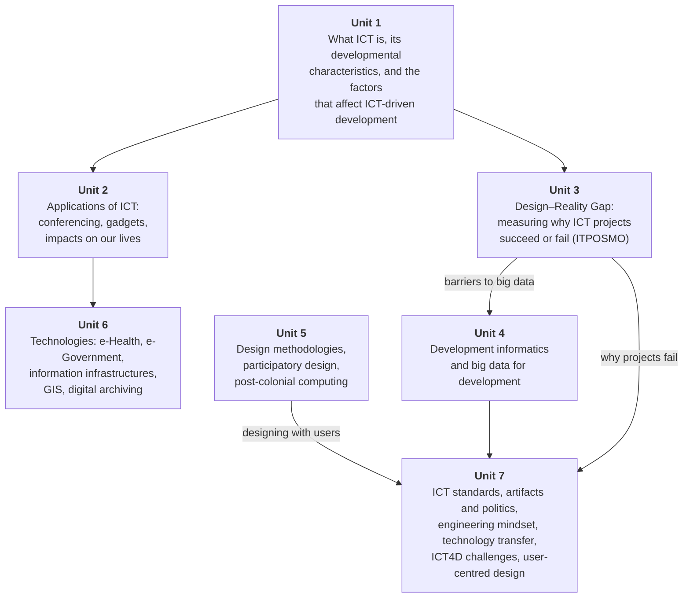

# CSC 584 — ICT for Development

*Lecture notes built from the courseware **"ICT for Development — A Courseware for CSC 584"** (Distance Learning Centre Programme), by **OGUNTUNDE Toyin (Ph.D)**.*

These notes cover **everything in the courseware**, in the same order and with the same section numbers, so you can match them to the PDF. Each section gives the courseware's content first, then explains it in plain language with examples and diagrams. At the end of each unit there are quick-check questions, the courseware's own self-test questions with model answers, practice exercises, and exam-style questions.

---

## General introduction and course objectives

The courseware opens by setting out the big idea behind the whole course. Here is what it says, point by point, with an explanation of each.

### 1. A broad international consensus

> Over the past several years, a broad international consensus has emerged that Information and Communications Technologies (ICTs) offer a potentially powerful mechanism for promoting social and economic growth. Several recent studies have described remarkable success in using ICTs to help underserved communities and to create new opportunities in developing countries.

Governments, international organisations and researchers broadly agree that ICTs (computers, the internet, mobile phones, broadcasting, and so on) *can* drive both **social** growth (health, education, inclusion) and **economic** growth (jobs, productivity, trade). Note the word *potentially*: ICT is a mechanism that can help, not a guarantee.

### 2. From enthusiasm to "pragmatic realism"

> As a result, the early, unbridled enthusiasm for ICTs in developing countries and the international development community is being replaced by a more pragmatic realism, one that seeks to look beyond the hype and to analyze how ICTs can be used sensibly and cost-effectively to promote development.

At first, people were very excited ("unbridled enthusiasm") and assumed that putting computers and internet into poor communities would automatically bring development. Experience showed many projects failed. The mood has shifted to **pragmatic realism**: asking *which* ICTs, used *how*, at *what cost*, actually help development.

!!! note "In plain terms"
    "Hype" = "giving a village laptops will end poverty."
    "Pragmatic realism" = "Will these laptops be maintained? Is there electricity? Do people have the skills? Is the information on them useful to farmers? Is this the cheapest way to get that result?"

### 3. The environment matters as much as the technology

> While debate on these issues continues, several analyses have concluded that the social, economic, and regulatory environment in which an ICT-based development project takes place can be as important as the ICTs themselves to the project's ultimate success.

This is one of the most important ideas in the whole course. Whether an ICT project succeeds depends on its surroundings:

- **Social environment** — skills, literacy, culture, trust, social norms.
- **Economic environment** — affordability, access to capital, markets, infrastructure costs.
- **Regulatory environment** — laws on property rights, intellectual property, trade, competition, privacy.

You will see this idea again in **Unit 1 (§1.14 Factors affecting ICT-driven development)**, **Unit 3 (the Design–Reality Gap)**, which measures the gap between what a project assumes and the real environment, and **Unit 7 (§7.7)**, on why rural ICT projects fail.

### 4. Lessons from multinationals working in many countries

> Some multinationals are active in the development of more than 90 countries around the world, each of which is at a different stage of development and has adopted unique strategies in applying ICTs to its own development goals. Through these experiences, they have gathered important insights into the types of policies that are more or less effective in promoting ICT-based development.

Large technology companies (the courseware draws on a Microsoft white paper, *ICTs as Enablers of Development*, 2004) work in many countries at different stages of development. Because each country uses its own strategy, these firms can compare which **policies** work better or worse. This is where much of Unit 1's material on policies comes from.

### 5. Public leadership **and** private commitment

> Although the challenges facing developing countries are many, these multinationals firmly believe that computing technologies and other ICTs hold tremendous potential to help overcome these challenges. They also recognize that unlocking this potential requires not only public-sector leadership, but also private-sector commitment. It has been observed that they are dedicated to working closely with underserved peoples, developing countries, and the broader international development community to realize the full potential of ICTs for human development.

Neither government alone nor business alone can deliver ICT-driven development:

| Public sector (government) provides | Private sector (business) provides |
|---|---|
| Leadership, policy, laws and regulation | Investment and capital |
| Infrastructure planning, e-government | Products, services, innovation |
| Education and digital literacy | Jobs, skills, entrepreneurship |

### 6. No technological "silver bullet"

> It has been understood that there is no technological silver bullet that can "solve" illiteracy, eradicate extreme poverty and hunger, or eliminate high child mortality rates or poor maternal health. It is also believed, however, that as new ICTs continue to drive rapid globalization, developing countries have a unique opportunity to harness the power of ICTs to address these and other urgent development challenges more effectively.

A **silver bullet** is a single, simple solution to a complicated problem. ICT is not one. Problems like illiteracy, extreme poverty and hunger, child mortality and maternal health have many causes. ICT can, however, help to tackle them **more effectively**. Globalization, driven by ICT, gives developing countries a *unique opportunity* to do so.

!!! info "Beyond the notes"
    The four problems named here (illiteracy; extreme poverty and hunger; child mortality; maternal health) are taken from the UN **Millennium Development Goals (MDGs)**. Unit 4 explains how the MDGs were replaced by the **Sustainable Development Goals (SDGs)**.

### 7. What the courseware hopes to achieve

> It is hoped that this courseware will help readers obtain a greater appreciation for the potential that ICTs hold for social and economic development, and of the important benefits that can accrue to developing nations that fully exploit these benefits. We also look forward to engaging in a broader dialogue with policymakers and thought leaders on how governments, industry, and users can work most effectively to unlock the full potential of ICTs for the developing world.

The course aims to help you:

1. appreciate the **potential** of ICTs for social and economic development;
2. understand the **benefits** developing nations gain if they fully exploit ICTs;
3. think about how **governments, industry and users** can work together to unlock that potential.

---

## How the course fits together

| Unit | Title in the courseware | Main question it answers |
|---|---|---|
| [1](unit-1-ict.md) | Information and Communication Technology | What is ICT, and what makes it useful (or not) for development? |
| [2](unit-2-applications.md) | Application of ICTs in the Developmental Agenda of the Developing Countries | Where and how is ICT applied in daily life and organisations? |
| [3](unit-3-design-reality-gap.md) | Design Reality Gap | How do we measure whether an ICT project will succeed or fail? |
| [4](unit-4-development-informatics.md) | Developmental Informatics | What can big data do for development, and what are its limits? |
| [5](unit-5-design-methodologies.md) | Design Methodologies | How should ICT products be designed, and with whom? |
| [6](unit-6-technologies.md) | Technologies Discussed | How do e-Health, e-Government, information infrastructures, GIS and digital archiving work? |
| [7](unit-7-standards-theory.md) | ICT Standards and Theoretic Concerns | Which standards matter, can technology be political, and how do we design ICT that rural users adopt? |

---

## How to use these notes

| Box | Meaning |
|---|---|
| Quoted text (grey bar) | The courseware's own wording, which is what the examiner sets questions from |
| **In plain terms** | A simpler explanation of the point |
| **Example** | A worked or real-world example |
| **Exam angle** | How this point is likely to be examined |
| **Beyond the notes** | Extra context that is *not* in the courseware, included only to help you understand it |
| **Courseware note** | An error or inconsistency in the PDF, and how to handle it in the exam |

!!! tip "Exam format"
    Expect the University of Ibadan Computer Science format: **2 hours, attempt any three questions**. Each question has parts (a), (b), (c) worth about 20 marks in total, and part (c) is usually a **scenario** where you must identify, recommend and **justify**. Each unit ends with questions in this style. The Exam Preparation section has a one-page [crash course](exam/crash-course.md), [exam technique](exam/exam-technique.md) and two full mock papers ([1](exam/mock-exam-1.md), [2](exam/mock-exam-2.md)), and the [glossary](glossary.md) lists every key term A–Z.

**Quick-check questions** are interactive: click an option to see whether you are right and why. **Model answers** are hidden under each question, so try the question first and then click to reveal.
