# Unit 1 — Information and Communication Technology (ICT)

*Courseware pages 6–23.*

## At a glance

This unit sets the foundation for the whole course. It answers four big questions:

1. **What is ICT?** Its definitions, the technologies it includes, how it differs from IT, and its components (§Intro–1.3).
2. **What does ICT do for us, and what problems does it create?** Business benefits, challenges, the digital age and the digital divide (§1.4–1.6).
3. **Why is ICT useful for development?** Its developmental characteristics and its three roles as an enabler of economic growth, social development and good governance. ICT is also an industry in its own right (§1.7–1.13).
4. **What decides whether ICT-driven development succeeds?** Policies, human capacity, enterprise and infrastructure (§1.14).

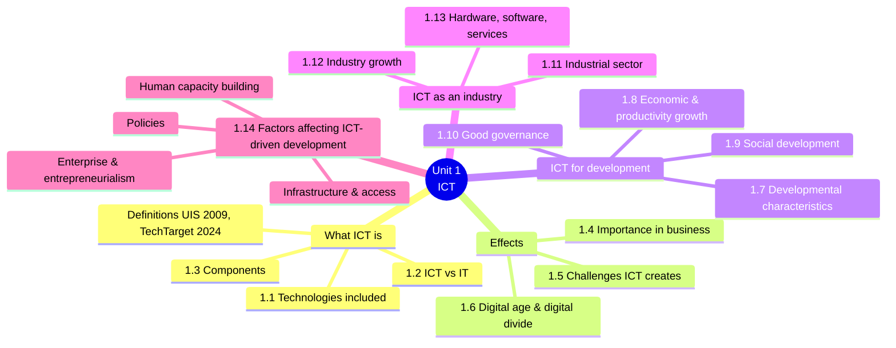

## Learning outcomes

At the end of the lecture, the learner should be able to:

- Define the term Information Communication Technologies (ICT)
- Identify 5 technologies included in ICT
- Differentiate between the terms ICT and IT
- Account for 5 challenges created by ICT

---

## Introduction — What is ICT?

The courseware gives **two definitions**. It then explains why there is **no single universal definition**.

### Definition 1 — UIS (2009)

> Information and communication technologies (ICT) is defined as a diverse set of technological tools and resources used to **transmit, store, create, share or exchange** information.

The tools and resources named in this definition fall into five groups:

| Group | Examples given in the courseware |
|---|---|
| Computers | Computers |
| The Internet | Websites, blogs and emails |
| Live broadcasting technologies | Radio, television and webcasting |
| Recorded broadcasting technologies | Podcasting, audio and video players, storage devices |
| Telephony | Fixed or mobile, satellite, visio/video-conferencing, etc. |

!!! note "In plain terms"
    The UIS definition focuses on **what ICT does with information**: transmit, store, create, share or exchange it. Learn the five verbs, because they make a complete definition in an exam answer.

    *UIS = UNESCO Institute for Statistics. The definition comes from its 2009* Guide to Measuring ICT in Education.

### Definition 2 — TechTarget (2024)

> Information and Communications Technologies (or technologies) is the **infrastructure and components that enable modern computing**.

TechTarget also states the **goals** of ICT tools and systems:

1. to **improve the way humans create, process and share data or information** with each other;
2. to **help humans improve their abilities** in numerous areas, including:
    - business;
    - education;
    - medicine;
    - real-world problem-solving;
    - leisure activities related to sports, music and movies.

### Why there is no single universal definition

> There is no single, universal definition of ICT because the technologies, devices and even ideas related to ICT are constantly evolving. However, the term is generally accepted to mean all devices, networking components and applications. When combined, these help people and organizations interact in the digital world.

ICT keeps changing. Ten years ago the definition might not have mentioned the cloud, IoT or AI, and new technologies keep being added. The generally accepted meaning is therefore broad:

**ICT = all devices + networking components + applications**, which together help people and organisations interact in the digital world.

!!! tip "Exam angle"
    "Define ICT" (or "Briefly describe ICT") is a near-certain short question. A strong answer:

    1. gives the UIS definition (tools and resources to **transmit, store, create, share or exchange** information);
    2. names some of the tools (computers, Internet, broadcasting, telephony);
    3. adds that there is no universal definition because ICT keeps evolving, so it is generally taken to mean **all devices, networking components and applications** that let people interact in the digital world.

---

## 1.1 Technologies included in ICT

The courseware describes ICT as covering **two spheres**:

- the **internet-enabled sphere**, and
- the **mobile sphere**, powered by **wireless networks**.

It then lists technologies from old to new.

### Old ("antiquated") technologies that are still ICT

- Landline telephones
- Radio broadcast
- Television broadcast

These *"all remain widely used alongside today's cutting-edge ICT pieces"*, such as **Artificial Intelligence (AI)** and **robotics**.

### Current technologies

- The Internet
- Internet of Things (IoT)
- The metaverse
- Virtual reality (VR)
- Social media
- Cloud computing services
- Video conferencing and collaboration tools
- Unified communications systems
- Mobile communication networks

### Emerging ("work-in-progress or still-nascent") technologies

- 5G/6G
- Web3
- Quantum computing

### The umbrella rule

> Any technology, infrastructure, component, or device that enables **communications, data sharing, and global connectivity** among humans and between humans and machines is included in the umbrella term ICT.

So whether something counts as ICT depends on one test: **does it enable communication, data sharing or connectivity, whether human-to-human or human-to-machine?**

| Antiquated (still widely used) | Current | Emerging / nascent |
|---|---|---|
| Landline telephone | Internet · IoT · metaverse · VR | 5G / 6G |
| Radio broadcast | Social media · cloud computing | Web3 |
| Television broadcast | Video conferencing & collaboration tools | Quantum computing |
| | Unified communications · mobile networks | |
| | AI · robotics | |

*Technologies included in ICT, arranged from old to emerging.*

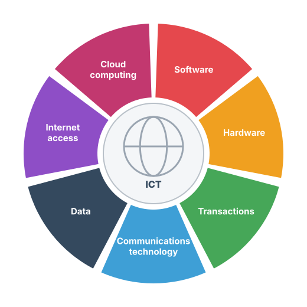{ .diagram }

Figure 1.1 — Components of ICT (redrawn). The seven segments in the courseware's figure are cloud computing, software, hardware, transactions, communications technology, data and internet access, all around a globe that stands for global connectivity.

!!! example "Example — is it ICT?"
    | Item | ICT? | Why |
    |---|---|---|
    | A community FM radio station | Yes | Broadcasting is an "antiquated" ICT that is still widely used |
    | A smart electricity meter that reports usage to the utility | Yes | IoT, a machine communicating data |
    | A POS terminal in a shop | Yes | Enables transactions and data sharing |
    | A manual typewriter | No | It produces documents but does not transmit or share data |

---

## 1.2 ICT versus IT (Information Technology)

> The acronym ICT is sometimes used synonymously with IT. However, ICT is generally used to represent a more comprehensive list of all components related to computer and digital technologies. IT is more about managing the technologies related to information, and its various technical aspects, including software, hardware, and networking. IT management does not include considerations of telecommunications devices and technologies while ICT does. **IT can be considered a subset of ICT.**

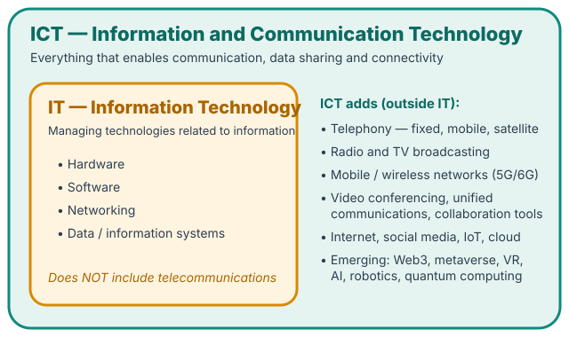{ .diagram }

IT is a subset of ICT. The extra items on the right are taken from §1.1.

| Basis of comparison | IT | ICT |
|---|---|---|
| Scope | Narrower | Broader, a "more comprehensive list of all components related to computer and digital technologies" |
| Focus | **Managing** technologies related to information and their technical aspects | All technologies that enable communication, data sharing and connectivity, *plus* their application |
| Main elements | Software, hardware, networking | Everything in IT **plus** telecommunications (telephony, broadcasting, mobile/wireless networks, conferencing, etc.) |
| Telecommunications | **Not** included in IT management | Included |
| Relationship | A subset of ICT | The superset that contains IT |

!!! note "In plain terms"
    The "C" in ICT is **communication**. IT is about computers and the information they manage. ICT is IT **plus** the technologies that carry information between people and places, such as phones, radio, TV, mobile networks and satellites.

!!! tip "Exam angle"
    "Differentiate between ICT and IT" — compare them on **scope**, **focus**, **telecommunications** and **relationship (subset)**. A table like the one above earns full marks quickly.

---

## 1.3 Components of ICT

> The list of ICT components (Figure 1.1) is exhaustive and continues to grow. Some components, such as computers and telephones, have existed for decades. Others, such as smartphones, digital TVs and robots, are more recent entries.

The courseware lists **ten components**:

| # | Component | What it means | Example |
|---|---|---|---|
| 1 | **Devices (hardware)** | The physical equipment | Laptops, smartphones, servers, routers |
| 2 | **Software** | Programs that make devices perform tasks | Operating systems, apps |
| 3 | **Middleware** | Software that sits *between* applications and the operating system/network and connects them | Database connectors, message queues, API gateways |
| 4 | **Data** | The information that ICT creates, stores and moves | Customer records, sensor readings |
| 5 | **Wired networks** | Networks that use cables | Ethernet LAN, fibre-optic links |
| 6 | **Wireless networks** | Networks that use radio signals | Wi-Fi, 4G/5G, Bluetooth |
| 7 | **Communication technologies** | Technologies for exchanging messages | Telephony, email, video conferencing |
| 8 | **The cloud** | Computing resources delivered over the Internet | Online storage, hosted applications |
| 9 | **Communications protocols and interfaces** | The agreed rules and connection points that let systems talk | TCP/IP, HTTP, USB |
| 10 | **Information security and governance policies** | The rules for protecting data and managing ICT responsibly | Access control policies, data-protection policies |

!!! info "Beyond the notes"
    The "What it means" and "Example" columns are added to explain each component. The courseware gives only the names. Note that **policies** count as an ICT component: ICT includes the rules for managing technology, not just the technology itself.

### ICT is more than its components

> ICT means more than its list of components. It encompasses the **application** of all those various components. It is here that the **real potential, power and danger** of ICT emerges — for economic, societal, and interpersonal transactions and interactions.

A pile of computers, cables and software is not yet ICT in the full sense. ICT is what happens when those components are **used**, for example in banking, health, government or social media. Using them is what creates both the **potential and power** (benefits) and the **danger** (risks, which §1.5 describes). The danger can affect three areas:

- **economic** transactions and interactions (e.g. online fraud);
- **societal** ones (e.g. misinformation);
- **interpersonal** ones (e.g. cyberbullying).

---

## 1.4 Importance of ICT in businesses

> For businesses, advances within ICT have brought a slew of cost savings, opportunities and conveniences.

The courseware gives **three**:

1. **Highly automated business processes that have cut costs.** Tasks once done by hand, such as bookkeeping, inventory and payroll, are now done automatically, so costs fall.
2. **The big data revolution.** Organisations turn the vast trove of data generated by ICT into **insights** that drive **new products and services**. (Unit 4 covers big data in detail.)
3. **ICT-enabled transactions**, such as **internet shopping, telemedicine and social media**, give customers more choice in how they shop, communicate and interact.

!!! example "Example"
    A Lagos supermarket chain uses (1) automated stock control that reorders goods when shelves run low, (2) analysis of loyalty-card data to see which products sell together, and (3) an online store with home delivery. These are the three benefits in action.

---

## 1.5 Challenges ICT creates

> Its many benefits notwithstanding, ICT has also created problems and challenges for organizations, individuals and society.

The courseware describes **three groups of challenges**. Because the learning outcome asks you to *"account for 5 challenges"*, the table breaks them into five or more specific points.

### 1. New opportunities for crime (cybercrime)

> The digitization of data, the expanding use of the high-speed internet and the growing global network together have created new opportunities for crime. Increasingly, bad actors leverage these opportunities to hatch new schemes to gain unauthorized access to enterprise or government systems.

- **Why it happens:** data is digitised, high-speed internet use is spreading, and the global network keeps growing.
- **What bad actors do:** gain **unauthorised access** to enterprise or government systems.
- **Why they do it:**
    - to steal **money**;
    - to steal **intellectual property**;
    - to steal **private information**;
    - to **disrupt systems that control critical infrastructure** (power grids, water, transport) and ultimately create **widespread chaos and panic**.

### 2. Job displacement through automation

> Developments in ICT have also brought new automation technologies and robots that sometimes displace workers, especially workers involved in repetitive, low-value tasks.

### 3. Social problems from reduced face-to-face interaction

> In some cases, ICT has let more people limit their face-to-face interactions with others, creating or exacerbating social issues such as trolling, cyberbullying, isolation, loneliness and depression.

| # | Challenge | Explanation |
|---|---|---|
| 1 | Theft of money (cyber fraud) | Unauthorised access to financial systems |
| 2 | Theft of intellectual property and private information | Data breaches, identity theft |
| 3 | Attacks on critical infrastructure | Disrupting systems that control infrastructure, causing chaos and panic |
| 4 | Job displacement | Automation and robots replace workers doing repetitive, low-value tasks |
| 5 | Trolling and cyberbullying | Abuse made easier by online interaction |
| 6 | Isolation, loneliness and depression | Fewer face-to-face interactions |

!!! tip "Exam angle"
    For "Account for 5 challenges created by ICT", *account for* means **explain**. Give each challenge a heading, say how ICT causes it, and give its effect, for example: "**Job displacement** — ICT has brought automation technologies and robots which replace workers, especially those doing repetitive, low-value tasks, leading to unemployment."

---

## 1.6 ICT, the digital age and the digital divide

### The digital age

> ICT has changed drastically how people work, communicate, learn and live. It continues to revolutionize all parts of the human experience as first computers and now robots do many tasks humans once handled.

> ICT's importance to economic development and business growth has been so monumental that it is often credited with ushering in the **Fourth Industrial Revolution**.

> ICT also underpins broad shifts in society, as individuals en masse are moving from personal, face-to-face interactions to ones in the digital space. This new era is frequently termed the **digital age**.

There are three points here:

1. ICT has changed how people **work, communicate, learn and live**, first through computers and now through robots doing tasks humans used to do.
2. ICT is credited with starting the **Fourth Industrial Revolution**.
3. Society has shifted, en masse, from face-to-face interaction to interaction in digital space. This era is the **digital age**.

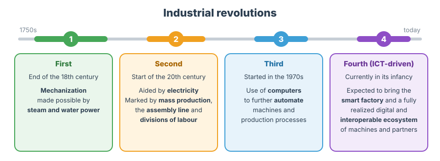{ .diagram }

Figure 1.2 — Comparison of industrial revolutions (redrawn). The text in each box is from the courseware's figure.

| Revolution | When | Driven by / marked by |
|---|---|---|
| First | End of the 18th century | **Mechanization**, made possible by **steam and water power** |
| Second | Start of the 20th century | Aided by **electricity**; marked by **mass production**, the **assembly line** and **divisions of labour** |
| Third | Started in the **1970s** | Use of **computers** to further **automate** machines and production processes |
| Fourth | Currently in its infancy | Expected to result in the **smart factory** and a fully realised **digital and interoperable ecosystem of machines and partners**. This is the one ICT is credited with. |

### The digital divide

> For all its revolutionary aspects, ICT capabilities are not evenly distributed, with richer countries and richer individuals getting to enjoy more access to ICT technologies. These entities are better able to seize the advantages offered by and the opportunities powered by ICT. This discrepancy in access to ICT has created what is now known as the **digital divide**.

> Numerous governmental authorities and non-government organizations advocate policies and programs that aim to bridge the digital divide by providing greater access to ICT among those individuals and populations struggling to afford it.

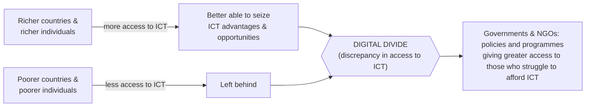

!!! note "In plain terms"
    The digital divide is the **gap in access to ICT** between rich and poor, at two levels:

    - **between countries** (e.g. high-income countries vs low-income countries);
    - **between individuals** within a country (e.g. urban professionals vs rural farmers in the same state).

    The divide matters because those with access can **seize ICT's opportunities** (online jobs, e-learning, mobile banking), so the gap in wealth can **widen**. Unit 4 (§4.6.2) adds that the divide keeps **evolving**: once everyone has a phone, a *bandwidth divide* remains.

---

## 1.7 Developmental characteristics of ICTs

These are the features of ICT that make it relevant to development. The courseware lists **nine**.

### i. ICTs are simply tools

> Like any tools, they can be either well-suited or not to the task at hand. Just as a hammer is ideal for driving a nail, but less useful in changing a light bulb, the value of a specific ICT to development cannot be answered in the abstract, but depends on:

- whether it is **suited to the project** at hand;
- whether the project provides **sustainable incentives** for those involved;
- whether the people implementing the project have the **skills** necessary to exploit the ICT effectively.

!!! note "In plain terms"
    You cannot say "laptops are good for development" in general. The answer depends on **fit**, **incentives** and **skills**. A laptop is a great tool for a data-entry clerk and a poor one for a farmer who needs weather alerts on a basic phone. This is the same idea as the Design–Reality Gap in Unit 3.

### ii. ICTs can be applied to a tremendously diverse range of human experience

> They are transforming virtually every sector of society and the economy. Digital breakthroughs are creating new possibilities for:

- improving **health and nutrition**;
- expanding **knowledge**;
- stimulating **economic growth**;
- **empowering people to participate** in their communities.

### iii. ICTs are multifunctional and increasingly interoperable

> …which allows users to **combine and implement them in almost infinite ways**.

*Multifunctional* means one device does many jobs (a smartphone is a phone, camera, bank and radio). *Interoperable* means different systems can work together and exchange data, so they can be combined.

### iv. ICTs are becoming less expensive and easier to use

> Rapid innovations in technology are making ICTs both less expensive and easier to use, thereby bringing the power of ICTs within the reach of a greater number of people.

### v. Knowledge management

> The **defining feature** of ICTs is their ability to help people **collect, manage, store, retrieve, and distribute knowledge**.

- Knowledge management is **critical in the global economy**, where success often depends on the ability to **acquire knowledge quickly, use it effectively, and disperse it to the right people rapidly and inexpensively**.
- ICTs can help **level the playing field** between firms in the developing and developed world, so developing nations can **compete more effectively** in the global economy.
- Many **non-economic** development challenges are rooted in **barriers to information**, and ICTs can help overcome those barriers.

!!! tip "Exam angle"
    Note the phrase **"the defining feature of ICTs"**. If asked for the single most important developmental characteristic, the courseware's answer is **knowledge management**. Remember its five verbs: **collect, manage, store, retrieve, distribute**.

### vi. Efficiency

> ICTs enable public administration and private enterprises in developing countries to operate **more efficiently and productively at reduced cost**.

- Efficiency gains make developing-country enterprises **more competitive** and make development projects **more cost-effective** (more viable).
- ICT-driven efficiency opens opportunities for **small and medium enterprises (SMEs)** to exploit their competitive strengths, for example:
    - **leveraging lower labour costs** to provide cost-effective **online services to distant markets**;
    - **supplying goods directly to customers rather than through intermediaries**, and so **retaining a greater share of profits**.

!!! example "Example"
    A shoemaker in Aba sells directly to customers in Abuja through Instagram and WhatsApp instead of selling to a middleman at a lower price. Cutting out the intermediary means the shoemaker keeps more of the profit.

### vii. Networks

> People increasingly use ICTs to tap into **networks of people and information**.

- The **Internet** is "perhaps the quintessential global ICT network". It runs on a multitude of **physical networks** (the traditional telecommunications network, satellite-based and cable-based networks, etc.).
- ICT networks are "an **indispensable element** of the development equation". They can give users in developing countries **effectively equivalent access** to information, resources, distribution mechanisms and potential customers as users and firms in developed countries.
- **However**, providing the **infrastructure** to access ICT networks can be **expensive and complex**.
- A key **challenge** for developing countries is to **select the technology that is most appropriate to their needs** and that **local populations have the capacity to use** effectively.

### viii. Multipurpose (ease of use and adaptability)

> Many firms (Microsoft prominent among them) are increasingly focused on ensuring that their ICT products are **easy to use** and can be **adapted to an almost infinite variety of uses**.

- More users can access ICTs, and users can **tailor even sophisticated ICTs** to their own needs.
- The **rapid pace of ICT innovation** means the time between **invention and commercial application** is measured in **months or even weeks, rather than years**.
- Therefore, **unlike many products and services**, ICTs used in the developed world are often **equally effective when applied to developing-world problems**.

### ix. Intertwined with globalization

> Finally, today's technological transformations are intertwined with globalization, and together they are creating the new realities of the global economy.

### From characteristics to three enabler roles

> These qualities make ICTs a highly relevant and essential enabler of the developing world. As many developing nations have recognized, ICTs have the potential to spur local economic growth and to expand the reach and effectiveness of development initiatives.

ICTs play this role **in three respects**, which are the subjects of the next three sections:

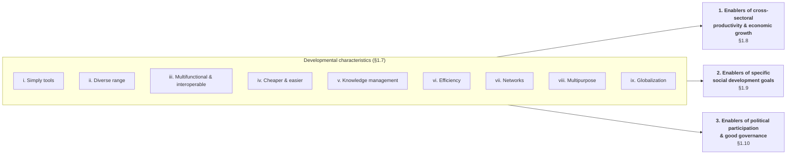

!!! tip "Memory aid"
    One way to remember the nine characteristics: **"Tools Diversify, Multiply, Cheapen; Know, Efficient, Network, Multipurpose, Global."**

    T-ools · D-iverse · M-ultifunctional · C-heaper · K-nowledge · E-fficiency · N-etworks · M-ultipurpose · G-lobalization.

---

## 1.8 ICTs as drivers of economic and productivity growth

> An economy's ability to increase **productivity** is a powerful measure of its economic well-being.

The points in this section:

1. Economists have **long debated** the relationship between ICTs and productivity. A **growing body of data** suggests that ICT investments, **particularly when linked to fundamental organisational change**, can have a substantial, positive impact on productivity.
2. This impact goes **beyond a direct return on investment**.
3. The **surest path to sustainable economic growth** is for organisations to **invest in assets that increase productivity**.
4. **Other factors** often strongly influence whether firms can exploit ICT's benefits:
    - the **regulatory environment**;
    - the **availability of appropriate skills**;
    - the **ability to spur organisational change**.
5. In today's integrated global economy, firms everywhere, including in developing countries, **must learn to acquire and use information effectively** if they hope to succeed.
6. ICT use in developing countries **remains below expectations**, but **case-study evidence** suggests ICTs are beginning to provide a basis for productivity and growth.
7. **Example:** ICTs are being used in **Africa, India and other nations** to create **rural trading networks that connect local craftspeople directly with their customers**.

!!! note "In plain terms"
    Buying computers alone does not raise productivity. Productivity rises when organisations **change how they work** around the technology, for example by redesigning processes, retraining staff and removing paperwork. This also depends on good regulations and available skills.

---

## 1.9 ICTs as enablers of social development

> Many of the challenges facing traditionally underserved communities result, at least in part, from **inadequate access to knowledge and information**. ICTs can help surmount these challenges by making it **easier and less expensive to collect, analyze, and disseminate information** to the people who need it. The Internet in particular is creating nearly endless opportunities for individuals and communities in developing countries to obtain knowledge and communicate with others.

### 1.9.1 Application areas of ICTs for social development

The courseware gives **three** application areas.

#### a. Healthcare

ICTs are increasingly used to deliver health care in the developing world, especially to **patients in remote areas** where services are scarce. Uses include:

- **remote consultations** between patients and physicians, as well as **remote diagnosis** and even **treatment**;
- **data collection** for both **research** and **diagnostic** purposes;
- **"real-time" collaboration** between physicians and health researchers in different parts of the world;
- improving the **speed and effectiveness with which nations and organisations respond to epidemics**;
- **streamlining and improving health care services** generally;
- delivering healthcare in **remote rural areas** where traditional services are scarce;
- a **central role in programmes to combat HIV/AIDS, tuberculosis, malaria** and other diseases.

#### b. Education

> Although ICTs **cannot replace the vital teacher–student relationship or supplant in-person instruction**, ICTs are increasingly being used as a tool to **supplement** traditional curricula and teaching methods and to open new opportunities for skills training.

Uses include:

- **low-cost access to online curricula** and other resources;
- **distance education** for students in remote areas or who for various reasons cannot physically attend school;
- supporting **research networks**;
- **technical and vocational training**, including **"lifelong" training** opportunities;
- improving and streamlining **education administration**.

!!! note "Notice the limit"
    The courseware is careful to say ICT **supplements** teaching and does **not replace** the teacher. Exam answers that say "ICT replaces teachers" contradict the courseware.

#### c. Environment / sustainable development

> Many environmental challenges in the developing world are the result of **failures to alert policymakers of risks** and the **inability to quantify the seriousness of environmental hazards until it is too late**.

ICTs let researchers and environmental agencies in developing countries **tap into global data networks and information resources**, so policymakers can make **better and more informed choices**. ICTs are used to:

- **monitor environmental conditions** and collect and analyse data;
- **coordinate responses to ecological threats**;
- **identify polluters** who might otherwise go undetected;
- help policymakers **understand threats** and formulate **less intrusive agricultural and industrial processes**.

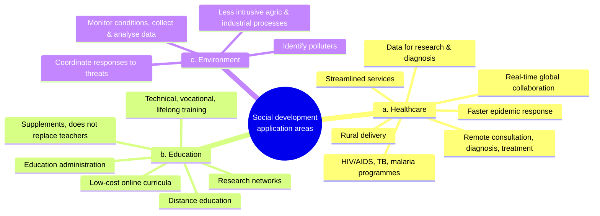

---

## 1.10 ICTs as enablers of good governance

> Like other organizations, governments increasingly are leveraging the power of ICTs to operate more efficiently and effectively.

How governments use ICT, and the effects:

1. **Digitising records.** Many governments in developed and developing countries are migrating **paper-based documents and records into digital format**.
2. **Linking databases.** They are beginning to **"link up" databases** of these records for use **between departments**.
3. **Results:** governments become **more responsive**, and it becomes **easier for citizens to access public records, information and services through the Internet**.
4. **"Democratizing" function.** e-Government gives people a **new and powerful way to participate in government** and **interact with public officials**.
5. **Risk to civil liberties.** These efforts can raise **civil-liberties issues**, particularly when they **share personal information without the individual's knowledge or consent**.
6. **Openness and transparency.** ICTs can make government processes **more open and transparent** to citizens.
7. **Oversight.** ICTs can let people see more clearly **how taxpayer money is being used** to provide public goods and services.

!!! info "Beyond the notes — local examples"
    Nigerian examples of these ideas include the **NIN/NIMC** database and its linking with BVN and SIM registration (linked databases, which also raises the consent and privacy risk); online **tax filing** with FIRS; and budget-tracking platforms such as **BudgIT**, which let citizens see how public money is spent (oversight). e-Government is covered fully in **Unit 6 (§6.2)**.

---

## 1.11 ICT as an industrial sector

> While it is clearly in their **application** that ICTs hold the greatest potential for economic and social development, many governments are actively seeking to spur domestic economic growth by **nurturing the emergence of local ICT industries**.

**Why governments do this:**

- The expansion of the ICT marketplace has generated **millions of new jobs** and **billions in additional tax revenues**, benefiting nearly every region of the world.
- Many developing countries see a domestic ICT industry as a way to achieve **related development objectives**:
    1. to **attract foreign direct investment (FDI)**;
    2. to provide a basis for **technology transfer**;
    3. to **satisfy local market demand** for ICTs;
    4. to generate further growth in **upstream and downstream industries** (such as **marketing** or **financial services**).

**The courseware's caution:**

- As the recent **downturn in corporate ICT spending** showed, the scope for growth in the ICT market, like every other sector, is **finite**.
- So it is **unrealistic** to think the ICT sector will be a **substantial share of economic activity in all or even most developing nations** in the foreseeable future.
- **Nevertheless**, many developing countries are establishing **domestic ICT firms to serve domestic and even regional users**.

!!! note "Two ways ICT helps development"
    Keep these two ideas apart:

    1. **ICT as an enabler** (§1.7–1.10): using ICT in health, education, business and government. The courseware says this is where the **greatest potential** lies.
    2. **ICT as an industry** (§1.11–1.13): making and selling ICT products and services, which creates jobs, tax revenue and FDI.

---

## 1.12 Impressive ICT industry growth over the past several years

The courseware gives growth figures for **1995–2001** in **three regions**, with **two countries each**:

| Region | Country | Annual growth in no. of IT **companies** | Annual growth in no. of IT **employees** | IT sector size in 2001 |
|---|---|---|---|---|
| **1.12.1 Asia** | India | over 10% | over 13% | almost **15,000 firms**, almost **550,000 people** |
| | Indonesia | over 14% | almost 20% | over **3,000 firms**, more than **55,000 people** |
| **1.12.2 Latin America** | Mexico | almost 10% | almost 22% | **9,800 firms**, more than **370,000 people** |
| | Venezuela | over 6% | over 12% | over **2,700 firms**, almost **91,500 people** |
| **1.12.3 Central & Eastern Europe** | Poland | over 11% | 13% | almost **8,500 firms**, nearly **177,000 people** |
| | Slovenia | over 5% | almost 8% | over **850 firms**, over **15,000 people** |

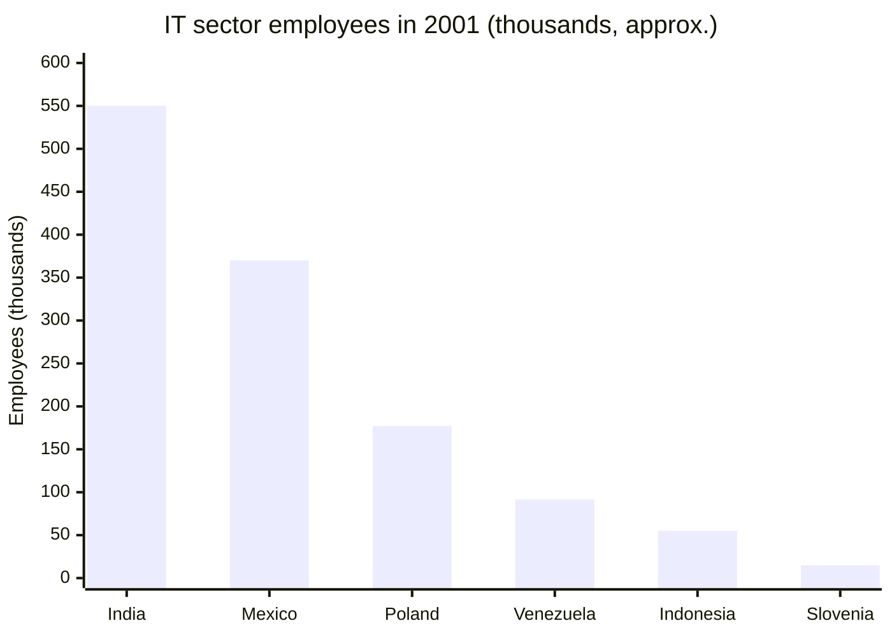

!!! note "What the numbers show"
    - In **every** country, employees grew faster than firms. Firms were getting **bigger** as well as more numerous.
    - **India** had by far the biggest IT workforce (about 550,000).
    - **Mexico** had the fastest employee growth (almost 22% a year).
    - **Indonesia** had the fastest growth in the number of firms (over 14% a year).

!!! tip "Exam angle"
    Self-test Q2, "Identify three areas of impressive ICT industry growth", is asking for the **three regions**: **Asia** (India, Indonesia), **Latin America** (Mexico, Venezuela) and **Central and Eastern Europe** (Poland, Slovenia). Give a supporting figure for each.

---

## 1.13 Characteristics of each major segment of the "Information Technology" component of the ICT industry

The IT part of the ICT industry has **four** segments.

### 1.13.1 Hardware

- Hardware is the **tangible** element of ICT systems.
- Despite the spread of ICT devices, the industry has been **consolidating**, and further consolidation seems likely.
- Hardware firms do **asset-intensive manufacturing**, so they often need **large up-front investments**.
- As a result, **start-up firms find it difficult to compete** against larger, established rivals.
- The trend is toward **commoditization of components**, which may make it hard for new firms to stand out on anything **other than price**.
- Much hardware manufacturing currently happens in **a handful of Asian nations**, whose **low labour costs** and **deep manufacturing know-how** make them formidable competitors.

### 1.13.2 Software

- Software helps people **use ICT devices to perform specific tasks**.
- The industry is **extremely varied**, with **literally thousands of firms** offering many products.
- Unlike hardware, software development has become **more focused and specialised**, which has led to **significant industry diversification**.
- Developing software is at its core an **intellectual activity**, so it generally needs **relatively few up-front resources**.
- Successful software firms exist in **many developing countries**, ranging from **one-person shops** to **large multinational corporations**.
- Because software is **intangible**, developers rely on **intellectual property laws** to protect products against **unauthorised copying**.

### 1.13.3 Service providers

- Service providers **help organisations use their ICT systems effectively**.
- The IT services industry is led by **a handful of large multinational firms** plus **thousands of smaller firms**.
- Like hardware, IT services firms often operate on **small margins**.
- So **changes in global exchange rates and labour costs** can quickly change the competitiveness of firms that depend on **export-oriented work**.
- **Smaller firms may not achieve the economies of scale** needed to bid competitively against large multinationals.

### 1.13.4 Software-plus-services

- Many nations have developed a **mixed software-plus-services** industry.
- This is largely because **most IT service providers also develop and license software**. For example, **web site designers, systems integrators, e-commerce solution providers and IT security providers** typically develop specialised products as part of their business.
- These firms typically have **higher margins than "pure" services firms** and are **less affected by economies of scale or changing labour rates**.
- Similarly, many **software firms also provide customisation and consulting services**, either in-house or through partnerships with third parties.

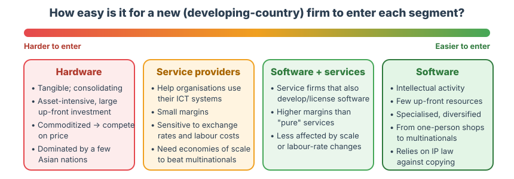{ .diagram }

The four segments compared. The "harder to easier to enter" ordering is an interpretation based on the barriers the courseware describes for each segment.

| Feature | Hardware | Software | Service providers | Software-plus-services |
|---|---|---|---|---|
| Nature | Tangible | Intangible, intellectual | Help others use ICT | Mix of both |
| Up-front investment | Large (asset-intensive) | Relatively few resources | Not stated | Not stated |
| Market structure | Consolidating | Thousands of firms, diversified | Few multinationals + thousands of small firms | Mixed |
| Margins | Compete on price (commoditization) | — | Small | Higher than pure services |
| Main risk | Can't compete with established/Asian rivals | Unauthorised copying (needs IP law) | Exchange rates, labour costs, economies of scale | Less affected by scale or labour rates |

### What policymakers should do

> Depending on their circumstances, some developing countries might be in a better position to leverage their local strengths and resources to competitive advantage in one ICT sector more than others. Indeed, it is relatively unlikely that any single developing country will excel in every sector of the ICT industry. Accordingly, policymakers working to drive the growth of a domestic ICT industry should carefully **evaluate their country's own resources and other sources of possible competitive advantage against the characteristics of each ICT sector** to determine which areas, if any, are potential areas for long-term industrial growth.

!!! example "Example — applying 1.13"
    A country with many young graduates but little manufacturing capital and an unstable currency should avoid **hardware** (large up-front investment, Asian competition) and be careful with **pure services** (margins exposed to exchange rates). **Software** (few up-front resources) or **software-plus-services** (higher margins, less exposed to labour rates) would suit it better, provided **IP laws** are enforced.

---

## 1.14 Factors affecting ICT-driven development

> A nation's **regulatory policies** can have a profound influence on ICT investment and use. Legal rules create a complex web of **incentives and disincentives** to private-sector action, some of which will impact a society's desire and ability to develop, acquire, or utilize ICTs. Where a nation's legal framework offers strong incentives for people to develop and acquire ICTs, including the skills necessary to use ICTs effectively, governments will have greater success in leveraging the power of ICTs and ICT industrial growth to advance social and economic development goals.

In most legal systems, the most critical laws and policies fall into **four areas**:

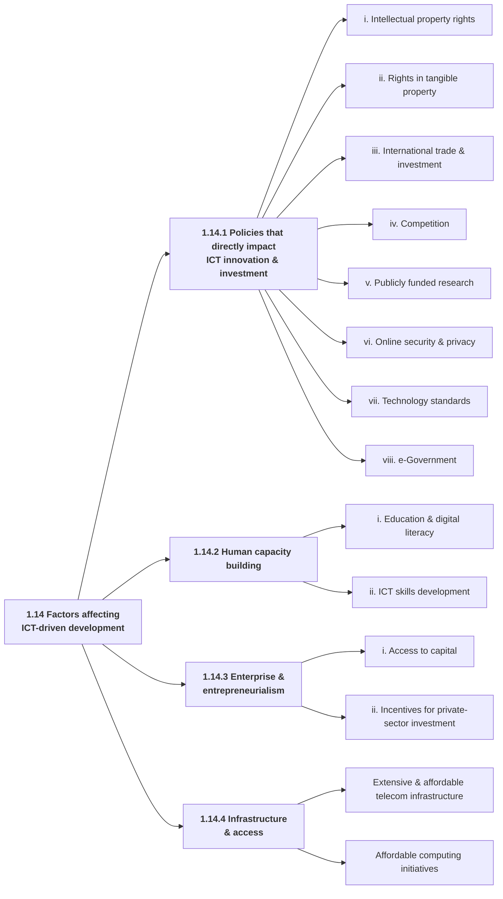

### 1.14.1 Policies that directly impact ICT innovation and investment

> ICT-based development is **sustainable over the long term only if people have incentives to acquire and utilize ICTs**, including meaningful opportunities to leverage ICTs to improve their own lives.

The private sector is **most likely to invest** in ICTs in an environment that:

- provides meaningful **protections for property rights** (including rights in **intangible** property);
- **promotes competition and trade**;
- **protects consumers**;
- creates **incentives for firms to invest in developing innovative new products and services**.

This happens through the enforcement of **eight** policy areas:

#### i. Intellectual property rights

- **Intellectual property (IP) laws** provide critical **incentives for ICT innovation**, because they **protect the work of any inventor**, whether an individual, a research institution or an enterprise.
- Robust IP laws let inventors **capture a portion of their innovation's value** in the market, either by **practising the innovation themselves** or by **licensing it to others**.
- IP is **particularly important to the ICT sector**, which is characterised by **rapid innovation** and **high rates of investment in research and development (R&D)**.
- Strong IP laws and effective enforcement are **just as vital to innovation in developing countries**:
    - IP protections let inventors and entrepreneurs in developing economies **prevent others from copying** their innovations and so **"free riding" on their R&D investments**.
    - Effective IP protection also **promotes foreign direct investment and technology transfer**, because foreign firms know their investments and technologies **will not be susceptible to rampant copying or compulsory licensing**.
    - In ICT, **domestic SMEs are often one of the driving forces** behind technology innovation.
    - **But** SMEs' innovative capacity is not always fully exploited, because many SMEs in the developing world are **not aware of applicable IP laws** or, more often, **do not have confidence that such laws will be respected and enforced**.

!!! note "In plain terms"
    **Free riding** means copying someone else's invention without paying for the research that created it. Without IP law, a Nigerian start-up that spends two years building an app could see a copycat clone it in a week, so nobody would bother to invest in innovation.

    **Compulsory licensing** means a government forcing an IP owner to let others use the invention, usually for a set fee.

#### ii. Rights in tangible property

- For many underserved populations, their **homes and land are their most important financial asset**.
- Ensuring people can **obtain and establish clear title** to such property is vital to a financial environment that supports **commerce and economic growth**.
- The private sector **will not invest** in the resources needed to drive growth **unless property rules are clear, reliable and consistently enforced**.
- Clearly defined and enforced property rules are widely seen as a **necessary precondition to meaningful participation in a market economy**. A **lack** of such rules can create significant **disincentives to foreign investment**.

!!! info "Beyond the notes"
    Why is land title in an ICT course? A person with **clear title** to land can use it as **collateral** to borrow money, for example to buy a computer or start an ICT business. Without title, the asset is "dead capital". Clear property rules also reassure investors.

#### iii. International trade and investment

- The **global reach** of the ICT market means **open and non-discriminatory trade** is of paramount importance.
- **Protectionist measures** and related trade barriers can create **substantial impediments to ICT access** in developing countries.
- Barriers to ICT trade also have **longer-term adverse effects on local ICT industries**:
    - they **prop up inefficient domestic firms**;
    - they **discourage multinational firms from pursuing local partnerships** or engaging in **foreign direct investment**.
- Trade barriers also **reduce competitive pressure** for local ICT firms to **innovate and lower prices**, so domestic consumers **pay higher prices for inferior goods**.
- **Government procurement** policies that give **preferences to domestic ICT suppliers** likewise **distort international trade**:
    - In many nations, **governments are the dominant purchasers** of ICT products and services, so their procurement practices can have a **profound impact on the marketplace**.
    - Governments that procure ICTs on **neutral, non-discriminatory criteria**, such as **performance, suitability for purpose and overall value**, force vendors to offer the **best products at the best price**. This creates a **dynamic of competition** that often spills over into the broader market.
    - Where governments procure on the **nationality** of the product or supplier, or on **non-performance criteria** (e.g. a software program's **development or licensing model**), **taxpayer funds are wasted**.

!!! note "In plain terms"
    If a government says "we will only buy software made locally" or "we will only buy open-source software", it may end up paying more for worse products. The courseware says the government should buy on **performance, suitability and value**.

!!! info "Beyond the notes"
    The phrase "development or licensing model" refers to debates over whether governments should prefer **open-source** over **proprietary** software. The source of this material is a Microsoft white paper (2004), and Microsoft opposed such preferences. Knowing this context is useful, but in the exam reproduce the courseware's position.

#### iv. Competition

- The global ICT market is **extremely competitive and diverse**, with **many opportunities for new entrants**.
- **Competition and industry diversity** are two important reasons the ICT industry is **so innovative**. They also help explain why **start-up ICT firms and entrepreneurs** have been so successful in creating **new markets** and **new business models**.
- The **main beneficiaries are consumers**. Competition:
    - **pushes down prices**;
    - spurs suppliers to develop products and services that are **accessible and easy to use** for the **broadest possible range of consumers**.
- Where consumers face risks that competition and new technology **cannot address**, governments should respond with legislation that is **targeted and technology-neutral**, and should ensure **liability rules do not deter ICT innovation**.

!!! note "In plain terms"
    **Technology-neutral** legislation regulates the *outcome* (e.g. "protect customers' data") rather than a particular technology (e.g. "all banks must use system X"). This avoids locking in one technology and blocking innovation.

#### v. Publicly funded research

- Government funding of scientific research can play a **vital, if often overlooked, role** in economic development.
- Besides enriching a nation's intellectual life, publicly funded research can:
    - **attract foreign investment**;
    - provide the **raw material for further innovation** and commercial development by the private sector.
- **Commercialisation** can provide a **revenue stream back to the research organisation** and strengthen **information sharing between research organisations**, creating a **financial and innovation synergy between the public and private sectors**.
- **But** how far public research actually stimulates commercialisation depends largely on whether recipients of public funds have **incentives to claim title to and license** the research to third parties for further development, including for commercial gain.
- It also requires that research be made available **under terms that will attract the private-sector resources needed to commercialise it**.

!!! info "Beyond the notes"
    This is the idea behind the US **Bayh–Dole Act (1980)**, which let universities own and license inventions made with federal money. It appears again in **Unit 7, §7.5** (technology transfer).

#### vi. Online security and privacy

- Internet use has exploded, so **more data is exchanged online or stored on Internet-connected networks**.
- This has been accompanied by a **dramatic increase in the number, sophistication and severity of criminal cyber attacks** that try to compromise this data.
- **Viruses, worms, Trojan horses, spyware, "phishing"** and other threats vary in method, but collectively they **undermine user trust in the Internet and e-commerce** by corrupting or stealing online data.
- **Strengthening online security** requires a **complementary, coordinated response by industry, government and users**.
- **Security vs privacy:** security threats almost always involve **clearly malicious or criminal activity**. **Privacy** raises **broader social questions** about the proper limits on using personal information.
- Some uses of personal information can **greatly improve the online experience and consumer welfare**. But users will keep **trusting** online communications **only if they have adequate control** over **how their personal information is collected and used**.
- An effective response again requires **coordinated, complementary action by industry and government**.
- Maintaining user trust online is **no less vital in developing countries**.

| | Security | Privacy |
|---|---|---|
| The problem | Malicious/criminal attacks: viruses, worms, Trojans, spyware, phishing | Proper limits on the use of personal information |
| Nature | Clearly criminal | A broader social question; some uses are beneficial |
| Who responds | Industry + government + **users** | Industry + government |
| Why it matters | Attacks undermine **trust** in the Internet and e-commerce | Users trust only if they **control** collection and use of their data |

#### vii. Technology standards

- Technology standards are **increasingly relevant to development**.
- Broad adoption of standards **promotes interoperability**, making it easier for ICT products and services to **share and mutually use data**.
- **Interoperability**, in turn:
    - **drives down costs** and **expands ICT access** for developing-world users by letting them **select competing products and services from multiple vendors** and **combine them in a single network**;
    - **facilitates the transfer of information** among **governments, development organisations and the populations they serve**.
- ICT firms already have strong **commercial incentives** to make products interoperate. **Voluntary industry adoption** of standards reinforces those incentives by giving a **common set of guidelines for data exchange**.
- Standards promote interoperability **in a way that also encourages innovation, enhances competition and expands consumer choice**, particularly where they are:
    - **developed by consensus**;
    - **publicly available**;
    - **implementable by anyone on reasonable and non-discriminatory terms**.
- The **ICT industry should always remain the principal driving force** in developing standards, though **governments may also play a role**.

(Standards are covered in depth in **Unit 6, §6.3.5–6.3.6** and **Unit 7, §7.1**.)

#### viii. e-Government

- Governments are turning to ICTs for the **same reasons as the private sector**: to **increase efficiency, streamline processes and provide better services** to a larger base of users.
- Government uptake of ICTs has **added benefits**: **increasing citizen participation**, making government processes **more transparent** and public officials **more accountable**.
- e-Government initiatives can play an important **"leadership" role**, particularly in developing countries, by giving a **concrete example of how ICTs can drive productivity and economic growth**.

### 1.14.2 Human capacity building

> **Investments in people are fundamental** to social and economic development. Investments in technology will do little to alleviate poverty or improve the lives of underserved communities **unless they are matched by efforts to build the capacity of target populations** to harness the opportunities that ICTs offer. Education and skills development are critical components in helping individuals, communities, and even entire countries thrive in the global information economy, and therefore should be **central elements of any development agenda**.

Two core policies and principles support human capacity building:

#### i. Education and digital literacy

- Expanding **educational opportunities and digital literacy in underserved communities** is critical to broadening economic opportunity and **removing barriers to digital inclusion**.
- Some ICTs (e.g. **telephones**) can be and are used effectively **without widespread digital literacy**, but digital literacy is **vital to unlocking the full potential of ICTs**.
- ICTs can also play a significant role in **helping teachers expand learning opportunities**.
- The vital role of education in capacity building, and ICT's contribution to it, has been recognised (**Microsoft, 2004**). The company supports several initiatives on the specific educational needs of developing countries and has partnered with many governments and development organisations to implement them.
- The developing world and the development community are commended for their efforts on literacy and for working with the private sector, **but more needs to be done**.

#### ii. ICT skills development

- ICT skills are **vital** to enabling individuals and organisations to leverage the full potential of ICT.
- Yet in many parts of the developing world, **relatively few users have the skills** to use ICT effectively, and **fewer still** have the expertise to **develop ICT products or provide critical IT services**.
- A **shortage of skilled ICT workers** makes organisations **reluctant to invest in ICT**. This **curtails demand** for domestic ICT products and services, leaving **fewer opportunities for entrepreneurs and domestic ICT firms**.
- A **chronic** shortage impairs a country's **competitiveness**, not only in the ICT sector (one of the fastest-growing areas of the global economy) but **in many other, more traditional sectors as well**.

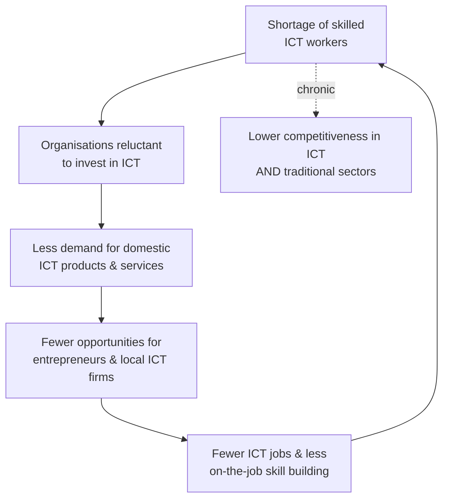

*The vicious cycle of an ICT skills shortage, as described in §1.14.2(ii). The arrow from E back to A completes the loop and is an interpretation.*

### 1.14.3 Enterprise and entrepreneurialism

> Although government policies can have a vital impact on the utilization of ICTs to achieve social and economic development, **the private sector is and will likely always remain at the forefront of ICT innovation, investment, and use**.

Governments can **leverage private-sector forces** by:

- **improving access to capital**;
- **requiring transparent accounting and investment practices**;
- **facilitating access to local and global markets**;
- **stimulating investments in ICT and technology R&D**.

Two areas where this can be achieved:

#### i. Access to capital

- Using ICTs for social and economic development **requires access to capital**.
- For developing nations to benefit fully from ICTs and grow domestic ICT industries, individuals and businesses need **ready access to affordable financing**.
- **Competitive, flexible capital markets** make it easier for individuals and firms to **purchase ICTs on credit**, and **cheaper for start-up ICT firms** to raise funds to **develop, manufacture and market** new products.

#### ii. Incentives for private-sector investment

- Particularly in an age of **limited public resources**, the **private sector must remain the primary engine** of ICT-based growth and industrial development.
- Governments **cannot dictate** private investment, but they can **channel** it into pro-growth areas by providing **appropriate tax and related incentives** for ICT investment.
- Governments can also **encourage foreign investment** by providing a **regulatory framework that increases predictability and reduces financial risk**.

### 1.14.4 Infrastructure and access

- How well the Internet and other networks serve as **communication and distribution mechanisms** depends substantially on the **quality and reach of the underlying telecommunications infrastructure**.
- Users **cannot achieve the full benefits of ICT unless the telecommunications infrastructure is both extensive and affordable**.
- Governments and industry must **work together** to promote **affordable computing initiatives** that **do not undermine market incentives for innovation and product development**.

!!! tip "Exam angle"
    Self-test Q3, "Discuss two areas where enterprise and entrepreneurialism can be achieved", is asking for **(i) access to capital** and **(ii) incentives for private-sector investment**. *Discuss* means explain each with reasons, not just name them.

---

## Key terms

ICT
:   A diverse set of technological tools and resources used to transmit, store, create, share or exchange information (UIS, 2009). Generally: all devices, networking components and applications that help people and organisations interact in the digital world.

IT (Information Technology)
:   Managing the technologies related to information (software, hardware, networking). Excludes telecommunications. A subset of ICT.

Middleware
:   Software that sits between applications and the operating system or network and connects them (one of the ten ICT components).

Digital age
:   The era in which individuals en masse move from face-to-face interactions to interactions in digital space.

Fourth Industrial Revolution
:   The ICT-driven industrial revolution, currently in its infancy, expected to bring the smart factory and an interoperable digital ecosystem of machines and partners.

Digital divide
:   The discrepancy in access to ICT between richer and poorer countries and individuals.

Knowledge management
:   The defining feature of ICTs: helping people collect, manage, store, retrieve and distribute knowledge.

Interoperability
:   The ability of different ICT products and systems to share and mutually use data. It is promoted by technology standards.

Free riding
:   Copying another's innovation without bearing the R&D cost. IP law prevents it.

Compulsory licensing
:   A government requiring an IP owner to allow others to use the invention.

Commoditization
:   The process by which components become interchangeable and compete mainly on price.

Technology-neutral legislation
:   Laws that target a risk or outcome without favouring a specific technology.

Human capacity building
:   Investing in people (education, digital literacy, ICT skills) so they can harness ICT.

---

## Unit summary

> Some multinationals are active in the development of more than 90 countries around the world, each of which is at a different stage of development and has adopted unique strategies in applying ICTs to its own development goals. Through these experiences, they have gathered important insights into the types of policies that are more or less effective in promoting ICT-based development.

*(The courseware's summary opens with this point: experience across 90+ countries shows which policies work. That is the basis for the policy factors in §1.14.)*

- **ICT** is a diverse set of tools and resources to transmit, store, create, share or exchange information (UIS 2009), or the infrastructure and components that enable modern computing (TechTarget 2024). There is no universal definition because ICT keeps evolving.
- ICT includes **old** (landline, radio, TV), **current** (internet, IoT, metaverse, VR, social media, cloud, conferencing, unified communications, mobile networks, AI, robotics) and **emerging** (5G/6G, Web3, quantum computing) technologies. It covers anything enabling communication, data sharing and connectivity.
- **IT is a subset of ICT.** IT manages information technologies (software, hardware, networking) and excludes telecommunications.
- **Ten components:** devices, software, middleware, data, wired networks, wireless networks, communication technologies, the cloud, protocols and interfaces, security and governance policies. ICT also includes their **application**, which is where its potential, power and danger appear.
- **Business benefits:** automation cuts costs; big data gives insights; ICT-enabled transactions give customer choice.
- **Challenges:** cybercrime (money, IP, private information, critical infrastructure); job displacement; trolling, cyberbullying, isolation, loneliness, depression.
- ICT ushered in the **Fourth Industrial Revolution** and the **digital age**. Uneven access creates the **digital divide**.
- **Nine developmental characteristics:** tools; diverse range; multifunctional and interoperable; cheaper and easier; knowledge management (the defining feature); efficiency; networks; multipurpose; globalization.
- ICT acts as an enabler of **(1) productivity and economic growth**, **(2) social development** (healthcare, education, environment) and **(3) good governance**.
- ICT is also an **industry** (jobs, taxes, FDI, technology transfer), with growth shown in Asia, Latin America and Central and Eastern Europe. Its four IT segments are hardware, software, services and software-plus-services. No country excels in all of them.
- **Factors affecting ICT-driven development:** (1) policies (IP, tangible property, trade, competition, public research, security and privacy, standards, e-government); (2) human capacity building (education and digital literacy, ICT skills); (3) enterprise and entrepreneurialism (access to capital, investment incentives); (4) infrastructure and access.

---

## Quick-check questions

*Click an option. These questions check key facts; they are not a mock exam.*

According to UIS (2009), ICT is a diverse set of tools and resources used to do which of the following with information?

<ul class="quiz-options">
  <li>Process, compute, print and display</li>
  <li data-correct>Transmit, store, create, share or exchange</li>
  <li>Collect, manage, store, retrieve and distribute</li>
  <li>Encrypt, compress, transmit and archive</li>
</ul>

The UIS definition uses **transmit, store, create, share or exchange**. "Collect, manage, store, retrieve and distribute" also comes from this unit, but it describes **knowledge management**, the defining *characteristic* of ICT in §1.7(v).

What is the main reason IT is described as a subset of ICT?

<ul class="quiz-options">
  <li>IT is older than ICT</li>
  <li>IT includes only software</li>
  <li data-correct>IT management does not include telecommunications devices and technologies, while ICT does</li>
  <li>ICT excludes networking</li>
</ul>

§1.2: IT covers software, hardware and networking but **not telecommunications**. ICT includes everything in IT plus telecommunications, so IT ⊂ ICT.

Which of these is NOT one of the ten ICT components listed in §1.3?

<ul class="quiz-options">
  <li>Middleware</li>
  <li>Information security and governance policies</li>
  <li data-correct>Electricity supply</li>
  <li>Communications protocols and interfaces</li>
</ul>

The ten are devices, software, middleware, data, wired networks, wireless networks, communication technologies, the cloud, protocols and interfaces, and security and governance policies. Electricity matters in practice but is not listed.

The courseware calls which characteristic "the defining feature of ICTs"?

<ul class="quiz-options">
  <li>Efficiency</li>
  <li>Networks</li>
  <li data-correct>Knowledge management</li>
  <li>Interoperability</li>
</ul>

§1.7(v): "The **defining feature** of ICTs is their ability to help people collect, manage, store, retrieve, and distribute knowledge."

The hammer-and-light-bulb analogy illustrates that…

<ul class="quiz-options">
  <li>ICTs are becoming cheaper and easier to use</li>
  <li data-correct>the value of an ICT depends on whether it suits the task, provides sustainable incentives, and whether implementers have the skills</li>
  <li>older ICTs should be replaced by newer ones</li>
  <li>ICTs are multifunctional</li>
</ul>

§1.7(i) "ICTs are simply tools": value "cannot be answered in the abstract". It depends on **suitability, sustainable incentives and skills**.

Why can ICTs used in the developed world often be equally effective in the developing world, according to the "multipurpose" characteristic?

<ul class="quiz-options">
  <li>Because developing countries have the same infrastructure</li>
  <li>Because ICTs are protected by IP law</li>
  <li data-correct>Because ICTs are easy to use, adaptable, and move from invention to commercial application in months or weeks</li>
  <li>Because of the digital divide</li>
</ul>

§1.7(viii). Ease of use, adaptability and rapid innovation mean that, "in contrast to many products and services", ICTs transfer well to developing-world problems.

According to §1.8, ICT investment has the greatest positive impact on productivity when it is…

<ul class="quiz-options">
  <li>financed by foreign aid</li>
  <li data-correct>linked to fundamental organisational change</li>
  <li>restricted to hardware</li>
  <li>protected by trade barriers</li>
</ul>

"ICT investments — particularly when linked to fundamental organizational change — can have a substantial, positive impact on productivity."

Which country had the largest IT workforce in 2001 according to §1.12?

<ul class="quiz-options">
  <li>Mexico (more than 370,000)</li>
  <li data-correct>India (almost 550,000)</li>
  <li>Poland (nearly 177,000)</li>
  <li>Indonesia (more than 55,000)</li>
</ul>

India had almost 15,000 firms employing almost 550,000 people. Mexico had the *fastest employee growth* (almost 22%), which is a common mix-up.

Which IT industry segment "generally requires relatively few up-front resources" because it is an intellectual activity?

<ul class="quiz-options">
  <li>Hardware</li>
  <li data-correct>Software</li>
  <li>Service providers</li>
  <li>Telecommunications</li>
</ul>

§1.13.2. Hardware is the opposite: asset-intensive with large up-front investment (§1.13.1).

According to §1.14.1(iii), on what basis should governments procure ICT?

<ul class="quiz-options">
  <li>Preference for domestic suppliers</li>
  <li>The software's development or licensing model</li>
  <li data-correct>Neutral criteria such as performance, suitability for purpose and overall value</li>
  <li>The lowest price only</li>
</ul>

Neutral, non-discriminatory criteria create competition. Procuring by **nationality** or **licensing model** wastes taxpayer funds.

How does online security differ from online privacy in §1.14.1(vi)?

<ul class="quiz-options">
  <li>Security concerns only governments; privacy concerns only users</li>
  <li data-correct>Security threats involve clearly malicious/criminal activity, while privacy raises broader social questions about limits on the use of personal information</li>
  <li>They are the same thing</li>
  <li>Privacy threats include viruses and worms</li>
</ul>

Security involves bad actors (viruses, worms, Trojans, spyware, phishing). Privacy is about the **proper limits** on using personal information, and some uses even benefit consumers.

The two areas named under 1.14.3 Enterprise and entrepreneurialism are…

<ul class="quiz-options">
  <li>Education and digital literacy; ICT skills development</li>
  <li data-correct>Access to capital; incentives for private-sector investment</li>
  <li>Competition; publicly funded research</li>
  <li>Infrastructure; affordable computing</li>
</ul>

The first option is 1.14.2 (human capacity building), the third is part of 1.14.1, and the fourth is 1.14.4.

A shortage of skilled ICT workers harms competitiveness…

<ul class="quiz-options">
  <li>only in the ICT sector</li>
  <li>only in traditional sectors</li>
  <li data-correct>in the ICT sector and in many other, more traditional sectors</li>
  <li>not at all if hardware is imported</li>
</ul>

§1.14.2(ii): a chronic shortage impairs competitiveness "not only in the ICT sector … but in many other more traditional sectors as well".

---

## Self-test assessment (from the courseware)

**1. Briefly describe Information and Communication Technologies.**

??? success "Model answer"
    **ICT** is a diverse set of technological tools and resources used to **transmit, store, create, share or exchange information** (UIS, 2009). These include **computers**; the **Internet** (websites, blogs, email); **live broadcasting** (radio, TV, webcasting); **recorded broadcasting** (podcasting, audio/video players, storage devices); and **telephony** (fixed or mobile, satellite, video-conferencing).

    TechTarget (2024) describes ICT as **the infrastructure and components that enable modern computing**. Its goals are to improve how humans create, process and share information, and to improve their abilities in business, education, medicine, problem-solving and leisure.

    There is **no single universal definition**, because ICT keeps evolving. It is generally taken to mean **all devices, networking components and applications** that together help people and organisations interact in the digital world. It covers old technologies (radio, TV, landlines), current ones (Internet, IoT, cloud, social media, AI) and emerging ones (5G/6G, Web3, quantum computing). IT, which excludes telecommunications, is a **subset** of ICT.

**2. Identify three areas of impressive ICT industry growth over the past several years.**

??? success "Model answer"
    The three regions (1995–2001) are:

    1. **Asia.** India grew by over 10% a year in IT companies and over 13% in IT employees, reaching almost 15,000 firms and about 550,000 workers by 2001. Indonesia's firms grew over 14% and employees almost 20% a year, reaching over 3,000 firms and more than 55,000 workers.
    2. **Latin America.** Mexico grew by almost 10% a year in firms and almost 22% in employees, reaching 9,800 firms and more than 370,000 workers. Venezuela grew over 6% in firms and over 12% in employees, reaching over 2,700 firms and almost 91,500 workers.
    3. **Central and Eastern Europe.** Poland grew over 11% in firms and 13% in employees, reaching almost 8,500 firms and nearly 177,000 workers. Slovenia grew over 5% in firms and almost 8% in employees, reaching over 850 firms and over 15,000 workers.

**3. Discuss two areas where enterprise and entrepreneurialism can be achieved.**

??? success "Model answer"
    The private sector is and will remain at the forefront of ICT innovation, investment and use. Governments can harness it in two areas:

    1. **Access to capital.** Using ICT for development needs affordable financing. **Competitive, flexible capital markets** let individuals and firms **buy ICTs on credit** and make it **cheaper for start-up ICT firms** to raise funds to develop, manufacture and market products. Without capital, even good ideas and willing buyers cannot become ICT adoption or local industry.
    2. **Incentives for private-sector investment.** With limited public resources, the **private sector must be the primary engine** of ICT growth. Government cannot dictate private investment but can **channel** it into pro-growth areas through **tax and related incentives** for ICT investment. It can also attract **foreign investment** with a **predictable regulatory framework that reduces financial risk**.

    *(Other supporting levers mentioned: transparent accounting and investment practices, access to local and global markets, and stimulating ICT R&D.)*

**4. Isolate the application areas of ICTs for social development.**

??? success "Model answer"
    The three application areas (§1.9.1) are:

    1. **Healthcare:** remote consultation, diagnosis and treatment; data collection for research and diagnosis; real-time collaboration between physicians and researchers worldwide; faster epidemic response; streamlined services; care in remote rural areas; programmes against HIV/AIDS, TB and malaria.
    2. **Education:** ICT **supplements** (does not replace) teachers. Uses include low-cost online curricula, distance education, research networks, technical, vocational and lifelong training, and streamlined education administration.
    3. **Environment / sustainable development:** access to global data networks so policymakers make informed choices; monitoring conditions; coordinating responses to ecological threats; identifying polluters; formulating less intrusive agricultural and industrial processes.

---

## Practice exercises

**Exercise 1.** Classify each item as **IT only** or **ICT but not IT**, and give a reason: (a) a database server, (b) a community radio station, (c) an office LAN, (d) a GSM mobile network, (e) a payroll application.

??? success "Answer"
    (a) **IT**: hardware and information management. (b) **ICT, not IT**: broadcasting is telecommunication. (c) **IT**: networking. (d) **ICT, not IT**: a telecommunications network. (e) **IT**: software. Remember that everything that is IT is also ICT, because IT ⊂ ICT.

**Exercise 2.** For each scenario, name the **developmental characteristic** (§1.7) it best illustrates:

1. A farmer in Kano gets market prices by SMS and sells directly to a buyer in Lagos, skipping the middleman.
2. An NGO gives tablets to a clinic, but nurses cannot use them and there is no budget for data, so they sit unused.
3. A single smartphone serves as a bank, camera, radio and medical-record app.
4. A university in Ibadan accesses the same online journals as a university in London.

??? success "Answer"
    1. **Efficiency**: SMEs supply customers directly rather than through intermediaries and keep more profit.
    2. **ICTs are simply tools**: value depends on suitability, sustainable incentives and **skills**.
    3. **Multifunctional and interoperable** (also *multipurpose*).
    4. **Networks**: "effectively equivalent access to information" (also *knowledge management*, levelling the playing field).

**Exercise 3.** Copy and complete the table for the four IT segments: *up-front investment*, *margins*, *main threat*.

??? success "Answer"
    | Segment | Up-front investment | Margins | Main threat |
    |---|---|---|---|
    | Hardware | Large (asset-intensive) | Low; compete on price (commoditization) | Established firms; Asian manufacturers with low labour costs |
    | Software | Few resources (intellectual) | Not stated in the courseware | Unauthorised copying, so it relies on IP law |
    | Service providers | Not stated | Small | Exchange-rate and labour-cost changes; no economies of scale against multinationals |
    | Software-plus-services | Not stated | Higher than pure services | Less affected by scale or labour rates |

**Exercise 4.** Explain, in your own words, why a country needs **both** IP protection (1.14.1-i) **and** digital literacy (1.14.2-i) for ICT-driven development. What happens if it has only one?

??? success "Answer"
    IP protection gives **innovators and investors** a reason to create and invest (no free riding, more FDI and technology transfer). Digital literacy gives **users** the ability to adopt and benefit from ICT.

    - **IP without literacy:** innovations are protected, but few people can use them, so demand is low and the investment does not pay off.
    - **Literacy without IP:** people can use ICT, but local innovators are copied, so local industry stagnates and the country depends on imports.

    The courseware's point is that **incentives** (policies) and **capacity** (people) must go together.

**Exercise 5.** List the **eight** policy areas under §1.14.1 from memory, then check.

??? success "Answer"
    i. Intellectual property rights · ii. Rights in tangible property · iii. International trade and investment · iv. Competition · v. Publicly funded research · vi. Online security and privacy · vii. Technology standards · viii. e-Government.

---

## Sample exam questions

*In the style of the real paper. Each question is about 20 marks. Try writing a full answer before revealing the model answer.*

### Question 1

**1a.** Define Information and Communication Technology (ICT) and differentiate between ICT and Information Technology (IT) in terms of scope, the place of telecommunications, and the relationship between them. (6 marks)

??? success "Model answer"
    **Definition (2 marks).** ICT is a diverse set of technological tools and resources used to transmit, store, create, share or exchange information (UIS, 2009), such as computers, the Internet, broadcasting technologies and telephony. More generally, it means all devices, networking components and applications that help people and organisations interact in the digital world.

    **Differences (4 marks):**

    - **Scope:** ICT is more comprehensive and covers all components related to computer and digital technologies and their application. IT is narrower and focuses on *managing* information technologies: software, hardware and networking.
    - **Telecommunications:** IT management does **not** include telecommunications devices and technologies. ICT **does** (telephony, broadcasting, mobile and wireless networks, conferencing).
    - **Relationship:** IT is therefore a **subset** of ICT. All IT is ICT, but not all ICT is IT.

    *Marking: definition 2; each difference 1 (+1 for clear explanation/example).*

**1b.** "ICTs are simply tools." Explain this statement and discuss **four** other developmental characteristics of ICTs that make them relevant to developing countries. (9 marks)

??? success "Model answer"
    **"Simply tools" (3 marks).** Like any tool, an ICT can be well suited or poorly suited to a task. A hammer is ideal for a nail but useless for changing a light bulb. So the value of an ICT for development **cannot be judged in the abstract**. It depends on (1) whether it **suits the project**, (2) whether the project gives **sustainable incentives** to those involved, and (3) whether implementers have the **skills** to exploit it.

    **Four other characteristics (any four, 1.5 marks each):**

    - **Knowledge management**, the *defining feature*: ICTs help collect, manage, store, retrieve and distribute knowledge. This levels the playing field with developed-world firms and overcomes the information barriers behind many non-economic problems.
    - **Efficiency:** public administration and firms operate more productively at lower cost. SMEs can use low labour costs to sell online services to distant markets and sell directly to customers without intermediaries.
    - **Networks:** the Internet and its underlying physical networks give developing-country users effectively equivalent access to information, resources and customers. However, infrastructure is costly and complex, so the most **appropriate** technology must be chosen.
    - **Multipurpose:** ICTs are easy to use and adaptable, and move from invention to market in months or weeks. So developed-world ICTs are often equally effective in developing countries.
    - *Also acceptable:* diverse range of application; multifunctional and interoperable; cheaper and easier; intertwined with globalization.

**1c.** The Government of a West African country plans to set up a domestic ICT industry to create jobs for its many university graduates. The country has a large pool of English-speaking graduates, limited manufacturing capital, frequent currency fluctuations, and weak enforcement of intellectual property laws.

1. Using the characteristics of the four segments of the IT industry, recommend which segment(s) the country should prioritise and justify your recommendation. (3 marks)
2. Identify **one** policy weakness in the scenario that threatens your recommendation and state what the government should do about it. (2 marks)

??? success "Model answer"
    **(i) Recommendation (3 marks).** Prioritise **software** and **software-plus-services**.

    - **Software** is an intellectual activity that needs **relatively few up-front resources**, which suits a country with many graduates but little capital.
    - **Software-plus-services** has **higher margins** than pure services and is **less affected by changing labour rates**, so it is less exposed to the currency fluctuations.
    - **Avoid hardware**: it is asset-intensive, needs large up-front investment, is consolidating and is dominated by low-cost Asian manufacturers.
    - **Pure services** are risky: small margins are **vulnerable to exchange-rate changes**, and small firms lack economies of scale against multinationals.

    **(ii) Policy weakness (2 marks).** **Weak IP enforcement.** Software is intangible and relies on **IP law** against unauthorised copying, and weak IP discourages FDI and technology transfer. The government should **strengthen IP laws and their enforcement** and **raise SMEs' awareness** of them, so innovators can capture value and are protected from free riders.

### Question 2

**2a.** Explain **three** groups of challenges that ICT has created for organisations, individuals and society. (6 marks)

??? success "Model answer"
    1. **Cybercrime (2 marks).** Digitisation of data, high-speed internet and the global network create new opportunities for crime. Bad actors gain **unauthorised access** to enterprise or government systems to steal **money**, **intellectual property** or **private information**, or to **disrupt systems controlling critical infrastructure**, causing widespread chaos and panic.
    2. **Job displacement (2 marks).** Automation technologies and robots **displace workers**, especially those in **repetitive, low-value tasks**.
    3. **Social problems (2 marks).** ICT lets people limit **face-to-face interaction**, creating or worsening **trolling, cyberbullying, isolation, loneliness and depression**.

**2b.** Discuss how ICTs act as enablers of good governance. In your answer, identify **one** risk that e-government efforts raise. (7 marks)

??? success "Model answer"
    - **Efficiency and effectiveness (1):** governments use ICT, like other organisations, to operate better.
    - **Digitising records (1):** migrating paper documents and records to digital format.
    - **Linking databases (1):** connecting records between departments, which makes government more responsive and lets citizens access records, information and services online.
    - **Democratizing function (1):** e-government gives people new and powerful ways to participate in government and interact with officials.
    - **Transparency (1):** government processes become more open.
    - **Oversight (1):** citizens can see how taxpayer money is used for public goods and services.
    - **Risk (1):** **civil liberties**. Linked databases may **share personal information without the individual's knowledge or consent**.

**2c.** A state government launches a programme to give every public secondary school 50 laptops and free internet. A year later, an evaluation finds the laptops are mostly unused. Teachers say they were never trained, there is no ICT support staff, and the laptops cannot be repaired locally.

1. Using §1.14, identify the factor affecting ICT-driven development that the programme neglected, and explain your answer. (3 marks)
2. Recommend **two** measures, drawn from the courseware, that would have improved the programme. Justify each. (4 marks)

??? success "Model answer"
    **(i) (3 marks).** The neglected factor is **human capacity building (§1.14.2)**. The courseware says investments in technology "will do little … unless they are matched by efforts to build the capacity of target populations". The teachers lacked **digital literacy and training**, and the schools lacked **skilled ICT workers** to support and repair the laptops. This also illustrates "ICTs are simply tools": the people implementing the project lacked the **skills** to exploit the ICT effectively.

    **(ii) Two measures (2 marks each):**

    1. **Education and digital literacy for teachers.** Train teachers before and alongside the rollout. Digital literacy is "vital to enabling users unlock the full potential of ICTs", and ICT can help teachers expand learning only if they can use it.
    2. **ICT skills development.** Train or hire local ICT support technicians. A shortage of skilled ICT workers leads to under-use and failed investment. Local skills also make maintenance sustainable.

    *Also acceptable:* infrastructure and access (§1.14.4), such as reliable, affordable connectivity and power; or choosing technology appropriate to local capacity (§1.7 vii, networks).

### Question 3

**3a.** Explain **four** reasons why governments in developing countries seek to nurture domestic ICT industries, and state the courseware's caution about this strategy. (6 marks)

??? success "Model answer"
    **Reasons (1 mark each):**

    1. To **attract foreign direct investment**.
    2. To provide a basis for **technology transfer**.
    3. To **satisfy local market demand** for ICTs.
    4. To generate growth in **upstream and downstream industries** such as marketing and financial services.

    *(Context: the ICT market has created millions of jobs and billions in tax revenue.)*

    **Caution (2 marks):** the downturn in corporate ICT spending shows that ICT market growth is **finite**. It is **unrealistic** to expect the ICT sector to be a substantial share of economic activity in all or most developing nations. ICT's greatest potential lies in its **application** across the economy, not in the ICT industry itself.

**3b.** With reference to international trade and government procurement, explain how protectionist ICT policies can harm a developing country. (6 marks)

??? success "Model answer"
    - Protectionist measures and trade barriers **impede ICT access**, making ICT scarcer and more expensive (1).
    - They **prop up inefficient domestic firms** (1).
    - They **discourage multinationals** from local partnerships and **FDI** (1).
    - They **reduce competitive pressure** to innovate and cut prices, so consumers pay **higher prices for inferior goods** (1).
    - **Procurement:** governments are often the **dominant buyers** of ICT. Preferences for domestic suppliers, or criteria based on nationality or licensing model, **distort trade and waste taxpayer funds** (1).
    - Procuring on **neutral criteria** (performance, suitability, value) forces vendors to offer the best products at the best price, and this competition spills over into the wider market (1).

**3c.** A Nigerian health-tech start-up has built an app that helps rural clinics manage patient records. Investors are hesitant. The founders report three problems: a larger company has copied their app's features, banks will not lend to them without collateral, and regulations on patient data are unclear and change frequently.

Map **each** problem to the relevant policy area or factor in §1.14 and recommend what government should do in each case. (8 marks)

??? success "Model answer"
    | Problem | Policy area / factor | Recommendation |
    |---|---|---|
    | App copied by a larger company (3 marks) | **Intellectual property rights (1.14.1-i)**: copying is "free riding" on the start-up's R&D; SMEs often lack awareness of, or confidence in, IP enforcement | Strengthen and **enforce** IP laws; raise SME awareness; this also reassures investors and supports FDI |
    | No loans without collateral (2–3 marks) | **Access to capital (1.14.3-i)**, also linked to **rights in tangible property (1.14.1-ii)**, since clear title lets assets serve as collateral | Develop **competitive, flexible capital markets** and affordable financing for start-ups; give **tax incentives** for ICT investment (1.14.3-ii); help people establish **clear title** to property |
    | Unclear, changing data regulations (2–3 marks) | **Online security and privacy (1.14.1-vi)**, plus the need for a **predictable regulatory framework** (1.14.3-ii) and **targeted, technology-neutral legislation** (1.14.1-iv) | Coordinated industry–government rules giving users **control** over personal data; keep rules **stable and predictable** to reduce financial risk for investors |

    *Marking: correct mapping and recommendation for each problem, with the extra marks for justification that uses the courseware's reasoning.*
