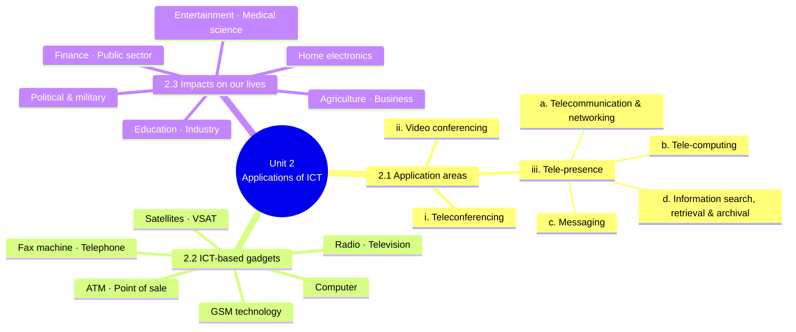
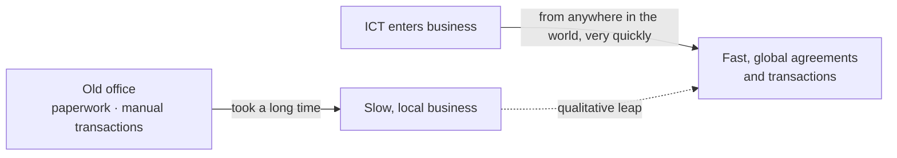
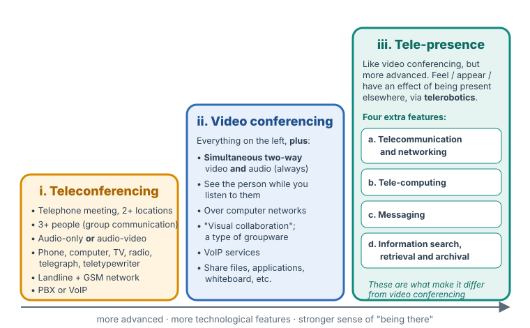
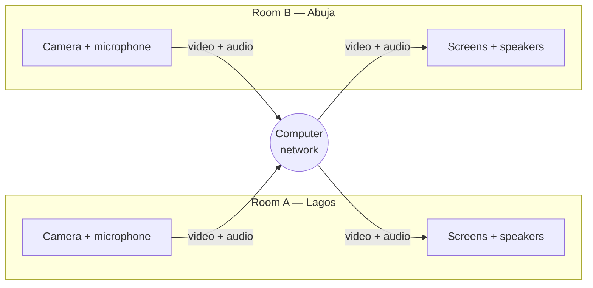
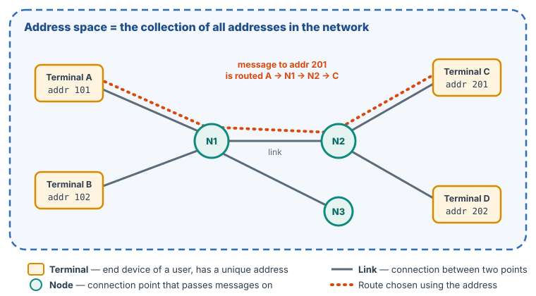
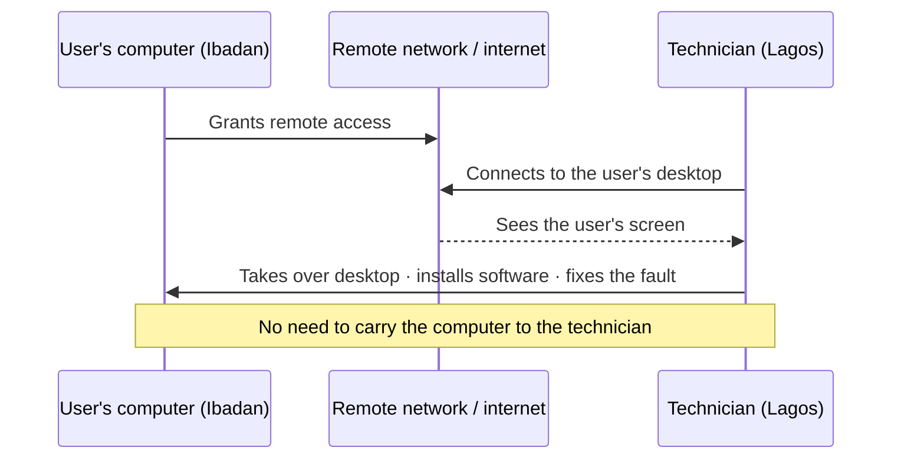
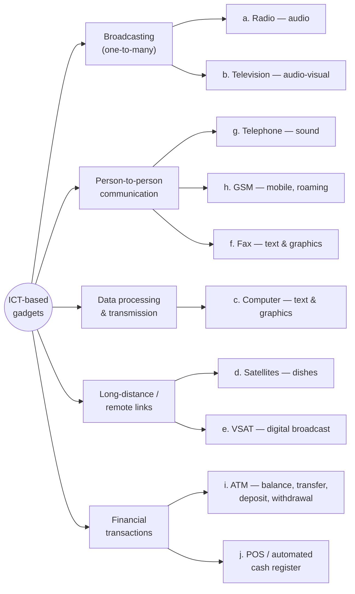
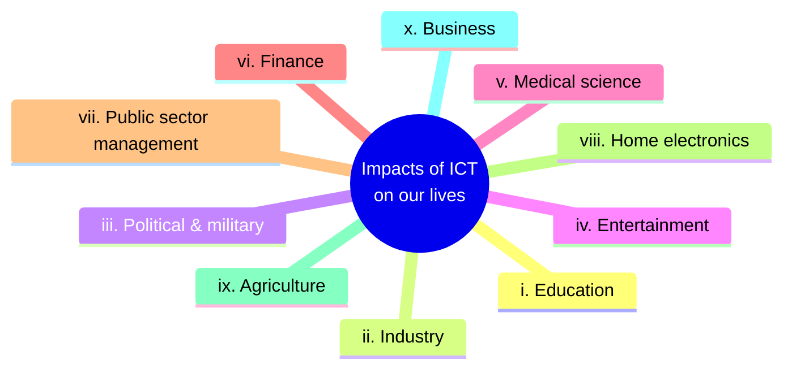

# Unit 2 — Application of ICTs in the Developmental Agenda of the Developing Countries

*Courseware pages 24–31.*

## At a glance

Unit 1 explained what ICT is and why it matters for development. Unit 2 is more practical. It covers **where ICT is actually used** and **what it has changed in our lives**, in three parts:

1. **Application areas (§2.1).** Three ways people use ICT to meet and work across distance: **teleconferencing**, **video conferencing** and **tele-presence**. Tele-presence is set apart by **four extra features**: telecommunication and networking, tele-computing, messaging, and information search, retrieval and archival.
2. **ICT-based gadgets (§2.2).** What a gadget is, and **ten** examples: radio, television, computer, satellites, VSAT, fax machine, telephone, GSM, ATM and point-of-sale (automated cash register).
3. **Impacts of ICT on our lives (§2.3).** **Ten** sectors ICT has changed: education, industry, politics and the military, entertainment, medical science, finance, public sector management, home electronics, agriculture and business.

## Learning outcomes

At the end of the lecture, the learner should be able to:

- Define the term, Information Communication Technologies (ICT) gadgets.
- Identify 5 areas to which ICT can be applied
- Identify four features that differentiates between Tele-presence and Video conference
- Account for 6 ICT-based gadgets
- Discuss 5 impacts of ICT on human lives

!!! warning "Courseware note"
    The outcomes, the section text and the self-test do not use the same numbers:

    - Outcome 2 asks for **5 areas** where ICT can be applied, but §2.1 ("Application Areas of ICT") lists only **three** (teleconferencing, video conferencing, tele-presence). If you are asked for five, give the three from §2.1 and add sectors from §2.3 such as education, medical science, finance, agriculture or business. All of these are areas where ICT is applied. Say which section each comes from.
    - Outcome 3 says **four** features separate tele-presence from video conferencing. Self-test Q2 asks for **three**. Learn all four (§2.1 iii); if asked for three, any three of the four will do.
    - Outcome 4 asks for **6** gadgets, self-test Q4 asks for **8**, and §2.2 lists **10**. Learn all ten.

---

## Introduction

### Recap of Unit 1

The courseware opens by listing what Unit 1 covered:

- the definition of ICT and the tools included in ICT;
- the problems and challenges of ICT for organisations, individuals and society;
- the developmental characteristics of ICTs: multi-functionality and interoperability; rapid innovation that makes ICTs **less expensive and easier to use**; the ability to help people **collect, manage, store, retrieve and distribute knowledge**; helping people **tap into networks** of other people and information; and ICT's ease of use;
- the application areas of ICTs for social development: **healthcare, education, environment and sustainable development**;
- the factors affecting ICT-driven development.

Unit 2 now turns to *"the applications of ICT to the development of individuals and organizations in general."*

### How ICT has changed human life

> Information and communication technologies have greatly affected human lives. Since the industrial revolution, man has begun to develop machines and equipment that facilitate his work. With the advent of information technology, mankind has jumped a qualitative leap towards development on the one hand and luxury on the other hand, where the work was done in the old offices using paperwork and transactions manually, which leads to taking a long time to finish. After the entry of technology into the world of business, agreements and transactions have been established from anywhere in the world and very quickly. Thus, ICT has a great impact on our lives.

!!! note "In plain terms"
    The argument has three steps:

    1. **Industrial revolution:** people built machines to make *physical* work easier.
    2. **Information technology:** a **qualitative leap**, meaning a change in the *kind* of progress and not just the amount. It brought both **development** (real economic and social progress) and **luxury** (comfort and convenience).
    3. **Before vs after:** offices used to run on **paperwork and manual transactions**, which were slow. With ICT, agreements and transactions can be made **from anywhere in the world, very quickly**.

The before-and-after picture in the courseware's introduction.

!!! example "Example"
    Opening a bank account used to mean filling paper forms at a branch and waiting days for approval. Today a Nigerian customer can open an account in a banking app, verify their BVN online and receive money from abroad within minutes. That is the "anywhere in the world and very quickly" the courseware describes.

---

## 2.1 Application areas of ICT

> ICT can be applied in the following areas namely:

1. Teleconferencing
2. Video conferencing
3. Tele-presence

All three let people in **different places** communicate as if they were in the **same meeting**. They differ in **what is transmitted** and **how strong the sense of "being there" is**. Each step up adds capability.

{ .diagram }

The three application areas as a capability ladder. The ordering is an interpretation: the courseware says internet teleconferencing <em>includes</em> video conferencing, and tele-presence is "like video conferencing except that it is more advanced".

### i. Teleconferencing

> A teleconference is a telephone meeting held between two or more locations through a telecommunications system. Technical terms like telephone conferencing, phone conferencing and audio conferencing are sometimes also used to refer to teleconferencing. In a teleconference, audio-only or audio-video data can be transmitted via one or more different telecommunications means, such as telephone, computer, television, radio, telegraph and teletypewriter. Particularly, internet teleconferencing includes video conferencing, web conferencing, internet telephone conferencing and augmented reality (AR) conferencing. Teleconferencing is an interactive group communication between three or more people in two or more location through an electronic medium. This is made possible by the provision of land line telephone and GSM network. It supports the conference by providing both the video and voice, so that you can absolutely see the person when you are listening to the communicator. Teleconferencing is capable of transmitting the data during the conferencing either using traditional PBX systems or VoIP

Broken into exam-sized points:

| Aspect | What the courseware says |
|---|---|
| **Definition** | A **telephone meeting** held between **two or more locations** through a telecommunications system |
| **Other names** | Telephone conferencing, phone conferencing, **audio conferencing** |
| **Data transmitted** | **Audio-only** or **audio-video** |
| **Means of transmission** | One or more of: telephone, computer, television, radio, telegraph, teletypewriter |
| **Internet teleconferencing includes** | Video conferencing, web conferencing, internet telephone conferencing, augmented reality (AR) conferencing |
| **Who** | Interactive **group** communication between **three or more people** in **two or more locations**, through an electronic medium |
| **Made possible by** | **Landline telephone** and **GSM network** |
| **Transmission systems** | Traditional **PBX** systems or **VoIP** |

!!! note "In plain terms"
    A teleconference is a **group call**. The basic form is people in different places dialling into one phone line, which is why it is also called *audio conferencing*. It *can* include video, and the internet versions (video, web, internet-phone and AR conferencing) all count as teleconferencing. The key points are: **group** (3+ people), **distance** (2+ locations), **any telecom medium**.

!!! warning "Courseware note"
    The sentence *"It supports the conference by providing both the video and voice, so that you can absolutely see the person…"* is repeated word for word in the video-conferencing paragraph, where it belongs. The same paragraph also says a teleconference can be **audio-only**. The safe reading for the exam: **teleconferencing may be audio-only or audio-video; video conferencing always includes video.** That is the main difference between them.

!!! info "Beyond the notes — PBX, VoIP, telegraph, teletypewriter, AR"
    - **PBX (Private Branch Exchange):** an organisation's private telephone switchboard. It connects internal extensions to each other and to the public phone network. Many PBXs have a "conference bridge" that joins several callers.
    - **VoIP (Voice over Internet Protocol):** carrying voice calls as data over the internet or another IP network instead of the traditional phone network. WhatsApp and Zoom calls use VoIP.
    - **Telegraph / teletypewriter:** older systems that send *text* over wires. They show that the courseware's definition of teleconferencing is broad and goes beyond voice.
    - **AR (augmented reality) conferencing:** digital images (e.g. a 3-D model or a remote participant) laid over the user's real surroundings through a headset or phone camera.

!!! example "Example"
    A state Ministry of Health holds a weekly 30-minute conference call with the medical officers of 20 local government areas. Most rural officers join from ordinary GSM phones, because data coverage is weak. This is **audio-only teleconferencing** made possible by the **GSM network**.

### ii. Video conferencing

> Video conferencing is the conduct of a videoconference by set of telecommunication technologies which allow two or more locations to communicate by simultaneous two-way video and audio transmission. It has also been called visual collaboration and it's a type of groupware. Videoconferencing (or video conferencing) is the conduct of a video meeting among two-person or more people in separate places by means of computer networks to transmit both audio and video data video conferencing supports the conference by providing both the video and voice, so that you can absolutely see the person when you are listening to the communicator. It offers VoIP services. It can also enable you to share more information like files, applications, whiteboard and etc.

| Aspect | What the courseware says |
|---|---|
| **Definition** | Telecommunication technologies that let **two or more locations** communicate by **simultaneous two-way video and audio** transmission |
| **Other names** | **Visual collaboration**; it is a type of **groupware** |
| **Participants** | Two or more people in separate places |
| **Network** | **Computer networks** transmit both audio and video data |
| **Experience** | You can **see** the person while **listening** to them |
| **Services** | Offers **VoIP** services |
| **Sharing** | Files, applications, **whiteboard**, etc. |

!!! note "In plain terms"
    Video conferencing is a meeting where everyone **sees and hears** each other **at the same time, in both directions**, over a computer network. It is also a collaboration tool: participants can share files, run an application together, or draw on a shared whiteboard. Zoom, Google Meet and Microsoft Teams are everyday examples.

!!! info "Beyond the notes — groupware"
    **Groupware** is software that helps a group of people work together on a shared task, e.g. shared calendars, document editors and project boards. Calling video conferencing "groupware" stresses that it is for **working together**, not just talking.

**Figure 2.1** in the courseware shows a **video conferencing session**: a group sits on one side of a curved boardroom table facing a row of large wall screens, and each screen shows the remote participants seated at their own table. The two rooms look like one long meeting table.

Figure 2.1 (described) — a video conferencing session. Both rooms send and receive video and audio at the same time: "simultaneous two-way" transmission.

!!! tip "Exam angle"
    "Differentiate between teleconferencing and video conferencing" is a natural short question. Compare on named criteria:

    | Criterion | Teleconferencing | Video conferencing |
    |---|---|---|
    | Media | Audio-only **or** audio-video | **Always** simultaneous two-way audio **and** video |
    | Number of people | Three or more | Two or more |
    | Network / means | Telephone, computer, TV, radio, telegraph, teletypewriter; landline + GSM; PBX or VoIP | Computer networks; VoIP |
    | Extra features | Not stated | Share files, applications, whiteboard (groupware / visual collaboration) |
    | Relationship | The wider category: internet teleconferencing *includes* video conferencing | One form of (internet) teleconferencing |

### iii. Tele-presence

> Tele-presence refers to a set of technologies which allow a person to feel as if they were present, to give the appearance of being present, or to have an effect of being present via telerobotics at a place other than their true location. Tele-presence is like video conferencing except that it is more advanced and offer more technological features as follows:

The definition has **three parts**. Tele-presence technologies allow a person, at a place other than their true location, to:

1. **feel** as if they were present;
2. **give the appearance** of being present;
3. **have an effect** of being present, via **telerobotics**.

!!! note "In plain terms"
    Video conferencing lets you **see** a distant place. Tele-presence aims to let you **be** there. Life-size screens make the remote person appear to be in the room, and a **telepresence robot** carries your face on a screen that you can drive around a remote office, hospital ward or classroom. "Having an effect" means you can *act* at the remote place, not just watch it.

**Figure 2.2** in the courseware shows two kinds of tele-presence:

- **left:** a man reaching out to "shake hands" with a life-size image of a remote colleague on a large screen, which gives the *appearance* of being present;
- **right:** four **telepresence robots** (wheeled stands with a tablet or screen showing a remote person's face), which give the *effect* of being present via telerobotics.

!!! info "Beyond the notes — telerobotics"
    **Telerobotics** is controlling a robot from a distance. In tele-presence the robot is the remote person's "body": they steer it, look through its camera and speak through its speaker. Surgeons use advanced telerobotic systems to operate on patients in other cities.

The courseware lists **four features** that tele-presence offers beyond video conferencing.

#### a. Telecommunication and networking

> This is a collection of terminals, links and nodes which connect to enable telecommunication between users of the terminals. Each terminal in the network has a unique address so messages or connections can be routed to the correct recipients. The collection of addresses in the network is called the address space.

Four terms to learn:

| Term | Meaning |
|---|---|
| **Terminals** | The end points (users' devices) that are connected |
| **Links** | The connections between terminals and nodes |
| **Nodes** | Connection points that join links and pass messages on |
| **Address space** | The **collection of addresses** in the network. Each terminal has a **unique address** so messages or connections reach the **correct recipient** |

{ .diagram }

A telecommunication network: terminals, links and nodes. Because every terminal has a unique address, a message for address 201 is routed only to Terminal C. The addresses shown are made up for illustration.

!!! example "Example"
    Every phone on a GSM network has a unique phone number, and every device on the internet has an IP address. When you call 0803 123 4567, the network's switches (nodes) use that number to route your call to one phone, out of millions. All possible numbers together form the network's **address space**.

#### b. Tele-computing

> This is the control of one's system by another person at a different location. No need carrying your computer for some software installation and maintenance. Through remote networking, somebody from a distance can remotely take over your desktop and do an installation or correct whatever needs to be corrected.

Tele-computing: control of one person's system by another person at a different location.

!!! note "In plain terms"
    Tele-computing is **remote control** of a computer. Instead of carrying your laptop to the IT unit, a technician connects over the network, takes over your desktop and installs software or fixes the fault. Tools such as AnyDesk, TeamViewer and Windows Remote Desktop do this.

#### c. Messaging

> Sending a letter through regular postage is outdated. Development in ICT has made it possible to send messages through the internet and telephone network. Such messages are received immediately they are sent. It is now common to send instant messages which are known as 'chatting'. This is communicating live with somebody through text, pictures and even video

| | Regular postage (old) | ICT messaging (new) |
|---|---|---|
| Channel | Postal service | **Internet** and **telephone network** |
| Speed | Days or weeks | Received **immediately** they are sent |
| Form | Paper letter | **Text, pictures and even video** |
| Interaction | One-way, delayed | **Live**: instant messaging, or "chatting" |

#### d. Information search, retrieval and archival

> Rather than using the traditional means of storing files and folders in a cabinet that is susceptible to theft, consumption of unnecessary space cumbersome to access and carry about, ICT has made information storage, security and management easy. Once they are stored in a database in the computer or in the World Wide Web, it becomes easy to retrieve from any location.

| Problems with filing cabinets | What ICT provides |
|---|---|
| Susceptible to **theft** | Easier **security** of information |
| **Consume unnecessary space** | Storage in a **database** on a computer or on the **World Wide Web** |
| **Cumbersome to access and carry about** | Easy **retrieval from any location** |

!!! example "Example"
    A university that keeps student transcripts in steel cabinets loses files to theft, termites and floods, and a graduate in Canada must travel home to request a copy. If the records are scanned into a secure database, the registry can search for and send a transcript in minutes. This is search, retrieval and archival, which Unit 6 develops further as *digital archiving*.

!!! tip "Exam angle"
    "Identify four features that differentiate tele-presence from video conferencing." Name all four, **define each in one sentence**, and add a one-line example:

    1. **Telecommunication and networking:** terminals, links and nodes; unique addresses; address space.
    2. **Tele-computing:** someone at a different location controls your system, e.g. remote installation and maintenance.
    3. **Messaging:** instant messages ("chatting") through text, pictures and video, received immediately.
    4. **Information search, retrieval and archival:** databases or the WWW replace filing cabinets; retrieval from any location.

    Open with the definition of tele-presence (feel present, appear present, or have an effect of being present via telerobotics).

---

## 2.2 ICT-based gadgets

### Definition

> Gadgets are tools or machines that help to do something. ICT gadgets are information and communication equipments, which includes computer hardware for example printer. Broadcasting technology such as radio, television, other ICT gadgets are ATM, fax machines and mobile phones.

So:

- a **gadget** is a tool or machine that helps to do something;
- an **ICT gadget** is **information and communication equipment**. Examples include computer hardware (e.g. a **printer**), **broadcasting technology** (radio, television), **ATMs**, **fax machines** and **mobile phones**.

### The ten examples

> Examples of ICT gadgets are:

**a. Radio.**
> This is an effective way of transmitting audio or voice information, using the radio

Radio carries **sound only**. It is cheap, needs no literacy, and reaches remote villages on batteries, so it remains one of the most important development tools (farm advice, health campaigns, distance-learning broadcasts).

**b. Television.**
> This is an effective way of transmitting information. It combines the quality of audio together with visual. It is an audio–visual transmission of information

Television adds **pictures** to sound. It is **audio-visual**, so it suits demonstrations such as how to mix oral rehydration solution or plant a crop.

**c. Computer.**
> This is an electronic data processing machine used for transmission of textual and graphic information

The computer **processes data** as well as transmitting it, and handles **text and graphics**.

**d. Satellites.**
> This is an information transmission method through cables or wireless by the use of satellites dishes

Satellites relay signals from space, received on the ground through **satellite dishes**. They reach places that cables and masts do not.

!!! warning "Courseware note"
    The courseware says satellites transmit "through cables or wireless". The link between a satellite and the dish is always **wireless** (radio waves); cables only connect the dish to equipment on the ground. In the exam you can quote the definition, but stress the dish and the wireless link.

**e. VSAT.**
> This is advanced telecom equipment for receiving digital broadcast. It stands for very small aperture terminal (VSAT)

!!! info "Beyond the notes — VSAT"
    A **VSAT** is a small satellite dish (often under 3 metres) with its electronics. It also **sends** data, so it gives two-way internet and data links to places with no fibre or mobile coverage: rural banks, oil platforms, remote schools and clinics. Many Nigerian bank branches and ATMs in remote areas have used VSAT links.

**f. Fax machine.**
> This is an age-long method of transmitting textual and graphical message. It consists of the features of photocopying with effective information transmission

A fax machine **scans** a document (like a photocopier) and **sends** the image over the telephone line to another fax machine, which prints it. So it is "photocopying + transmission".

**g. Telephone.**
> Telephone is a telecommunication equipment or device used in transmitting sound across a distance

**h. GSM technology.**
> GSM Stands for global system for mobile communication. It is an ICT telecommunication device. It is the most popular mobile phone in the world today. GSM allows network operators to offer "roaming" services. Roaming means the ability of customer to make use of their phone wherever they are at any point in time

Key points: **GSM = Global System for Mobile communication**; most popular in the world; it allows **roaming**, meaning a customer can use their phone **wherever they are, at any time** (including on another operator's network, e.g. abroad).

!!! warning "Courseware note"
    Strictly, GSM is a **standard** (set of rules) for mobile networks, not a phone or device. "GSM phone" means a phone that works on GSM networks. Use the courseware's wording in the exam, but know the distinction.

**i. Automated Teller Machines (ATM).**
> This is a type of retail banking technology that has the capability to make enquiry on customers account balance, interest and exchange rates, money transfer, deposits and withdrawals

The courseware lists the ATM's **capabilities**:

- enquiry on the customer's **account balance**;
- **interest and exchange rates**;
- **money transfer**;
- **deposits**;
- **withdrawals**.

**j. Point of sale — Automated Cash Register (ACR).**

The courseware names this gadget but gives no description.

!!! info "Beyond the notes — point of sale (POS)"
    A **point-of-sale (POS) terminal** or automated cash register is the device at a checkout where a sale is recorded and paid for. It totals the items, accepts cash, card or transfer payments, prints a receipt and updates stock records. In Nigeria, POS terminals run by agents also act as mini bank branches for cash withdrawals and transfers in areas without banks.

### Gadgets grouped by function

The ten gadgets of §2.2 grouped by what they do. The grouping is added to aid memory; the courseware lists them a–j without groups.

!!! tip "Exam angle"
    "Account for six ICT-based gadgets" means **name and explain** each one, not just list it. For each, give (1) what it is, (2) what it transmits or does, and (3) a use. A memory aid for the ten, in order: **R**adio, **T**V, **C**omputer, **S**atellite, **V**SAT, **F**ax, **T**elephone, **G**SM, **A**TM, **P**OS.

---

## 2.3 Impacts of ICT on our lives

The courseware lists **ten** areas of life that ICT has changed.

| Impact area | Key words to remember |
|---|---|
| i. Education | Computer boards replace boards, chalk, heavy books; computers, tablets, data displays, interactive boards; UNESCO |
| ii. Industry | Machines linked to the web; productivity up; time to goal down |
| iii. Political & military | Power and dominance of the state; information about the enemy; information as a weapon; radars, drones; encryption |
| iv. Entertainment | Movies and music from the Internet; interactive TV; digital cameras, printers, scanners; graphic interfaces |
| v. Medical science | Devices for use, detection, treatment; acquisition, retrieval, storage, use of health information; health informatics tools |
| vi. Finance | Trading, reporting earnings, personal budgets; rapid calculation; e-transfer, credit cards, e-commerce; security, legal, global markets |
| vii. Public sector management | Convenient, transparent, accountable, efficient, cost-effective; economic/financial/structural/legal conditions; bills and licences online |
| viii. Home electronics | Access to home care; lighting, home security, air conditioning |
| ix. Agriculture | Rural development; farming techniques; natural resources; production strategies; digital marketing; financial services |
| x. Business | Secure communication; analyse/store/process/share data; profitability, cost, lead times; quick, accurate decisions; predict opportunities/threats |

The ten impacts at a glance. Full courseware wording follows below.

### i. On the educational side

> Boards, chalk, and heavy books were overloaded with a computer board containing all the educational courses, thus providing greater comfort to the student and introducing him to the world of development since childhood. Information and communication technology contributes greatly to education because it improves the way of education and provides a better educational environment, through the use of computers, tablets, data displays, interactive electronic boards, and others in the process of communicating information to students. UNESCO pursues a comprehensive educational system, enhanced by information and communications technology, which focuses on the main challenges in joint work, whether in the field of communications, information, science, and education.

Points:

- **Replacement:** boards, chalk and heavy books are replaced ("overloaded") by a **computer board** containing all the courses. This brings **greater comfort** to the student and introduces them to development **from childhood**.
- **Better teaching:** ICT improves the way of education and gives a better learning environment through **computers, tablets, data displays and interactive electronic boards**.
- **UNESCO** pursues a comprehensive education system enhanced by ICT, focusing on the main challenges in joint work across **communications, information, science and education**.

### ii. On the industrial side

> The entry of ICT after the industrial revolution led to the development of the machines used and linking them to the web to send orders to them from different sectors. ICT has increased the productivity of industries and reduced the time required to achieve the desired goal.

- Machines are **linked to the web**, so orders can be sent to them from different sectors.
- Result: **higher productivity** and **less time** to reach the desired goal.

This links to the **smart factory** of the Fourth Industrial Revolution in Unit 1.

### iii. In the political and military aspects

> Information technology has played a major role in the power and dominance of the state. The major countries sought to develop means of communication and means of obtaining information about the enemy. The amount of information available became a serious weapon in which entire countries could be destroyed: radars, drones. Encrypted information is one of the fundamentals of military power in the state.

- IT underpins the **power and dominance of the state**.
- Major countries develop means of **communication** and of **obtaining information about the enemy**.
- **Information is a serious weapon**; whole countries could be destroyed. Examples: **radars, drones**.
- **Encrypted information** is one of the fundamentals of military power.

### iv. ICT in entertainment

> Information and communication technologies (ICT) have impacted entertainment and leisure activities in different ways in which you spend your time. ICT offers a variety of entertainment and leisure activities and allows for quick access to movies or music that can be easily accessed and you can watch movies and listen to music directly from the Internet. ICT adds more interactive technologies to TV shows. Digital cameras, printers and scanners have enabled more people to experience image production, in addition to developing graphic interfaces.

- **Variety** of entertainment and leisure activities.
- **Quick access** to movies and music, watched and heard **directly from the Internet**.
- **Interactive technologies** added to TV shows.
- **Digital cameras, printers and scanners** let more people produce images, and **graphic interfaces** have developed.

!!! example "Example"
    Nollywood films are now streamed worldwide, Afrobeats spreads through streaming platforms, and viewers vote for reality-show contestants by SMS or app. These are internet access to movies and music, and interactive TV.

### v. ICT in medical science

> Medical devices and modern equipment have evolved considerably favoring information and communications technology. Information and communication technologies (ICT) are related to the devices, resources and tools needed to improve the acquisition, retrieval, storage and use of information in health and biomedicine. That is why we find that most of the medical devices that now exist rely on information and communication technology in the way of use, detection and treatment of diseases. Health informatics tools include formal medical terms, clinical guidelines, computers, and information and communication systems.

- Medical devices and equipment have **evolved considerably** thanks to ICT.
- ICT here means the devices, resources and tools that improve the **acquisition, retrieval, storage and use** of health and biomedical information.
- Most medical devices now rely on ICT for **use, detection and treatment of diseases**.
- **Health informatics tools** (four): **formal medical terms**, **clinical guidelines**, **computers**, and **information and communication systems**.

This is expanded in Unit 6 (e-Health).

### vi. ICT in finance

> Information and communication technology is used daily by financial companies, to trade financial instruments, to report a business's earnings, and to keep records of personal budgets. ICT allows rapid calculation of financial data and provides financial services companies with strategic and innovative benefits as well as electronic transfer of money, through the use of credit cards, or e-commerce, which includes the purchase and payment via the Internet and others. ICT helps deal with security concerns, legal issues and access to global markets.

- **Daily uses:** trading financial instruments, reporting a business's earnings, keeping records of personal budgets.
- **Rapid calculation** of financial data.
- **Strategic and innovative benefits** for financial services companies.
- **Electronic transfer of money** through **credit cards** and **e-commerce** (purchase and payment via the Internet).
- Helps deal with **security concerns, legal issues** and **access to global markets**.

### vii. ICT in public sector management

> Information and communication technology (ICT) is used to facilitate more convenient government services, make the government more transparent and accountable to citizens, promote a more efficient and cost-effective government. ICT provides greater public access to information and constitutes opportunities for public administration that require meeting many economic, financial, structural and legal conditions. ICT also allows people to perform many different activities, such as: paying bills or renewing official documents such as driving licenses and others over the Internet.

- Government services become **more convenient**.
- Government becomes **more transparent and accountable** to citizens.
- Government becomes **more efficient and cost-effective**.
- **Greater public access to information**.
- Opportunities for public administration, which require meeting **economic, financial, structural and legal conditions**.
- Citizens can **pay bills** and **renew official documents** (e.g. **driving licences**) over the Internet.

!!! note "In plain terms"
    The "conditions" sentence is a warning: e-government does not happen just by buying computers. It needs **money** (economic and financial conditions), **organisation** (structural, e.g. an ICT department and trained staff) and **laws** (legal, e.g. accepting electronic records and signatures). Unit 3's Design–Reality Gap case shows what happens when these are missing.

### viii. ICT in home electronics

> The use of ICT in domestic electronics is developing rapidly. ICT equipment is used to increase access to home care. As it became possible to manage the house through a system that controls lighting, home security, air conditioning, and others.

- ICT in domestic electronics is **developing rapidly**.
- ICT equipment **increases access to home care**.
- The house can be managed through one system that controls **lighting, home security, air conditioning** and more (a "smart home").

### ix. ICT in agriculture

> Information and communication technology in agriculture helps in the growing demand for new approaches and focuses on enhancing agricultural and rural development through better information and communication processes. ICT also helps empower rural people by providing better farming techniques, better access to natural resources, effective production strategies, and digital marketing strategies for agribusiness and financial services, etc.

- Meets the **growing demand for new approaches**; enhances **agricultural and rural development** through better information and communication.
- **Empowers rural people** by providing:
    1. better **farming techniques**;
    2. better **access to natural resources**;
    3. effective **production strategies**;
    4. **digital marketing strategies** for agribusiness;
    5. **financial services**.

!!! example "Example"
    A cassava farmer in Oyo State gets weather alerts and planting advice by SMS in Yoruba, sells produce to buyers through a WhatsApp group (digital marketing), and receives a loan through a mobile-money app (financial services).

### x. ICT in business

> The use of information and communications technology is very important for businesses to establish a hassle-free and secure communication flow and to meet daily operational tasks. ICT tools help companies analyze, store, process and share vast amounts of data and make better use of products and resources. ICT tools also help improve profitability, reduce costs compared to manual tasks and minimize lead times. ICT systems allow managers and employees to make decisions quickly and accurately so that they can effectively manage the operations process and day-to-day activities and rapidly predict business opportunities or threats.

- **Hassle-free, secure communication** and help with daily operational tasks.
- **Analyse, store, process and share** vast amounts of data; make better use of products and resources.
- **Improve profitability**, **reduce costs** compared to manual tasks, **minimise lead times**.
- Managers and employees **decide quickly and accurately**, manage operations and day-to-day activities, and **rapidly predict opportunities or threats**.

!!! info "Beyond the notes — lead time"
    **Lead time** is the time between starting a process and finishing it, e.g. from a customer's order to delivery. ICT shortens it by removing manual steps such as re-typing orders or waiting for paper approvals.

!!! warning "Courseware note"
    The unit summary lists only **eight** gadgets (it omits ATM and POS) and **eight** impact areas (it omits agriculture and business). The section text has **ten of each**. Learn all ten.

!!! tip "Exam angle"
    "Discuss five impacts of ICT on human lives." **Discuss** means each impact needs a heading, **two or three specific points from the courseware**, and ideally an example. "ICT helps education" alone earns little; "ICT replaces chalk and heavy books with computer boards and interactive electronic boards, giving students greater comfort and exposing them to development from childhood" earns the mark.

---

## Key terms

Teleconferencing
:   A telephone meeting between two or more locations through a telecommunications system. It is interactive group communication between three or more people, audio-only or audio-video. Also called telephone, phone or audio conferencing.

Video conferencing
:   Telecommunication technologies that let two or more locations communicate by simultaneous two-way video and audio over computer networks. Also called visual collaboration; a type of groupware.

Tele-presence
:   Technologies that let a person feel present, appear present or have an effect of being present via telerobotics at a place other than their true location. A more advanced form of video conferencing.

Telerobotics
:   Control of a robot from a distance. *(Beyond the notes.)*

Groupware
:   Software that helps a group work together on a shared task. *(Beyond the notes.)*

Terminal, link, node
:   The parts of a telecommunication network: terminals are the users' end points, links are the connections, nodes are connection points that pass messages on.

Address space
:   The collection of all addresses in a network. Each terminal has a unique address so messages are routed to the correct recipient.

Tele-computing
:   Control of one's system by another person at a different location, e.g. remote software installation and maintenance.

Instant messaging ("chatting")
:   Communicating live with someone through text, pictures and even video, received immediately.

Gadget / ICT gadget
:   A gadget is a tool or machine that helps to do something. An ICT gadget is information and communication equipment, e.g. a printer, radio, TV, ATM, fax machine or mobile phone.

VSAT
:   Very Small Aperture Terminal: advanced telecom equipment for receiving digital broadcast.

GSM
:   Global System for Mobile communication. It allows roaming.

Roaming
:   The ability of a customer to use their phone wherever they are at any point in time.

ATM
:   Automated Teller Machine: retail banking technology for balance enquiry, interest and exchange rates, money transfer, deposits and withdrawals.

PBX / VoIP
:   Private Branch Exchange (an organisation's private telephone switch) / Voice over Internet Protocol (voice carried as data over IP networks). The two ways teleconferencing transmits data.

Health informatics tools
:   Formal medical terms, clinical guidelines, computers, and information and communication systems.

---

## Unit summary

- ICT has greatly affected human lives. After the machines of the industrial revolution, IT was a **qualitative leap** towards development and luxury. Slow paperwork gave way to fast transactions from anywhere in the world.
- **Three application areas (§2.1):**
    - **Teleconferencing:** a telephone meeting of 3+ people in 2+ locations, audio-only or audio-video, over any telecom means (landline, GSM, PBX, VoIP). Internet teleconferencing includes video, web, internet-telephone and AR conferencing.
    - **Video conferencing:** simultaneous two-way video and audio over computer networks; visual collaboration and groupware; VoIP; sharing files, applications and whiteboard.
    - **Tele-presence:** feel, appear or have an effect of being present elsewhere via telerobotics. It is more advanced than video conferencing because of **four features**: (a) telecommunication and networking (terminals, links, nodes, unique addresses, address space); (b) tele-computing (remote control of a system); (c) messaging (instant "chatting" with text, pictures, video); (d) information search, retrieval and archival (databases or WWW instead of filing cabinets).
- **Gadgets (§2.2)** are tools or machines that help to do something. ICT gadgets are information and communication equipment. Ten examples: radio, television, computer, satellites, VSAT, fax machine, telephone, GSM, ATM, point of sale (automated cash register).
- **Ten impacts (§2.3):** education, industry, political and military, entertainment, medical science, finance, public sector management, home electronics, agriculture, business.

---

## Quick-check questions

Which of these is NOT another name the courseware gives for teleconferencing?

<ul class="quiz-options">
  <li>Audio conferencing</li>
  <li>Phone conferencing</li>
  <li data-correct>Visual collaboration</li>
  <li>Telephone conferencing</li>
</ul>

"Visual collaboration" is another name for **video conferencing** (§2.1 ii). Teleconferencing is also called telephone, phone or audio conferencing (§2.1 i).

According to the courseware, teleconferencing is interactive group communication between…

<ul class="quiz-options">
  <li>two or more people in one location</li>
  <li data-correct>three or more people in two or more locations</li>
  <li>two people in two locations only</li>
  <li>three or more people in three or more locations</li>
</ul>

§2.1 i: "an interactive group communication between **three or more people** in **two or more location** through an electronic medium."

Which statement best distinguishes video conferencing from teleconferencing?

<ul class="quiz-options">
  <li>Video conferencing uses the telephone network; teleconferencing uses computer networks</li>
  <li data-correct>Video conferencing always involves simultaneous two-way video and audio; teleconferencing may be audio-only</li>
  <li>Teleconferencing allows file sharing; video conferencing does not</li>
  <li>Video conferencing needs at least three locations</li>
</ul>

Teleconferencing carries "audio-only or audio-video data" (§2.1 i). Video conferencing is "simultaneous two-way video and audio transmission" over computer networks, and it is the one that allows sharing files, applications and whiteboard (§2.1 ii).

Which two systems does the courseware say teleconferencing uses to transmit data?

<ul class="quiz-options">
  <li>VSAT and GSM</li>
  <li data-correct>Traditional PBX systems or VoIP</li>
  <li>Telegraph and fax</li>
  <li>Satellites and radio</li>
</ul>

§2.1 i: "capable of transmitting the data during the conferencing either using traditional **PBX** systems or **VoIP**."

Tele-presence gives a person the effect of being present at another place via…

<ul class="quiz-options">
  <li>teletypewriters</li>
  <li>groupware</li>
  <li data-correct>telerobotics</li>
  <li>roaming</li>
</ul>

§2.1 iii: "to have an effect of being present **via telerobotics** at a place other than their true location." Figure 2.2 shows telepresence robots.

In a telecommunication network, the collection of addresses is called the…

<ul class="quiz-options">
  <li>node set</li>
  <li data-correct>address space</li>
  <li>routing table</li>
  <li>terminal list</li>
</ul>

§2.1 iii(a): each terminal has a unique address so messages are routed correctly; "the collection of addresses in the network is called the **address space**."

An IT officer in Abuja logs into a staff member's laptop in Kano over the network and installs an update. Which tele-presence feature is this?

<ul class="quiz-options">
  <li>Messaging</li>
  <li>Telecommunication and networking</li>
  <li data-correct>Tele-computing</li>
  <li>Information search, retrieval and archival</li>
</ul>

Tele-computing is "the control of one's system by another person at a different location", e.g. remote installation (§2.1 iii b). Networking is the infrastructure it runs on, but the *feature* described is tele-computing.

Which of these is NOT a problem with filing cabinets named by the courseware?

<ul class="quiz-options">
  <li>Susceptible to theft</li>
  <li>Consume unnecessary space</li>
  <li>Cumbersome to access and carry about</li>
  <li data-correct>Cannot store graphics</li>
</ul>

§2.1 iii(d) names theft, unnecessary space, and being cumbersome to access and carry. ICT fixes these by storing information in a database or on the World Wide Web.

VSAT stands for…

<ul class="quiz-options">
  <li>Very Secure Automated Terminal</li>
  <li data-correct>Very Small Aperture Terminal</li>
  <li>Virtual Satellite Access Technology</li>
  <li>Video Signal And Telephony</li>
</ul>

§2.2 e: VSAT is "advanced telecom equipment for receiving digital broadcast. It stands for very small aperture terminal."

Which gadget does the courseware describe as combining "the features of photocopying with effective information transmission"?

<ul class="quiz-options">
  <li>Computer</li>
  <li>Television</li>
  <li data-correct>Fax machine</li>
  <li>Printer</li>
</ul>

§2.2 f: the fax machine is "an age-long method of transmitting textual and graphical message" that combines photocopying with transmission.

"The ability of a customer to make use of their phone wherever they are at any point in time" defines…

<ul class="quiz-options">
  <li>VoIP</li>
  <li data-correct>Roaming</li>
  <li>Tele-computing</li>
  <li>Address space</li>
</ul>

§2.2 h: GSM "allows network operators to offer 'roaming' services."

Which of these is listed among health informatics tools in §2.3?

<ul class="quiz-options">
  <li>Drones and radars</li>
  <li data-correct>Formal medical terms and clinical guidelines</li>
  <li>Interactive electronic boards</li>
  <li>Automated cash registers</li>
</ul>

§2.3 v: health informatics tools include formal medical terms, clinical guidelines, computers, and information and communication systems. Drones and radars belong to the political and military impact.

According to §2.3, ICT opportunities for public administration require meeting which conditions?

<ul class="quiz-options">
  <li>Technical, cultural and social</li>
  <li data-correct>Economic, financial, structural and legal</li>
  <li>Political, military and security</li>
  <li>Educational and religious</li>
</ul>

§2.3 vii: ICT "constitutes opportunities for public administration that require meeting many **economic, financial, structural and legal** conditions."

"Minimise lead times" and "rapidly predict opportunities or threats" are benefits of ICT in…

<ul class="quiz-options">
  <li>Industry</li>
  <li>Finance</li>
  <li data-correct>Business</li>
  <li>Public sector management</li>
</ul>

§2.3 x (business). Industry (§2.3 ii) is about machines linked to the web, higher productivity and less time to reach a goal. Don't mix the two.

---

## Self-test assessment (from the courseware)

**1. Briefly describe Information and Communication Technologies gadgets.**

??? success "Model answer"
    **Gadgets** are tools or machines that help to do something. **ICT gadgets** are **information and communication equipment**: devices used to create, process, transmit or receive information. They include computer hardware (e.g. a **printer**), **broadcasting technology** (radio, television), **ATMs**, **fax machines** and **mobile phones**.

    Examples with their functions:

    - **Radio** transmits audio or voice information.
    - **Television** is audio-visual, combining sound and pictures.
    - **Computer** is an electronic data-processing machine for text and graphics.
    - **Satellites** transmit information using satellite dishes.
    - **VSAT** (Very Small Aperture Terminal) is advanced telecom equipment for receiving digital broadcast.
    - **Fax machine** combines photocopying with transmission of text and graphics.
    - **Telephone** transmits sound across a distance.
    - **GSM** (Global System for Mobile communication) is the most popular mobile system and offers roaming.
    - **ATM** handles balance enquiry, rates, transfers, deposits and withdrawals.
    - **Point of sale / automated cash register** records sales and takes payment.

**2. Identify three areas where video conference differs from tele-presence.**

??? success "Model answer"
    **Tele-presence** lets a person feel present, appear present, or have an effect of being present via **telerobotics** at a place other than their true location. It is like video conferencing but **more advanced**, with extra technological features. Any three of the four:

    1. **Telecommunication and networking:** a collection of terminals, links and nodes. Each terminal has a **unique address** so messages are routed to the correct recipient; the collection of addresses is the **address space**.
    2. **Tele-computing:** another person at a different location **controls your system**, e.g. remotely taking over your desktop to install software or fix a fault, so you need not carry the computer anywhere.
    3. **Messaging:** messages sent over the internet and telephone network arrive **immediately**. Instant messaging ("chatting") lets you communicate live through text, pictures and video. Postal letters are outdated.
    4. **Information search, retrieval and archival:** instead of filing cabinets (theft, space, cumbersome), information is stored in a **database or on the WWW** and retrieved from **any location**.

    *Courseware note:* the learning outcomes say **four** features; give all four if time allows.

**3. Discuss two areas where ICT could be applied.**

??? success "Model answer"
    Any two from §2.1, discussed (not just named). For example:

    1. **Teleconferencing:** a telephone meeting held between two or more locations through a telecommunications system. It is interactive group communication between **three or more people in two or more locations**, and can be **audio-only or audio-video**. It can run over telephone, computer, TV, radio, telegraph or teletypewriter, and is made possible by **landline and GSM networks**, using **PBX or VoIP**. Internet teleconferencing includes video, web, internet-telephone and AR conferencing. *Application:* a ministry holds weekly audio meetings with officers in remote local governments.
    2. **Video conferencing:** **simultaneous two-way video and audio** between two or more locations over **computer networks**, so you can see the person while listening. It is "visual collaboration", a type of **groupware**, offers **VoIP**, and lets participants **share files, applications and a whiteboard**. *Application:* a company's board meets across Lagos, Abuja and London without travel.

    *(Tele-presence is also acceptable. Areas from §2.3, e.g. education or medical science, may be accepted where the question says "areas where ICT could be applied" broadly.)*

**4. Mention 8 ICT-based gadgets.**

??? success "Model answer"
    Any eight of the ten: (1) **radio**, (2) **television**, (3) **computer**, (4) **satellites**, (5) **VSAT**, (6) **fax machine**, (7) **telephone**, (8) **GSM technology**, (9) **Automated Teller Machine (ATM)**, (10) **point of sale (automated cash register)**.

    Adding a few words on each (e.g. "radio — transmits audio/voice information") makes the answer safer if the examiner expects more than names.

---

## Practice exercises

**Exercise 1.** Classify each situation as **teleconferencing (audio-only)**, **video conferencing** or **tele-presence**, and give the deciding clue:

1. A doctor in Ibadan steers a wheeled robot with a screen around a ward in Ogbomoso, talking to patients at their bedsides.
2. Five pastors in different towns dial into a single phone line for a prayer meeting.
3. A lecturer holds a Google Meet class, sharing slides and drawing on a whiteboard while students watch and ask questions on camera.

??? success "Answer"
    1. **Tele-presence:** the doctor has an *effect* of being present via **telerobotics** (Figure 2.2's robots).
    2. **Teleconferencing (audio-only):** 3+ people, 2+ locations, a **telephone** meeting with voice only.
    3. **Video conferencing:** simultaneous two-way video and audio over computer networks, with **whiteboard and file sharing** (groupware).

**Exercise 2.** Match each description to a tele-presence feature (a–d):

1. "The collection of addresses in the network."
2. "Rather than storing files and folders in a cabinet…"
3. "Communicating live with somebody through text, pictures and even video."
4. "No need carrying your computer for some software installation."

??? success "Answer"
    1 → **(a) telecommunication and networking**; 2 → **(d) information search, retrieval and archival**; 3 → **(c) messaging**; 4 → **(b) tele-computing**.

**Exercise 3.** Copy and complete for each gadget: *what it transmits or does* and *one development use in a rural community*.

| Gadget | Transmits / does | Rural development use |
|---|---|---|
| Radio | | |
| Television | | |
| VSAT | | |
| GSM | | |
| ATM | | |

??? success "Answer"
    | Gadget | Transmits / does | Rural development use |
    |---|---|---|
    | Radio | Audio or voice information | Farm-advice programmes in local languages |
    | Television | Audio-visual information | Demonstrating health practices, e.g. handwashing |
    | VSAT | Receives digital broadcast (in practice also two-way satellite data) | Internet for a school or clinic with no fibre or mobile data |
    | GSM | Mobile communication with roaming | Farmers checking market prices; mobile money |
    | ATM | Balance, rates, transfer, deposit, withdrawal | Cash access without travelling to a city bank branch |

    The third column is application; any sensible use is accepted.

**Exercise 4.** For each statement, name the impact area in §2.3:

1. "Encrypted information is one of the fundamentals of … power."
2. "Make the government more transparent and accountable to citizens."
3. "Better access to natural resources, effective production strategies."
4. "Managing the house through a system that controls lighting."
5. "Acquisition, retrieval, storage and use of information in … biomedicine."
6. "Machines … linked to the web to send orders to them from different sectors."

??? success "Answer"
    1. Political and military · 2. Public sector management · 3. Agriculture · 4. Home electronics · 5. Medical science · 6. Industry.

**Exercise 5.** Explain why the courseware says the filing cabinet is being replaced, and name **one** new risk that the replacement brings (use Unit 1).

??? success "Answer"
    Filing cabinets are **susceptible to theft**, **consume unnecessary space** and are **cumbersome to access and carry about**. A database on a computer or on the WWW makes storage, security and management easy and allows **retrieval from any location** (§2.1 iii d).

    **New risk (Unit 1 §1.5):** **cybercrime**. Digital records can be hacked, stolen or held to ransom from anywhere in the world, so they need passwords, encryption and backups.

---

## Sample exam questions

*In the style of the real paper. Each question is about 20 marks. Try writing a full answer before revealing the model answer.*

### Question 1

**1a.** Explain teleconferencing and differentiate it from video conferencing in terms of the media transmitted, the network used, and the collaboration features offered. (6 marks)

??? success "Model answer"
    **Teleconferencing (2 marks).** A teleconference is a **telephone meeting held between two or more locations** through a telecommunications system. It is interactive group communication between **three or more people in two or more locations** through an electronic medium. It is also called telephone, phone or audio conferencing.

    **Differences (4 marks):**

    - **Media transmitted:** teleconferencing may be **audio-only or audio-video**. Video conferencing always has **simultaneous two-way video and audio**, so you see the person while listening.
    - **Network used:** teleconferencing can use telephone, computer, TV, radio, telegraph or teletypewriter, and is made possible by **landline and GSM networks** with **PBX or VoIP**. Video conferencing uses **computer networks** and offers **VoIP** services.
    - **Collaboration features:** video conferencing is "**visual collaboration**", a type of **groupware**, and lets participants **share files, applications and a whiteboard**. The courseware states no such sharing features for basic teleconferencing.
    - *(Relationship: internet teleconferencing includes video conferencing, so video conferencing is a richer form of teleconferencing.)*

    **Marking points:** definition 2; each criterion compared 1⅓ (≈ 4).

**1b.** "Tele-presence is like video conferencing except that it is more advanced." Define tele-presence and explain the **four** features that support this statement. (8 marks)

??? success "Model answer"
    **Definition (2 marks).** Tele-presence is a set of technologies that allow a person to **feel** as if they were present, to **give the appearance** of being present, or to **have an effect** of being present **via telerobotics** at a place other than their true location (e.g. life-size screen images or telepresence robots).

    **Four features (1.5 marks each):**

    1. **Telecommunication and networking:** a collection of **terminals, links and nodes** connected to enable telecommunication. Each terminal has a **unique address** so messages or connections reach the correct recipient; the collection of addresses is the **address space**.
    2. **Tele-computing:** control of one's system by **another person at a different location**. Through remote networking, someone can take over your desktop to install software or correct faults, so you need not carry your computer to them.
    3. **Messaging:** messages sent through the internet and telephone network are **received immediately**. Instant messaging ("chatting") is live communication through **text, pictures and even video**, replacing postal letters.
    4. **Information search, retrieval and archival:** instead of filing cabinets, which are prone to **theft**, waste **space** and are **cumbersome**, information is stored in a **database or on the WWW** and can be **retrieved from any location**.

    **Marking points:** definition 2 (feel/appear/effect + telerobotics); each feature named and explained 1.5 × 4 = 6.

**1c.** Unity Microfinance Bank has its head office in Ibadan and 30 branches across Oyo, Ogun and Kwara States. Most rural branches have reliable GSM voice coverage but weak mobile data. The bank's only IT engineers are in Ibadan, and they spend about two days each month travelling to branches to install and fix software. The board, which includes two directors living abroad, wants to review loan documents and charts together during its monthly meeting.

1. Recommend the most suitable application area for the **weekly meeting between the head office and rural branch managers**, and justify it. (2 marks)
2. Recommend the most suitable application area for the **monthly board meeting**, and justify it. (2 marks)
3. Which tele-presence feature would cut the engineers' travel? Explain how it works and state **one** precondition for it to work. (2 marks)

??? success "Model answer"
    1. **Audio teleconferencing.** Rural branches have GSM voice but weak data. Teleconferencing can be **audio-only** and is made possible by **landline and GSM networks** (through PBX or VoIP at head office). Video conferencing needs computer networks able to carry two-way video, which these branches lack. *(1 recommendation + 1 justification)*
    2. **Video conferencing.** Directors abroad must **see** each other and **review documents and charts together**. Video conferencing gives **simultaneous two-way video and audio** and lets participants **share files, applications and a whiteboard** (groupware). Head office and the directors have good internet, so the network condition is met. Full tele-presence (robots, life-size rooms) would be unnecessary cost for a monthly meeting. *(1 + 1)*
    3. **Tele-computing.** Engineers in Ibadan remotely **take over the branch computer's desktop** through remote networking to install software and correct faults, so nobody travels. **Precondition:** each branch computer must be reachable over a network (a data link, e.g. **VSAT** where mobile data is weak), with a unique address and remote-access permission. *(1 + 1)*

### Question 2

**2a.** Define ICT gadgets. Differentiate between **radio**, **television** and the **fax machine** in terms of the type of information each transmits and how it is transmitted. (6 marks)

??? success "Model answer"
    **Definition (2 marks).** **Gadgets** are tools or machines that help to do something. **ICT gadgets** are **information and communication equipment**, e.g. computer hardware such as a printer, broadcasting technology such as radio and TV, ATMs, fax machines and mobile phones.

    **Differences (4 marks):**

    | Criterion | Radio | Television | Fax machine |
    |---|---|---|---|
    | Type of information | **Audio / voice** only | **Audio-visual**: sound combined with pictures | **Text and graphics** (documents) |
    | How transmitted | Broadcast (one-to-many) over radio waves | Broadcast (one-to-many), audio with visual | Scans the document, as in photocopying, and sends it to another fax machine (point-to-point) |

    **Marking points:** definition 2; each gadget correctly characterised on both criteria ≈ 1⅓ each.

**2b.** Explain how ICT has impacted (i) **finance** and (ii) **public sector management**. (6 marks)

??? success "Model answer"
    **(i) Finance (3 marks):**

    - Financial companies use ICT daily to **trade financial instruments**, **report business earnings** and keep **records of personal budgets**.
    - ICT allows **rapid calculation** of financial data and gives financial firms **strategic and innovative benefits**.
    - It enables **electronic transfer of money** through **credit cards** and **e-commerce** (purchase and payment via the Internet).
    - It helps deal with **security concerns, legal issues** and **access to global markets**.

    **(ii) Public sector management (3 marks):**

    - ICT makes government services **more convenient**.
    - It makes government **more transparent and accountable** to citizens and **more efficient and cost-effective**.
    - It provides **greater public access to information**. These opportunities require meeting **economic, financial, structural and legal conditions**.
    - Citizens can **pay bills** and **renew official documents such as driving licences** online.

    **Marking points:** about 3 well-explained points per sector, 1 mark each.

**2c.** A primary health centre in a remote village in Kebbi State has no landline, no fibre internet and weak GSM data. Its staff need to:

- receive the State's health-education broadcasts and share them with the community;
- send weekly patient reports and receive guidelines from the general hospital;
- let patients pay small fees without the clinic keeping large amounts of cash;
- let a staff member collect salary cash without travelling to the city.

Recommend an ICT-based gadget from §2.2 for **each** need and justify each choice. (8 marks)

??? success "Model answer"
    | Need | Gadget | Justification (2 marks each: choice 1 + reason 1) |
    |---|---|---|
    | Health-education broadcasts for the community | **Radio** (or **television** where there is power) | Radio transmits **audio/voice** information effectively, works on batteries and reaches people who cannot read. TV is **audio-visual**, better for demonstrations but needs more power. |
    | Weekly reports and guidelines | **VSAT** with a **computer** | With no landline or fibre and weak GSM data, a **satellite** link through a **very small aperture terminal** gives the clinic connectivity. The **computer** processes and transmits the **text and graphic** reports. |
    | Cashless payments | **Point of sale (automated cash register)** | Records each sale and takes electronic payment, so less cash is kept on site, reducing theft. It needs a GSM or VSAT data link. |
    | Salary cash without travel | **ATM** (or a POS agent) | The ATM supports **withdrawals**, balance enquiry and transfers, so staff need not travel to a city bank. Where there is no ATM, a **POS agent** can give cash. |

    **Marking points:** 4 needs × (1 for an appropriate gadget + 1 for a justification tied to the scenario's constraints) = 8. Reject choices that ignore the constraints, e.g. a landline telephone.

### Question 3

**3a.** Explain how ICT has impacted **education** and **medical science**. (6 marks)

??? success "Model answer"
    **Education (3 marks):**

    - **Boards, chalk and heavy books** are replaced by a **computer board** containing all the courses. This gives the student **greater comfort** and introduces them to development **from childhood**.
    - ICT improves teaching and gives a **better learning environment** through **computers, tablets, data displays and interactive electronic boards**.
    - **UNESCO** pursues a comprehensive education system enhanced by ICT, addressing the main challenges in joint work across communications, information, science and education.

    **Medical science (3 marks):**

    - Medical devices and modern equipment have **evolved considerably** because of ICT; most devices now rely on ICT for **use, detection and treatment of diseases**.
    - ICT improves the **acquisition, retrieval, storage and use** of information in health and biomedicine.
    - **Health informatics tools** include **formal medical terms, clinical guidelines, computers, and information and communication systems**.

    **Marking points:** 3 points × 1 mark per sector.

**3b.** Discuss how ICT benefits **business**, with particular reference to profitability and decision-making. In your answer, contrast this with the impact of ICT on **industry**. (6 marks)

??? success "Model answer"
    **Business (4 marks):**

    - **Communication:** ICT gives businesses a **hassle-free and secure communication flow** and helps with daily operational tasks.
    - **Data:** ICT tools help firms **analyse, store, process and share vast amounts of data** and make better use of products and resources.
    - **Profitability:** ICT **improves profitability**, **reduces costs** compared with manual tasks and **minimises lead times**.
    - **Decision-making:** managers and employees can **decide quickly and accurately**, manage operations and day-to-day activities, and **rapidly predict business opportunities or threats**.

    **Contrast with industry (2 marks):** the industrial impact is about **production machinery**. After the industrial revolution, machines were developed and **linked to the web** so orders could be sent to them from different sectors, **raising productivity** and **reducing the time** to reach a goal. The business impact is about **communication, data and management decisions**.

    **Marking points:** 4 business points × 1; contrast 2.

**3c.** The Ministry of Lands in a southern Nigerian state keeps all land titles in filing cabinets in the state capital. Files often go "missing", the registry has run out of space, and citizens must travel to the capital and wait weeks to renew a Certificate of Occupancy. The Governor wants to "put the Ministry online".

1. Name the tele-presence feature **and** the §2.3 impact area most relevant to this plan, and explain the benefits each would bring to the Ministry. (4 marks)
2. Using the courseware, explain why buying computers alone will not make the plan succeed. (2 marks)
3. Identify **one** new risk the plan introduces and state a measure against it. (2 marks)

??? success "Model answer"
    1. **Feature: information search, retrieval and archival** (§2.1 iii d). Filing cabinets are **susceptible to theft** (the "missing" files), **consume unnecessary space** (the full registry) and are **cumbersome to access**. Storing scanned titles in a **database** makes storage, security and management easy and allows **retrieval from any location**. *(2)*

        **Impact area: public sector management** (§2.3 vii). ICT makes government services **more convenient**: citizens can **renew official documents online**, as with driving licences, without travelling. Records are visible and traceable, which makes the Ministry **more transparent and accountable** and **more efficient and cost-effective**. *(2)*
    2. The courseware says ICT opportunities for public administration **"require meeting many economic, financial, structural and legal conditions."** The Ministry needs **funding** for scanning and maintenance (economic and financial), an **ICT unit and trained staff** (structural), and **laws accepting electronic titles and payments** (legal). Without these, the computers will not change how the Ministry works. *(2)*
    3. **Risk: cybercrime** (Unit 1 §1.5): hackers could alter or steal land records. **Measure:** secure access controls and passwords, encryption, audit logs, and regular off-site backups. *(Alternative: staff resistance or lack of skills; measure: training.)* *(1 + 1)*
