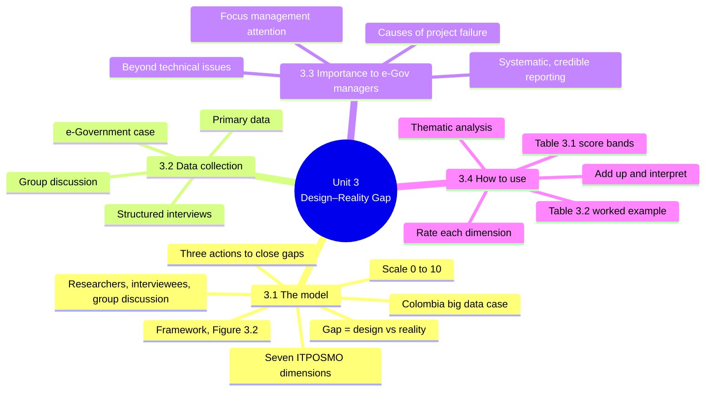
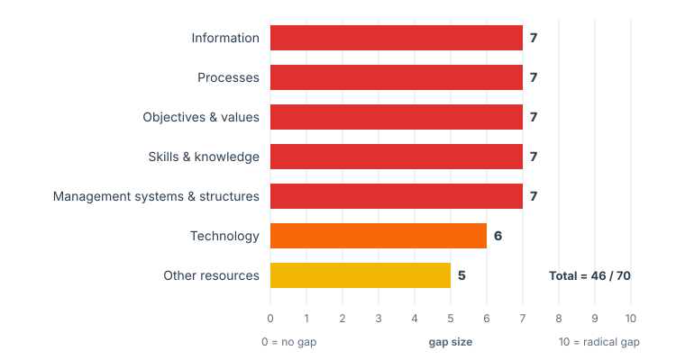
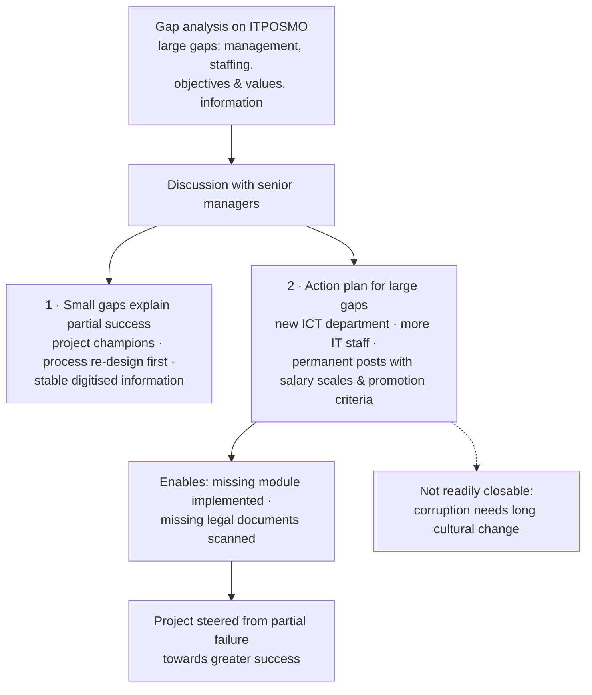
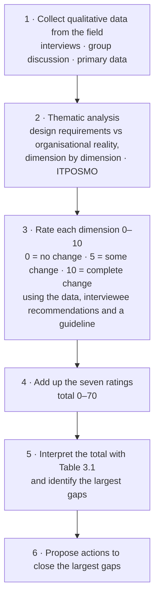
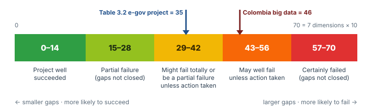

# Unit 3 — Design Reality Gap

*Courseware pages 31–38.*

## At a glance

Many ICT projects in developing countries fail, fully or partly. This unit gives you a **tool for measuring why**: the **design–reality gap (DRG) model**. The idea is simple:

- every project is **designed** with certain requirements and assumptions;
- the **reality** on the ground is usually different;
- the bigger the **gap** between design and reality, the more likely the project is to fail.

The gap is scored **0–10** on each of **seven dimensions**, remembered as **ITPOSMO**: **I**nformation, **T**echnology, **P**rocesses, **O**bjectives and values, **S**taffing and skills, **M**anagement systems and structures, **O**ther resources. The scores are added up to a **total out of 70**, and a table tells you what the total means.

The unit uses three cases:

1. **Big data in the Colombian public sector:** DRG used to measure barriers (§3.1).
2. **A city e-government project:** DRG used **mid-implementation** to turn partial failure into success (§3.2).
3. **A worked scoring table** (Table 3.2): total gap 35 (§3.4).

## Learning outcomes

At the end of the lecture, the learner should be able to:

- Explain the term, Design Reality Gap
- Briefly describe Design Reality Gap model
- Identify the barriers on all the 7 dimensions of Design Reality Gap
- Identify three ways to turn around each of the gaps to propose actions to overcome barriers
- Vividly draw a well annotated diagram of design-reality gap framework
- Discuss how to use the Design Reality Gap model.

!!! tip "Exam angle"
    This unit is the most "applied" one in the course. Expect a question that gives you a project, asks you to **rate each ITPOSMO dimension**, **total** the scores, **interpret** them with Table 3.1, and **propose actions** for the largest gaps. Learn the seven dimensions, the 0/5/10 meaning, and the five score bands by heart. You will also be expected to **draw the framework**; see the drawing steps in §3.1.

---

## Introduction

> The last unit discussed the areas that ICTs could applied such as video conferencing, teleconferencing and tele-presence. It also spoke to a number of impacts that ICTs have on human lives as well as distinguishion between video conferencing and tele-presence. The difference is mainly the addition of more technological features than video conferencing. In this unit we will be learning about Design Reality Gap.

Unit 2 showed *where* ICT is applied. Unit 3 asks a harder question: **when we apply ICT through a project, how can we tell whether it will work?** The design–reality gap model answers it by comparing what a project *needs* with what *actually exists*.

---

## 3.1 Design Reality Gap

### Why the model is needed: big data in developing countries

> Big data holds much promise for development such as improving the speed, quality and consistency of a wide variety of development decision. At present, this is more of a potential than actuality because big data initiatives in developing countries face many barriers. But so far there has been little sense of how these barriers can be systematically measured. Research to date tends to be rather broad-brush or haphazard. To measure these barriers, an ICT for Development (ICT4D) framework already known for measurement of barriers, the design-reality gap model, could be used.

The argument in four steps:

1. **Promise:** big data could improve the **speed, quality and consistency** of many development decisions.
2. **Problem:** so far this is **potential, not actuality**, because big data initiatives in developing countries face **many barriers**.
3. **Gap in knowledge:** there has been **little sense of how to measure these barriers systematically**. Research has been **broad-brush or haphazard**.
4. **Solution:** use the **design–reality gap model**, an **ICT4D framework** already known for measuring barriers.

!!! warning "Courseware note"
    The unit opens with **big data**, which is only explained in [Unit 4](unit-4-development-informatics.md#42-two-fold-core-of-big-data). For now, read "big data" as **very large, fast-growing collections of digital data** (e.g. from mobile phones, sensors and online activity) that can be analysed to support decisions. The DRG model itself is not specific to big data: the rest of this unit applies it to e-government projects.

!!! info "Beyond the notes — where the model comes from"
    The design–reality gap model was developed by **Richard Heeks** of the Centre for Development Informatics, University of Manchester, to explain why so many information-system and e-government projects in developing countries fail. The courseware's references (the ICT4D blog and Lemma et al., 2012) build on his work.

### The model in its basic form

> In its basic form, the model is straightforward:

1. It records the **gap between the design requirements or assumptions** of big data **vs. the current reality on the ground**.
2. The gap is typically recorded on a **scale from 0** (no gap: everything needed for big data is present) **to 10** (radical gap: none of the requirements for big data is present).
3. The gap can be estimated via **analysis of researchers**, or derived directly from **interviewees**, or recorded from **group discussions**.
4. It is typically measured along **seven "ITPOSMO" dimensions**.

!!! note "In plain terms"
    Think of a project plan as a **picture of the future** ("we will have fast internet, trained staff, digitised records…"). Now look at **today**. For each area, ask: *how far is today from that picture?* If today already matches the plan, the gap is **0**. If nothing in the plan exists yet, the gap is **10**. Most real gaps fall in between.

!!! example "Example"
    A state plans an online land registry that assumes every office has **broadband internet**.

    - If all offices already have broadband, the technology gap ≈ **0**.
    - If half the offices have it, the gap ≈ **5**.
    - If no office has any internet at all, the gap ≈ **10**.

### Proof of concept: big data in the Colombian public sector

> As proof-of-concept, the model was applied to measure barriers to big data in the Colombian public sector; gathered from a mix of participant-observation in two IT summits, interviews, and secondary data analysis.

Data came from three sources:

- **participant-observation** at **two IT summits** (the researchers attended and observed);
- **interviews**;
- **secondary data analysis** (studying existing reports and data).

{ .diagram }

Figure 3.1 — Overview of barriers to big-data reality gap dimensions (redrawn, with the gap sizes from the text added). Red = 7, orange = 6, yellow = 5. The total of 46 is calculated here; the courseware does not total these scores.

> As summarised in figure 3.1, the model showed serious barriers on all seven dimensions:

| Dimension | Barrier found in Colombia | Gap size |
|---|---|---|
| **Information** | Some **variety** of data but limited **volume, velocity and visibility** | **7** |
| **Technology** | **Good mobile**, **moderate internet** and **poor sensor** availability, with a **strong digital divide** | **6** |
| **Processes** | Few **"information value chain"** processes at work to put big data into action | **7** |
| **Objectives and values** | **Basic data policies** in place but **lack of big data culture and drivers** | **7** |
| **Skills and knowledge** | **Foundational** but not **specialised** big data capabilities | **7** |
| **Management systems and structures** | **General IT** systems and structures in place but **little specific to big data** | **7** |
| **Other resources** | **Some budgets earmarked** for big data projects | **5** |

> A simple summary would be that Colombia's public sector has a number of the foundations or precursors for big data in place, but very few of the specific components that make up a big data ecosystem.

!!! note "In plain terms"
    Notice the **pattern** in every row: something **general** exists (some data, mobile phones, basic policies, basic skills, general IT systems, some budget) but the **specific big-data** version does not. That is exactly the summary: **foundations present, specific components absent**. The smallest gap is **Other resources (5)**, because some money has been set aside. Technology (6) is helped by good mobile coverage.

!!! info "Beyond the notes — terms in the table"
    - **Volume, velocity, variety:** three classic characteristics of big data (how much data, how fast it arrives, how many kinds). "Visibility" here means how *accessible* the data is to those who could use it. Unit 4 covers the characteristics of big data.
    - **Information value chain:** the chain of steps that turns raw data into value: collect → store → process/analyse → decide → act. Colombia had few processes that got data all the way to *action*.
    - **Sensor availability:** devices that capture data automatically (weather stations, traffic counters, smart meters).

### Turning the gaps into actions

> One can turn around each of the gaps to propose actions to overcome barriers:

1. **Greater use of existing datasets.**
2. **Investments in data-capture technologies.**
3. **Prioritisation of value-generation rather than data-generation processes.**

| Action | What it means | Gaps it addresses (interpretation) |
|---|---|---|
| i. Greater use of existing datasets | Start with data that already exists (some variety is present) instead of waiting for new big data | Information; Other resources (cheaper) |
| ii. Investments in data-capture technologies | Buy and deploy the means of collecting data, e.g. sensors and better internet | Technology (poor sensors, moderate internet); Information (volume, velocity) |
| iii. Prioritise value-generation over data-generation | Focus on processes that *use* data to make decisions, not just on collecting more data | Processes (few information-value-chain processes); Objectives and values (big data culture) |

The third column is an interpretation linking each action to the Colombian gaps; the courseware lists only the three actions.

!!! tip "Exam angle"
    "Identify three ways to turn around the gaps" is a learning outcome. Write the three actions **and** explain each with the gap it closes. A good answer shows the logic: *the gap tells you where to act*. The largest gaps point to the most urgent actions.

### The design–reality gap framework

> The design-reality gap framework helps measure any differences that exist between the project's initial design expectations and current implementation realities. It does this along seven dimensions.

{ .diagram }

Figure 3.2 — Design–reality gap framework (redrawn). Each double arrow is one dimension's gap. The first letters spell ITPOSMO. Outside world is the eighth row in the courseware's figure (see the Courseware note below).

The courseware defines each dimension as a comparison between **what the design requires** and **the real situation now**:

| Dimension | Courseware definition |
|---|---|
| **Information** | The information used in the application: the **information requirements** in the design of the e-government application vs. the **information currently really being used** in the organisation |
| **Technology** | The technology used in the agency: the **requirements** in the design of the application vs. the **real situation now** |
| **Process** | The **work processes** undertaken in the agency: the processes **needed for successful implementation** vs. the real situation now |
| **Objectives** (and values) | The **objectives and values that key stakeholders need** for successful implementation vs. **their current real objectives and values** |
| **Staffing and skill** | The **staffing numbers and skill levels/types** required by the agency for successful implementation vs. the real situation now |
| **Management and structure** | The **management systems and structures** required in the agency for successful implementation vs. the real situation now |
| **Others** | Issues such as the **time and money** required to implement and operate the new application vs. the **time and money really available** now |

!!! note "In plain terms — what each dimension asks"
    | Dimension | The question to ask |
    |---|---|
    | Information | Does the data the system needs actually exist, in the right form (e.g. digitised)? |
    | Technology | Do the computers, networks, software and power the design assumes actually exist? |
    | Processes | Do the work routines the system needs exist, or must people change how they work? |
    | Objectives and values | Do the people involved actually *want* what the system is meant to achieve? (e.g. a transparency system where some staff profit from secrecy) |
    | Staffing and skills | Are there enough staff with the right skills? |
    | Management systems and structures | Is there an ICT department, clear roles, reporting lines, permanent posts? |
    | Other resources | Is there enough time and money? |

!!! warning "Courseware note — seven or eight dimensions?"
    The text says **seven** dimensions (ITPOSMO), Table 3.1 is built on 7 × 10 = **70**, and Table 3.2 scores **seven**. But **Figure 3.2 shows eight rows**, adding **Outside world**, and **Self-test Q1 asks for "the 8 dimensions"**.

    - **For scoring**, use the **seven** ITPOSMO dimensions.
    - **If asked for eight**, list the seven and add **Outside world**: the external environment of the project (e.g. national politics, the economy, laws and regulations, donors, suppliers) compared with what the design assumed about it.

!!! warning "Courseware note — dimension names vary"
    The same dimensions appear under different names: "Skills and knowledge" (Colombia), "Staffing and skills" (Figure 3.2, Table 3.2), "Staffing and Skill" (definitions), "staff and skill" (p.37); "Objectives" vs "Objectives and values"; "Management and Structure" vs "Management systems and structures"; "Others" vs "Other resources". These are the **same** dimensions. In the exam, use the full names from Figure 3.2.

    Also, the "Process" bullet on p.34 ends with a run of words ("Information Technology Processes Objectives and values … Current Reality Design proposal for New eGov project …"). These are labels from a figure in the source paper that were pasted in as text. They show that the source compared a **"Design proposal for New eGov project"** with **"Current Reality"** on the same dimensions. Ignore them as text.

#### How to draw the framework in the exam

The learning outcome asks you to "vividly draw a well annotated diagram". It takes about three minutes:

1. Draw **two boxes** at the top: **System design** (left) and **Current reality** (right).
2. Under each, write the **seven dimensions** in the same order, **ITPOSMO**, underlining the first letter: Information, Technology, Processes, Objectives and values, Staffing and skills, Management systems and structures, Other resources. (Add **Outside world** as an eighth row if you are reproducing Figure 3.2.)
3. Join each pair with a **double-headed arrow** and label one arrow "gap (0–10)".
4. At the bottom, draw a **Design** box and a **Reality** box joined by a double arrow, with an upward arrow labelled **Gap**.
5. **Annotate:** "0 = no gap, 5 = some gap, 10 = complete gap; total out of 70; larger total → greater risk of failure."

---

## 3.2 Design Reality Gap data collection

> i. Primary data to be fed into the model will be collected
>
> ii. Interviews will be conducted for the stakeholders. The questions for the structured interview should be prepared based on the constructs of the Design-Reality gap model and a copy of the interview questions was supposed to be given to each study subject at least two days in advance.
>
> iii. Group discussion could also be made with some stake-holders on the project

| Method | Key details |
|---|---|
| i. **Primary data** | Data collected first-hand for this analysis and fed into the model |
| ii. **Structured interviews** with stakeholders | Questions prepared from the **constructs of the DRG model** (i.e. the ITPOSMO dimensions). A copy given to each interviewee **at least two days in advance** |
| iii. **Group discussion** | With some stakeholders on the project |

!!! note "In plain terms"
    "Constructs of the model" means the **dimensions**. So a structured interview would have questions such as *"What information does the system need? What information do you currently use?"* for each of the seven dimensions. Giving the questions **two days early** lets interviewees check facts (e.g. how many IT staff are actually employed) so the answers are accurate. These match the three sources of gap estimates in §3.1: researchers' analysis, interviewees, group discussions.

### Case: using DRG mid-implementation on an e-government project

> Where large gaps are found, these highlight the key and specific problem areas for a project.

In one city's e-government initiative, **significant design–reality gaps** were found in four dimensions:

| Dimension | Gap found |
|---|---|
| **Management systems and structures** | Failure to **set up an ICT department** and to **hire permanent IT staff** |
| **Staffing and skills** | Hired only **five of the required nine** IT staff, and **undershot** the necessary qualifications and experience |
| **Project objectives and values** | Allowed some **culture of corruption** to remain among **lower-level administrators** |
| **Information systems** | **Absence of one core system module** and of **digitised documents** |

> These gaps demonstrated that the e-government system had not yet institutionalised within the city government. The gap analysis was therefore used as the basis for a discussion with senior managers. From the analysis and discussion emerged two things.

**First: the small gaps behind the partial success.** Some things had gone well, and they matched dimensions with **small** gaps:

- the **commitment of project champions**;
- **process re-design** carried out **before** introducing new technology;
- **stability in the information** digitised onto the e-government system.

**Second: an action plan to close the main remaining gaps:**

- **create the proposed new ICT department**;
- **hire additional IT staff**;
- **set up permanent positions** with clearly defined **salary scales and promotional criteria**.

These, in turn, would provide the basis for **implementing the missing module** and **scanning the missing legal documentation**.

> Not all the gaps can readily be closed: it will take a much longer process of cultural change before the last vestiges of corruption can be eliminated. Nonetheless, design-reality gap analysis did prove itself to be a valuable mid-implementation tool. It is helping steer this e-government project from partial failure to greater success.

How the e-government case used DRG analysis mid-implementation.

!!! note "In plain terms — why this case matters"
    - **"Not yet institutionalised"** means the system had not become a normal, permanent part of how the city government works. It still depended on temporary arrangements.
    - The order of actions matters: **fix management and staffing first** (department, staff, permanent posts), and *then* the technical gaps (missing module, scanning) can be closed. People and structures come before technology.
    - Some gaps are **hard to close quickly**. Objectives and values (e.g. corruption) need **long-term cultural change**, not a purchase.
    - DRG is not only for prediction before a project starts. It is also a **mid-implementation** tool for steering a project that is already running.

!!! tip "Exam angle"
    A scenario question may describe problems in a project and ask you to (1) **classify each problem by ITPOSMO dimension**, (2) **propose actions**, and (3) say **which gaps cannot be closed quickly**. Use this case as your model: management and staffing fixes first, technical fixes follow, values change slowly.

---

## 3.3 The importance of the Reality Gap model to e-Government managers

> 1. it has helped to focus management attention on key e-government project issues
> 2. it digs beyond just technical issues to address underlying human and organisational factors; and
> 3. it offers a systematic and credible basis for project reporting and analysis.

| Importance | Explanation |
|---|---|
| 1. **Focuses management attention** on key project issues | The largest gap scores show managers exactly where to act first, instead of trying to fix everything |
| 2. **Digs beyond technical issues** to human and organisational factors | Only *one* of the seven dimensions (Technology) is purely technical. The rest (objectives and values, staffing, management, processes) are about people and organisations, which is where many projects actually fail |
| 3. **Systematic and credible basis** for project reporting and analysis | Every dimension is scored on the same 0–10 scale, so reports are consistent and comparable, not "broad-brush or haphazard" |

### DRG as a theoretical framework and the causes of project failure

> Design-Reality gap model is used as a theoretical framework to assess the project status. Researches have argued that most of these projects fail either totally or partially due to 'design-actuality' or 'design-reality' gaps, long-term sustainability problems, or lack of commitment on the part of political leadership and public managers. This is a disturbing fact, especially as developing countries have limited resources at their disposal. Design-Reality Gap model, a theoretical model that explains success/failure of IT project implementation in low-income countries, vis-à-vis e-Government project.

Most (e-government) projects **fail totally or partially** because of three causes:

1. **"Design–actuality" or "design–reality" gaps.**
2. **Long-term sustainability problems.**
3. **Lack of commitment** on the part of **political leadership and public managers**.

This is **disturbing** because developing countries have **limited resources**: every failed project wastes money that could not easily be spared. The DRG model is a **theoretical model that explains the success or failure of IT project implementation in low-income countries**, especially e-government projects.

!!! info "Beyond the notes — total vs partial failure"
    In the DRG literature, a **total failure** is a project never implemented, or implemented and immediately abandoned. A **partial failure** is a project where major goals are not met or there are significant undesirable outcomes, though something is delivered. The Table 3.1 bands use both terms.

!!! example "Example"
    A state government installs an electronic payroll system to remove "ghost workers". It fails partly because (1) the **design** assumed every worker had a bank account and biometric record, but many did not (**design–reality gap**); (2) when the donor grant ended, nobody paid for software licences (**sustainability**); and (3) a new commissioner had other priorities (**lack of political commitment**).

---

## 3.4 How to use the model: presentation and analysis of data

The courseware gives the steps:

> Thematic analysis of the organizational reality and requirements within the design of a project application should be made based on the qualitative data collected from the field as per the seven ITPOSMO dimensions

> Next, the rating of each dimension as well as the interpretation of the sum of the numerical values of the dimensions is made based on the data at hand and recommendations made by interviewees during group discussion by adopting a detailed guideline available for same

> Accordingly, each dimension is numerically rated in a scale from zero to ten where zero is to mean no change between the design proposal and current reality; ten means complete change between the design and current reality; and five would indicate some degree of change.

> Finally, all the rating numbers for each dimension will be added up and interpreted

> The original table is for use with predictive – i.e. pre-hoc design-reality gap analysis before implementation.

How to use the DRG model. Steps 2–5 are the courseware's; steps 1 and 6 come from §3.2 and §3.1.

!!! note "In plain terms — the 0 / 5 / 10 rule"
    Rating asks: **how much would have to change** to get from today's reality to what the design requires?

    - **0:** no change needed; the reality already matches the design.
    - **5:** some degree of change needed.
    - **10:** complete change needed; nothing the design requires exists.

    **Thematic analysis** means sorting the interview and discussion notes by **theme**, here by the seven dimensions, so that each dimension's evidence is in one place before it is scored.

### Table 3.1 — Interpretation of total gap score

| Total gap score | Interpretation (courseware wording) |
|---|---|
| **0–14** | The project well succeeded. |
| **15–28** | There is partial failure in the project as actions are not taken to close design-reality gaps. |
| **29–42** | The project might fail totally, or might well be a partial failure unless action is taken to close design-reality gaps. |
| **43–56** | The project may well fail unless action is taken to close design-reality gaps. |
| **57–70** | The project certainly failed as actions are not taken to close design-reality gaps. |

{ .diagram }

Table 3.1 as a scale. The Colombia total (46) is calculated on this site from the Figure 3.1 scores; it measured big-data readiness rather than a single project, so use it only as an illustration.

!!! note "In plain terms — reading the bands"
    | Band | Plain reading |
    |---|---|
    | 0–14 | Small gaps: the project is likely to succeed |
    | 15–28 | Moderate gaps: expect partial failure if they are left unaddressed |
    | 29–42 | Significant gaps: partial failure likely, total failure possible, unless action is taken |
    | 43–56 | Large gaps: failure likely unless action is taken |
    | 57–70 | Very large gaps: failure is almost certain if nothing is done |

!!! warning "Courseware note — Table 3.1 wording"
    - The **maximum 70 = 7 dimensions × 10**, which confirms that scoring uses **seven** dimensions, not eight.
    - The wording mixes tenses ("well **succeeded**", "certainly **failed**") even though the text says the table is for **predictive (pre-hoc)** use, i.e. **before** implementation. Read the bands as predictions: "will likely succeed", "will certainly fail unless…".
    - Bands 15–28 and 57–70 say "as actions are **not** taken". Read this as "if actions are not taken".

    Quote the courseware wording, then give your plain reading, as above.

!!! info "Beyond the notes — pre-hoc, mid-implementation, post-hoc"
    - **Pre-hoc (predictive):** before implementation, to judge the risk and fix gaps early. Table 3.1 was designed for this.
    - **Mid-implementation:** during the project, to steer it (the e-government case in §3.2).
    - **Post-hoc:** after the project, to explain why it succeeded or failed.

### Table 3.2 — Summary of design–reality gap (worked example)

| SN | Dimension | Gap |
|---|---|---|
| 1 | Information | 3 |
| 2 | Technology | 5 |
| 3 | Process | 2 |
| 4 | Objectives and values | 7 |
| 5 | Staffing and skills | 7 |
| 6 | Management system and structure | 8 |
| 7 | Other resources | 3 |
| | **Total** | **35** |

> The total gap of 35 indicates that there is a partial failure in the project and the project may fail totally unless action is taken to close design-reality gaps; Table 3.1 for reference. The largest gap is 'management system and structure' which is 8 followed by significant gaps in 'staff and skill' & 'Objectives and values', both showing 7.

**Reading the example:**

1. **Total:** 3 + 5 + 2 + 7 + 7 + 8 + 3 = **35**.
2. **Band:** 35 falls in **29–42**: partial failure, and possible total failure unless action is taken.
3. **Largest gaps:** **Management system and structure (8)**, then **Staffing and skills (7)** and **Objectives and values (7)**.
4. **Smallest gaps:** Process (2), Information (3), Other resources (3). These are the project's strengths.

!!! note "In plain terms"
    This profile is exactly what §3.3 means by "digs beyond technical issues". The **technical** side is moderate (Technology 5) and **information and processes are fine** (3, 2). The project is at risk because of **people and organisation**: management structures, staff and stakeholder values. Buying more computers would not fix it.

!!! tip "Exam angle — answering a scoring question"
    Use this structure:

    1. Put the scores in a **table** (dimension, score, one-line justification from the scenario).
    2. **Add them up** and show the sum.
    3. **Name the band** from Table 3.1 and quote its interpretation.
    4. Name the **largest gaps** and propose **one action for each**.
    5. Say whether the analysis is **pre-hoc** or **mid-implementation**, and why that matters.

---

## Key terms

Design–reality gap
:   The difference between the requirements or assumptions built into a project's design and the current reality on the ground.

Design–reality gap model / framework
:   An ICT4D framework that measures this gap on seven ITPOSMO dimensions, each on a 0–10 scale, to assess project status and explain success or failure of IT projects in low-income countries.

ITPOSMO
:   Information, Technology, Processes, Objectives and values, Staffing and skills, Management systems and structures, Other resources (time and money).

Outside world
:   The eighth row in Figure 3.2: the project's external environment. Not part of the 7-dimension score.

Gap score
:   A 0–10 rating per dimension: 0 = no change (no gap), 5 = some change, 10 = complete change (radical gap).

Total gap score
:   The sum of the seven dimension scores (0–70), interpreted with Table 3.1.

Pre-hoc (predictive) analysis
:   DRG analysis done before implementation. Table 3.1 was designed for this.

Mid-implementation tool
:   Using DRG analysis on a running project to steer it, as in the e-government case.

Institutionalised
:   Built into the organisation's normal, permanent way of working.

Project champion
:   A committed person who drives a project forward. Champions were one of the small-gap strengths in the e-government case.

Thematic analysis
:   Sorting qualitative data (interview and discussion notes) by theme, here by the seven dimensions.

ICT4D
:   ICT for Development.

---

## Unit summary

- The **design–reality gap (DRG) model** is an **ICT4D framework** for measuring barriers. Big data could improve the speed, quality and consistency of development decisions, but faces many barriers that were not measured systematically.
- **Basic form:** it records the gap between **design requirements/assumptions** and **current reality**, on a **0 (no gap) to 10 (radical gap)** scale, estimated by **researchers, interviewees or group discussions**, along **seven ITPOSMO dimensions**.
- **Colombia (big data):** gaps of 7 for Information, Processes, Objectives and values, Skills and knowledge, Management systems and structures; 6 for Technology; 5 for Other resources. Summary: **foundations present, specific big-data components absent**. Three actions: **use existing datasets; invest in data-capture technologies; prioritise value-generation over data-generation**.
- **Framework (Figure 3.2):** system design vs current reality, dimension by dimension. Figure 3.2 adds an eighth row, **Outside world**.
- **Data collection:** primary data; **structured interviews** built on the model's constructs, questions given **two days in advance**; **group discussion**.
- **e-Government case:** large gaps in management (no ICT department, no permanent IT staff), staffing (5 of 9, under-qualified), objectives and values (corruption) and information (missing module, no digitised documents). Small gaps (champions, process re-design first, stable information) explained the partial success. Action plan: ICT department, more staff, permanent posts → missing module and scanning. Corruption needs long cultural change. DRG proved a **valuable mid-implementation tool**.
- **Importance to e-gov managers:** focuses attention; goes beyond technical to human and organisational factors; systematic, credible basis for reporting.
- **Causes of failure:** design–reality gaps; long-term sustainability problems; lack of commitment by political leaders and public managers.
- **How to use:** thematic analysis by ITPOSMO → rate each 0–10 → add up → interpret with **Table 3.1** (0–14, 15–28, 29–42, 43–56, 57–70). The original table is for **pre-hoc** use.
- **Table 3.2:** total **35** (band 29–42); largest gap Management system and structure (8), then Staffing and skills and Objectives and values (7 each).

---

## Quick-check questions

On the design–reality gap scale, a score of 0 means…

<ul class="quiz-options">
  <li>none of the requirements are present</li>
  <li data-correct>no gap: everything the design needs is already present</li>
  <li>the dimension was not measured</li>
  <li>the project has certainly failed</li>
</ul>

§3.1: "from 0 (no gap: everything needed … is present) to 10 (radical gap: none of the requirements … is present)." In §3.4 terms, 0 = no change between design and reality.

What does the "S" in ITPOSMO stand for in Figure 3.2?

<ul class="quiz-options">
  <li>Systems and structures</li>
  <li>Sustainability</li>
  <li data-correct>Staffing and skills</li>
  <li>Stakeholders</li>
</ul>

ITPOSMO = Information, Technology, Processes, Objectives and values, **Staffing and skills**, Management systems and structures, Other resources. "Systems and structures" belongs to **M**. The Colombia case calls S "Skills and knowledge".

In the Colombian big-data case, which dimension had the smallest gap?

<ul class="quiz-options">
  <li>Technology (6)</li>
  <li data-correct>Other resources (5)</li>
  <li>Information (7)</li>
  <li>Skills and knowledge (7)</li>
</ul>

§3.1: Other resources = 5 ("some budgets earmarked for big data projects"). Technology was 6; all others were 7.

"Good mobile, moderate internet and poor sensor availability with a strong digital divide" describes which Colombian gap?

<ul class="quiz-options">
  <li>Information</li>
  <li data-correct>Technology</li>
  <li>Processes</li>
  <li>Other resources</li>
</ul>

§3.1, Technology (gap size 6). Information was "some variety of data but limited volume, velocity and visibility".

Which is NOT one of the three actions for turning around the gaps?

<ul class="quiz-options">
  <li>Greater use of existing datasets</li>
  <li>Investments in data-capture technologies</li>
  <li>Prioritisation of value-generation rather than data-generation processes</li>
  <li data-correct>Prioritisation of data-generation rather than value-generation processes</li>
</ul>

§3.1: the courseware says prioritise **value**-generation **over** data-generation. Collecting more data is not the goal; using it is.

In DRG data collection, how far in advance should interviewees receive the structured-interview questions?

<ul class="quiz-options">
  <li>On the day of the interview</li>
  <li>At least one week</li>
  <li data-correct>At least two days</li>
  <li>They should not see the questions in advance</li>
</ul>

§3.2 ii: "a copy of the interview questions was supposed to be given to each study subject at least two days in advance."

In the e-government case, "hiring only five of the required nine IT staff" was a gap in…

<ul class="quiz-options">
  <li>Management systems and structures</li>
  <li data-correct>Staffing and skills</li>
  <li>Other resources</li>
  <li>Objectives and values</li>
</ul>

§3.2. The failure to **set up an ICT department and hire permanent IT staff** was the management systems and structures gap; the **number and qualifications** of staff was the staffing and skills gap.

Which gap in the e-government case did the courseware say could NOT readily be closed?

<ul class="quiz-options">
  <li>The missing core system module</li>
  <li>The missing ICT department</li>
  <li data-correct>The culture of corruption among lower-level administrators</li>
  <li>The missing digitised legal documents</li>
</ul>

§3.2: "it will take a much longer process of cultural change before the last vestiges of corruption can be eliminated." This is an objectives-and-values gap.

Which of these was one of the small gaps behind the e-government project's partial success?

<ul class="quiz-options">
  <li>Hiring nine qualified IT staff</li>
  <li data-correct>Process re-design conducted before introducing new technology</li>
  <li>A fully digitised document archive</li>
  <li>A new ICT department</li>
</ul>

§3.2: commitment of **project champions**, **process re-design before new technology**, and **stability in the digitised information**. The other options were gaps or parts of the action plan.

Which is NOT one of the three reasons the DRG model is important to e-government managers?

<ul class="quiz-options">
  <li>It focuses management attention on key project issues</li>
  <li>It digs beyond technical issues to human and organisational factors</li>
  <li>It offers a systematic and credible basis for reporting and analysis</li>
  <li data-correct>It guarantees that a project will succeed</li>
</ul>

§3.3 lists the first three. The model measures and explains risk; it guarantees nothing.

According to §3.3, which is NOT a cause of total or partial failure of projects?

<ul class="quiz-options">
  <li>Design–reality gaps</li>
  <li>Long-term sustainability problems</li>
  <li>Lack of commitment by political leadership and public managers</li>
  <li data-correct>Use of open-source software</li>
</ul>

§3.3 names the first three causes. Open-source software is not mentioned.

A project's seven scores total 47. According to Table 3.1, the project…

<ul class="quiz-options">
  <li>might fail totally, or might well be a partial failure unless action is taken</li>
  <li data-correct>may well fail unless action is taken to close design-reality gaps</li>
  <li>certainly failed</li>
  <li>well succeeded</li>
</ul>

47 falls in **43–56**. The first option is the 29–42 band. Know the band edges: 14, 28, 42, 56, 70 (multiples of 14).

The courseware says the original Table 3.1 is intended for…

<ul class="quiz-options">
  <li>post-hoc analysis after a project ends</li>
  <li data-correct>predictive, pre-hoc analysis before implementation</li>
  <li>measuring big data volume</li>
  <li>rating individual staff performance</li>
</ul>

§3.4: "The original table is for use with predictive – i.e. pre-hoc design-reality gap analysis before implementation." The e-government case shows it can also be used mid-implementation.

In Table 3.2, which dimension had the largest gap?

<ul class="quiz-options">
  <li>Staffing and skills (7)</li>
  <li>Objectives and values (7)</li>
  <li data-correct>Management system and structure (8)</li>
  <li>Technology (5)</li>
</ul>

Table 3.2: Management system and structure = 8, followed by Staffing and skills and Objectives and values (7 each). Total 35.

---

## Self-test assessment (from the courseware)

**1. Identify the 8 dimensions of Design Reality Gap Model.**

??? success "Model answer"
    The DRG framework (Figure 3.2) compares **system design** with **current reality** on these dimensions:

    1. **Information:** information required by the design vs information really being used.
    2. **Technology:** technology required by the design vs the real situation now.
    3. **Processes:** work processes needed for successful implementation vs those actually undertaken.
    4. **Objectives and values:** objectives and values stakeholders need vs their current real ones.
    5. **Staffing and skills:** staff numbers and skill levels required vs actual.
    6. **Management systems and structures:** management systems and structures required vs actual.
    7. **Other resources:** time and money required vs really available.
    8. **Outside world:** the external environment (politics, economy, laws, suppliers, donors) assumed by the design vs the actual one.

    The first seven, ITPOSMO, are the scored dimensions (total out of 70). Outside world appears as the eighth row in Figure 3.2.

**2. What are the importance of Design Reality Gap Model to e-Government Managers?**

??? success "Model answer"
    1. **It focuses management attention on key e-government project issues.** The largest gap scores show where to act first.
    2. **It digs beyond technical issues to address underlying human and organisational factors**, such as objectives and values, staffing and skills, and management structures, which are often the real causes of failure.
    3. **It offers a systematic and credible basis for project reporting and analysis**, because every dimension is scored on the same 0–10 scale and interpreted with a standard table.

    In addition, it serves as a **theoretical framework to assess project status** and explains the success or failure of IT projects in low-income countries. As the city e-government case showed, it is a **valuable mid-implementation tool** for steering a project from partial failure to greater success.

**3. Briefly describe the seven barriers on the dimensions of Design Reality Gap Model.**

??? success "Model answer"
    The barriers found when the model was applied to big data in the Colombian public sector:

    1. **Information (7):** some variety of data, but limited volume, velocity and visibility.
    2. **Technology (6):** good mobile, moderate internet and poor sensor availability, with a strong digital divide.
    3. **Processes (7):** few "information value chain" processes to put big data into action.
    4. **Objectives and values (7):** basic data policies in place, but no big-data culture or drivers.
    5. **Skills and knowledge (7):** foundational but not specialised big-data capabilities.
    6. **Management systems and structures (7):** general IT systems and structures in place, but little specific to big data.
    7. **Other resources (5):** some budgets earmarked for big-data projects.

    Overall, the foundations for big data are present but very few of the specific components of a big-data ecosystem.

**4. What are the causes of failure in respect of the projects initiated by political leadership and public managers?**

??? success "Model answer"
    Research argues that most such (e-government) projects **fail totally or partially** because of:

    1. **Design–reality (design–actuality) gaps:** large differences between what the project design requires or assumes and the reality on the ground, on the ITPOSMO dimensions.
    2. **Long-term sustainability problems:** the project cannot be kept running once initial funding, staff or enthusiasm runs out.
    3. **Lack of commitment on the part of political leadership and public managers:** without support from the top, resources, staff and authority are not provided.

    This is especially disturbing because developing countries have **limited resources**, so failures waste scarce funds. The DRG model helps explain and reduce such failures.

---

## Practice exercises

**Exercise 1.** Write out ITPOSMO in full from memory, then state what 0, 5 and 10 mean.

??? success "Answer"
    **I**nformation · **T**echnology · **P**rocesses · **O**bjectives and values · **S**taffing and skills · **M**anagement systems and structures · **O**ther resources (time and money).

    **0** = no change / no gap (reality matches design) · **5** = some degree of change · **10** = complete change / radical gap (none of the requirements present).

**Exercise 2.** Classify each problem by ITPOSMO dimension:

1. The hospital records system needs patient data in digital form, but all records are on paper cards.
2. Clerks fear the new system will expose their "informal fees", so they quietly avoid using it.
3. The design assumes 24-hour electricity; the clinic gets power six hours a day.
4. There is no IT unit and nobody is responsible for the system.
5. Only one person can use the software, and they are on a one-year contract.
6. The donor grant covers the first year only; licences must be renewed yearly.
7. Patients are currently registered by hand at the door; the system requires online pre-registration.

??? success "Answer"
    1. **Information** (information required vs information currently used).
    2. **Objectives and values** (stakeholders' real objectives conflict with the system's).
    3. **Technology** (infrastructure assumed vs real).
    4. **Management systems and structures** (no ICT department or responsible structure, as in the e-government case).
    5. **Staffing and skills** (numbers and skills); the temporary contract also touches management structures (no permanent posts).
    6. **Other resources** (money and time).
    7. **Processes** (work processes required vs current).

**Exercise 3.** Total and interpret each set of scores (I, T, P, O, S, M, Other):

- (a) 1, 2, 1, 2, 3, 2, 2
- (b) 6, 8, 7, 5, 8, 7, 6
- (c) 9, 9, 8, 9, 10, 8, 9

??? success "Answer"
    - (a) Total **13** → **0–14**: "the project well succeeded" (likely to succeed).
    - (b) Total **47** → **43–56**: "the project may well fail unless action is taken." Priorities: Technology and Staffing and skills (8 each).
    - (c) Total **62** → **57–70**: "the project certainly failed as actions are not taken to close design-reality gaps." It should be redesigned or not started.

**Exercise 4.** In the e-government case, explain why the action plan created the ICT department and permanent posts **before** implementing the missing module and scanning documents.

??? success "Answer"
    The missing module and the unscanned documents are **information/technology** gaps, but their **cause** was a **management and staffing** gap: no ICT department, no permanent IT staff, only 5 of 9 staff, under-qualified. Without people and structures, nobody would build, run or maintain the module or do the scanning, and temporary staff would leave. So closing management and staffing gaps **"would provide the basis for"** closing the technical ones. People and organisation come before technology, which is the point of §3.3's "digs beyond just technical issues".

**Exercise 5.** Draw the DRG framework from memory with all annotations. Then check against Figure 3.2.

??? success "Checklist"
    - [ ] Two header boxes: System design / Current reality
    - [ ] Seven ITPOSMO rows on each side, same order, first letters underlined
    - [ ] Double-headed arrows between each pair
    - [ ] (Optional) Outside world as an eighth row
    - [ ] Design ↔ Reality boxes at the bottom with an arrow labelled "Gap"
    - [ ] Annotation: 0 = no gap, 5 = some, 10 = complete; total out of 70; Table 3.1 bands

---

## Sample exam questions

*In the style of the real paper. Each question is about 20 marks. Try writing a full answer before revealing the model answer.*

### Question 1

**1a.** Explain the design–reality gap model in its basic form. (5 marks)

??? success "Model answer"
    The design–reality gap model is an **ICT4D framework** for measuring the barriers facing a project (e.g. big-data or e-government initiatives in developing countries). In its basic form:

    1. **What it records:** the **gap between the design requirements or assumptions** of a project and the **current reality on the ground**.
    2. **Scale:** each gap is recorded from **0** (no gap: everything needed is present) to **10** (radical gap: none of the requirements is present); 5 indicates some degree of change.
    3. **Who estimates it:** **researchers'** analysis, **interviewees** directly, or **group discussions**.
    4. **Dimensions:** it is measured along **seven ITPOSMO dimensions**: Information, Technology, Processes, Objectives and values, Staffing and skills, Management systems and structures, Other resources.

    The scores are summed (0–70) and interpreted: the larger the total, the more likely the project is to fail.

    **Marking points:** ICT4D framework/purpose 1; design vs reality 1; scale 1; sources of estimate 1; seven dimensions 1.

**1b.** With the aid of a well-annotated diagram, explain the design–reality gap framework and **four** of its dimensions. (8 marks)

??? success "Model answer"
    **Diagram (3 marks):** the Figure 3.2 layout. **System design** box (left) and **Current reality** box (right); the seven ITPOSMO dimensions listed under each; a double-headed arrow joining each pair, labelled "gap 0–10"; Design ↔ Reality with an arrow labelled **Gap** at the bottom. Optionally Outside world as an eighth row.

    **Explanation (1 mark):** the framework measures differences between a project's **initial design expectations** and **current implementation realities**, dimension by dimension.

    **Four dimensions (1 mark each), e.g.:**

    - **Information:** information requirements in the design vs the information really being used now.
    - **Technology:** technology required by the design vs the real situation in the agency.
    - **Objectives and values:** objectives and values key stakeholders need for success vs their current real objectives and values.
    - **Staffing and skills:** staff numbers and skill levels required vs the real situation.
    - *(Also acceptable: processes, management systems and structures, other resources such as time and money.)*

**1c.** Lagos State plans to roll out an electronic health-records (EHR) system to 50 primary health centres next year. A pre-implementation assessment finds:

- Patient records are on paper cards, though about 30% of centres have typed registers.
- Most centres have one old desktop computer, unreliable power and weak internet.
- Clerks would have to change from paper registration to typing records during consultations.
- Senior doctors support the project, but many nurses see it as extra work with no reward.
- Each centre has no staff trained in computing; the State has only three IT officers for all 50 centres.
- No ICT unit exists in the Primary Health Care Board; responsibility for the system is unclear.
- Funding is approved for hardware only; training and maintenance are not budgeted.

Rate each ITPOSMO dimension (0–10) with a one-line justification, total the scores, interpret them with Table 3.1, and recommend actions for the **two** largest gaps. (7 marks)

??? success "Model answer"
    | Dimension | Score | Justification |
    |---|---|---|
    | Information | 7 | Records mostly on paper; only ~30% typed registers; digitising needed |
    | Technology | 8 | One old computer per centre, unreliable power, weak internet vs a networked EHR |
    | Processes | 6 | Registration and consultation routines must change from paper to typing |
    | Objectives and values | 5 | Doctors support it, but many nurses see no benefit |
    | Staffing and skills | 8 | No trained staff at centres; 3 IT officers for 50 centres |
    | Management systems and structures | 8 | No ICT unit, unclear responsibility |
    | Other resources | 7 | Hardware funded; training and maintenance not budgeted |
    | **Total** | **49** | |

    **Interpretation:** 49 falls in **43–56**: "the project may well fail unless action is taken to close design-reality gaps." Since this is a **pre-hoc** assessment (Table 3.1's intended use), there is time to act.

    **Actions for the two largest gaps:** the joint largest are Technology, Staffing and skills, and Management (8 each). Choose two, for example:

    - **Management systems and structures:** create an **ICT unit** in the Primary Health Care Board with **permanent posts**, clear salary scales and promotion criteria, and named responsibility for the EHR (as in the e-government case's action plan).
    - **Staffing and skills:** recruit more IT officers (e.g. one per cluster of centres) and **train clerks and nurses** before rollout, and budget for this.
    - *(Technology alternative: phase the rollout, starting with centres that have power, and provide solar back-up and data links.)*

    *Scores within about ±1 are accepted if justified; the total and band must match the student's own scores.*

    **Marking points:** sensible scores with justification 3 (½ each, rounded); correct total 1; correct band and interpretation 1; two actions tied to the largest gaps 2.

### Question 2

**2a.** Explain **three** reasons why the design–reality gap model is important to e-government managers, and state the **three** causes of e-government project failure identified in the courseware. (6 marks)

??? success "Model answer"
    **Importance (3 marks):**

    1. It **focuses management attention** on key project issues: the largest gaps show where to act.
    2. It **digs beyond technical issues** to underlying **human and organisational factors** (values, staffing, management), which are often the real causes of failure.
    3. It offers a **systematic and credible basis** for project reporting and analysis: standard 0–10 scores and a standard interpretation table.

    **Causes of failure (3 marks):** most projects fail totally or partially because of (1) **design–reality (design–actuality) gaps**; (2) **long-term sustainability problems**; (3) **lack of commitment by political leadership and public managers**. This is especially serious because developing countries have limited resources.

**2b.** Describe how data for a design–reality gap analysis is collected, and explain how the collected data is turned into a total gap score. (6 marks)

??? success "Model answer"
    **Data collection (3 marks):**

    - **Primary data** is collected to feed into the model.
    - **Structured interviews** are held with stakeholders. The questions are based on the **constructs of the DRG model** (the ITPOSMO dimensions), and each interviewee receives a copy **at least two days in advance**.
    - **Group discussions** are held with some stakeholders on the project.

    **From data to score (3 marks):**

    1. **Thematic analysis** of organisational reality vs the requirements in the design, using the qualitative field data, **per ITPOSMO dimension**.
    2. **Rate** each dimension **0–10** (0 = no change between design and reality, 5 = some change, 10 = complete change), based on the data, interviewees' recommendations in group discussion and a detailed guideline.
    3. **Add up** the seven ratings (0–70) and **interpret** the total with Table 3.1.

**2c.** A local government council introduced an electronic revenue-collection system 18 months ago. It works in the head office but is barely used in outlying offices. An evaluation finds:

- The council never created the planned ICT unit; the two IT staff are on temporary contracts.
- Only four of the eight planned system administrators were hired, and two lack the required certification.
- Some revenue officers prefer cash collections, which allow "side payments".
- The property-valuation module was never installed, and property records are still on paper.
- Head-office staff had redesigned the collection process before the system arrived.

Answer the following:

1. Classify each finding by ITPOSMO dimension, and say which finding explains the system's partial success at head office. (4 marks)
2. Propose an action plan, explaining the order in which actions should be taken. (3 marks)
3. Which gap cannot readily be closed? Explain why. (1 mark)

??? success "Model answer"
    1. **Classification:**
        - No ICT unit, temporary IT staff → **Management systems and structures**.
        - Four of eight administrators, two uncertified → **Staffing and skills**.
        - Preference for cash and "side payments" → **Objectives and values**.
        - Valuation module missing, paper property records → **Information** (and technology/information systems).
        - **Partial success:** head office had **redesigned the process before introducing the technology**, a small **Processes** gap. This is one of the small gaps behind partial success in the courseware's e-government case.
    2. **Action plan (in order):**

        - **First, management:** create the planned **ICT unit** and convert IT staff to **permanent positions** with clear salary scales and promotion criteria.
        - **Second, staffing:** hire the remaining four administrators and certify or train the existing ones.
        - **Third, technical/information:** with staff and structures in place, **install the valuation module** and **digitise property records**.

        Reason: as in the courseware's case, closing management and staffing gaps "provides the basis" for closing information and technology gaps. Without permanent, skilled staff, technical fixes will not be built or maintained. Also extend the head-office process redesign to outlying offices.
    3. **Objectives and values (corruption):** "side payments" reflect a culture that takes **a much longer process of cultural change** to eliminate. It cannot be fixed by hiring or buying, though going cashless reduces opportunities.

    **Marking points:** (i) four classifications ½ each + partial-success identification 2; (ii) three actions 1 each with the ordering explained; (iii) 1.

### Question 3

**3a.** The design–reality gap model was applied to big data in the Colombian public sector. Describe the barriers found on **any five** dimensions, giving the gap size for each, and summarise the overall finding. (7 marks)

??? success "Model answer"
    Data came from participant-observation at two IT summits, interviews and secondary data analysis. Any five of:

    - **Information (7):** some variety of data but limited volume, velocity and visibility.
    - **Technology (6):** good mobile, moderate internet, poor sensor availability, and a strong digital divide.
    - **Processes (7):** few information-value-chain processes to put big data into action.
    - **Objectives and values (7):** basic data policies but no big-data culture or drivers.
    - **Skills and knowledge (7):** foundational, not specialised, big-data capabilities.
    - **Management systems and structures (7):** general IT systems and structures, little specific to big data.
    - **Other resources (5):** some budgets earmarked for big-data projects.

    **Overall finding (2 marks):** serious barriers on all seven dimensions. Colombia's public sector had many of the **foundations or precursors** for big data, but **very few of the specific components** of a big-data ecosystem.

    **Marking points:** five dimensions × 1 (barrier + score); summary 2.

**3b.** Explain the **three** ways of turning around the gaps found in the Colombian case, showing which gaps each would address. (6 marks)

??? success "Model answer"
    1. **Greater use of existing datasets (2):** Colombia already had *some variety* of data. Using it now, rather than waiting for new big data, narrows the **information** gap and needs little extra money (**other resources**).
    2. **Investment in data-capture technologies (2):** sensors were poor and internet only moderate. Investing in capture technologies (sensors, connectivity) narrows the **technology** gap and increases data **volume and velocity** (information).
    3. **Prioritising value-generation over data-generation processes (2):** there were few information-value-chain processes turning data into action. Focusing on processes that **use** data for decisions narrows the **processes** gap and builds the missing **big-data culture and drivers** (objectives and values).

    **Marking points:** each action named 1 + linked to the right gap(s) with explanation 1.

**3c.** The table shows design–reality gap ratings for two proposed state e-procurement projects, rated before implementation.

| Dimension | Project A | Project B |
|---|---|---|
| Information | 4 | 2 |
| Technology | 3 | 7 |
| Processes | 5 | 3 |
| Objectives and values | 8 | 3 |
| Staffing and skills | 4 | 6 |
| Management systems and structures | 6 | 3 |
| Other resources | 3 | 5 |

1. Calculate each total and interpret it with Table 3.1. (2 marks)
2. The state can fund only one project this year. Which would you recommend, and why? (3 marks)
3. Explain why the analysis is "pre-hoc", and why that matters for how the bands should be read. (2 marks)

??? success "Model answer"
    1. **Project A:** 4 + 3 + 5 + 8 + 4 + 6 + 3 = **33** → **29–42**: might fail totally or be a partial failure unless action is taken. **Project B:** 2 + 7 + 3 + 3 + 6 + 3 + 5 = **29** → also **29–42**, at the lower edge. *(1 + 1)*
    2. **Recommend Project B.** Its total is lower, but the main reason is the **kind** of gaps. B's largest gaps are **Technology (7)** and **Staffing and skills (6)**, which can be closed with money and training, and its Objectives and values gap is small (3), so stakeholders want it. Project A's largest gap is **Objectives and values (8)**: stakeholders' real objectives conflict with the design (for e-procurement, possibly resistance to transparency in contract awards). The courseware warns that value gaps such as corruption need "a much longer process of cultural change", so A is riskier even though its technology gap is small. *(choice 1 + reasoning 2)*
    3. **Pre-hoc** means the analysis is done **before implementation**, which is what the original Table 3.1 was designed for. So the bands are **predictions of risk**, not verdicts. "Might fail … unless action is taken" means there is still time to close the gaps before rollout. *(1 + 1)*
