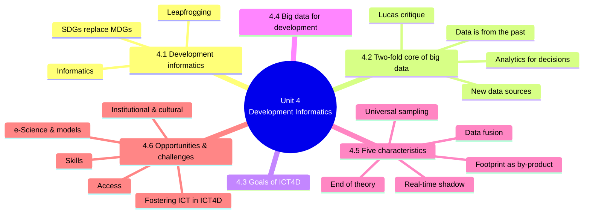
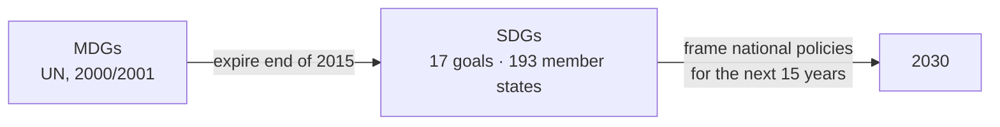
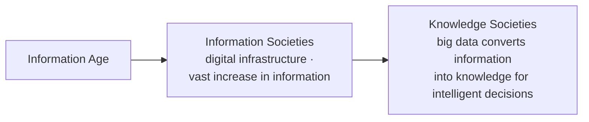
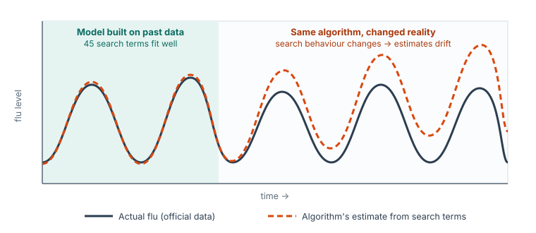
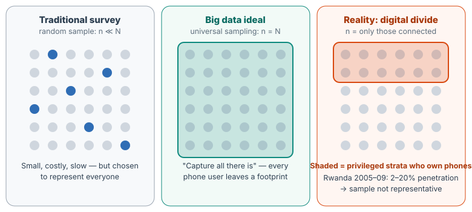
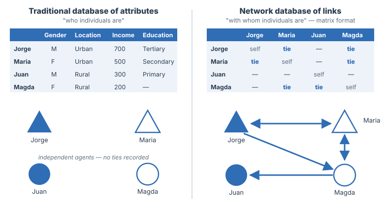
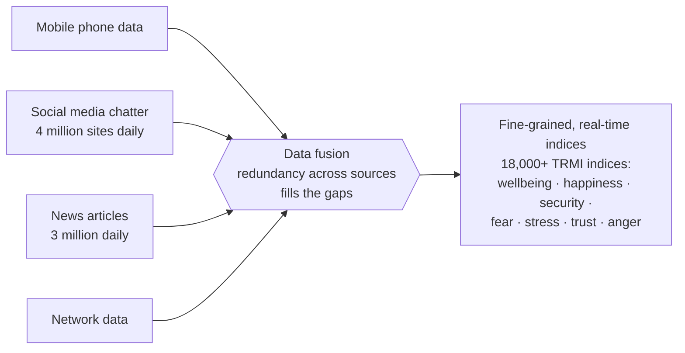
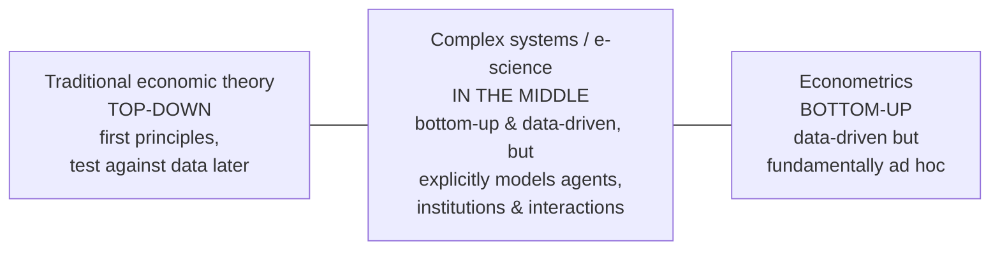
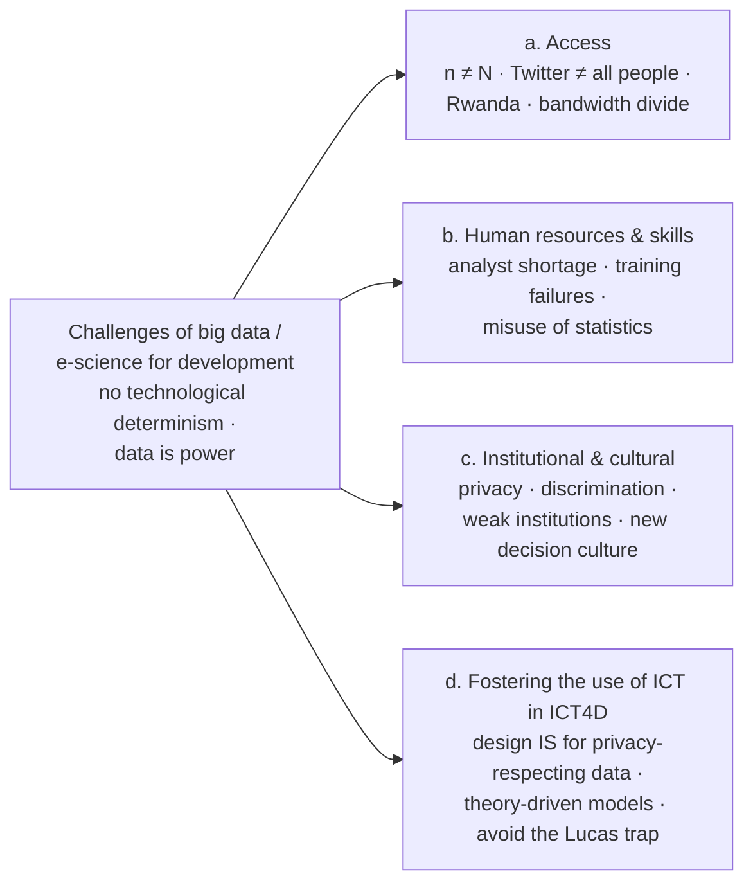

# Unit 4 — Developmental Informatics

*Courseware pages 39–54.*

## At a glance

This unit is about **big data for development**: the idea that the huge amounts of digital data people now produce (phone records, social media posts, online searches) can help measure and guide development, and the limits of that idea.

It moves through five steps:

1. **What development informatics is** (§4.1): the study of how information is processed and communicated, applied to ICT for sustainable socio-economic development and the SDGs.
2. **What big data really is** (§4.2): **new data sources** plus **analytics for decisions**. Its great **limitation** is that all data is from the past (Google Flu Trends; the Lucas critique).
3. **Why that limitation matters for ICT4D** (§4.3): development *aims to change the future*, so past data has limited use. Yet big data is praised as "the new oil" (§4.4).
4. **The five characteristics of big data** (§4.5), each with development examples: universal sampling, real-time shadow, digital footprint as by-product, data fusion, end of theory.
5. **Opportunities and challenges** (§4.6): combining big data with computer models (e-science), and four challenges: access, skills, institutions and culture, and fostering the use of ICT in ICT4D.

## Learning outcomes

At the end of the lecture, the learner should be able to:

1. Describe the term, Developmental Informatics
2. Explain the two-fold crux of Big data
3. Identify and explain the characteristics of Big Data
4. Describe the concept, "Digital footprints"
5. identify and explain 3 challenges and opportunities for development, each.

!!! warning "Courseware note"
    - Outcome 5 asks for **3 challenges and 3 opportunities**. §4.6.2 lists **four** challenges (a–d), but §4.6.1 "Opportunities" is written as an argument, not a numbered list. This page pulls **three opportunities** out of it (see the box at the end of §4.6.1). You can also use the opportunities in §4.4–4.5.
    - Self-test Q4 asks for "the two-fold core **goals**". It means the **two-fold core of big data** (§4.2), not the goals of ICT4D (§4.3).
    - The text has many typos ("nown", "broer", "Faceboo Lies", "adingley", "plan ton", "urprisingly", "Barak"). They are corrected in the quotes below: known, broker, Facebook Likes, Madingley, plankton, surprisingly, Barack.

---

## Introduction

> In the previous unit, we dwelled on Design Reality Gap vis-à-vis its definition, design reality gap, design reality gap model, overview of barriers to Big-data, reality gap dimensions, how to turn each of the gaps to propose action to overcome barriers, collecting primary data, the importance of reality gap model by e-Government Managers and interpretation of total gap scores. In this unit we will be discussing about Developmental Informatics.

Unit 3 *measured* the barriers to big data (e.g. in Colombia). Unit 4 explains **what big data is**, **what it can do for development**, and **why it has limits**.

---

## 4.1 Development informatics

> Informatics is a diverse field of study, with a focus on the transformation of information and, specifically, on how information is processed and communicated. The domain of informatics for development revolves mainly around the role of ICTs for "sustainable socio-economic development". It also analyses and reflects on the contribution of ICTs to public services and in the broader public sector.

| Term | Meaning (courseware) |
|---|---|
| **Informatics** | A diverse field of study focused on the **transformation of information**, specifically **how information is processed and communicated** |
| **Development informatics** (informatics for development) | Mainly the role of ICTs for **"sustainable socio-economic development"**. It also analyses the contribution of ICTs to **public services** and the broader **public sector** |

### Development informatics and the SDGs

> The role of development informatics will become increasingly more strategic in light of the United Nations' recently released set of Sustainable Development Goals (SDGs). These seventeen SDGs replace the UN's 2001 Millennium Development Goals (MDGs), which expire at the end of 2015. The SDGs are a reworked set of global targets, agreed upon by 193 UN member states. Each country will face specific challenges in pursuit of this sustainable development agenda and the SDGs will be used to frame each country's development policies over the next 15 years.

Key facts:

- **17** SDGs, agreed by **193** UN member states.
- They **replace** the **MDGs** (courseware: "2001"), which **expired at the end of 2015**.
- They are a **reworked set of global targets**, framing each country's development policies for the **next 15 years** (to 2030).
- Each country faces **specific challenges** in pursuing them.

> Sustainable development goals for areas like health and education will require innovative, well-researched and bold policy interventions. Much of what may be achievable will need to be framed by a research agenda that supports these policy initiatives. While there may be some dissenting voices around the SDGs, with some commentators arguing that the large number of goals will make it unwieldy and may diffuse effort, there is, however, no doubt concerning the vital role that ICTs will have to play if there is to be any meaningful attempt at achieving these goals. ICTs offer a set of enabling tools and services for development and are explicitly mentioned in the sustainable development agenda. ICTs are transformational technologies and enable the Schumpeterian view of "leapfrogging", thus allowing all countries to close many technology gaps. Closing technology and development gaps is vital if countries, especially developing countries, are to make any significant impact on their developmental targets.

Points to remember:

- SDGs in areas like **health and education** need **innovative, well-researched and bold policy interventions**, framed by a **research agenda**.
- **Criticism:** some say the **large number of goals** makes the agenda **unwieldy** and may **diffuse effort**.
- **But** there is **no doubt** about the **vital role of ICTs**. ICTs offer **enabling tools and services** and are **explicitly mentioned** in the SDG agenda.
- ICTs are **transformational** and enable the **Schumpeterian view of "leapfrogging"**, letting all countries **close technology gaps**.
- Closing **technology and development gaps** is vital for developing countries to meet their targets.

!!! info "Beyond the notes — leapfrogging and Schumpeter"
    **Leapfrogging** means skipping a stage of technology that others went through. Most of Africa went straight to **mobile phones** without first building a nationwide landline network, and to **mobile money** without a branch for every bank. **Joseph Schumpeter** was an economist who argued that new technologies drive economic change. Leapfrogging follows his view: a latecomer can adopt the newest technology directly instead of repeating old investments.

!!! warning "Courseware note"
    The MDGs came from the UN **Millennium Declaration of 2000**; the list of goals and targets was set out in **2001**. Either date may be accepted, but "2000" is more common. The SDGs were adopted in **September 2015** ("recently released" because the source paper was written in 2015).

---

## 4.2 Two-fold core of big data

> It is important to recognize that the crux of the big data paradigm is twofold.

**1. New sources of data.**

> For one, it refers to new sources of data. The digital footprint created with each digital communication and transaction can replace traditional data sources (like surveys) with proxy indicators that correlate with the variable of interest. The benefit is the low cost and real-time availability of the digital proxy indicator. The epitome is Google's illustrious use of 50 million most-common search terms as a proxy for the spread of the seasonal flu (Ginsberg, et al., 2009).

**2. Analytics to inform intelligent decisions.**

> Secondly, the notion of big data goes beyond data itself, and focuses on methods of data analytics to inform intelligent decisions. Independent from the specific giga-, tera-, peta-, or exabyte scale, the big data paradigm argues to systematically place analytic treatment of data at the forefront of intelligent decision-making.

| | Core 1: new data sources | Core 2: data analytics for decisions |
|---|---|---|
| What | The **digital footprint** of every digital communication and transaction | **Methods of analysing data** to inform intelligent decisions |
| How it works | Replaces traditional sources (e.g. **surveys**) with **proxy indicators** that **correlate** with the variable of interest | Places **analytic treatment of data at the forefront** of decision-making |
| Benefit / point | **Low cost** and **real-time** availability | It is **not about size**: independent of giga-, tera-, peta- or exabyte scale |
| Example | Google used the **50 million most common search terms** as a proxy for seasonal flu (Ginsberg et al., 2009) | Google tested **450 million models** and found **45 terms** that predicted flu (see below) |

!!! note "In plain terms"
    - A **proxy indicator** is something easy to measure that moves together with something hard to measure. People with flu search for "flu symptoms" and "fever remedy", so the number of such searches in a region rises and falls with the flu itself.
    - Core 2 says big data is not just "lots of data". A small dataset, analysed well and used for a decision, is part of the big-data paradigm. A huge dataset that nobody analyses is not.

!!! info "Beyond the notes — data sizes"
    1 gigabyte (GB) = 1,000 megabytes · 1 terabyte (TB) = 1,000 GB · 1 petabyte (PB) = 1,000 TB · 1 exabyte (EB) = 1,000 PB.

### From the Information Age to Knowledge Societies

> The process can be seen as the natural next step in the evolution from the "Information Age" and "Information Societies" to "Knowledge Societies". Building on the digital infrastructure that led to vast increases in information during recent decades, the big data paradigm focuses on converting this digital information into knowledge that informs intelligent decisions.

### The Google Flu Trends case: promise and limitation

> For example, Google processed 450 million different mathematical models in order to test for correlations between online search terms and flu outbreaks reported by official data. Eventually, 45 search terms were identified that outperformed traditional models of flu outbreak with real-time predictions. Actually, the opportunities of big data are enormous, especially for developing countries, but the same Google flu trend case also showed the ultimate limitation of (big) data analytics: the fact that all data is from the past. The application of the same Google flu trend algorithm became increasingly out of sync with actual flu epidemics over time.

| Number | What it refers to |
|---|---|
| **50 million** | Most common search terms used as a proxy for flu |
| **450 million** | Mathematical models Google processed to test correlations with official flu data |
| **45** | Search terms finally identified; they **outperformed traditional models** with **real-time** predictions |

**The limitation:** **all data is from the past**. Over time, the same algorithm became **increasingly out of sync** with actual flu epidemics.

> The reason is straightforward: reality (search behaviour) is changing over time, which provides different input and changes the results if the same algorithm is used. The best big data analytics can do is to update estimations in 'real-time': so called 'nowcasting'. Since data is always from the past, it can only detect patterns that have occurred in the past. When the past and the future follow the same stationary logic, data analytics is extremely useful to predict future patterns. However, if significant changes occur in the system's dynamic, empirical statistics are at best limited, if not deceiving.

{ .diagram }

Illustrative sketch (not real data) of why Google Flu Trends drifted: the algorithm was fixed, but search behaviour changed, so its estimates moved further from the official figures.

The reasoning step by step:

1. **Reality changes:** people's search behaviour changes over time.
2. The same algorithm gets **different input**, so its **results change**.
3. The best analytics can do is **update estimates in real time**. This is **nowcasting**: estimating the present, not forecasting the future.
4. Data can only detect **patterns that occurred in the past**.
5. If the past and future follow the **same stationary logic**, analytics predicts the future **extremely well**.
6. If the **system's dynamic changes significantly**, statistics are **at best limited, if not deceiving**.

!!! info "Beyond the notes — why search behaviour changed"
    One widely cited reason: news coverage of flu made healthy people search for flu terms too, and changes in Google's search suggestions altered what people typed. The algorithm counted these searches as sickness, so it overestimated flu.

### The Lucas critique, Goodhart's law and Campbell's law

> This argument is known as the 'Lucas critique' in economics, as 'Goodhart's law' in finance and as 'Campbell's law' in education, all dating back to 1976. Nobel Prize-winning economist Robert Lucas criticized colleagues who used sophisticated statistics to make economic predictions ('econometrics') in order to inform policy making. He argued that no useful information can emerge from such analysis because "any change in policy will systematically alter the structure of econometric models".

| Name | Field | Year |
|---|---|---|
| **Lucas critique** | Economics | 1976 |
| **Goodhart's law** | Finance | 1976 |
| **Campbell's law** | Education | 1976 |

All three make the **same argument**: models built on past data break down when the system changes, especially when **policy itself** changes it.

- **Robert Lucas** (Nobel Prize-winning economist) criticised colleagues who used **econometrics** (sophisticated statistics for economic predictions) to inform **policy**.
- His argument: **"any change in policy will systematically alter the structure of econometric models"**, so no useful information can emerge from such analysis.

!!! info "Beyond the notes — the usual statements of the three laws"
    - **Lucas critique:** people change their behaviour when policy changes, so relationships estimated under the old policy do not hold under the new one.
    - **Goodhart's law:** often paraphrased as *"when a measure becomes a target, it ceases to be a good measure."*
    - **Campbell's law:** the more a quantitative indicator is used for social decision-making, the more it will be corrupted and the more it will distort the process it is meant to monitor (e.g. "teaching to the test" when schools are judged by exam scores).

!!! example "Example"
    A state notices from mobile-money data that areas with many small top-ups are poor, and announces that cash transfers will go to "areas with many small top-ups". People soon split their top-ups into small amounts to qualify. The pattern the policy relied on is **destroyed by the policy itself**. That is the Lucas critique.

!!! tip "Exam angle"
    "Explain the two-fold core of big data" (self-test Q4) and "what is the ultimate limitation of big data?" go together. Give both cores with the Flu Trends example, then the limitation (**all data is from the past**), nowcasting, stationary vs changing systems, and the Lucas critique.

---

## 4.3 Goals of ICT for Development (ICT4D)

> This is crucial for ICT4D. Development work has the explicit goal:
>
> i. to create a future that is significantly different from the past
>
> ii. It explicitly aims at changing aspects of the modus operandi of the system
>
> Considering the diversity of development settings, the outcome is very context dependent and almost always unique. A developing Africa is not simply an extrapolated version of Europe's past development trajectory. This limits the usefulness of data from a specific case of the past.

The two goals of development work (ICT4D):

1. **To create a future significantly different from the past.**
2. **To change aspects of the modus operandi** (the way of working) **of the system.**

**Why this matters for big data:**

- Outcomes are **context dependent** and **almost always unique**, because development settings are diverse.
- **"A developing Africa is not simply an extrapolated version of Europe's past development trajectory."**
- So data from a **specific past case** has **limited usefulness**.

!!! note "In plain terms"
    Big data predicts well when **tomorrow looks like yesterday**. Development deliberately tries to make **tomorrow different from yesterday**. That is a built-in tension: the more successful an intervention is at changing a system, the less the old data can tell you about the new system. This is the Lucas critique applied to ICT4D.

---

## 4.4 Big data for development

> The value unleashed by big data to inform decision has been referred to as "the new oil" and recent literature has started to point to the important opportunities that big data opens up for development.

| Source | What it says |
|---|---|
| General literature | Big data is **"the new oil"** |
| **OECD** | Big data "now represents a **core economic asset** that can create **significant competitive advantage**" |
| **United Nations** | "new technologies are… creating **unprecedented possibilities** for informing and transforming society and protecting the environment… **faster and more detailed** than ever before" |
| **UN Economic and Social Council** (report to the UN Secretary-General) | "big data have the potential to produce **more relevant and more timely statistics** than traditional sources of official statistics, such as **survey and administrative data** sources" |

!!! info "Beyond the notes — why "the new oil"?"
    Like crude oil, raw data is valuable only after it is **refined** (cleaned and analysed). Whoever controls it gains economic power, which links to "data is power" in §4.6.2.

---

## 4.5 Characteristics of big data

> The big data paradigm can be characterized by some five general features

| # | Characteristic | Courseware description | Section |
|---|---|---|---|
| 1 | **Universal sampling** | Replaces random sampling with the ambition to **capture all there is** (sampling **n = universe N**) | 4.5.1 |
| 2 | **Real-time** | **Often accessible in real-time** | 4.5.2 |
| 3 | **Digital footprint as by-product** | **Produced anyways** as a **low-cost** and almost **inevitable** digital footprint | 4.5.3 |
| 4 | **Data fusion** | **Messy and incomplete**, which can be compensated by **data redundancy from different sources** ("data fusion") | 4.5.4 |
| 5 | **End of theory** | Uses **exploratory data mining and machine learning**, which **replace the need for theory with plain pattern detection**, giving a **theory-free and automated** way to inform decisions | 4.5.5 |

> We will review concepts and applied examples of each of these five characteristics from the field of development

!!! tip "Exam angle"
    Memory aid: **U-R-B-F-E**, "**U**niversal **R**eal **B**y-product **F**usion **E**nd". For each characteristic, learn **one development example**: Kenya malaria (U), Haiti cholera tweets (R), Obama campaign or SNA (B), TRMI vs HDI (F), Google Translate or Facebook Likes (E).

### 4.5.1 Universal sampling

**Mobile phones as the main source:**

- One of the **biggest potentials** for big data in developing countries is **mobile phone data**.
- **Global penetration over 95%**, and around **75% access** among those making **US$1 per day or less**. Mobile phones have become an important source of social data in developing countries.
- Their **pervasiveness** gives access to features of **society as a whole**, **without** setting up **sophisticated sampling mechanisms**.

**Two-way relationship between behaviour and phones:**

- Patterns in human behaviour are used to influence mobile phone development.
- Mobile phone records can be used to **infer demographic, socio-economic and other behavioural traits** from continuously registered digital conduct.
- So mobile usage patterns are used to **identify and eventually influence human behaviour**.

**Use 1: complementing traditional surveys (e.g. poverty):**

- This can **complement traditional statistical surveys**. For example, **poverty measurement** is one of the most **politically relevant statistics** in the developing world.
- Using call records from **many base stations**, the **prediction of socio-economic level** in a region has been **automated**. Accuracy depends on the kind of variable.
- In general, accuracy is about **80–85%** using call data records such as **call duration or frequency**.

**Use 2: new insights:**

| Place | What mobile phone records revealed |
|---|---|
| **Rural Kenya** | Unprecedentedly detailed **travel and migration patterns** in low-income settings, to understand the spread of **malaria** and infectious diseases |
| **Haiti** | **Population movements** after the **earthquake** and **cholera outbreak** |
| **Mexico** | **Social responses to urban earthquakes** |
| **Rwanda** | **Charity and reciprocal aid** among peers after a **natural disaster** |

**Commercial use:** telecom companies already **sell mobility profiles** from mobile phones to **business clients**, who use them for **real-time insight into consumer behaviour**.

{ .diagram }

Universal sampling. Big data aims for n = N, but where phone ownership is low and unequal the "sample" is only the connected. The right panel anticipates the access challenge in §4.6.2(a).

!!! note "In plain terms"
    A survey asks, say, 5,000 carefully chosen households and assumes they represent the country. Universal sampling says: **why sample when nearly everyone carries a phone that records data anyway?** Use everyone's records (n = N). The catch, covered in §4.6.2, is that "everyone with a phone" is not "everyone".

!!! warning "Courseware note"
    The bullet "patterns in human behaviour are used to influence mobile phone development" seems garbled; the next bullets are about phone data being used to infer and influence *human behaviour*. Learn the clear point: **mobile phone usage patterns are used to identify and eventually influence human behaviour.**

### 4.5.2 Real-time shadow

**Mobile phones again:** they are close to universal **and** provide **real-time** information.

| Example | Details |
|---|---|
| **Estonia: border statistics** | A **global leader** in using **mobile phone location data** to complement, and partly substitute, **international travel statistics**. The **Bank of Estonia** says real-time phone traces give a "**reliable overview of persons crossing the Estonian border** to travel abroad or to Estonia", and that "**the biggest advantage of the method is its speed**", using information already stored by mobile operators |
| **Rainfall from phone towers** | The **attenuation (weakening) of radio signals when rain falls between cellular towers** has been used to **measure rainfall**. This gives timely, large-scale data to **farmers, water resource managers and climate researchers** where **rain-gauge networks are underdeveloped** |
| **Social media chatter (Figure 1)** | **184.5 million Twitter mentions** show what **U.S. society talked about in 2014** |
| **Facebook users, 2013** | Top countries included **India, Brazil, Indonesia and Mexico** |
| **Twitter per capita, 2011** | **Kuwait and Brunei** had more Twitter users per capita than the **UK or U.S.**; **Chile** more than **Canada**; **Brazil** more than **France or Germany** |
| **Geolocated tweets** | Automatic identification of **land uses** |
| **Language of tweets** | Identifying **foreign languages and cultural identities**, **international migration and tourism mobility**, e.g. in **Malaysia, the Philippines, Venezuela and Indonesia** |
| **Haiti cholera, 2010** | The **140-character** tweets contained information about the outbreak's spread **up to two weeks earlier than official statistics** |

**Figure 1** (p.43) is titled *"184.5 million Twitter mentions in the United States during 2014 as weekly share of news conversation by story, from Echelon Insights (2014)."* It is a stacked area chart running January to December. Each coloured band is a news story, and labelled peaks mark big events: State of the Union, Russia invades Crimea, Sterling/Clippers controversy, Hobby Lobby decision, MH17, Ferguson shooting, Ray Rice/NFL controversy, Ebola in the US, Election Day, Ferguson grand jury (the tallest peak) and Sony/Cuba.

> The ups and downs shown in Figure 1 illustrate that online chatter provides a real-time digital shadow of national interest, outcry, attention, and general sentiment

- This real-time source is **especially important in developing countries**, given their **acceptance** of social media and the **wide array of content** they provide.
- **Social chatter becomes a real-time and actionable source of information** for decisions in many contexts.

!!! note "In plain terms"
    A **"shadow"** follows you everywhere without effort. Society's digital activity casts a **real-time shadow** of what people are doing, feeling and talking about, available **now** rather than months later when a survey report is published.

!!! warning "Courseware note"
    "The top **five** leading countries in terms of Facebook users in 2013 included India, Brazil, Indonesia and Mexico" names only **four**. The fifth, at the top of the list in the source, was the **United States**. The point to learn is that **four of the top five were developing or emerging countries**.

### 4.5.3 Digital footprint as by-product

- Producing digital footprints is **almost inevitable** and gives **readily available** information sources.
- Many earlier examples show footprints are produced **as a by-product, without any explicit intention**.

The courseware shows an infographic, **"Digital footprints: what do yours say?"**: a large footprint with arrows leading to app and social-media icons. Its advice: **be careful about** what you share, where you share and with whom you share; **be smart about** sites you visit, emails you open and links you click.

!!! info "Beyond the notes — what is a digital footprint?"
    A **digital footprint** is the trail of data a person leaves through digital activity: calls, texts, searches, posts, likes, card payments, location pings, app use. Some is **active** (a post you choose to make); much is **passive** (location logs, metadata). For big data, the key feature is that it is produced **anyway**, at **no extra cost**, as a **by-product** of daily life.

#### The "neglected other half": social ties

- The digital footprint sheds light on **previously under-investigated aspects of the social fabric**, especially the **importance of social ties**.
- Social links have **always existed**: "they are the thread that holds the social fabric together". Human civilisation has always been **one giant network**, and network structures and their dynamics turn individuals into "society".
- **But before the digital footprint, most ties were invisible.** Recording ties takes much more effort than recording individual attributes, because **ties grow exponentially with the number of people**.
- So **traditional statistics** focused on **attributes of independent agents** (income, demographics, location, gadgets owned).
- **Social network analysis (SNA)** also collects and analyses the **ties between actors**. This needs extra databases describing relations in **matrix format**, and is **complementary** to traditional methods.
- The **digital footprint records these ties anyway**, with every digital contact.
- This fills in the **"neglected other half"** of social analysis: society is based not only on **"who individuals are"** but as much on **"with whom individuals are"**, and **the second is often a much more powerful predictor of behaviour**.

{ .diagram }

Redrawn from the courseware's figure on p.46: traditional database of attributes vs network database of links. Triangles = urban, circles = rural; filled = male, outlined = female. The same four people look like isolated individuals on the left but form a network on the right, where Juan is reached only through Magda.

!!! info "Beyond the notes — why ties "grow exponentially""
    With *n* people there are up to *n*(*n*−1)/2 possible ties: 4 people → 6 ties, 100 people → 4,950, 1 million people → about 500 billion. Collecting this by survey is impossible. Phone call logs record it automatically. (Strictly this growth is quadratic, but the point is that it grows much faster than the number of people.)

#### Social network analysis concepts

> Concepts like 'agent of change', 'intermediary', 'gate keeper', 'broker', 'polarization', 'exclusion', 'marginalization', 'fragmentation', 'discrimination', 'social stability', 'social capital', and 'sphere of influence' are mathematically precisely definable concepts in social network analysis and help to formalize the discussion about development

All **twelve** concepts can be **defined mathematically** in SNA, which **formalises** development discussions.

??? info "Beyond the notes — what each SNA concept means (click to expand)"
    | Concept | Meaning in network terms |
    |---|---|
    | Agent of change | A well-connected person who spreads new ideas or practices |
    | Intermediary | A person through whom others are connected |
    | Gatekeeper | A person who controls the flow of information into or out of a group |
    | Broker | A person who links otherwise unconnected groups (and can gain from that position) |
    | Polarization | The network splitting into two opposed, internally dense camps |
    | Exclusion | People or groups with no ties to the main network |
    | Marginalization | People at the edge of the network, with few or weak ties |
    | Fragmentation | The network breaking into disconnected pieces |
    | Discrimination | Ties systematically avoiding certain groups |
    | Social stability | How durable the network's structure is over time |
    | Social capital | The resources (help, information, trust) a person can reach through their ties |
    | Sphere of influence | The part of the network a person can affect |

    In the figure above, **Magda** is a **gatekeeper/broker** for **Juan**, who is **marginalised**: his only tie is to Magda.

#### What network ties show and how they have been used

- Network ties are important **indicators of economic development** at **micro and macro** levels. There is a **strong relation between economic development and the diversity** of individuals' relationships and of an economy's **production networks**.
- Network approaches have **proven useful in ICT4D**:
    1. design of **media campaigns for reproductive health**;
    2. the dynamic of the **diffusion of innovations** such as ICT;
    3. **accelerated diffusion** through **targeting opinion leaders**, including the diffusion of **microfinance**;
    4. **inter-organisational cooperation and knowledge-sharing** in the ICT4D community;
    5. the role of **telecentres and cybercafés** in creating **social capital** in developing countries.

**From available to actionable:** the digital footprint makes SNA not only **available** but **actionable**. The **2012 U.S. presidential re-election campaign of Barack Obama** targeted the digital footprint of social connections, spending about **US$1 billion** with a team of **40 big data engineers** (from **Twitter, Google, Facebook, Craigslist**, a **stem cell biophysicist** and a **professional poker player**).

!!! tip "Exam angle"
    "Describe the concept 'digital footprints'" (learning outcome 4). Cover: (1) the trail produced with every digital communication and transaction; (2) a **by-product**, without explicit intention, **almost inevitable** and **low cost**; (3) it replaces surveys with **proxy indicators**; (4) it reveals **social ties**, the "neglected other half" ("with whom" vs "who"), enabling SNA; (5) it is **actionable** (Obama 2012). Add one risk: **privacy** (§4.6.2c).

### 4.5.4 Data fusion

Mobile, social media and network data (and others) can be **combined** to fine-tune development indicators.

**The problem with current measures:**

- Current methods of measuring development are **quite coarse-grained**. The main example is the most important development barometer, the **UN Human Development Index (HDI)**.
- The HDI is a better reflection of development than any single variable, but it feeds off only **four generic indicators**:
    1. **life expectancy**;
    2. **adult literacy**;
    3. **school enrolment ratio**;
    4. **gross domestic product (GDP) per capita**.
- It has been **increasingly criticised**. Alternatives include **"happiness" indices**, which rely on **costly subject surveys**.

**What big data offers:**

- A large variety of sources to **complement and even substitute** these indices.
- Sources: **social network chatter** (Figure 1) and **news items**.
- The **Thomson Reuters MarketPsych Indices (TRMI)** combine both. They distil, **daily**, over **4 million social media sites** and **3 million news articles** through an extensively curated **language framework**.
- They measure **emotions** (optimism, confusion, urgency), **opinions** (price forecasts) and **topics** (special events).
- **Result:** a **fine-grained, real-time** assessment of **local, national or regional sentiment** in development-relevant indices. These are grouped into **coarse-grained** groups (**wellbeing, happiness, security**) and **fine-grained** notions (**fear, stress, urgency, optimism, trust, anger**).
- **More than 18,000 indices** give a much finer assessment of a society's wellbeing than the HDI or happiness indices, and **combine their advantages** through data fusion.
- So the digital footprint can give evidence about **socio-economic status** *and* the **emotional state** of individuals and groups.

**Why fusion is needed:**

- Diverse footprints produce a dataset that is **messy and incomplete**. Often **not one single row is complete** (not everybody provides social media feeds).
- **Explicit data redundancy** among sources lets them **make up for each other**.
- So **data fusion is the remedy for the chronic incompleteness and messiness** of big data.

Data fusion: each source is messy and incomplete, but together they compensate. Compare the HDI's four coarse indicators.

| | HDI | Happiness indices | Big-data fusion (TRMI) |
|---|---|---|---|
| Inputs | 4 generic indicators | Subject surveys | 4 million social media sites + 3 million news articles daily |
| Granularity | Coarse | — | Fine (18,000+ indices) |
| Cost | Not stated | **Costly** | Not stated |
| Timeliness | Not stated | Not stated | **Real-time, daily** |

"Not stated" means the courseware does not say.

!!! warning "Courseware note"
    The sentence "the current **Manchester Centre for Development Informatics** methods on measuring development are quite coarse-grained" is garbled: the Manchester Centre published the source paper (Working Paper 60), and its name has leaked into the sentence. The intended meaning: **current methods of measuring development are coarse-grained**, as shown by the **HDI**.

### 4.5.5 End of theory

- Most big data predictions come from **data mining and machine learning**, informed **not by theory** but by **pattern detection**.

**Example 1: Google Translate.**

- The most common example is Google's translation service, built **without a single linguist**.
- Users can translate among **100 languages**. Machine learning found patterns in documents **previously translated by humans** (**UN and EU transcripts** and other legal documents).
- Machines learned **patterns senseless to humans**, but translated better than earlier machines trained on **theory-laden** methods (grammar and semiotics), and **better than many humans**.
- It is the **amount of data** that makes such a-theoretical predictions work so well.

**Example 2: Facebook Likes.**

- Socially relevant data lets algorithms become **superior to many human judges**. Facebook Likes can automatically and accurately predict: **sexual orientation, ethnicity, religious and political views, personality traits, intelligence, happiness, use of addictive substances, parental separation, age and gender**.
- In a test, subjects took a **standard personality test**, and algorithms estimated their personality from Facebook Likes:

| Judge of personality | Accuracy (correlation r) |
|---|---|
| **Computer, from Facebook Likes** | **r = 0.56** |
| Participants' **Facebook friends** | r = 0.49 |

- Computer judgments also had **higher external validity** in predicting **life outcomes** (substance use, political attitudes, physical health), and for some outcomes **out-performed self-rated personality scores**.
- In other words, algorithms fed only with Likes judge personality and life outcomes **better than our friends, and even ourselves**.

!!! info "Beyond the notes — what r means"
    **r** is the correlation coefficient: 0 = no relationship, 1 = perfect agreement. Here it measures how closely each judge's rating matched the person's own personality-test score. 0.56 vs 0.49 means the computer agreed more closely than friends did.

!!! warning "Courseware note"
    The courseware says "such a **theoretical** machine-learning predictions". The meaning is **a-theoretical** (without theory), as the heading "End of theory" shows.

!!! note "In plain terms — and the catch"
    "End of theory" means: **don't explain, just detect patterns**. It works when there is a lot of data and the world stays the same. But §4.2 already showed the catch: patterns from the past fail when the system changes (Flu Trends, Lucas critique). That is why §4.6 and §4.6.2(d) call for **theory-driven models** alongside big data.

---

## 4.6 Opportunities and challenges for development

> The full potential of e-science becomes clear when combining both the empirical big data and the Agent-Based Model (ABM) modeling approach. The challenges become clear when remembering that these innovations are subject to the well-known innovation processes of Schumpeterian creative destruction, including its diffusion and learning curves

- **Opportunity in one line:** **e-science** = **empirical big data + agent-based models (ABM)**.
- **Challenge in one line:** these innovations go through **Schumpeterian creative destruction**, with its **diffusion and learning curves**.

!!! info "Beyond the notes — ABM, e-science, creative destruction"
    - **Agent-based model (ABM):** a computer simulation of many individual "agents" (people, firms, households), each following simple behaviour rules, to see what happens to the whole system, e.g. how traffic changes if a new rail line opens.
    - **e-Science:** science done with large-scale data and computing.
    - **Creative destruction (Schumpeter):** new technologies and ways of working replace old ones, which is disruptive. They spread gradually (**diffusion curve**), and people need time to learn them (**learning curve**).

### 4.6.1 Opportunities

**The problem big data alone cannot solve:**

- **Data from the past has limited value after an intervention** designed to **systematically alter the modus operandi** of the targeted system.
- This depends on the **kind of statistical analysis**:
    - some tests are **broad**, predicting a large, general group of cases (**"out-of-group" samples**);
    - others are **fitted to explain particular cases**.
- The difference is between finding patterns in a **larger, general class of cases** and explaining the **particular circumstances** of a specific case.
- Even broad tests **reach their limit** when the **structure of the system is altered** and **no data exists** for the changed system.

**The e-science solution:**

- The final goal of e-science is to **combine big data approaches with computer-facilitated modelling**.
- "A good complex systems model **both begins and ends with data**: **low level data** is used to formulate the **assumptions about the building blocks** of the model, and both **high and low level data** is also used to **test** whether the resulting …" (quote cut off in the courseware).

!!! warning "Courseware note"
    The quote "A good complex systems model both begins and ends with data…" is **cut off** in the courseware after "whether the resulting". The sense is that data is used to test whether the resulting model behaves like the real system.

**Natural vs social sciences: getting the data:**

- Natural-science simulations painstakingly collect data with **sensors and cameras**, e.g. the ambitious **Madingley model** of the world's ecosystem, which aims to simulate **"all life on earth"**.
- **Ecologists** report that "**the biggest stumbling block… is obtaining the data** to parameterize and validate" the model.
- **Social scientists** do **not** need "motion-activated cameras… [or] continuous **plankton recorders** towed beneath ships".
- **Humans produce relevant data as a by-product of their digital life.** This allows a "more realistic representation of human behavior which includes the **behavioral changes** that might take place".

**Example: the Portland simulation:**

| Feature | Detail |
|---|---|
| City | **Portland**, USA (virtual simulation) |
| Residents modelled | **1.6 million**, with **real socio-demographic profiles** |
| Locations | Daily activities in **180,000 specific locations** |
| Data sources | Traditional **census data** + **digitally recorded (big data) records** + **personal activity logs** |
| Use | Testing the installation of a **new light-rail system**: how would traffic and individual behaviour change for different routes? |
| Result | **Surprising insights** into complex social dynamics |

Extensive infrastructure projects like these are **also common in ICT4D**.

**Where e-science sits (Farmer):**

> "is intermediate between traditional economic theory and econometrics. Traditional economic theory is top-down, modeling decision making from first principles, and then testing against data later… Econometrics, in contrast, takes a bottom up, data-driven, but fundamentally ad hoc approach. The complex systems approach sits in the middle, taking a bottom up data-driven approach that differs from traditional econometrics by explicitly representing agents and institutions and modelling their interactions, without the requirement that everything be derived from fundamental principles" (Farmer)

Farmer's spectrum: e-science combines the data of econometrics with the structure of theory.

!!! tip "Exam angle — three opportunities (learning outcome 5)"
    The courseware does not number the opportunities. Three you can extract and defend:

    1. **Combining big data with computer models (e-science/ABM)** lets planners test interventions that would *change* the system, overcoming the "all data is from the past" limit. A model "begins and ends with data".
    2. **Cheap, abundant behavioural data:** unlike ecologists, social scientists get data as a **by-product** of digital life, so models can represent **behavioural change** realistically.
    3. **Simulating large infrastructure projects before building them** (Portland: 1.6 million residents, 180,000 locations, light-rail routes). Such projects are common in ICT4D.

    Opportunities from §4.4–4.5 are also acceptable: **cheaper and more timely statistics** (UN ECOSOC), **poverty prediction** (80–85%), **disease tracking** (Kenya, Haiti), **rainfall measurement** for farmers, **finer development indices** (TRMI).

### 4.6.2 Challenges

> The transition to e-science does not happen in a vacuum, but within the structural, institutional, economic, and social reality of existing societies

- This **affects the potential benefits**.
- **The rejection of technological determinism** means a new technology is **never inherently and automatically good**.

**Bangalore land records case:**

| Item | Detail |
|---|---|
| What | Digitisation of **20 million land records** in **Bangalore** (India) |
| Intended beneficiaries | **7 million small farmers** in **over 27,000 villages** |
| What happened | **Contrary to expectations**, the usual **large players** were better placed to exploit the data |
| Result | **Perpetuation of existing inequalities** |

- **"Even well-intended practices can turn out the wrong way."**
- **"Data is power, and power benefits from data."**
- Most limitations of e-science for development are **similar to the challenges of traditional ICT4D projects**: **infrastructure, human resources and institutional frameworks**.

!!! info "Beyond the notes — technological determinism"
    **Technological determinism** is the belief that technology by itself causes social change, so introducing a technology automatically produces its intended benefits. ICT4D **rejects** this: results depend on who has the power, skills and resources to use the technology. In Bangalore, the people with lawyers, money and connections used the digitised records. Unit 7 ("Do artifacts have politics?") develops this idea.

#### a. Access challenges

- The **lack of infrastructure access and usage** limits the availability of any digital footprint. "**Twitter does not represent 'all people'**, and it is an error to assume 'people' and 'Twitter users' are synonymous."
- **Sample representativeness** is closely linked to **digital inequality**: the question is **how close the big data sample n gets to the universe N**.

| Case | Mobile penetration | Finding |
|---|---|---|
| **Rwanda, 2005–2009** | **2%–20%** | "Phones are **disproportionately owned and used by the privileged strata** of Rwandan society", so the sample is **not representative** |
| **An emerging Latin American economy** | **~60–80%** | The big data sample **matched the social stratification of census data impressively well** |

- **Even once everyone has a phone**, the **bandwidth divide** means big data will always be better from **some parts of society than others**.
- Telecom access has **diversified**: in the **late 1980s** most subscriptions were **fixed-line** with **the same performance**. Twenty years later there are **myriad subscriptions** with very different performance.
- **"Far from being closed, the digital divide incessantly evolves"** through ever-changing bandwidth capacities, so digital footprints have **varying depth** across devices and countries.

!!! note "In plain terms"
    Big data from phones describes **phone users**, and from smartphones with fast data it describes **smartphone users** even better. If the poor are missing or under-represented, a "poverty map" built from that data can make the poor **invisible**, which is the opposite of what development needs.

#### b. Human resource and skills challenges

- **Hal Varian**, chief economist at Google: "**the sexy job in the next years will be statisticians… And I'm not kidding**." The same applies to **programmers and computer scientists**.
- Case studies show **inadequate training for data specialists and managers** is **one of the main reasons for failure** of big data projects in development.

**Predicted U.S. shortage:**

| Role | Shortage | Total demand | Share short (calculated) |
|---|---|---|---|
| Professionals with **deep analytical skills** | **160,000** | 450,000 | ≈ 36% |
| **Data managers** able to decide from analytic findings | **1.5 million** | 4 million | ≈ 38% |

The last column is calculated here to show the scale; the courseware gives only the first three columns.

**Figure 6** (p.52): *"2011 graduates with deep analytical training: total (horizontal x-axis), per 100 people (vertical y-axis); software and service employees as % of total employment (size of bubbles); based on Manyika et al. (2011); ITU (2014); UNCTAD (2012)."* It is a bubble chart:

- **High per 100 people (top of chart):** Romania and Poland highest, then the UK, Bulgaria and France.
- **High total but low per person (right of chart):** the United States furthest right; China, India and Russia also far right.
- **Low on both:** Germany, Japan, Spain, Italy, Brazil, Czech Republic near the bottom left.

What the text draws from it:

- **Former Soviet bloc** countries (e.g. **Romania, Poland, Bulgaria**) produce **many analysts**.
- The **BRIC** countries (**Brazil, Russia, India, China**) produce **40% of the world's professionals with deep analytical skills**, **twice as many as the United States**.
- BRICs are expected to have **large future demand**, because their share of software and service employees in total employment is still **relatively low** (small bubbles).
- **Germany and Japan** are **comparatively ill-prepared** to meet their demand from national training.

**Quality, not only quantity:**

| Study | Finding |
|---|---|
| **Kalampokis et al. (2013)**: inventory of big data social media studies | **More than one third** of studies claiming the **predictive power** of social media **did not run any explicit predictive analytics**, only explanatory statistics such as **R²** |
| **Shmueli and Koppius (2011)**: traditional information systems research | Only **13%** of studies claiming predictive power used **actual predictive analytics** |

- The big data ratio is **better** than in traditional studies, but it still shows **systematic misuse of statistical techniques** in the social sciences.
- **Remedies:** ensure **young ICT4D researchers** have **data analytics skills**; **established researchers update** their skills; **collaborate** with data-savvy researchers from other fields.

!!! info "Beyond the notes — explanatory vs predictive"
    **Explanatory** statistics (e.g. R², how well a line fits the data you already have) show association **within** the data. **Predictive** analytics tests a model on **new, unseen data** (e.g. train on 2020–2022, test on 2023). Claiming "predictive power" from R² alone is the misuse the courseware criticises.

!!! warning "Courseware note"
    The phrase "BRIC countries **Manchester Centre for Development Informatics Working Paper 60 21** (Brazil, Russia…)" contains a **page footer** from the source paper pasted into the text. Ignore it.

#### c. Institutional and cultural challenges

- **Privacy concerns, social discrimination and related abuses** are among the **biggest threats**.
- A **2014 White House report** on big data (Office of President Obama) warned of "**vexing issues** (big data technologies can cause **societal harms beyond damages to privacy**, such as **discrimination against individuals and groups**)", while stressing the "**tremendous opportunities** … to improve public services, grow the economy, and improve the health and safety of our communities".
- Building institutions that **minimise risks and maximise benefits** is **especially delicate in developing countries**, where **institutional frameworks are notoriously weak** but the **catch-up potential is extraordinarily high**.
- The challenge is **not merely institutional, it is cultural**. It is "not just a question of providing information-, decision-, and action-related skills and other resources for individuals. It will typically require":
    1. **new, more evidence-based decision-making processes**;
    2. **new, more agile decision-making structures**;
    3. **new institutional values and incentives** that orient towards these new decision-making modes.
- For ICT4D students it is not news that **technological change requires socio-cultural evolution**. This time it is the socio-cultural evolution of ICT4D's **own core business: the application of ICT4D**.

!!! example "Example"
    A big-data credit-scoring app in Nigeria uses phone contacts and location to decide loans. It speeds up lending (opportunity) but can expose borrowers' private data and **discriminate** against people from certain areas or networks (threat). The NDPR (2019) and the **Nigeria Data Protection Act 2023** are examples of the institutions the courseware says are needed.

#### d. Fostering the use of ICT in ICT4D

- **Goal:** use these possibilities for **concrete development projects and policy interventions that benefit the general public**.
- This needs **social scientists** *and* the **adequate design of information systems** that build these approaches **into their design**. For example, information systems could **automatically produce privacy-respecting big data** that **feeds computer simulations**, so **policy interventions can be adjusted on the go**.
- **Strength of the ICT4D community:** it is convinced of the power of ICT and has a **critical mass of programming and IS design skills**. **One in three ICT4D papers come from computer science and engineering** (Hanafizadeh et al., 2013).
- **ICT4D projects inevitably involve ICT, which produces big data footprints.**
- **Ongoing challenge:** greatly increase the effort to create **theory-driven models** usable in an **ever-changing reality**. There are many more examples and applications in **big data** than in **computer simulations**.
- **Warning:** without more theory-driven models, "**we run the risk of falling into the same traps that Lucas' colleagues did in the 1970s**", some four decades before the big data revolution.

!!! note "In plain terms"
    "ICT in ICT4D" (the source paper calls it **ICT4ICT4D**) means: ICT4D projects should **use their own data**. Every e-health, e-government or mobile-money project creates data. If its information system is designed to produce **privacy-respecting** data that feeds **simulations**, policy can be adjusted as the project runs. But this needs **theory-driven models**, not just pattern detection, or it will fall into the **Lucas trap**: predicting a changing system from its past.

!!! tip "Exam angle"
    "Identify and explain 3 challenges of ICT for development" (self-test Q1). Pick three of a–d. For each: **name it**, give **two or three courseware points**, and **one piece of evidence** (Rwanda 2–20%; 160,000 analysts / 13%; White House 2014 report; Lucas trap). Open with technological determinism and Bangalore to show you understand why challenges arise.

---

## Key terms

Informatics
:   A diverse field of study focused on the transformation of information, specifically how it is processed and communicated.

Development informatics
:   The study of the role of ICTs for sustainable socio-economic development, including their contribution to public services and the public sector.

SDGs / MDGs
:   17 Sustainable Development Goals agreed by 193 UN member states, replacing the Millennium Development Goals, which expired at the end of 2015.

Leapfrogging
:   (Schumpeterian) using transformational ICTs to skip stages of development and close technology gaps.

Big data (two-fold core)
:   (1) New data sources: digital footprints used as low-cost, real-time proxy indicators; (2) data analytics placed at the forefront of intelligent decision-making, whatever the scale.

Proxy indicator
:   An easily measured variable that correlates with the variable of interest (e.g. flu-related searches for flu levels).

Nowcasting
:   Updating estimates of the present in real time, the best that data analytics can do because all data is from the past.

Lucas critique / Goodhart's law / Campbell's law
:   The same 1976 argument in economics, finance and education: any change in policy systematically alters the structure of models built on past data.

Universal sampling (n = N)
:   Capturing all there is instead of a random sample.

Real-time shadow
:   Digital activity (e.g. social media chatter) giving an immediate picture of interest, outcry, attention and sentiment.

Digital footprint
:   The data trail produced, almost inevitably and as a by-product, by every digital communication and transaction.

Social network analysis (SNA)
:   Collecting and analysing ties between actors (in matrix format), complementing traditional attribute statistics: "with whom individuals are" as well as "who individuals are".

Data fusion
:   Combining redundant data from different sources to make up for the messiness and incompleteness of big data.

HDI
:   Human Development Index: a coarse barometer built on life expectancy, adult literacy, school enrolment ratio and GDP per capita.

TRMI
:   Thomson Reuters MarketPsych Indices: 18,000+ indices distilled daily from over 4 million social media sites and 3 million news articles.

End of theory
:   Replacing theory with plain pattern detection by data mining and machine learning.

e-Science
:   Combining empirical big data with computer modelling, especially agent-based models.

Agent-based model (ABM)
:   A simulation of many individual agents and their interactions. *(Definition beyond the notes.)*

Technological determinism
:   The belief that technology is automatically and inherently good or transformative. Rejected in ICT4D.

Bandwidth divide
:   The continuing gap in connection quality that persists even when everyone has access.

---

## Unit summary

- **Informatics** focuses on the transformation of information: how it is processed and communicated. **Development informatics** is about ICTs for **sustainable socio-economic development** and public services. It is strategic for the **17 SDGs** (193 states, replacing the MDGs that expired in 2015, 15-year horizon). ICTs are explicitly in the agenda and enable **Schumpeterian leapfrogging**.
- **Two-fold core of big data:** (1) **new data sources**: digital footprints as low-cost, real-time **proxy indicators** (Google: 50 million search terms for flu); (2) **analytics for intelligent decisions**, whatever the scale. Big data is the step from Information Societies to **Knowledge Societies** (Google tested 450 million models and found 45 terms).
- **Ultimate limitation:** **all data is from the past.** Flu Trends drifted as search behaviour changed. The best analytics can do is **nowcasting**. This works for **stationary** systems but is limited or deceiving when systems change: the **Lucas critique** / **Goodhart's law** / **Campbell's law** (1976).
- **Goals of ICT4D:** create a future **significantly different from the past**, and **change the modus operandi** of the system. Outcomes are **context dependent**: Africa is not an extrapolation of Europe.
- **Big data for development:** "the new oil"; a core economic asset (**OECD**); unprecedented possibilities (**UN**); more relevant, timely statistics (**UN ECOSOC**).
- **Five characteristics:**
    - **universal sampling**: n = N via mobile phones (95% penetration); 80–85% poverty prediction; Kenya, Haiti, Mexico, Rwanda;
    - **real-time shadow**: Estonia borders, rain from tower signals, 184.5 million tweets, Haiti cholera two weeks early;
    - **digital footprint as by-product**: social ties, SNA, the 12 concepts, Obama 2012 (US$1 billion, 40 engineers);
    - **data fusion**: HDI's four indicators vs TRMI's 18,000+ indices; fusion remedies messiness;
    - **end of theory**: Google Translate in 100 languages; Facebook Likes r = 0.56 vs friends 0.49.
- **Opportunities:** **e-science** combines big data with **agent-based models**. A good model begins and ends with data (Madingley; Portland: 1.6 million residents, 180,000 locations, light rail). It sits between top-down theory and ad hoc econometrics (Farmer).
- **Challenges:** no technological determinism (**Bangalore**: 20 million records, 7 million farmers, 27,000 villages, inequality perpetuated; "data is power").
    - **(a) Access**: n vs N, Rwanda 2–20%, Latin America 60–80%, the evolving bandwidth divide.
    - **(b) Skills**: Varian; US shortage of 160,000 of 450,000 analysts and 1.5 million of 4 million managers; BRIC 40%; Kalampokis (>⅓) and Shmueli & Koppius (13%).
    - **(c) Institutional and cultural**: privacy, discrimination, the 2014 White House report, weak institutions, new evidence-based processes, agile structures, values and incentives.
    - **(d) Fostering ICT in ICT4D**: privacy-respecting IS that feed simulations; 1 in 3 ICT4D papers from CS and engineering; theory-driven models to avoid the Lucas trap.

---

## Quick-check questions

According to the courseware, informatics focuses on…

<ul class="quiz-options">
  <li>the manufacture of computer hardware</li>
  <li data-correct>the transformation of information, specifically how information is processed and communicated</li>
  <li>the measurement of poverty only</li>
  <li>telecommunication networks</li>
</ul>

§4.1. Development informatics then applies this to the role of ICTs for "sustainable socio-economic development".

How many SDGs are there, and how many UN member states agreed them?

<ul class="quiz-options">
  <li>8 goals, 189 states</li>
  <li data-correct>17 goals, 193 states</li>
  <li>17 goals, 189 states</li>
  <li>15 goals, 193 states</li>
</ul>

§4.1: "These seventeen SDGs replace the UN's … MDGs … agreed upon by 193 UN member states." 15 is the number of **years** they frame policy for.

Which pair correctly states the two-fold core of big data?

<ul class="quiz-options">
  <li>Volume and velocity</li>
  <li>Universal sampling and data fusion</li>
  <li data-correct>New sources of data, and data analytics to inform intelligent decisions</li>
  <li>Creating a different future, and changing the modus operandi</li>
</ul>

§4.2. The last option is the two **goals of ICT4D** (§4.3), a common mix-up.

How many search terms did Google finally identify as outperforming traditional flu models?

<ul class="quiz-options">
  <li>50 million</li>
  <li>450 million</li>
  <li data-correct>45</li>
  <li>18,000</li>
</ul>

§4.2: 50 million most common search terms were used as a proxy; 450 million models were tested; **45** terms were identified. 18,000 is the number of TRMI indices.

Why did the Google Flu Trends algorithm drift out of sync with actual epidemics?

<ul class="quiz-options">
  <li>Google stopped collecting data</li>
  <li data-correct>Reality (search behaviour) changed, but the same algorithm was used, and all data is from the past</li>
  <li>Flu stopped being seasonal</li>
  <li>The official data was wrong</li>
</ul>

§4.2: "reality (search behaviour) is changing over time, which provides different input and changes the results if the same algorithm is used."

The argument that "any change in policy will systematically alter the structure of econometric models" is called, in education,…

<ul class="quiz-options">
  <li>the Lucas critique</li>
  <li>Goodhart's law</li>
  <li data-correct>Campbell's law</li>
  <li>Moore's law</li>
</ul>

§4.2: Lucas critique (economics), Goodhart's law (finance), Campbell's law (education), all from 1976.

Updating estimates of the present in real time is called…

<ul class="quiz-options">
  <li>forecasting</li>
  <li data-correct>nowcasting</li>
  <li>data fusion</li>
  <li>leapfrogging</li>
</ul>

§4.2: "The best big data analytics can do is to update estimations in 'real-time': so called 'nowcasting'."

"Replaces random sampling with the ambition to capture all there is" describes which characteristic?

<ul class="quiz-options">
  <li>Real-time shadow</li>
  <li data-correct>Universal sampling (n = N)</li>
  <li>Data fusion</li>
  <li>End of theory</li>
</ul>

§4.5 and §4.5.1. Mobile phones (over 95% global penetration) make this possible in developing countries.

Measuring rainfall from the weakening of radio signals between cellular towers is an example of…

<ul class="quiz-options">
  <li>universal sampling</li>
  <li data-correct>real-time shadow</li>
  <li>end of theory</li>
  <li>social network analysis</li>
</ul>

§4.5.2. It gives timely, large-scale precipitation data to farmers, water managers and climate researchers where rain gauges are scarce.

Twitter data contained information about the 2010 Haitian cholera outbreak how much earlier than official statistics?

<ul class="quiz-options">
  <li>Two days</li>
  <li data-correct>Up to two weeks</li>
  <li>Two months</li>
  <li>One year</li>
</ul>

§4.5.2: "up to two weeks earlier than official statistics."

The "neglected other half" of social analysis that digital footprints reveal is…

<ul class="quiz-options">
  <li>who individuals are (attributes)</li>
  <li data-correct>with whom individuals are (social ties)</li>
  <li>where individuals live</li>
  <li>how much individuals earn</li>
</ul>

§4.5.3: traditional statistics collected attributes; the footprint records ties, and "the second is often a much more powerful predictor of human behaviour."

Which is NOT one of the four indicators the HDI feeds off?

<ul class="quiz-options">
  <li>Life expectancy</li>
  <li>Adult literacy</li>
  <li>GDP per capita</li>
  <li data-correct>Mobile phone penetration</li>
</ul>

§4.5.4: life expectancy, adult literacy, school enrolment ratio and GDP per capita.

The courseware's remedy for the messiness and incompleteness of big data is…

<ul class="quiz-options">
  <li>random sampling</li>
  <li>deleting incomplete rows</li>
  <li data-correct>data fusion: redundancy among different sources</li>
  <li>theory-driven econometrics</li>
</ul>

§4.5.4: "data fusion is the assigned remedy for the chronic issue of data incompleteness and messiness in big data."

How accurate were computer personality judgments from Facebook Likes, compared with friends?

<ul class="quiz-options">
  <li>Computer r = 0.49, friends r = 0.56</li>
  <li data-correct>Computer r = 0.56, friends r = 0.49</li>
  <li>Both r = 0.56</li>
  <li>Computer 80–85%, friends 13%</li>
</ul>

§4.5.5: computer predictions (r = 0.56) were more accurate than friends' (r = 0.49). 80–85% is the mobile-data poverty prediction accuracy; 13% is the Shmueli and Koppius figure.

In the Bangalore case, digitising 20 million land records mainly benefited…

<ul class="quiz-options">
  <li>the 7 million small farmers, as intended</li>
  <li data-correct>the usual large players, perpetuating existing inequalities</li>
  <li>nobody, because the system failed technically</li>
  <li>foreign investors</li>
</ul>

§4.6.2: this shows the rejection of technological determinism: "data is power, and power benefits from data."

In Rwanda (2005–2009), mobile phone big data was unrepresentative mainly because…

<ul class="quiz-options">
  <li>the data was encrypted</li>
  <li data-correct>penetration was only 2–20%, and phones were owned mostly by the privileged</li>
  <li>there were no base stations</li>
  <li>Twitter was banned</li>
</ul>

§4.6.2(a), the access challenge: n was far from N. Compare the Latin American case (60–80% penetration), where the sample matched the census well.

---

## Self-test assessment (from the courseware)

**1. Identify and explain 3 challenges of ICT for development.**

??? success "Model answer"
    Using big data and e-science for development happens within existing structural, institutional, economic and social realities, and **technological determinism is rejected**: technology is never automatically good. In **Bangalore**, digitising 20 million land records meant for 7 million small farmers in 27,000 villages mostly benefited large players, because "data is power". Three challenges:

    1. **Access challenges.** Lack of infrastructure access limits digital footprints: "Twitter does not represent 'all people'". Representativeness depends on **digital inequality**, i.e. how close the sample **n** gets to the universe **N**. In **Rwanda (2005–09)**, penetration was 2–20% and phones were owned by the privileged; in a Latin American economy with 60–80% penetration the data matched the census well. Even with universal phones, the **bandwidth divide** keeps evolving, so data is always richer for some groups.
    2. **Human resource and skills challenges.** Statisticians, programmers and computer scientists are in short supply (Hal Varian: "the sexy job… will be statisticians"). Poor training of data specialists and managers is a **main reason for failure**. The US alone is predicted to lack **160,000 of 450,000** deep-analytics professionals and **1.5 million of 4 million** data-literate managers. **Quality** is also a problem: over a third of social-media studies claiming predictive power ran no predictive analytics (Kalampokis et al., 2013), and only 13% of IS studies did (Shmueli & Koppius, 2011). Researchers need training and collaboration.
    3. **Institutional and cultural challenges.** **Privacy, discrimination and abuse** are major threats (2014 White House report). Institutions to manage this are **weak in developing countries**, though catch-up potential is high. The change is also **cultural**: it needs **evidence-based decision processes, agile decision structures, and new institutional values and incentives**.

    *(Also acceptable: (d) fostering the use of ICT in ICT4D: designing information systems that produce privacy-respecting data for simulations, and building theory-driven models to avoid the Lucas trap.)*

**2. Describe, briefly, the term Informatics.**

??? success "Model answer"
    **Informatics** is a diverse field of study focused on the **transformation of information**, specifically **how information is processed and communicated**. **Development informatics** applies this to the role of ICTs in **sustainable socio-economic development**, and analyses ICTs' contribution to **public services** and the wider **public sector**. Its role is increasingly strategic with the UN's **17 Sustainable Development Goals** (agreed by 193 member states, replacing the MDGs that expired in 2015), in which ICTs are explicitly mentioned as enabling tools that allow **leapfrogging** and the closing of technology gaps.

**3. Enumerate and explain 2 goals of ICT4D.**

??? success "Model answer"
    1. **To create a future that is significantly different from the past.** Development is not about continuing current trends but about changing outcomes: better health, education, incomes.
    2. **To change aspects of the modus operandi of the system.** Development interventions deliberately alter how a system works (e.g. how farmers sell, how government delivers services).

    **Implication:** development settings are diverse, so outcomes are **context dependent and almost always unique**. "A developing Africa is not simply an extrapolated version of Europe's past development trajectory." This **limits the usefulness of data from past cases**, which is the Lucas critique applied to big data in ICT4D.

**4. Identify and explain the two-fold core [of big data].**

??? success "Model answer"
    1. **New sources of data.** Every digital communication and transaction leaves a **digital footprint** that can **replace traditional sources such as surveys** with **proxy indicators** that correlate with the variable of interest. The benefits are **low cost** and **real-time availability**. *Example:* Google used the **50 million most common search terms** as a proxy for seasonal flu (Ginsberg et al., 2009).
    2. **Data analytics to inform intelligent decisions.** Big data goes beyond the data itself: **independent of scale** (giga-, tera-, peta- or exabytes), it places **analytic treatment of data at the forefront of decision-making**. *Example:* Google tested **450 million models** and found **45 search terms** that outperformed traditional flu models in real time.

    Together these mark the step from **Information Societies to Knowledge Societies**. **Limitation:** all data is from the past. Flu Trends drifted as search behaviour changed, so analytics can at best **nowcast**, and it fails when systems change (**Lucas critique**).

---

## Practice exercises

**Exercise 1.** Match each example to one of the five characteristics of big data:

1. Google Translate learned 100 languages from UN and EU transcripts without linguists.
2. TRMI combines 4 million social media sites and 3 million news articles daily.
3. The Bank of Estonia uses phone location data for border-crossing statistics.
4. Using records of all mobile subscribers in Kenya to map malaria-related travel.
5. Your phone logs every call and location without you deciding to "provide data".

??? success "Answer"
    1. End of theory · 2. Data fusion · 3. Real-time shadow · 4. Universal sampling · 5. Digital footprint as by-product.

**Exercise 2.** Write each number with what it refers to: 95%, 75%, 80–85%, 184.5 million, 2 weeks, US$1 billion, 40, 4, 18,000+, 0.56, 0.49, 1.6 million, 180,000, 20 million, 7 million, 27,000, 2–20%, 60–80%, 160,000 / 450,000, 1.5 million / 4 million, 40%, 13%, 1 in 3.

??? success "Answer"
    | Number | Refers to |
    |---|---|
    | 95% | Global mobile penetration |
    | 75% | Mobile access among those on ≤ US$1/day |
    | 80–85% | Accuracy of socio-economic prediction from call records |
    | 184.5 million | Twitter mentions, US 2014 (Figure 1) |
    | 2 weeks | Haiti cholera seen in tweets before official statistics |
    | US$1 billion, 40 | Obama 2012 campaign spend and big data engineers |
    | 4 | HDI indicators |
    | 18,000+ | TRMI indices |
    | 0.56 / 0.49 | Personality accuracy: computer (Likes) / friends |
    | 1.6 million / 180,000 | Portland simulation residents / locations |
    | 20 million / 7 million / 27,000 | Bangalore land records / farmers / villages |
    | 2–20% | Rwanda mobile penetration 2005–09 |
    | 60–80% | Latin American penetration where data matched the census |
    | 160,000 / 450,000 | US deep-analytics shortage / demand |
    | 1.5 million / 4 million | US data-manager shortage / demand |
    | 40% | BRIC share of global deep-analytics graduates |
    | 13% | IS studies using actual predictive analytics (Shmueli & Koppius) |
    | 1 in 3 | ICT4D papers from computer science and engineering |

**Exercise 3.** Explain in your own words why big data can predict next year's flu season well but cannot reliably predict the effect of a new national school-feeding programme.

??? success "Answer"
    Flu seasons follow a roughly **stationary** pattern, so the past is a good guide to the future and analytics (or nowcasting) works. A new school-feeding programme is designed to **change the system's modus operandi** (attendance, nutrition, household decisions). There is **no data from the changed system**, and people's behaviour responds to the policy itself (**Lucas critique**). Past data can mislead, so you need **theory-driven or agent-based models**, fed and tested with data (e-science).

**Exercise 4.** Using the attributes-vs-links figure, explain one conclusion you can draw from the network database that you **cannot** draw from the attributes database.

??? success "Answer"
    From the links, **Juan** (rural, lowest education) is connected **only through Magda**. Magda is his **gatekeeper/broker**, and Juan is **marginalised**. A programme wanting to reach Juan should go through Magda. The attribute table only shows that Juan is rural, male, earns 300 and has primary education; it says nothing about **with whom** he is connected, which is often the stronger predictor of behaviour.

**Exercise 5.** Draw the challenges tree from memory: four branches, two evidence points each.

??? success "Answer"
    - **a. Access:** Twitter ≠ all people; n vs N; Rwanda 2–20%; Latin America 60–80%; bandwidth divide.
    - **b. Skills:** Varian quote; US shortages (160,000/450,000; 1.5 m/4 m); BRIC 40%; Kalampokis > ⅓; Shmueli & Koppius 13%.
    - **c. Institutional and cultural:** privacy and discrimination; 2014 White House report; weak institutions vs high catch-up; evidence-based processes, agile structures, new values and incentives.
    - **d. Fostering ICT in ICT4D:** IS that produce privacy-respecting data for simulations; 1 in 3 papers from CS/engineering; theory-driven models; avoid the Lucas trap.

---

## Sample exam questions

*In the style of the real paper. Each question is about 20 marks. Try writing a full answer before revealing the model answer.*

### Question 1

**1a.** Describe development informatics and explain why its role is becoming "increasingly more strategic" in light of the Sustainable Development Goals. (6 marks)

??? success "Model answer"
    **Description (2 marks).** Informatics is a diverse field focused on the **transformation of information**: how information is **processed and communicated**. **Development informatics** applies this to the role of ICTs for **sustainable socio-economic development**, and analyses their contribution to **public services** and the **public sector**.

    **Why strategic (4 marks):**

    - The UN's **17 SDGs**, agreed by **193 member states**, replaced the **MDGs** (which expired at the end of 2015) and will frame national development policies for **15 years**.
    - Goals in areas like **health and education** require **innovative, well-researched and bold policy interventions** backed by a **research agenda**, which development informatics provides.
    - Despite criticism that so many goals are **unwieldy** and may **diffuse effort**, ICTs are **vital** and are **explicitly mentioned** in the SDG agenda as enabling tools and services.
    - ICTs are **transformational** and enable **Schumpeterian leapfrogging**, letting developing countries **close technology and development gaps** needed to meet their targets.

**1b.** Explain the two-fold core of big data. Using the Google Flu Trends case, explain the "ultimate limitation" of big data analytics and relate it to the Lucas critique. (8 marks)

??? success "Model answer"
    **Two-fold core (3 marks):**

    1. **New data sources:** digital footprints from every communication and transaction replace surveys with low-cost, real-time **proxy indicators** (Google: 50 million search terms as a proxy for flu).
    2. **Analytics for intelligent decisions:** regardless of scale (giga- to exabytes), big data places **analytic treatment of data at the forefront of decision-making**, the step from Information Societies to **Knowledge Societies**.

    **Flu Trends and the limitation (3 marks).** Google tested **450 million models** and found **45 search terms** that outperformed traditional flu models in real time. But over time the same algorithm went **out of sync** with actual epidemics, because **search behaviour changed** and fed different input into an unchanged algorithm. The ultimate limitation is that **all data is from the past**: analytics can only detect past patterns and at best **nowcast**. It predicts well only when the past and future follow the **same stationary logic**; if the system's dynamic changes, statistics are "at best limited, if not deceiving".

    **Lucas critique (2 marks).** In 1976 Nobel laureate **Robert Lucas** criticised the use of econometrics for policy, because "**any change in policy will systematically alter the structure of econometric models**". The same idea is **Goodhart's law** in finance and **Campbell's law** in education. For ICT4D, which aims to change the system, this means past data has limited value once an intervention starts.

**1c.** Nigeria's National Bureau of Statistics proposes replacing its five-yearly household poverty survey with a model that predicts poverty in every local government area from mobile call records. In many northern rural LGAs, mobile penetration is about 35%, and phones are owned mainly by traders and civil servants. Once the poverty map is ready, it will be used to decide which LGAs receive cash transfers.

1. Identify the main problem with the data and explain it using the courseware. (2 marks)
2. Explain the risk created by using the predictions to allocate cash transfers. (2 marks)
3. Recommend how the Bureau should proceed and justify your recommendation. (2 marks)

??? success "Model answer"
    1. **Representativeness / access (n ≠ N).** Universal sampling assumes the data covers everyone, but here **n** (phone owners) is far from **N** (the whole population). As in **Rwanda (2–20% penetration)**, phones are "disproportionately owned and used by the privileged strata", so the poorest are **missing**, and the map may show rural LGAs as **richer than they are**. *(1 + 1)*
    2. **Lucas critique / changing system.** Once cash transfers depend on phone-based indicators, **behaviour changes** (people alter call or top-up patterns to qualify, and the transfers themselves change spending and phone use). The model was trained on the **pre-policy** system, so the policy will "systematically alter the structure" of the model and its predictions will drift, as Flu Trends did. *(1 + 1)*
    3. **Complement, don't replace: use data fusion.** Keep the household survey as ground truth, use mobile data (80–85% accuracy elsewhere) to **update estimates between surveys (nowcasting)**, and **fuse** it with other sources (e.g. satellite imagery, mobile-money and survey data) so that redundancy compensates for gaps. The courseware says big data can **complement** traditional surveys and that data fusion remedies **incompleteness**, while the access challenge shows it cannot yet replace them where penetration is low. *(1 + 1)*

### Question 2

**2a.** Explain **four** characteristics of big data, giving **one** development example of each. (8 marks)

??? success "Model answer"
    Any four of the five (1 mark explanation + 1 mark example each):

    - **Universal sampling (n = N):** big data replaces random sampling with the ambition to capture **all there is**. Mobile phones, with over **95%** penetration, give data on society as a whole. *Example:* call records from **rural Kenya** mapped travel and migration to understand the spread of **malaria**. Call data predicts socio-economic level with **80–85%** accuracy.
    - **Real-time shadow:** big data is often **available in real time**. *Example:* Twitter carried information on the **2010 Haiti cholera** outbreak **two weeks** before official statistics; rain-induced signal **attenuation between cell towers** measures rainfall for farmers.
    - **Digital footprint as by-product:** data is produced **anyway**, at low cost and without explicit intention, and reveals **social ties**. *Example:* the **Obama 2012** campaign used social-connection footprints (US$1 billion, 40 engineers); network approaches guided **reproductive-health campaigns**.
    - **Data fusion:** big data is **messy and incomplete**, compensated by **redundancy across sources**. *Example:* **TRMI** fuses 4 million social media sites and 3 million news articles daily into **18,000+** wellbeing indices, much finer than the **HDI**'s four indicators.
    - **End of theory:** **data mining and machine learning** replace theory with **pattern detection**. *Example:* **Google Translate** (100 languages) was built from UN/EU transcripts without linguists; Facebook Likes judge personality (r = 0.56) better than friends (0.49).

**2b.** Differentiate between a traditional database of attributes and a network database of links in terms of what is recorded, how it is stored, and what it reveals. Explain **two** social network analysis concepts that are relevant to development. (6 marks)

??? success "Model answer"
    | Criterion | Database of attributes | Network database of links |
    |---|---|---|
    | What is recorded | Characteristics of **independent agents**: income, demographics, location, gadgets | **Ties between actors**: who is connected to whom |
    | How stored | One row per person, one column per attribute | **Matrix format**: person × person |
    | What it reveals | **"Who individuals are"** | **"With whom individuals are"**, often a **more powerful predictor of behaviour** |
    | Ease of collection | Easier; traditional surveys | Hard by survey (ties grow exponentially), but recorded **anyway** by digital footprints |

    *(4 marks: about one per criterion.)*

    **Two SNA concepts (1 mark each), e.g.:**

    - **Gatekeeper / broker:** a person who links otherwise separate people or groups and controls information flow. Targeting such **opinion leaders** has **accelerated the diffusion of microfinance**.
    - **Social capital:** the resources available through one's ties. **Telecentres and cybercafés** have been shown to create social capital in developing countries.
    - *(Also: marginalisation, exclusion, fragmentation, agent of change, etc.)*

**2c.** Classify each of the following projects by the characteristic of big data it **mainly** illustrates, and justify each classification. (6 marks)

1. A Ghanaian agency estimates daily rainfall in each district from fluctuations in mobile network signal strength.
2. A researcher combines tweets, online news and mobile-money data to build a monthly "wellbeing index" for Lagos, because no single source covers everyone.
3. A start-up builds a Hausa–English translator by training a model on millions of parallel sentences, without grammar rules.
4. A ride-hailing company's trip logs, recorded for billing, are later used by the state to plan bus routes.

??? success "Model answer"
    1. **Real-time shadow:** like the courseware's example of rain attenuating radio signals between towers, this gives **real-time, large-scale** rainfall data where rain gauges are scarce.
    2. **Data fusion:** each source is **messy and incomplete**, and combining **redundant** sources compensates, as TRMI does with social media and news.
    3. **End of theory:** **pattern detection** from previously translated texts replaces theory-laden grammar methods, as with Google Translate.
    4. **Digital footprint as by-product:** the data was created **without any explicit intention** of planning transport. It is a low-cost, almost inevitable **by-product**.

    **Marking points:** 4 × 1.5 (classification ½ + justification 1).

### Question 3

**3a.** "Twitter does not represent 'all people'." Explain the access challenge and the human resource and skills challenge to using big data for development, citing evidence from the courseware. (8 marks)

??? success "Model answer"
    **Access (4 marks):**

    - Lack of infrastructure access and use **limits digital footprints**; Twitter users are not "people".
    - **Representativeness depends on digital inequality**: how close **n** gets to **N**.
    - **Rwanda 2005–09:** 2–20% penetration, phones owned by the **privileged**, so the data was biased. **Latin America:** 60–80% penetration, and the data **matched the census** well.
    - Even with universal phones, the **bandwidth divide** persists. Subscriptions have diversified from identical fixed lines (1980s) to very different performance levels, so the **digital divide keeps evolving** and footprints vary in depth.

    **Skills (4 marks):**

    - Hal Varian: statisticians will have "the sexy job". Programmers and computer scientists are equally needed.
    - **Poor training** of data specialists and managers is a **main reason for project failure**.
    - US shortages: **160,000 of 450,000** deep-analytics professionals; **1.5 million of 4 million** data managers. BRICs produce **40%** of analysts (twice the US); the former Soviet bloc produces many; Germany and Japan are ill-prepared.
    - **Quality:** over **⅓** of social-media studies claiming predictive power ran no predictive analytics (Kalampokis et al., 2013); only **13%** in IS research (Shmueli & Koppius, 2011). Remedy: train young researchers, update established ones, collaborate.

**3b.** Explain what is meant by the "rejection of technological determinism", using the Bangalore case, and explain the statement "data is power, and power benefits from data". (4 marks)

??? success "Model answer"
    **Rejection of technological determinism (2 marks):** e-science and big data operate within existing **structural, institutional, economic and social realities**, so a new technology is **never inherently and automatically good**. Its effects depend on who can use it.

    **Bangalore (1 mark):** **20 million land records** were digitised to benefit **7 million small farmers** in **over 27,000 villages**, but the **usual large players** were better placed to exploit the data, **perpetuating existing inequalities**. "Even well-intended practices can turn out the wrong way."

    **Data is power (1 mark):** those who already have resources, skills and connections can turn data into advantage, so new data tends to strengthen existing power unless institutions and design counter this.

**3c.** A state government launches "Smart State 2030". It plans to use social-media sentiment and mobile data to guide policy. It has hired a foreign consultancy to build dashboards. The civil service has no data scientists, the state has no data-protection rules, and senior officials say they "will keep deciding the usual way but look at the dashboards".

Identify **four** challenges from the courseware that threaten the project, and recommend **one** measure for each. (8 marks)

??? success "Model answer"
    | Challenge (1 mark each) | Evidence in scenario | Measure (1 mark each) |
    |---|---|---|
    | **(a) Access**: social-media and mobile users ≠ all citizens (n ≠ N) | Sentiment from social media will over-represent the connected, urban and young | Check representativeness against census/survey data; **fuse** sources; keep surveys for under-connected groups |
    | **(b) Human resources and skills** | No data scientists; reliance on a foreign consultancy | Train civil servants in data analytics; partner with local universities; require knowledge transfer from the consultancy |
    | **(c) Institutional**: privacy and discrimination | No data-protection rules | Enact or enforce data-protection rules (e.g. align with the Nigeria Data Protection Act 2023); anonymise data; independent oversight |
    | **(c) Cultural** | Officials will "keep deciding the usual way" | Create **evidence-based decision processes**, **agile structures** and **incentives** that reward using data (courseware's three requirements) |
    | *(alt.)* **(d) Fostering ICT in ICT4D / Lucas trap** | Dashboards show past patterns only | Build **theory-driven or agent-based models** to test policies before rollout; design systems to produce privacy-respecting data that feeds simulations |

    **Marking points:** any four challenges × (1 identification tied to the scenario + 1 appropriate measure) = 8.
