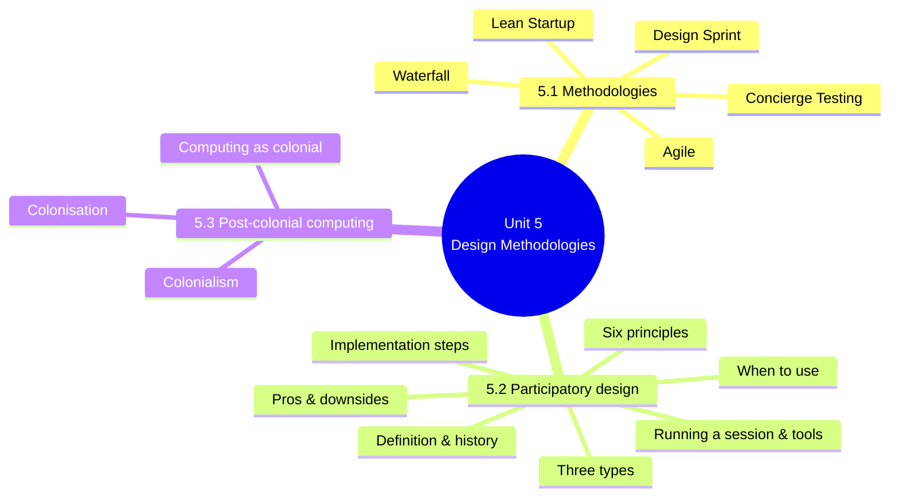
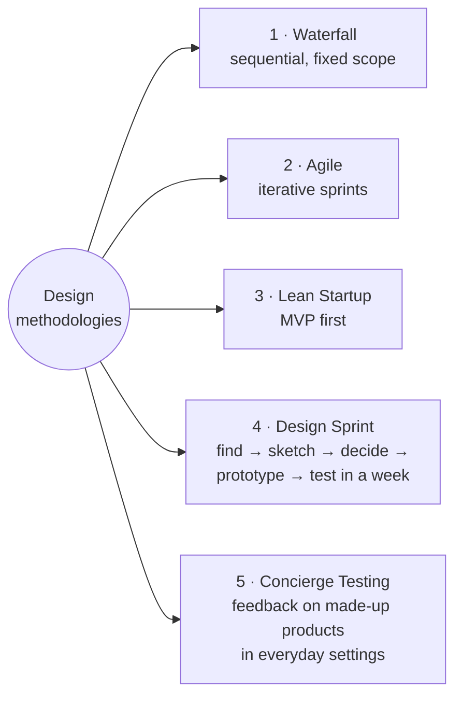
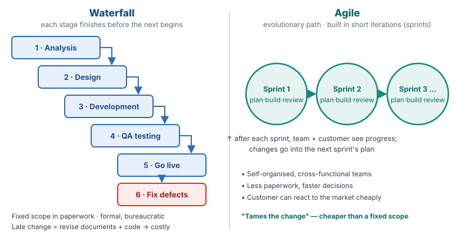
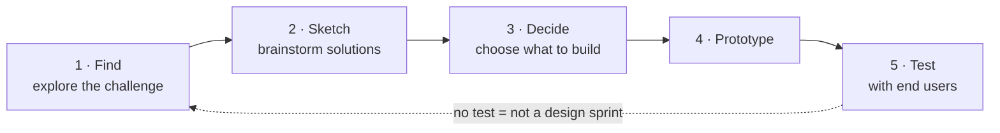
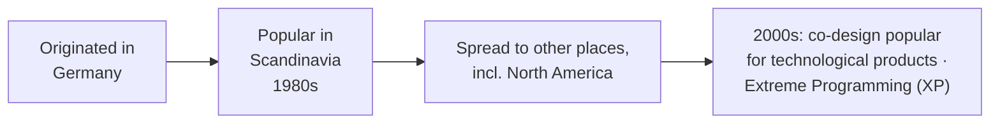
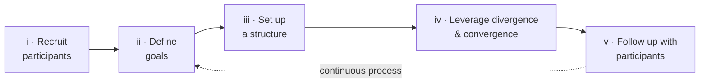
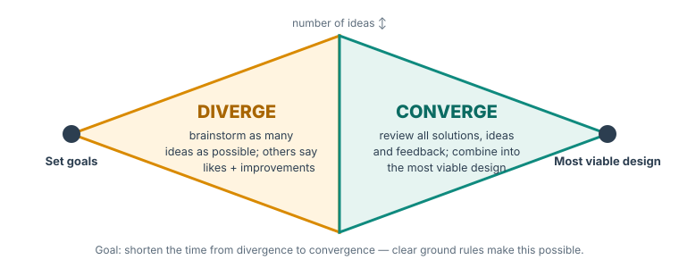

# Unit 5 — Design Methodologies

*Courseware pages 55–68.*

## At a glance

Units 3 and 4 showed that ICT projects often fail because the design does not fit reality. Unit 5 looks at **how products are designed**, and **with whom**:

1. **Design methodologies (§5.1):** what they are, why choosing one matters, and **five** popular methodologies: **Waterfall, Agile, Lean Startup, Design Sprint, Concierge Testing**.
2. **Participatory design (§5.2):** designing **with** users and stakeholders. Its definition, history, **six principles**, **four pros**, **four downsides**, **when to use it**, **three types**, **five implementation steps**, **how to run a session**, **tools**.
3. **Post-colonial computing (§5.3):** the argument that computing should be seen as a **colonial phenomenon**, with the meaning of **colonisation** and **colonialism**.

## Learning outcomes

At the end of the lecture, the learner should be able to:

1. Describe what design methodologies mean, briefly
2. Identify and explain the design techniques for new products

!!! warning "Courseware note"
    The outcomes and the self-test cover only **design methodologies** (§5.1). Participatory design (§5.2) and post-colonial computing (§5.3) take up most of the unit but are not in the outcomes or self-test. They are still examinable course content, so this page includes extra exercises and exam questions on them.

---

## Introduction

> Design methodologies are a term that may sound a little hazy to some people, but if we summon up topics like Lean Startup or Design Sprint approaches, everything becomes much more clearer. There are, without a doubt, a great deal more things to be found on the list of product development methodologies. Using them will be extremely helpful for developers and save the day, or at the very least, a significant amount of time, money, and effort. The improvements of its use will be seen in our productivity and the motivation of our team members, as well as in the quality of products and the dependability of our software.

Using a design methodology:

- **saves time, money and effort**;
- improves **productivity** and **team motivation**;
- improves **product quality** and **software dependability**.

Familiar examples: **Lean Startup** and **Design Sprint**.

---

## 5.1 Design methodologies

### Definition and why they matter

> Design methodologies are systems or models that offer structure or consistency to focus on problems and drive success within a design process. Methodologies help align all stakeholders within a project, an organization, or an industry.

| Point | Courseware |
|---|---|
| **What they are** | **Systems or models** that give **structure or consistency** to focus on problems and drive success in a design process |
| **What they do** | **Align all stakeholders** within a project, organisation or industry |
| **Before choosing** | Know each method's **complexities, pros and disadvantages, highlights and downsides** |
| **Link to products** | Digital product development and idea generation work "hand in hand" with methodologies |
| **Why the choice matters** | In the **highly competitive IT market**, the right strategy, philosophy or model can **tip the scales** and make a product stand out. It can decide the **success or failure of a company** |
| **What is needed** | **Quick reflexes, flexibility, willingness to learn new skills, and adjusting to shifting conditions** |
| **What stays relevant** | Solutions that are **adaptable, agile, and founded on feedback and time-boxed iterations** |
| **Result** | Design of digital products becomes **more effective, quicker** and in tune with the dynamic nature of our era |
| **Also helpful** | Being able to **alter your plan** for unforeseen developments from **inside or outside** the project |

> It is why, once you've settled on a set of goods or solutions to create, you might employ methodologies such as agile methodologies, waterfall methodology, design sprint methodology, and lean startup methodology. In addition, it is possible that knowing the use cases of various methodologies is essential to appraise things accurately. Therefore, this unit will talk about the top 5 popular types of design methodologies.

!!! info "Beyond the notes — key words"
    - **Time-boxed iteration:** a short, fixed period of work (e.g. two weeks) after which you stop, review and plan the next one, whatever has been finished.
    - **Stakeholder:** anyone with an interest in the project: users, clients, managers, funders, regulators.

### The five methodologies

#### 1. Waterfall methodology

> For a considerable amount of time, digital projects have been planned and developed using the waterfall methodology.

How it works:

- **The next stage does not begin until the one before it is completed.**
- The first step is **in-depth and structured analysis**.
- Then **designing, developing and quality assurance (QA) testing**.
- Finally you **go live** and **repair defects after the release**.

Its character:

- **Step-by-step** activity, a **more formal** style of managing workflow, and **a lot of bureaucracy**.
- **Fixed scope**, presented as **paperwork** accepted by decision-makers, is a **defining characteristic**.

Its problems:

- **Changing the project is difficult.** You must step back and modify the **project documentation as well as the code**, which is **bad for the budget**.
- **Development time is significantly prolonged.**
- The work is "already **doomed to fail**" if you end up with a product that is **cohesive with the documentation but outdated** and in need of further adjustment.

#### 2. Agile methodologies

> The significant drawbacks of the waterfall methodology served as the primary push for conducting a more in-depth investigation of the various techniques for the delivery of digital products.

- Agile is a **more flexible** way to create and efficiently launch new applications (the name comes from "agile").
- It emphasises **self-organised and cross-functional teams**.
- As a result, **"paperwork" is much reduced** and **decision time is significantly shortened**.
- The product is **not assembled all at once**: development follows an **evolutionary path**.
- **Iterations** are small components of the overall process. Each iteration is called a **sprint**.
- After each sprint, the **team and customer** see the **progress** and **results**.
- This check-up helps **plan the next iteration**. If any part needs to change, **sprint planning** takes it into account.
- The **customer can respond to the market** and adjust with **fewer severe financial repercussions**.
- This is how agile **"tames the change"**, making it **less expensive** than under a **waterfall fixed scope**.

{ .diagram }

Waterfall vs agile, drawn from the courseware's descriptions.

| Criterion | Waterfall | Agile |
|---|---|---|
| Process | Sequential: each stage completes before the next | Evolutionary: small iterations (sprints) |
| Scope | **Fixed**, agreed in paperwork | Flexible; adjusted each sprint |
| Documentation | Heavy; formal, bureaucratic | Much reduced "paperwork" |
| Teams / decisions | Formal management | Self-organised, cross-functional; faster decisions |
| Customer visibility | Mainly at go-live | After every sprint |
| Cost of change | High (revise documents and code) | Low ("tames the change") |
| Risk | Product matches documents but is outdated on release | Customer adapts to the market as it goes |

!!! tip "Exam angle"
    "Differentiate between waterfall and agile" is very likely. Use the table criteria. A strong answer also explains **why** agile appeared: as a response to waterfall's drawbacks (costly change, prolonged development, outdated products).

#### 3. Lean Startup methodology

- Another popular system for **organising and controlling work processes**.
- The **MVP (Minimum Viable Product)** is a crucial part of it.
- **Basic concept:** **prioritise** the features you want in the product.
- Then ask whether all of them are **truly essential** to the **business's success** and **customers' satisfaction**.
- Some components must remain for reasons of **profitability or functionality**. The courseware calls these essential capabilities **"Most Valuable Features"**.
- **Initial focus:** develop the **most basic version** of the product.

!!! warning "Courseware note"
    The courseware writes "MVP (Minimal Viable Product)" and then "The term 'Most Valuable Features' (MVP) describes these essential capabilities". **MVP stands for Minimum (or Minimal) Viable Product.** "Most Valuable Features" describes **what the MVP contains**: the essential features kept for profitability or functionality. A stray "4." also appears in the middle of this list; it belongs to the next heading, Design Sprint.

!!! example "Example"
    A team wants to build a farm-produce marketplace app with payments, delivery tracking, chat, ratings and price forecasts. The **MVP** is a simple list of produce with a phone number to call the seller. If farmers and buyers use it, the team adds payments next, then delivery tracking, guided by what users actually need.

#### 4. Design Sprint methodology

- A **framework** that uses **creative thinking** to:
    - **validate ideas**;
    - **solve product difficulties**;
    - **align the team's vision** of a product;
    - create **clear goals and objectives**.
- **Within a week:** the **design challenge** (purpose, problem) is **explored**, solutions **brainstormed**, and a **prototype built and tested with end users**.
- The final solution, built on these findings, is **tested again in the real world**.
- The week-long deadline needs a **well-defined objective** and **extensive familiarity with the features planned for the MVP**.
- It is **a guideline, not a hard and fast rule**, and may (and should) be **modified** to fit a project.
- The **number of days, methods and types of people** are **flexible**, but the **structure is fixed**: **find, sketch, decide, prototype, test**.
- **"It is not a Design Sprint if there is no testing phase."**

The fixed five-stage structure of a design sprint, normally run within one week.

#### 5. Concierge testing

- A **practical approach**: interacting with **potential customers in everyday settings** (such as **stores or cafes**) to get **feedback on made-up products**.
- Responses to **open-ended questions** and to **specific prompts** (such as participants' level of **happiness or sadness**) are compiled.
- It is easy to confuse with **WOZ**, but they are different: **concierge testing is meant to spark creativity; WOZ is meant to put theories to the test.**

| | Concierge testing | WOZ (Wizard of Oz) |
|---|---|---|
| Purpose | **Spark creativity** | **Test theories** |
| Setting | Everyday settings: stores, cafes | Not stated in the courseware |
| Data | Open-ended answers and prompted responses (e.g. happiness/sadness) | Not stated |

!!! info "Beyond the notes — WOZ testing and the "concierge MVP""
    - **Wizard of Oz (WOZ) testing:** users interact with what looks like a working automated system, but a hidden person (the "wizard") produces the responses by hand. It tests whether a planned feature would work for users before it is built. For example, a "chatbot" is actually a person typing replies.
    - In lean-startup writing, a **"concierge MVP"** often means delivering the service **manually and openly** to a few customers (e.g. personally shopping for them) to learn what they need. Use the **courseware's definition** in the exam; this is only background.

!!! warning "Courseware note"
    The courseware promises "the top 5 popular types of design methodologies" but earlier names only four (agile, waterfall, design sprint, lean startup). The fifth is **concierge testing**, which is more a **validation technique** than a full methodology. List all five as given.

!!! tip "Exam angle — choosing a methodology"
    | If the project… | Choose | Because |
    |---|---|---|
    | Has fixed, well-understood requirements that will not change (e.g. a regulated payroll calculation) | Waterfall | Structured analysis first; fixed scope accepted by decision-makers |
    | Has requirements likely to change; customer wants to see progress | Agile | Sprints, customer review after each, "tames the change" |
    | Is a new venture with limited money and uncertain demand | Lean Startup | Build an MVP of essential features first |
    | Needs a quick decision on whether an idea works | Design Sprint | Prototype and test with users within a week |
    | Is at the idea stage and needs creative feedback from the public | Concierge testing | Feedback on made-up products in everyday settings |

---

## 5.2 Participatory design

> Participatory design is a collaborative approach to designing a product that involves designers, users, and stakeholders. Implementing everyone's opinions and commentary in the design process allows designers to devise a solution that meets the highest expectations. This democratic process allows users and stakeholders to create something that works for them. Participatory design is applicable in many industries, including software development, architecture, urban planning, and healthcare.

- **Collaborative:** designers + users + stakeholders.
- **Implementing everyone's opinions** gives a solution that meets the **highest expectations**.
- **Democratic** process: users and stakeholders create **something that works for them**.
- **Industries:** **software development, architecture, urban planning, healthcare**.

!!! warning "Courseware note"
    The line "Analyze with Dovetail" after the introduction is a leftover link from the source website (Dovetail, a UX research company). It is not content.

### 5.2.1 What is participatory design?

> Participatory design is a methodology that allows real-world users to participate in the design process with professional designers. The goal of participatory design is to create a high-quality product, service, or system that suits the user's needs.

**Other names (4):**

1. **Cooperative design**
2. **Community design**
3. **Co-design**
4. **Co-creation**

Whatever the name, the idea is the same: **users and stakeholders participate in the design process**.

**History:**

- In the 2000s, **Extreme Programming (XP)** used a collaborative approach to **improve software quality**, and group design gained momentum among software developers.

**Large industry users:**

| Company | Used participatory design to… |
|---|---|
| **Microsoft** | Develop the **interface for the Office suite** |
| **IKEA** | Develop **products** and design **store layouts** |
| **Airbnb** | Improve **website navigation** and the **UX** |

**Level of involvement varies:** sometimes users are involved in the **entire project**, making significant changes and **sharing responsibility**. In other cases their contribution is **consultation only**.

!!! info "Beyond the notes — why Scandinavia?"
    Scandinavian participatory design grew out of the workplace-democracy movement: trade unions wanted workers to have a say in the computer systems introduced into their jobs. This is why PD is described as **democratic**.

### 5.2.2 Key principles of participatory design

> While your approach to participatory design can be drastically different from your competition's, the core principles remain the same:

| # | Principle | Meaning (courseware) |
|---|---|---|
| i | **Focus on the user** | **User-centricity** is the main principle. Designers actively involve users and stakeholders |
| ii | **Mutual learning** | Designers and stakeholders learn from each other; **everyone's opinion and feedback carry weight** |
| iii | **Empowerment** | All participants can **empower the design team** to achieve set goals |
| iv | **Inclusiveness** | A **wide range of opinions and perspectives** gives a high-quality, user-centred product |
| v | **Stages** | Has elements of **agile**: smaller steps (**iterations**) towards bigger goals; user feedback contributes to every stage |
| vi | **Respect** | All participants are **valued, respected and heard**; discussion uses strategies that **remove potential inequality** |

Explaining these principles to all participants **simplifies the process** and helps create a **strong discussion structure**.

!!! tip "Exam angle"
    Memory aid: **"FM EISR"**: **F**ocus on user, **M**utual learning, **E**mpowerment, **I**nclusiveness, **S**tages, **R**espect.

### 5.2.3 Pros of participatory design

> Over the past 40 years, participatory design has evolved to minimize downsides and maximize the benefits. While it may not apply to all projects, many product designers take advantage of user consultations and participation.

**a. Innovative approach**

- New people bring **unique opinions**. Developers, designers and engineers may need help to keep innovating after working on a project for a long time.
- Users come from **different backgrounds**, bring **outside perspectives** and a **more intimate relationship with the product**. Because they **need the solution**, they are more likely to suggest something fresh.
- Top designers may miss **minor details** that significantly affect user experience. **Users point out nuances designers miss.**
- User involvement helps designers **"think outside the box"** and **build empathy** for users.
- Companies that involve users boast **excellent sales and approval ratings**.
- People who imagine others' experiences are more likely to have **original ideas**.

**b. Cost-effectiveness**

- More participants means **errors are caught before they become costly**.
- Even as consultants, users can warn that the design is **going in the wrong direction**.
- Checking each step lets designers **implement feedback in real time**, reducing the **cost of adjustments after the product is ready**.
- PD can **reduce expenses** while maximising **immediate user satisfaction**, **eliminating expensive rework**.

**c. Engagement**

- Engaged users develop a **sense of belonging and responsibility**, which leads to **higher satisfaction**, **faster journeys down the sales funnel**, and **brand ambassadorship**.
- Contributors have a **stake** in the process and feel **closer to the brand**.
- Closeness and loyalty encourage **word-of-mouth marketing** and increase **customer lifetime value (LTV)**.

**d. Better inclusion**

- Products, systems and services become **inclusive to a wider audience**.
- An opportunity to connect with users with **diverse perspectives**, so important **segments of the target audience** are included.

!!! info "Beyond the notes — sales funnel and LTV"
    The **sales funnel** is the path from first hearing about a product to buying it. **Customer lifetime value (LTV)** is the total revenue a customer brings over their whole relationship with the company.

### 5.2.4 Downsides of participatory design

| # | Downside | Explanation (courseware) | Mitigation (courseware where given) |
|---|---|---|---|
| i | **Time** | More people → more opinions to hear and process → **longer development** | The **agile approach of design sprints** can compensate for some lost time |
| ii | **Sample size** | **Nearly impossible** to involve a representative of **every audience segment** → missed opinions, **dissatisfied groups** | Not stated |
| iii | **Structure** | Needs a **strong collaborative structure**; without it the process becomes **chaos**, with delays and dissatisfaction | (See §5.2.7 iii, set up a structure) |
| iv | **Quality** | Focusing **solely on user ideas** builds empathy, but designers may **lack the resources** to fulfil user desires | **Clever solutions** and knowledge of **existing resources** by designers and developers |

> Participatory design is an excellent way to improve your products, services, and systems. However, it's not always the best methodology. It's up to the project manager and owner to decide whether this approach is beneficial.

### 5.2.5 When to use participatory design

- PD can be **expensive and time-consuming**, so companies must ensure **the benefits are worth the inconvenience**.
- Market research shows what users want, but **profits may come from an entirely different demographic**.
- This happens with **B2B products** when **those who buy** or sign contracts **are not the end users**.

**Example: public K-12 education:**

- Those who decide which tech packages to buy for schools are **not** the **principals, secretaries or teachers** who use them daily.
- If the administration **ignores user feedback**, it will **keep buying the software**, **removing any need for innovation**.
- This **disincentivises** the software company from building around feedback. Usable, problem-solving software is not its focus.
- Its metrics may be **solely sales objectives**, which it meets, so there is **no data-backed usability** and no worry about user experience.
- **But** this puts the company in a **precarious position**: a **competitor** could show **better usability and function** and **take its customers**.

!!! note "In plain terms"
    PD pays off when **user satisfaction drives success**. When the **buyer is not the user** (B2B, government procurement, school districts), a company may sell well without PD, but it is exposed: once a competitor offers something users clearly prefer, buyers can switch. So PD is still a **strategic protection** even where it is not commercially forced.

!!! example "Example"
    A state ministry buys a school-management system for all public secondary schools. Teachers find it hard to use, but the ministry renews the contract every year. The vendor has no reason to improve it until a rival vendor demonstrates a system that teachers love and lobbies the ministry. This is the K-12 case in a Nigerian setting.

### 5.2.6 Types of participatory design

> Each company can create a unique participatory design method to suit their needs. However, the majority takes advantage of one of the three common design types:

**a. User-centred design**

- An **iterative** methodology focusing on the **user's needs at each step**.
- Users can be **partially involved**, giving opinions, views and commentary **after each iteration**.
- Participating users can make **important choices**, including **the features and how they work**.
- Designers and developers collect feedback from the **earliest stages**, analyse it and implement it as needed.

**b. Co-design**

- Gives **all participants similar rights** in the design process.
- Users work **together with designers**; the team **supports and implements** users' ideas.
- Users, partners and stakeholders can basically **"own the product"**, but **the final decision belongs to the designer**.
- When designers rely on users' suggestions, they should **design according to them**.
- Users start in the **early stages** and give **lighter feedback until the end** of development.

**c. User-created (user-generated) design**

Four distinct stages:

1. **Gather feedback** to understand the **context of using the product**.
2. **Specify user requirements** to design and development teams based on that feedback.
3. **Design against these requirements.**
4. **Evaluate the final design against the requirements.**

This shows **exactly what the user wants**. Once a design exists, **professional designers can change it** according to project specifications.

| Criterion | User-centred design | Co-design | User-created design |
|---|---|---|---|
| User's role | Gives feedback after each iteration; can make important choices on features | Equal partner with designers; "owns the product" | Users' needs and requirements generate the design |
| Who decides | Designers implement feedback "as needed" | **Designer has the final decision** | Requirements drive design; professionals adjust to specifications |
| When users join | From the earliest stages | Early stages, lighter feedback to the end | From the start (gather feedback on context) |
| Process | Iterative | Collaborative | Four stages: gather → specify → design → evaluate |

### 5.2.7 How to implement participatory design

First **choose the type of design**, then follow these steps:

**i. Recruit participants**

- The **right choice of participants** defines the **quality of collaboration**.
- Attract users from **different audience segments**. They must be **actual users** or have **the problem the product intends to solve**.
- This makes **success metrics** clear and straightforward.

**ii. Define goals**

- Set **design goals** together; users and stakeholders share **ideas, pain points and needs**.
- Everyone should be **on the same page** about goals, problems and opportunities.
- A clear understanding of **scope** prevents **low-quality suggestions** and **saves time**.

**iii. Set up a structure**

- Structure ensures **smooth collaboration**.
- Users without design experience may struggle to tell **viable ideas from low-quality ones**.
- A **clear framework** prevents unnecessary discussions and saves time.
- **Deadlines and milestones** are part of the structure. Members should understand **how iterations work** and the **goals of each stage**.
- A **journey map** of the project helps everyone see what they need to do.

**iv. Leverage divergence and convergence**

- These can happen **at any stage**.
- **Divergence** includes **brainstorming**: the team creates **as many ideas as possible** from the set goals. Each member presents ideas; the rest give feedback on what they like and how to improve.
- **Convergence**: the team **reviews all solutions, ideas and feedback** and creates the **most viable design**.
- Goal: **minimise the time from divergence to convergence**. **Clear ground rules** make this possible.

{ .diagram }

Divergence and convergence, drawn from §5.2.7 iv.

**v. Follow up with participants**

- After each session, **show them the solution you built** rather than explaining how you used their feedback.
- Ask for their **feedback** and what they **expect** in future.
- PD is **continuous** throughout the project; **engage participants frequently**.

### 5.2.8 How to conduct a participatory design session

**a. Ensure time management.** A session can last hours or days without results. You can:

- give each speaker a **limited amount of time**;
- use a **timer application**;
- **share the volume of work** with participants **before the session**, so they know how much to do in a short time.

**b. Assign facilitators.** A facilitator is in charge of the **session's structure**. Instead of brainstorming, they:

- create an **engaging atmosphere**;
- **monitor the time**;
- **redirect the conversation** when needed;
- **encourage ideas**;
- **observe participants** and read their **non-verbal language**.

Facilitators help finish **on time**, ensure **everyone shares** their thoughts, and keep the group **on track**. In a large group they can ask **silent participants direct questions**.

**c. Record the session.**

- Designers and facilitators **take notes**.
- Participants can **write down thoughts** for later, e.g. on **Post-its**.
- Consider **video recording** the session, to return for more ideas and to **observe how participants behaved**, which gives extra insight.

### 5.2.9 Tools for participatory design

- Tools depend on **goals and types of participants**.
- **Everyone in the same room:** no additional instruments needed.
- **Remote participatory design:**
    1. **surveys**;
    2. **interviews**;
    3. **online questionnaires**;
    4. **video conferencing**.
- These collect information from many online participants; their contribution can be **just as valuable**.
- **Smaller groups representing all project teams** may give the **best results**.

### 5.2.10 Implementing participatory design in projects

- PD creates a **user-oriented product** by involving **all interested parties**.
- Despite challenges, it can achieve **high satisfaction** among users and design teams.
- **Co-design takes user-centricity to the next level.** With the right tools, a product can address **all relevant pain points** and gain a **significant competitive edge**.

!!! info "Beyond the notes — why PD matters for ICT4D"
    Units 3 and 4 showed that ICT projects in developing countries fail when the **design does not match reality** (design–reality gaps) and when designers assume users are like them. Participatory design closes those gaps at the source: the people who know the reality help write the design. Unit 7's user-centred design framework for rural ICT builds on the same idea.

---

## 5.3 Post-colonial computing

> Computing is – or at least should be considered as – a colonial phenomenon. 'Critical' positions such as feminism and disciplines such as science and technology studies (STS) afford insights into the social, economic, political, cultural and other factors impinging on computing as an entangled outgrowth of various developments within fields such as logic, mathematics, science and technology. Yet surely it is somewhat of a stretch to describe computing as 'colonial', especially since colonialism as a phenomenon tied up with imperial structures of domination and settlement is a thing of the past. How can computing be colonial if the 'age of empires' is over and we live in a postcolonial world?

The argument, step by step:

1. **Claim:** computing is, or should be considered, a **colonial phenomenon**.
2. **Existing critical lenses:** **feminism** and **science and technology studies (STS)** already show the **social, economic, political and cultural** factors shaping computing, which grew out of **logic, mathematics, science and technology**.
3. **Objection:** calling computing "colonial" seems a stretch. Colonialism (imperial **domination and settlement**) is **in the past**. How can computing be colonial if the **"age of empires" is over** and we live in a **postcolonial world**?
4. **Response:** "excavate" the **history, or genealogy, of modernity**, and consider the formation of the contemporary **world system** in terms of its **socio-political ontology** (what kinds of power structures make up the world as it is today).

> Colonisation and Colonialism emanates from the history of the modern world-system as part of history of the expansion of European states and peoples into the rest of the world in 1492 CE which resulted in the emergence of a capitalist world-economy.

| Term | Courseware definition |
|---|---|
| **Origin of both** | The **expansion of European states and peoples** into the rest of the world from **1492 CE**, which produced a **capitalist world-economy** |
| **Colonisation** | From Latin **colere, "to inhabit"**. An **ongoing process of control** by which a **central system of power dominates surrounding lands** and their **"resources"** (people, animals etc.) through the **"establishment of a colony"** |
| **Colonialism** | The **establishment, exploitation, maintenance, acquisition and expansion** of a colony in one territory **by a political power from another territory** |

!!! note "In plain terms"
    - **Colonisation** is the **process** of a centre of power taking control of surrounding lands and their "resources". The courseware calls it **ongoing**.
    - **Colonialism** is the **system** of setting up, exploiting, maintaining, acquiring and expanding a colony by an **outside** political power.
    - **Computing as colonial:** the modern world system that began in 1492 still has a **centre** and a **periphery**. Computing, largely designed in and controlled from the centre (big tech firms, standards bodies, data centres), can reproduce that pattern. Data, attention and labour flow from the periphery to the centre; designs made for the centre are imposed on the periphery. Political empires ended, but **patterns of domination** can continue through technology.

!!! info "Beyond the notes — what "post-colonial / decolonial computing" asks"
    The courseware's reference is Ali (2016), *A brief introduction to decolonial computing*. This approach asks designers to consider:

    - **Who designs** the technology and **whose knowledge** counts?
    - **Who benefits** from the data it collects, and **where does value flow**?
    - Does it **impose** outside assumptions (language, culture, business models) on local users?

    This links to **participatory design** (users shape the design), the **design–reality gap** (outside designs failing local realities) and Unit 7 ("Do artifacts have politics?").

!!! warning "Courseware note"
    §5.3 ends after the two definitions; it never finishes the argument it starts. The plain-terms and Beyond-the-notes boxes above complete the reasoning only as far as needed to understand it. In the exam, **quote the courseware's definitions**, then explain.

!!! example "Example"
    A global ride-hailing app enters Lagos with pricing, rules and data practices designed in San Francisco. Drivers' trip data flows to servers abroad, the company's commission leaves the country, and drivers have no say in the design. A post-colonial computing lens asks whether this repeats a centre–periphery pattern of control over local "resources", here labour and data.

---

## Key terms

Design methodology
:   A system or model that gives structure or consistency to focus on problems and drive success within a design process, and aligns stakeholders.

Waterfall
:   A sequential methodology: analysis → design → development → QA testing → go live → fix defects. Each stage finishes before the next. Fixed scope in paperwork; change is costly.

Agile
:   A flexible, evolutionary methodology using self-organised, cross-functional teams and short iterations (sprints) reviewed with the customer. It "tames the change".

Sprint
:   One iteration in agile development, after which progress is reviewed and the next sprint is planned.

Lean Startup
:   A methodology that prioritises essential features and builds the most basic version first (the MVP).

MVP
:   Minimum Viable Product: the most basic version containing the essential ("most valuable") features.

Design Sprint
:   A week-long framework: find, sketch, decide, prototype, test. Without testing it is not a design sprint.

Concierge testing
:   Getting feedback on made-up products from potential customers in everyday settings. It sparks creativity (unlike WOZ, which tests theories).

Participatory design (PD)
:   A collaborative, democratic methodology in which real-world users and stakeholders take part in design with professional designers. Also called cooperative design, community design, co-design or co-creation.

Extreme Programming (XP)
:   A 2000s collaborative software development method that boosted co-design.

Divergence / convergence
:   Generating as many ideas as possible (brainstorming) / reviewing them to produce the most viable design.

Facilitator
:   The person in charge of a PD session's structure: atmosphere, time, redirection, encouraging ideas, reading non-verbal language.

Colonisation
:   (Latin *colere*, "to inhabit") an ongoing process of control by which a central power dominates surrounding lands and their "resources" through establishing a colony.

Colonialism
:   The establishment, exploitation, maintenance, acquisition and expansion of a colony in one territory by a political power from another territory.

STS
:   Science and technology studies: the study of the social, political and cultural factors shaping science and technology.

---

## Unit summary

- **Design methodologies** are systems or models that give **structure and consistency** to a design process and **align stakeholders**. Choosing the right one can decide a product's or company's success. Adaptable, agile, **feedback-based, time-boxed** approaches stay relevant.
- **Five methodologies:**
    - **Waterfall:** sequential stages, fixed scope in paperwork, bureaucratic, costly change, outdated products.
    - **Agile:** self-organised cross-functional teams, sprints reviewed with the customer, "tames the change".
    - **Lean Startup:** prioritise essential features, build the **MVP** first.
    - **Design Sprint:** find, sketch, decide, prototype, test within a week; no test, no sprint.
    - **Concierge testing:** feedback on made-up products in everyday settings; sparks creativity, unlike WOZ, which tests theories.
- **Participatory design** is a collaborative, democratic approach (software, architecture, urban planning, healthcare). It is also called cooperative design, community design, co-design or co-creation. It began in Germany, was popular in Scandinavia in the 1980s and spread to North America; XP boosted it in the 2000s (Microsoft Office, IKEA, Airbnb).
    - **Six principles:** focus on the user, mutual learning, empowerment, inclusiveness, stages, respect.
    - **Pros:** innovation, cost-effectiveness, engagement (belonging, LTV, word of mouth), inclusion.
    - **Downsides:** time, sample size, structure, quality.
    - **When to use:** when benefits outweigh cost. Beware B2B cases where buyers ≠ users (K-12).
    - **Three types:** user-centred, co-design (designer decides), user-created (gather → specify → design → evaluate).
    - **Five steps:** recruit, define goals, set up structure, diverge/converge, follow up.
    - **Sessions:** time management, facilitators, recording. **Remote tools:** surveys, interviews, online questionnaires, video conferencing.
- **Post-colonial computing:** computing should be considered a **colonial phenomenon**, understood through the **genealogy of modernity** and the world system that began with European expansion in **1492**. **Colonisation** (*colere*, to inhabit) is the ongoing process of control over surrounding lands and resources. **Colonialism** is the establishment, exploitation, maintenance, acquisition and expansion of a colony by an outside power.

---

## Quick-check questions

In the waterfall methodology, what is the first step?

<ul class="quiz-options">
  <li>Designing</li>
  <li data-correct>In-depth and structured analysis</li>
  <li>Building a prototype</li>
  <li>Sprint planning</li>
</ul>

§5.1: "The in-depth and structured analysis is the first step of the waterfall process", followed by design, development, QA testing, go-live and fixing defects.

Which is a defining characteristic of the waterfall strategy?

<ul class="quiz-options">
  <li>Self-organised teams</li>
  <li data-correct>A fixed scope presented as paperwork accepted by decision-makers</li>
  <li>Testing with users within one week</li>
  <li>Building the most basic version first</li>
</ul>

§5.1 (Waterfall). The other options describe agile, design sprint and lean startup.

In agile development, each iteration is called a…

<ul class="quiz-options">
  <li>milestone</li>
  <li>stage</li>
  <li data-correct>sprint</li>
  <li>release</li>
</ul>

§5.1 (Agile): "Following each iteration which is referred to as a sprint, the team and the customer can observe … the progression of the work."

MVP, central to the Lean Startup methodology, correctly stands for…

<ul class="quiz-options">
  <li>Most Valuable Player</li>
  <li data-correct>Minimum (Minimal) Viable Product</li>
  <li>Maximum Value Process</li>
  <li>Most Valuable Features</li>
</ul>

The courseware also uses "Most Valuable Features" for the essential capabilities the MVP keeps, but MVP itself = **Minimum Viable Product** (Courseware note, §5.1).

What is the fixed structure of a design sprint?

<ul class="quiz-options">
  <li>Analyse, design, develop, test, deploy</li>
  <li data-correct>Find, sketch, decide, prototype, test</li>
  <li>Recruit, define, structure, diverge, follow up</li>
  <li>Gather, specify, design, evaluate</li>
</ul>

§5.1 (Design Sprint). The other options are waterfall, the PD implementation steps (§5.2.7) and user-created design (§5.2.6).

According to the courseware, concierge testing differs from WOZ in that…

<ul class="quiz-options">
  <li>concierge testing is done online, WOZ in person</li>
  <li data-correct>concierge testing sparks creativity, while WOZ tests theories</li>
  <li>WOZ uses made-up products, concierge testing uses real ones</li>
  <li>they are the same thing</li>
</ul>

§5.1 (Concierge Testing): "the former is meant to spark creativity, while the latter is intended to put theories to the test."

Which is NOT one of the other names for participatory design?

<ul class="quiz-options">
  <li>Co-design</li>
  <li>Cooperative design</li>
  <li>Co-creation</li>
  <li data-correct>Concierge design</li>
</ul>

§5.2.1: cooperative design, community design, co-design, co-creation.

Participatory design originated in ___ and became popular in ___ in the 1980s.

<ul class="quiz-options">
  <li>the USA; Germany</li>
  <li data-correct>Germany; Scandinavia</li>
  <li>Scandinavia; North America</li>
  <li>the UK; Japan</li>
</ul>

§5.2.1. It then spread to other places, including North America.

The PD principle that says participatory design "has the elements of agile methodology" is…

<ul class="quiz-options">
  <li>Mutual learning</li>
  <li>Empowerment</li>
  <li data-correct>Stages</li>
  <li>Inclusiveness</li>
</ul>

§5.2.2 v: Stages, meaning smaller steps (iterations) towards bigger goals.

"It's nearly impossible to involve a representative of each target audience segment" describes which downside of PD?

<ul class="quiz-options">
  <li>Time</li>
  <li data-correct>Sample size</li>
  <li>Structure</li>
  <li>Quality</li>
</ul>

§5.2.4 ii.

In the K-12 example, why does the software company have little incentive to innovate?

<ul class="quiz-options">
  <li>Teachers refuse to give feedback</li>
  <li data-correct>The buyers (administrators) are not the users, and keep buying regardless of user feedback</li>
  <li>The software is free</li>
  <li>Schools use waterfall methodology</li>
</ul>

§5.2.5: in B2B cases, buyers ≠ end users. If the administration keeps purchasing, there is no need to innovate, which leaves the company exposed to competitors.

In which type of participatory design does the final decision belong to the designer, although users "own the product"?

<ul class="quiz-options">
  <li>User-centred design</li>
  <li data-correct>Co-design</li>
  <li>User-created design</li>
  <li>Concierge testing</li>
</ul>

§5.2.6 b: co-design gives similar rights, "the final decision-making process belongs to the designer."

Which is NOT a role of a facilitator in a PD session?

<ul class="quiz-options">
  <li>Monitor the time</li>
  <li>Observe non-verbal language</li>
  <li>Redirect the conversation when needed</li>
  <li data-correct>Lead the brainstorming with their own ideas</li>
</ul>

§5.2.8 b: "Instead of participating in the brainstorming action", facilitators manage atmosphere, time, redirection, encouragement and observation.

"Colonisation" comes from the Latin <em>colere</em>, meaning…

<ul class="quiz-options">
  <li>to conquer</li>
  <li data-correct>to inhabit</li>
  <li>to trade</li>
  <li>to compute</li>
</ul>

§5.3: colonisation is "an ongoing process of control by which a central system of power dominates surrounding lands and their 'resources'."

The courseware traces colonisation and colonialism to European expansion in…

<ul class="quiz-options">
  <li>1776</li>
  <li data-correct>1492 CE</li>
  <li>1884</li>
  <li>1960</li>
</ul>

§5.3: expansion "into the rest of the world in 1492 CE which resulted in the emergence of a capitalist world-economy."

---

## Self-test assessment (from the courseware)

**1. Briefly describe the term, Design Methodologies.**

??? success "Model answer"
    **Design methodologies** are **systems or models that offer structure or consistency** to focus on problems and drive success within a design process. They **align all stakeholders** within a project, organisation or industry.

    Before choosing one, it is vital to know its **complexities, pros and disadvantages, highlights and downsides**. In the competitive IT market, the right methodology can **tip the scales** and decide a product's or company's **success or failure**. Good methodologies are **adaptable, agile, and based on feedback and time-boxed iterations**, and allow the plan to be altered for unforeseen developments. Using them **saves time, money and effort**, and improves **productivity, team motivation, product quality and software dependability**. Examples: waterfall, agile, lean startup, design sprint, concierge testing.

**2. Identify 5 design methodologies and explain each of them, briefly.**

??? success "Model answer"
    1. **Waterfall:** a sequential method in which each stage (**analysis → design → development → QA testing → go live → fix defects**) must finish before the next starts. It is formal and bureaucratic, with a **fixed scope** in paperwork. Changes are costly (documents and code must be revised), development is prolonged, and the product may be outdated on release.
    2. **Agile:** a flexible response to waterfall's drawbacks. **Self-organised, cross-functional teams** build the product in an **evolutionary** way through short iterations called **sprints**. After each sprint the team and customer review progress and plan the next, so change is cheaper: agile "**tames the change**". Less paperwork, faster decisions.
    3. **Lean Startup:** prioritise features and keep only those **essential** to business success and customer satisfaction (for profitability or functionality). Build the **Minimum Viable Product (MVP)**, the most basic version, first.
    4. **Design Sprint:** a creative-thinking framework to validate ideas, solve product problems, align the team's vision and set goals. Within **a week**, the challenge is explored, solutions brainstormed, and a prototype built and **tested with end users**. The structure is fixed (**find, sketch, decide, prototype, test**); without testing it is not a design sprint.
    5. **Concierge testing:** interacting with potential customers in **everyday settings** (stores, cafes) to get feedback on **made-up products**, collecting open-ended and prompted responses (e.g. happiness or sadness). It **sparks creativity**, unlike WOZ testing, which tests theories.

---

## Practice exercises

**Exercise 1.** List the waterfall stages in order, and give **two** reasons the courseware says changes are costly under waterfall.

??? success "Answer"
    Analysis → design → development → QA testing → go live → fix defects. Changes are costly because (1) you must **revise the project documentation as well as the code**, and (2) **development time is significantly prolonged**, so the product may be outdated, "cohesive with documentation but needs to be updated".

**Exercise 2.** Name the six PD principles and give a one-line meaning of each.

??? success "Answer"
    Focus on the user (user-centricity) · Mutual learning (everyone's opinion carries weight) · Empowerment (participants empower the team to reach goals) · Inclusiveness (wide range of perspectives) · Stages (agile-style iterations) · Respect (everyone valued and heard; remove inequality).

**Exercise 3.** Match each PD downside to the courseware's remedy, or to the step in §5.2.7 that addresses it: time, sample size, structure, quality.

??? success "Answer"
    - **Time** → the agile approach of **design sprints**; §5.2.8 time management.
    - **Sample size** → §5.2.7 i, **recruit participants** from different audience segments; §5.2.9, smaller groups representing all teams.
    - **Structure** → §5.2.7 iii, **set up a structure** (deadlines, milestones, journey map); facilitators.
    - **Quality** → designers' and developers' **clever solutions and knowledge of existing resources**; §5.2.7 ii, define goals and scope to prevent low-quality suggestions.

**Exercise 4.** Compare the three types of participatory design on: user's role, who has the final say, and process.

??? success "Answer"
    See the comparison table in §5.2.6. Key point: **co-design** gives users similar rights, but **the designer decides**. **User-centred design** gathers feedback after each iteration. **User-created design** follows four stages: gather feedback → specify requirements → design → evaluate against requirements.

**Exercise 5.** Distinguish **colonisation** from **colonialism**, and explain in two sentences why someone might call computing "colonial" when the "age of empires" is over.

??? success "Answer"
    **Colonisation** (from *colere*, "to inhabit") is an **ongoing process of control** by which a central power dominates surrounding lands and their "resources". **Colonialism** is the **establishment, exploitation, maintenance, acquisition and expansion** of a colony by a **political power from another territory**.

    Although formal empires have ended, the **world system** created by European expansion since 1492, with a dominant centre and a periphery, still exists. Computing designed and controlled from that centre can reproduce the same patterns of domination over the periphery's "resources" (data, labour, markets), so the courseware argues it should be considered a colonial phenomenon.

---

## Sample exam questions

*In the style of the real paper. Each question is about 20 marks. Try writing a full answer before revealing the model answer.*

### Question 1

**1a.** What are design methodologies? Explain **three** benefits the courseware associates with using them. (5 marks)

??? success "Model answer"
    **Definition (2 marks):** systems or models that give **structure or consistency** to focus on problems and drive success in a design process, and that **align stakeholders** in a project, organisation or industry.

    **Benefits (1 mark each, any three):** they **save time, money and effort**; they improve **productivity and team motivation**; they improve **product quality and software dependability**; in a competitive IT market the right choice can **make a product stand out** and decide a company's success; feedback-based, time-boxed approaches let teams **alter plans** for unforeseen developments.

**1b.** Differentiate between the waterfall and agile methodologies in terms of how work is sequenced, how scope and change are handled, and how the customer is involved. Explain why the courseware says agile "tames the change". (8 marks)

??? success "Model answer"
    | Criterion | Waterfall | Agile |
    |---|---|---|
    | **Sequencing (2)** | Strictly sequential: analysis → design → development → QA → go live → fix defects; no stage starts until the previous one ends | Evolutionary: the product is built in small iterations (**sprints**), not all at once |
    | **Scope and change (2)** | **Fixed scope** in paperwork accepted by decision-makers; change means revising documents **and** code, which is costly and prolongs development | Scope adapts: changes are folded into the next sprint's planning; less paperwork, faster decisions |
    | **Customer involvement (2)** | Mainly at the start (analysis) and at go-live | After every sprint the customer sees progress and results and can respond to the market |

    **"Tames the change" (2 marks):** because each sprint is small and reviewed, needed changes are absorbed into **sprint planning** instead of reworking a whole fixed plan. The customer can adjust to market changes **with fewer severe repercussions for the financial plan**, so change is **cheaper than under a waterfall fixed scope**.

**1c.** For each of the following projects, recommend a design methodology from the courseware and justify your choice:

1. A fintech start-up with little funding wants to test whether market women in Ibadan will use a savings app.
2. A federal agency must build a system to compute pension entitlements exactly as set out in a new law that will not change.
3. A hospital wants to find out, within one week, whether a new patient-queue idea will work before investing in it.

(7 marks)

??? success "Model answer"
    1. **Lean Startup.** Funds are limited and demand is uncertain, so prioritise only the **essential features** (e.g. deposit and balance) and build an **MVP** to learn whether market women use it before adding more. *(Agile is acceptable if justified by changing requirements.)* *(2)*
    2. **Waterfall.** Requirements are **fully known and fixed by law**. A structured **analysis first**, a **fixed scope** accepted by decision-makers and formal documentation suit a stable, regulated calculation, and the cost-of-change drawback matters little because change is not expected. *(2)*
    3. **Design Sprint.** It explores the challenge, brainstorms, **prototypes and tests with end users within a week**, which validates the idea before investing. It needs a **well-defined objective** (shorter waiting times) and must include the **test** stage. *(3: choice 1, justification 2)*

### Question 2

**2a.** Define participatory design and explain **four** of its key principles. (6 marks)

??? success "Model answer"
    **Definition (2 marks):** a **collaborative, democratic** methodology that lets **real-world users and stakeholders participate in the design process with professional designers**, to create a high-quality product, service or system that suits users' needs. Also called cooperative design, community design, co-design or co-creation.

    **Principles (1 mark each, any four):**

    - **Focus on the user:** user-centricity; designers actively involve users and stakeholders.
    - **Mutual learning:** designers and stakeholders learn from each other; everyone's feedback carries weight.
    - **Empowerment:** all participants can empower the team to achieve set goals.
    - **Inclusiveness:** a wide range of perspectives gives a high-quality, user-centred product.
    - **Stages:** agile-style iterations, with user feedback at every stage.
    - **Respect:** everyone is valued, respected and heard; strategies remove potential inequality.

**2b.** Discuss **two** advantages and **two** downsides of participatory design. (6 marks)

??? success "Model answer"
    **Advantages (1.5 each):**

    - **Innovative approach:** users bring outside perspectives and spot nuances designers miss, helping designers "think outside the box" and build empathy.
    - **Cost-effectiveness:** errors are caught early, and feedback is applied in real time, avoiding expensive rework after release.
    - *(Also: engagement, which brings belonging, satisfaction, word of mouth and higher LTV; better inclusion of diverse audience segments.)*

    **Downsides (1.5 each):**

    - **Time:** more participants means more opinions to process, so development takes longer (partly offset by design sprints).
    - **Sample size:** it is nearly impossible to represent every audience segment, so some groups may be missed and dissatisfied.
    - *(Also: structure, since without strong structure the process becomes chaotic; quality, since designers may lack resources to fulfil user desires.)*

**2c.** The Oyo State Ministry of Agriculture wants to build a mobile app that gives extension advice to smallholder farmers, many of whom have basic phones and limited literacy. You are asked to run participatory design for the app.

1. Describe the **five** steps you would follow to implement participatory design, applying each to this case. (5 marks)
2. Explain **three** practices you would use to run each design session well. (3 marks)

??? success "Model answer"
    1. **Steps (1 mark each):**
        - **Recruit participants:** actual farmers from different segments (crops, villages, men and women, younger and older, phone types), plus extension officers. They must have the problem the app solves.
        - **Define goals:** agree together on the app's goals (e.g. timely pest advice, prices) and its scope, so suggestions stay relevant.
        - **Set up a structure:** deadlines, milestones and a simple journey map (in Yoruba, with pictures for those with limited literacy) so participants understand each iteration.
        - **Leverage divergence and convergence:** brainstorm many ideas (voice messages, SMS, call-in lines), then converge on the most viable design for basic phones, with clear ground rules to save time.
        - **Follow up:** return to farmers with the **working prototype** (show, don't explain), collect feedback and continue throughout the project.
    2. **Session practices (1 mark each):**
        - **Time management:** time limits per speaker, a timer, and work shared before the session.
        - **Facilitators:** a facilitator (ideally speaking the local language) keeps time, encourages ideas, redirects discussion, reads non-verbal cues and asks quiet participants direct questions.
        - **Record the session:** notes, Post-its or pictures, and video recording to review behaviour later.

### Question 3

**3a.** Compare user-centred design, co-design and user-created design in terms of the user's role and who makes final decisions. List the four stages of user-created design. (7 marks)

??? success "Model answer"
    | Type | User's role (1 each) | Final decision (1 each) |
    |---|---|---|
    | **User-centred design** | Iterative; users partially involved, giving opinions after each iteration and making important choices about features | Designers and developers analyse feedback and implement it "as needed" |
    | **Co-design** | Users have **similar rights**, work with designers from the early stages, and basically "own the product" | **The designer** |
    | **User-created design** | Users' context and needs **generate** the requirements | Design follows the requirements; professionals adjust to project specifications |

    **Four stages (1 mark for all four):** (1) gather feedback to understand the context of use; (2) specify user requirements to the teams; (3) design against these requirements; (4) evaluate the final design against the requirements.

**3b.** Using the courseware's K-12 education example, explain when participatory design may **not** seem commercially necessary, and why ignoring users is still risky. (5 marks)

??? success "Model answer"
    - PD can be **expensive and time-consuming**, so benefits must outweigh the cost. *(1)*
    - In some **B2B** markets **the buyer is not the user**. In public K-12 education, administrators choose tech packages, not the principals, secretaries and teachers who use them daily. *(1)*
    - If administrators keep buying regardless of user feedback, the vendor has **no incentive to innovate**. Its metrics may be **sales only**, with no data-backed usability. *(2)*
    - **Risk:** this is a **precarious position**. A **competitor** could demonstrate better usability and function and **take its customers**. *(1)*

**3c.** A foreign technology company offers a West African government a free national digital-ID system. The system is designed abroad, stores citizens' biometric data on servers outside the region, and the company will use anonymised data to train its commercial products. Local engineers and citizens had no part in the design.

1. Using the courseware's definitions, explain how a "post-colonial computing" perspective would interpret this offer. (5 marks)
2. Recommend **three** design or policy changes, drawing on other parts of this unit. (3 marks)

??? success "Model answer"
    1. **Interpretation (5 marks):**
        - The courseware argues computing should be considered a **colonial phenomenon**, even though the "age of empires" is over. *(1)*
        - **Colonisation** is an **ongoing process of control** by which a **central system of power dominates surrounding lands and their "resources"**. Here the "resources" are citizens' **biometric data**, flowing to a centre abroad. *(1)*
        - **Colonialism** includes **exploitation** and **maintenance** by a power from **another territory**. Using the data to train commercial products extracts value outward, and dependence on foreign servers maintains control. *(1)*
        - This continues the **world-system** pattern begun by European expansion in **1492**, a capitalist world-economy with centre and periphery, now through technology rather than territory. *(1)*
        - Excluding local engineers and citizens from design means the system imposes outside assumptions: a design–reality gap risk. *(1)*
    2. **Recommendations (1 each):**
        - Use **participatory design**: involve citizens, civil society and local engineers (recruit, define goals, diverge/converge, follow up), following the principles of **inclusiveness, empowerment and respect**.
        - **Local data storage and control**, with data-protection law forbidding commercial reuse without consent.
        - **Build local capacity**: transfer skills and source code so the system can be maintained locally, avoiding dependence.
