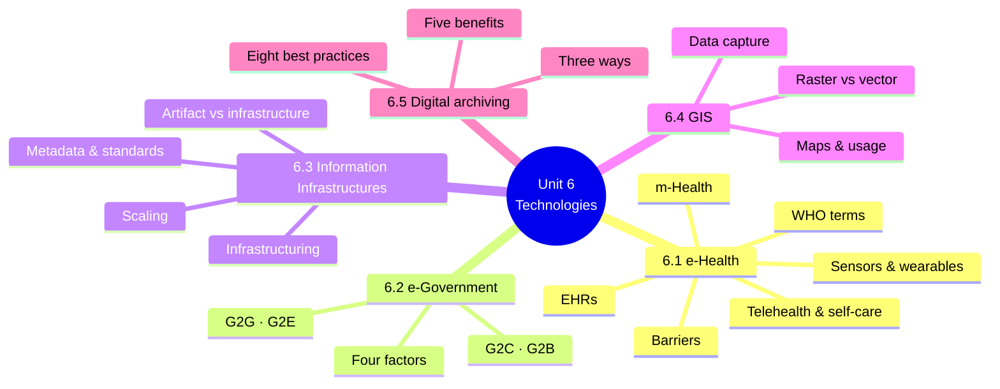
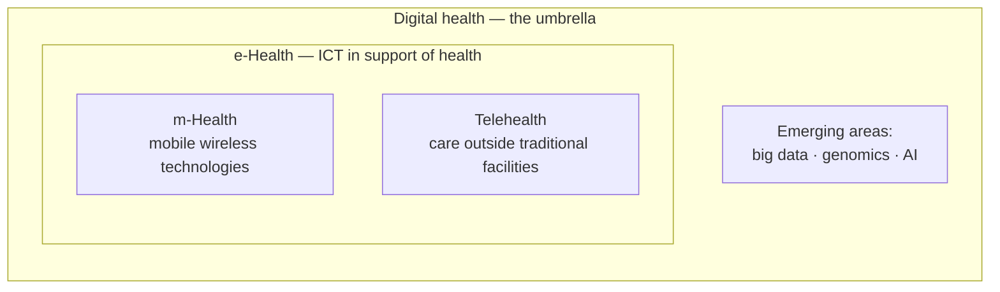
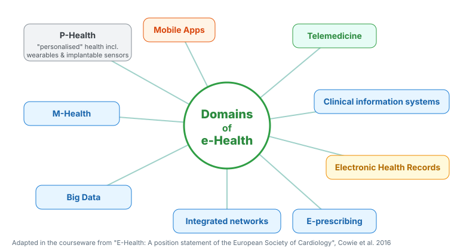
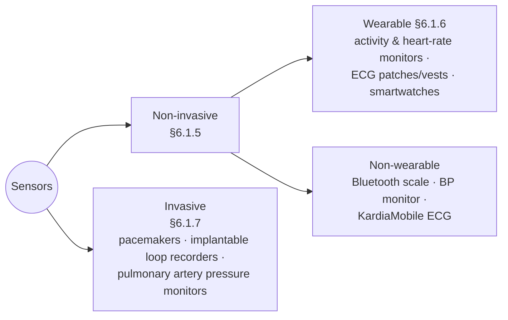
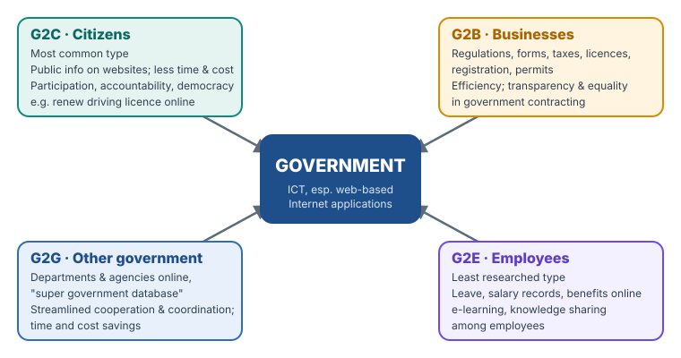
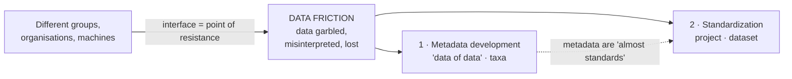
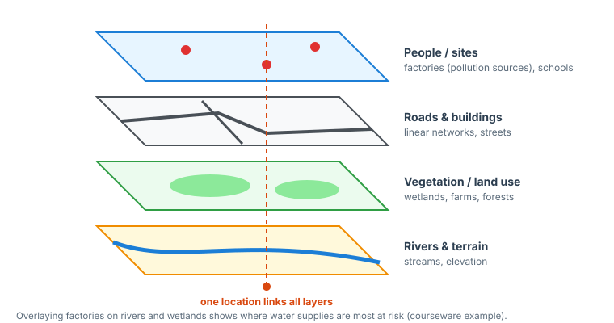
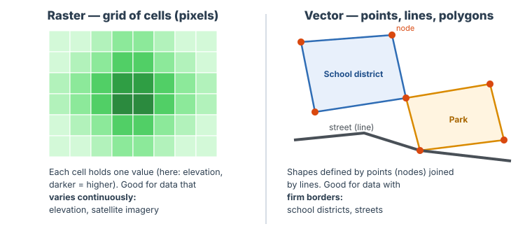

# Unit 6 — Technologies Discussed

*Courseware pages 69–89.*

## At a glance

This unit surveys **five technologies** that ICT for development depends on:

| § | Technology | The big idea |
|---|---|---|
| 6.1 | **e-Health** | Using ICT in health: EHRs, m-Health, sensors, wearables, telehealth, and the **barriers** to rolling them out |
| 6.2 | **e-Government** | Using ICT to deliver government services: **G2C, G2B, G2G, G2E**, and the **factors** that decide success |
| 6.3 | **Information Infrastructures (IIs)** | The large, invisible, ever-evolving systems (networks, standards, metadata) that information flows through |
| 6.4 | **GIS** | Systems that capture, store, check and display data tied to **locations on Earth**; **raster vs vector** |
| 6.5 | **Digital archiving** | Storing documents electronically: **three ways** to archive, **five benefits**, **eight best practices** |

## Learning outcomes

The courseware lists:

1. Define the term, e-Health
2. *(left blank in the courseware)*

!!! warning "Courseware note"
    Only one learning outcome is given; the second is empty. Based on the self-test and section headings, you should also be able to:

    - distinguish e-Health, m-Health, digital health and telehealth, and explain the barriers to e-Health;
    - identify and explain the **four types of e-government** services and the factors affecting e-government;
    - explain what an **information infrastructure** is and how standards and metadata support it;
    - **briefly describe GIS**, its data sources and the **raster vs vector** formats;
    - identify and explain the **benefits of digital archiving**.

    *These suggested outcomes are not from the courseware.*

---

## Introduction

> Significant investment in eHealth solutions is being made in nearly every country of the world. Absent, poor, or vague eHealth strategy is a significant barrier to effective investment in, and implementation of, sustainable eHealth solutions and establishment of an eHealth favorable policy environment. Strategy is the driving force, the first essential ingredient, that can place countries in charge of their own eHealth destiny and inform them of the policy necessary to achieve it. In the last 2 years, there has been renewed interest in eHealth strategy from the World Health Organization (WHO), International Telecommunications Union (ITU), Pan American Health Organization (PAHO), the African Union, and the Commonwealth; yet overall, the literature lacks clear guidance to inform countries why and how to develop their own complementary but locally specific eHealth strategy. To address this gap, this paper further develops an eHealth Strategy Development Framework, basing it upon a conceptual framework and relevant theories of strategy and complex system analysis available from the literature.

Key points:

- **Significant investment** in eHealth is happening in nearly every country.
- **Absent, poor or vague eHealth strategy** is a **significant barrier** to effective investment, implementation of sustainable solutions, and a favourable policy environment.
- **Strategy is the driving force, the "first essential ingredient"**: it puts countries in charge of their own eHealth destiny and tells them which policies they need.
- **Renewed interest** in eHealth strategy from **WHO, ITU, PAHO, the African Union and the Commonwealth**.
- **But** the literature lacks **clear guidance** on why and how countries should develop their own **complementary but locally specific** strategy.

!!! warning "Courseware note"
    "This paper further develops an eHealth Strategy Development Framework" is copied from the source research paper. **The framework is not presented anywhere in the unit.** Do not try to describe it; just know the point that **strategy comes first**.

---

## 6.1 e-Health

> Many definitions of e-Health have been developed or adopted, but perhaps the bottom-line message is that e-Health can be anything we want it to be.

| Point | Courseware |
|---|---|
| Simple definition | **The application of ICTs to the health sector** |
| **WHO definition** | **"The use of information and communications technology in support of health and health-related fields"** |
| Status | A **globally pervasive** tool, but health organisations, countries or regions **seldom have a proper e-Health strategy** to guide implementation |
| **Three predicted areas of disruption** | **Telemedicine**, **smartphone apps**, **wearable sensors** |
| Citizens | Increasingly use digital technologies to support **their own health and healthcare decisions** |
| Challenge | **Linking data streams into the electronic health record** remains challenging |
| Reimbursement | Often **trails behind innovation**, but was **forced to support remote approaches** during **Covid-19** |
| Transformation | Preserving **high-quality outcomes** and improving the **experience of care** during digital transformation is challenging but **vital to long-term success** |

**Then and now:**

| Ten years ago | Today |
|---|---|
| Computers to **view test results**, **rudimentary EHRs**, **teleconsultation** for people in **remote** areas | A **wide range** of uses, from **m-Health** to **telehealth**; e-Health **increasingly underpins all healthcare activity** |

### 6.1.1 Terms relating to e-Health (WHO)

| Term | WHO definition |
|---|---|
| **a. e-Health** | The use of information and communications technology in support of health and health-related fields |
| **b. m-Health** | The use of **mobile wireless technologies** for health |
| **c. Digital health** | A **broad umbrella term** covering e-Health (which **includes m-Health**) and **emerging areas** such as advanced computing in **"big data"**, **genomics** and **artificial intelligence** |
| **d. Telehealth** | The use of telecommunications and virtual technology to deliver health care **outside of traditional healthcare facilities** |

How the four WHO terms nest. Digital health contains e-Health, which contains m-Health. Placing telehealth inside e-Health is an interpretation: it is ICT used for health, delivered remotely.

{ .diagram }

Figure 6.1 — Domains of e-Health (redrawn). Nine domains: P-Health ("personalised" health including wearables and implantable sensors), mobile apps, m-Health, telemedicine, clinical information systems, electronic health records, e-prescribing, integrated networks, big data.

> The process of "transformation" of healthcare to be more digital has been accelerated by the Covid-19 health emergency, which has necessitated much less face-to-face contact and more remote working. Eric Topol identified the three key areas are telemedicine, smartphone Applications (Apps), and sensors and wearables. Indeed, the smartphone is now a portable (and powerful) personal computer and communications device, with nearly 80% of adults in high-income countries regularly using it to access the internet. The smartphone is arguably the key tool which facilitates m-Health.

- **Covid-19 accelerated** digital transformation (less face-to-face contact, more remote working).
- **Eric Topol's three key areas:** **telemedicine**, **smartphone apps**, **sensors and wearables**.
- The **smartphone** is a portable, powerful computer and communications device. **Nearly 80% of adults in high-income countries** use it to access the internet. It is **the key tool for m-Health**.

!!! warning "Courseware note"
    The text refers to "Table 1" and "Figure 1" from the source article. These are the **list in §6.1.1** and **Figure 6.1**.

### 6.1.2 Electronic health records (EHRs)

- EHRs are a **fundamental component** of e-Health.
- Functionality ranges from **basic documentation** to **real-time display of clinical signs and observations**, often linked to **communication with other professionals** and **electronic prescribing**.

**Clinicians' mixed reception (USA):**

| Finding | Figure |
|---|---|
| Primary care physicians who believed EHRs **improved care** | **63%** |
| Who said EHRs **increased their workload** | **74%** |
| Who said EHRs **took valuable time away from patient care** | **68%** |
| Clinician time spent on **EHRs and administration** (time-and-motion study) | **49%** |

**Europe:**

- **No unified EHR** across Europe. Even within one country, organisations buy **their own software** and are at **varying levels of digital maturity**.
- **Primary care** tends to be **more unified** than hospital systems.
- So **interoperability** is a key challenge:
    - data cannot easily be **transferred** between systems;
    - **coding** may differ;
    - much information is **not easily searchable**;
    - **language differences** across Europe.
- A **political drive, backed by patients**, for citizens' **access to their own health data**, within limits of **security and confidentiality**. **90% of EU citizens** expect to access their own data, but this is **currently limited**.
- **Cross-border care:** the EU's **eHealth Digital Service Infrastructure (eHDSI)** aims to allow **cross-border sharing of EHRs** and **e-prescription and dispensing** by **2021** in **22 EU countries**.
- For clinicians to use **m-Health data** (apps, wearables), it must be **easily viewed, imported into the EHR and shared**. A clear **"audit" trail** must show on what basis decisions were made.

!!! info "Beyond the notes — interoperability"
    **Interoperability** is the ability of different systems to exchange data and use it (Unit 1). In health, it means a patient's record from a clinic in Ibadan can be read correctly by a hospital in Lagos, with the same codes for diagnoses and drugs. This needs **standards** (§6.3.5), which is why the courseware links EHR problems to coding and searchability.

### 6.1.3 m-Health

> m-Health is the use of mobile wireless technologies for health. This often, but not always, involves the use of a smartphone. A simple use of m-Health is remote access to healthcare information and services.

**Examples of remote access and apps:**

| Example | What it does |
|---|---|
| **Estonia's "e-Health record"** | **Nationwide** system: patients and **emergency services** access **summary health data** remotely via an **"e-Patient portal"** |
| **UK NHS App** | Patients access their **summary medical record** (incl. **test results**) and **book appointments**; more functions being added |
| **European Society of Cardiology (ESC) apps** | **Clinical guideline apps** for professionals and apps for **patients** |
| **"My AF" app** | Patients record **symptoms and quality-of-life data** and **share** it with professionals |

**Patient education and health literacy:**

- **Patient education** is key to better outcomes, especially in **cardiovascular disease**: diet, exercise, smoking cessation, medication compliance.
- **Health literacy in Europe is poor.** In eight European countries, **47%** had **low or inadequate** health literacy, rising to **61%** for those with **more than one long-term illness**.
- The **NHS partnered with Amazon** so people can get health advice via **Alexa**.
- Many **educational apps** present information **visually**; others offer **symptom tracking**, **basic triage** and **health advice**.

**Assessing and regulating apps:**

| Body | Role |
|---|---|
| Various health authorities | Guidance on assessing apps, so professionals trust patient data and can even **"prescribe" apps** with the strongest evidence |
| **NICE** (England) | **Evidence standards framework** for digital technologies: evaluating **effectiveness and economic impact** |
| **FDA** (USA) | Regulates apps whose functionality could **risk patient safety** if they failed. Many **"health and wellbeing" apps avoid definite medical claims** to escape regulation |
| **Catalan government** + **ICT Social Health Foundation** | **Public library of accredited apps**: fit for purpose, trustworthy, secure, credible |
| **NHS Apps Library** (UK) | Catalogues apps assessed as **safe, secure and meeting technical standards** |

### 6.1.4 Sensors

- Sensors are **integral to m-Health**.
- A sensor **measures a signal and collects data** that can be **transmitted or recorded** for analysis.
- Range: from a **Bluetooth-enabled scale** to a **multi-parameter monitoring device**.
- Broadly divided into **invasive** and **non-invasive**. Non-invasive includes **wearable** and **non-wearable** technologies.

### 6.1.5 Non-invasive sensors

- **Bluetooth-enabled "smart" devices** connect sensors to smartphones or computers to **track data and show trends**.
- **Self blood-pressure monitoring**, combined with **adjusting (titrating) antihypertensive medication** in response to readings, **reduces systolic blood pressure** compared with usual care.
- **Patient-activated lead-I ECG recorders** such as **KardiaMobile** (AliveCor) have **transformed the diagnosis** of **atrial fibrillation (AF)** and **paroxysmal arrhythmia**.
- Previously, diagnosis used **Holter monitors**, limited by **availability**, **technician analysis time** and **how long they can be worn**.
- The Kardia device: **98.5% sensitivity** and **91.4% specificity**, and **cost-effective**, in community diagnosis of AF.

!!! warning "Courseware note"
    The courseware says "98.5% sensitivity and 91.4% **sensitivity**". The second figure is **specificity**.

!!! info "Beyond the notes — sensitivity and specificity; AF"
    - **Sensitivity** = of people who **have** the condition, the % the test correctly flags (98.5%: it misses few cases).
    - **Specificity** = of people who **do not** have it, the % the test correctly clears (91.4%: few false alarms).
    - **Atrial fibrillation (AF)** is an irregular heart rhythm that raises stroke risk. **Paroxysmal** means it comes and goes, which is why a recorder the patient can use *when symptoms occur* helps.

### 6.1.6 Wearables

- **Wearables** are sensors **externally applied to the body**, increasingly popular consumer products.
- Most common features: **activity monitoring** and **heart-rate monitoring**. Usually for fitness, but **step counters** help in **cardiac rehabilitation** and may help **predict outcomes in heart failure (HF)**.
- **Continuous ECG** via **patches or vests**: more comfortable, less cumbersome, and can monitor **longer** than Holter monitors.
- Some **smartwatches** (e.g. **Apple Watch**) have **irregular-pulse detection** and **lead-I ECG**.

**Apple Heart Study:**

| Item | Figure |
|---|---|
| Patients recruited | **Over 400,000** |
| Received an irregular-pulse notification | **0.5%** |
| Of those notified who returned a **7-day ECG patch**, diagnosed with AF | **34%** |
| Shows | Potential for **community screening of AF**; digital tech **transformed research**: **no study centres**, rapid, **low-cost** recruitment |

### 6.1.7 Invasive sensors

- **Cardiac implantable electronic devices**, such as **pacemakers** and **implantable loop recorders**, are invasive sensors. A **computer algorithm, not a physician, analyses the data in real time**.
- More sophisticated implants monitor **cardiac electrograms** plus **intrathoracic impedance**, **respiratory rate** and **sleep apnoea**.
- **Proprietary algorithms** show promise in identifying patients at **short-term risk of HF decompensation** and can **alert the clinician**.
- A significant rise in **pulmonary artery pressure** usually **precedes** HF decompensation, so **implantable pulmonary artery pressure monitors** help **titrate HF therapy** and **significantly reduce repeat hospitalisation**.

### 6.1.8 Telehealth, self-care and personalised care

**Telehealth:**

- Not yet widely used in **cardiology**, but **growing pressure on outpatient departments** will likely speed it up.
- **UK outpatient appointments nearly doubled in 10 years**. **Cardiology** accounts for **more than 3%** of all NHS outpatient attendances.
- Alternatives to face-to-face visits are needed for **limited capacity** and **patient convenience**.
- **Video consultations** are well received (**shorter waits, lower travel cost**), but there are **few data on outcomes** for specialist long-term-condition appointments.
- Telehealth can connect specialists, or primary and secondary care, into a **"virtual Heart Team"**, saving unnecessary appointments and supporting **holistic care**.

**Self-care:**

- Digital health supports **expert patient self-management** using **real-life data**, e.g. **diuretic dosage in HF**, or **compliance** with blood-pressure medication or exercise rehabilitation, with or without **decision-support algorithms**.
- This differs from the **traditional** approach: data only from **validated hospital/clinic equipment**, with **poor accessibility** for citizens.
- **CardioMEMS** (Abbott): an implantable pulmonary artery pressure monitor. Patients **record their own pressure**; the physician advises on medication and reinforces compliance.
- **Future:** such data could **bypass the healthcare team**, with decision-support software **reassuring** patients when stable and giving **early warning** to change therapy (e.g. temporarily increase diuretics). This **reduces delay**, but must be **proven safe before regulators support it**.

**Adoption:**

- **Clinicians are often reluctant**: remote working seems **organisationally complex** and may **not be reimbursed**.
- **Covid-19** caused a **sudden massive swing** to these technologies, with support from **insurers and reimbursement authorities**. Healthcare is **unlikely to return** to how it was; good experiences may make remote care **usual practice**.
- **Integrating remote data into the EHR** is challenging but **getting easier**.

**Example: blood-glucose sensors in type 1 diabetes:**

- Newer devices such as **Freestyle Libre** (Abbott) allow **continuous glucose monitoring**, with **dose adjustments managed by people with diabetes**.
- Results: **fewer hypoglycaemic episodes**, and contact with the health system **only as an exception**.
- Glucose is a single, easy measurement, but this principle of **self-care based on remote data** is likely to spread to **blood pressure in hypertension** and **pulmonary artery pressure in heart failure**.

### 6.1.9 Barriers to the implementation of e-Health

The **EU e-Health Action Plan 2012–2020** identified these barriers:

1. **Lack of awareness of, and confidence in, e-Health solutions** among patients, citizens and healthcare professionals.
2. **Lack of interoperability** between e-Health solutions.
3. **Limited large-scale evidence of cost-effectiveness** of e-Health tools and services.
4. **Lack of legal clarity** for health and wellbeing **mobile apps**, and **lack of transparency** about how their **data** is used.
5. **Inadequate or fragmented legal frameworks**, including **lack of reimbursement schemes**.
6. **High start-up costs.**
7. **Regional differences in access to ICT**; **limited access in deprived areas**.

Near the end of the plan's period, **most of these remain unresolved**.

**ESC e-Cardiology working group priorities for addressing them:**

| Priority | Detail |
|---|---|
| **Patient education** | Tackle the notion that digital interventions are **inferior**; ensure patients can **easily access** them. **Older age, low health literacy and low socio-economic status** are linked to **lower uptake** |
| **Co-design with patients** | Essential for **wide uptake** (Unit 5's participatory design) |
| **Financial support** | From health systems or insurers, to buy technology for patients with **low disposable incomes** |
| **Workflow redesign** | So systems are **efficient** and physicians remain **diagnosticians and educators**, not doing tasks that could be **automated** |
| **EU-wide legislation** | High, uniform standards so data flows are **secure, safe and interoperable** |

!!! tip "Exam angle"
    Learn the seven barriers with the memory aid **"A-I-E-L-L-C-R"**: **A**wareness, **I**nteroperability, **E**vidence, **L**egal clarity (apps), **L**egal frameworks / reimbursement, **C**osts, **R**egional access. In a scenario, match each barrier to an ESC remedy: awareness → education; interoperability → legislation and standards; access → financial support; usability → co-design.

!!! example "Example — a Nigerian lens"
    A state rolls out a telemedicine app for antenatal care. Rural women with basic phones and low health literacy rarely use it (**regional access, awareness**). Clinic EHRs cannot import the app's data (**interoperability**). Nobody pays doctors for video consultations (**reimbursement**). The Nigeria Data Protection Act 2023 applies, but the app's terms say little about how data is used (**legal clarity and transparency**).

---

## 6.2 e-Government

> E-government refers to the use of innovative information and communication technologies (ICT), particularly web-based Internet applications, to provide citizens, businesses, and government employees with convenient access to government information and services, improve the quality of services, and enhance opportunities for democratic participation.

Three aims:

1. **convenient access** to government information and services for **citizens, businesses and government employees**;
2. **improve the quality** of services;
3. **enhance opportunities for democratic participation**.

**Other names:** **Electronic Governance**, **Digital Government**, **Online Government**, **e-Gov**.

### 6.2.1 Types of e-government

{ .diagram }

The four types of e-government. "Renew driving licence online" is an example taken from Unit 2 §2.3; the other entries are the courseware's.

| Type | Who | Courseware details |
|---|---|---|
| **a. Government-to-Citizen (G2C)** | Citizens | The **most common** type. Serves citizens by making public information **more accessible through websites** and **reducing the time and cost** of transactions. Can **connect citizens** who might not otherwise meet, **increase participation**, and support **accountability, democracy and better public services** |
| **b. Government-to-Business (G2B)** | Businesses | Services such as **current business information, new regulations, downloading forms, lodging taxes, renewing licences, registering businesses, obtaining permits**. Brings **efficiencies** to both sides, improves communication and transactions, and increases **equality and transparency of government contracting and projects** |
| **c. Government-to-Government (G2G)** | Other government organisations, departments, agencies | Online communication based on a **"super government database"**. Aims to improve **inter-government processes** by streamlining **cooperation and coordination**. Sharing or centralising information and automating intergovernmental processes has produced **time and cost savings** and **service enhancement** |
| **d. Government-to-Employee (G2E)** | Government employees | The **least** researched sector. Online services such as **applying for annual leave**, **checking leave balance**, **reviewing salary records**. Supports **e-learning**, brings employees together, encourages **knowledge sharing**, and gives access to **compensation, benefits, training** information and online benefit management |

!!! example "Example — Nigerian services classified"
    | Service | Type |
    |---|---|
    | Applying for an international passport online (NIS portal) | G2C |
    | Registering a company with the Corporate Affairs Commission online | G2B |
    | Filing company tax returns online | G2B |
    | Ministries sharing staff data through a central database (e.g. IPPIS) | G2G |
    | A civil servant checking payslips or applying for leave on a staff portal | G2E |
    | JAMB e-registration for university admission | G2C |

    *Examples added for illustration; they are not in the courseware.*

### 6.2.2 Factors affecting the development and implementation of e-government

| Factor | Meaning (courseware) |
|---|---|
| **i. National context** | The broader **political and legal** context: the **political system**, the level of **economic development**, and the **cultural and historical background** of the country |
| **ii. Political and institutional factors** | The **institutional arrangements and governance structures** that underpin e-government initiatives |
| **iii. Socio-economic and cultural factors** | The **social and cultural values and beliefs** that influence **adoption and use** of e-government services |
| **iv. Technical infrastructure** | The infrastructure needed to support e-government: **hardware, software, telecommunications and human resources** |

> In conclusion, e-government is a way for governments to use ICT to transform the structures, operations, and culture of government. The development of different types of e-government reflects the diversity of user needs and priorities in government strategies. The successful development and implementation of e-government initiatives depend on a range of factors, including national context, political and institutional factors, socio-economic and cultural factors, and technical infrastructure. E-government has the potential to improve the quality of services, enhance opportunities for democratic participation, and support accountability and good governance objectives.

!!! note "In plain terms — linking back"
    - These four factors are a coarser version of Unit 3's ITPOSMO dimensions: technical infrastructure ≈ Technology + Staffing; political and institutional ≈ Management systems and structures; socio-economic and cultural ≈ Objectives and values; national context ≈ the "Outside world".
    - e-Government is the main way ICT enables **good governance** (Unit 1 §1.10) and appears in Unit 2 §2.3 (public sector management).

---

## 6.3 Information Infrastructures (IIs)

> Infrastructures - and in particular Information Infrastructures - allow, facilitate, mediate, saturate and influence our material and immaterial surroundings. Furthermore, they are often shaped and intertwined with networks of relations and distributed agency. They even enable the existence of networks, being in turn produced by them, often in a distributed way. Infrastructures are not static and immobile in time and space: they need maintenance and repair, which become an important aspect of their use as well.

What IIs do and are:

- They **allow, facilitate, mediate, saturate and influence** our **material and immaterial** surroundings.
- They are **shaped by and intertwined with networks of relations** and **distributed agency** (no single controller).
- They **enable networks** to exist and are **in turn produced by them**.
- They are **not static**: they need **maintenance and repair**, which is part of their use.
- IIs are **not mere information artifacts**, though they are related to them and can **include** them.

!!! note "In plain terms"
    Think of the **internet, the mobile network, the national ID system or the banking payment network**. Nobody owns all of it; thousands of organisations build and fix parts of it; it is always being upgraded; and you only notice it when it fails. That is an **information infrastructure**: much bigger than any single program or device.

### 6.3.1 Information artifact

> An information artifact is a wide array of tools, systems, interfaces and devices for storing, tracking, displaying and retrieving information.

| | Information artifact | Information infrastructure |
|---|---|---|
| What | **Tools, systems, interfaces, devices** for **storing, tracking, displaying and retrieving** information | A large, evolving web of systems, standards, people and practices carrying information **across space and time** |
| Example | A spreadsheet, a database, a hospital EHR application | The national health information network that links all EHRs |
| Relation | Can be **part of** an II | Has a **genealogical relation** with artifacts and **can include** them, but is more than them |

The examples are added for illustration.

### 6.3.2 Information infrastructures

**What they carry:** information across **different spaces** and **different times**, creating a "texture" for **information exchange**, and also for **work, mobility, leisure** and everyday life.

**Technical view:** a list of **numbers, technical specifications and hidden mechanisms**: **standards, wires and settings** that incorporate elements into the system, **link them in a specific way**, and **codify interactions by rules and procedures**.

**Properties:**

| Property | Meaning |
|---|---|
| **Embeddedness** | "Sunk" into other material, technical or social structures |
| **Transparency** | **Taken for granted** by users; invisible in time and space while it works |
| **Reach or scope** | Both **spatial and temporal**, spanning places and time |
| **Built on an installed base** | An infrastructure **"does not grow"** from nothing; it is built on what exists and must **link and interoperate** with it |
| **Visible upon breakdown** | Its transparency is **threatened by accidents**: it becomes **visible when it breaks** |

**Working definition:** IIs are characterised by:

1. **openness** to the number and types of users (**no fixed notion of "user"**);
2. **interconnections** of numerous modules and systems (**multiple purposes, agendas, strategies**);
3. **dynamically evolving portfolios** (an **ecosystem**) of systems;
4. being **shaped by an installed base** of existing systems and practices, which **restricts the scope of design** as traditionally conceived;
5. being **stretched across space and time**: shaped and used in many **locales**, enduring **over long decades**.

**Infrastructuring as an ongoing process:** creating, implementing and using infrastructures is **ongoing**. Design is **continuous rather than discrete**: many actors keep **changing and fixing** elements. **IIs "do not exist but occur"** where and when a series of **tensions are resolved**.

!!! example "Example — visible upon breakdown"
    Nobody thinks about the interbank switch that routes POS and ATM payments until it fails on a busy Friday, cards stop working nationwide, and suddenly everyone is discussing it. That is **transparency** turning into **visibility upon breakdown**.

### 6.3.3 Infrastructuring

- **Infrastructuring** is the **collective practice that manages all these tensions**.
- It is hard to assign to any **specific actor**.
- **Design, development, use, maintenance, repair and implementation** are different practices. Because infrastructuring is ongoing, the courseware uses the metaphor of a **"web of infrastructuring"**:
    - **no one can control** infrastructures;
    - only one part is **visible**: the **user at the terminal**;
    - the overwhelming practices of **assemblage and articulation** (putting things together and making them fit) are **invisible**.

### 6.3.4 Scaling information infrastructures

Scaling up is both the **condition of existence** of IIs and a **heuristic tool** to describe and analyse them. Scaling **"mirrors participants' activities"** in three spheres:

| Sphere | Meaning (courseware) |
|---|---|
| **a. Enactment** | A **technological venture**: "seeking to deploy **durable resources** to support work, automate tasks, and enable collaboration" |
| **b. Organizing** | The **organisational arrangements** that make **long-term** projects possible: work, organisation, **repair and maintenance**, fitting infrastructures **with people** |
| **c. Institutionalization** | Activities that **link** the infrastructure to a **wider, longer-term goal** beyond the project team |

**Two main relations that define IIs:**

1. **Convergence with human behaviour and social practices.**
2. IIs take on **transparency "by plugging into other infrastructures and tools in a standardized fashion"**: the **embodiment of standards**.

**Convergence** is "the **double process** by which **information artifacts and social worlds** are **fitted into each other** and come together". A **social world** is a group sharing **conventions, language, technologies and practices**.

**Participants are active:** they take into account conventions, take on **"unprecedented reflexivity"**, and do not merely implement and use IIs. They are involved in **"extended design"**: **maintenance and repair**.

**Data friction:**

- Any **interface** between groups, organisations or machines is a **point of resistance** where data can be **garbled, misinterpreted or lost**.
- Convergence is **not a perfect mechanism**: people and machines **do not plug into each other neutrally**.
- **Data friction** describes this **imperfect operability** of IIs across different groups and systems.

**Two recursive responses to data friction:**

| Response | Courseware details |
|---|---|
| **1. Metadata development** | **"Data of data"**. Classifying principles that produce **classes of data (taxa)** describing files, objects and libraries. Metadata refer to a **single file** (format, creation date, title…) and to **software and hardware requirements** for managing data. Widely used to **order heterogeneous data**, its **dispersion in time and space** ("chronotopic dispersion") and **data disorder**. **But** there is **no unique or standardised metadata scheme**, so metadata do not fully order data complexity, which is often **inconsistent and contradictory**. Metadata are **"almost standards"** and go through **standardisation** |
| **2. (Metadata) standardization** | Two streams: **project** (a site where all datasets from multiple field campaigns and investigators are associated) and **dataset** (tables of related measurements with **specified units**). Metadata schemes and their standardisation are **unstable**, better seen as a **process of ordering in data culture** |

Data friction and the two recursive responses.

!!! example "Example — data friction"
    Two hospitals record date of birth as DD/MM/YYYY and MM/DD/YYYY. When records merge, 03/04/1990 becomes ambiguous. **Metadata** (a field saying "format: DD/MM/YYYY") and a **standard** (everyone uses ISO 8601: 1990-04-03) are the two responses.

!!! info "Beyond the notes — sources"
    The II material comes from the book *Information Infrastructure(s): Boundaries, Ecologies, Multiplicity* (Mongili & Pellegrino, eds., 2014). "Data friction" is Paul Edwards' term. The courseware's "They propose the concept of data friction" refers to these authors.

### 6.3.5 Standards

> Standards are an inescapable passage point in Information Infrastructure's architecture and work. Their importance is at the same level as software and hardware in both IIs and computing.

- Standards **permit interconnection of systems** and the **flow of data**.
- They exist because **many other standards are already in use**, often **transparent** in existing IIs.
- They allow the **growth and cultivation of shared IIs and collaborative platforms**.

### 6.3.6 Characterisation of standards

| # | Standards are… | Explanation / example |
|---|---|---|
| i | **Nested inside one another** | e.g. a web page relies on HTML, which relies on HTTP, which relies on TCP/IP *(example added)* |
| ii | **Unevenly distributed** across the socio-cultural landscape | Some groups and places have them, others don't |
| iii | **Relative to communities of practice** | "One person's well-fitting standard may be another's impossible nightmare" |
| iv | **Increasingly linked and integrated** | Across many **organisations, nations and technical systems** |
| v | **Codify, embody or prescribe ethics and values** | With great consequences for individuals, e.g. **standardised testing in schools** |

**Standardisation as a process:**

- Standards are **points in a process of standardisation**, similar to other processes creating **networks** and **social and socio-material links** worldwide.
- Standardisation resembles **quantification and formal representation**: producing a **digital, discrete image** of social, material, technoscientific, emotional and bodily processes.
- Standards are the **operational dimension of classifications**. As **shared regulations**, they help produce abstract or concrete objects.
- Standardisation allows **"the same" technology to be articulated elsewhere**, and the **embeddedness** of one II within others.
- It differs from quantification because of its **effects on lives and "reality"**: standardisation **"stabilizes knowledge, freezes action, deletes outliers and residuals, and facilitates use"**.
- Standards are **crucial for connecting machines and devices**, and then often **legally regulated**. **Legal regulation** gives standards **social strength** as a **mandatory way** of doing things, making **change and opposition difficult**.

!!! example "Example — standards embody values"
    A national exam standard (e.g. one cut-off mark for all regions) looks neutral but embodies a value choice: equal treatment vs adjusting for unequal schooling. Students in under-resourced areas experience the "well-fitting standard" of others as an "impossible nightmare". That is characteristics **iii** and **v** together.

!!! warning "Courseware note"
    Characteristic v contains a pasted book title ("…with Information Infrastructure(s): Boundaries, Ecologies, Multiplicity great consequences…"). The intended sentence: standards **codify, embody or prescribe ethics and values, often with great consequences for individuals**. Unit 7 §7.1 lists the main **ICT standards organisations** (ISO, W3C, etc.).

### 6.3.7 Relationships between users, machines, designers, standards and design

- Relationships among **users, machines, designers, standards and design** **converge towards IIs**, and IIs in turn **mediate and saturate** these relationships.
- Analysing the whole needs **hybrid socio-technical alignments**, a **non-reductionist** stance, and a focus on **collective activity** rather than on individual elements.
- IIs are not only a **"nest" for boundary objects**; they are **themselves a boundary phenomenon**, especially in **distributed hi-tech workplaces**.
- Calling them **"information"** infrastructures describes only **what they carry**. Calling them **"boundary" infrastructures** shows their **intersectional** nature: building **texture across dispersed locales**, **strengthening mobility**, and characterising society as **a world of networks and social intersections**.

!!! info "Beyond the notes — boundary objects"
    A **boundary object** (Star & Griesemer) is something different groups use and understand in their own way but which still links them, e.g. a patient record used differently by doctors, nurses, billing clerks and insurers. A **boundary infrastructure** is an infrastructure that spans many such groups.

!!! warning "Courseware note"
    The II section has several slips from the source: "**Metad** Infrastructuring" (read: "Infrastructuring"), "Information **Structures** in turn mediate" (read: Infrastructures), and "**they** propose the concept of data friction" (the authors of the source book). The meaning is not affected.

---

## 6.4 GIS (Geographic Information System)

> A geographic information system (GIS) is a computer system for capturing, storing, checking, and displaying data related to positions on Earth's surface. GIS can show many different kinds of data on one map, such as streets, buildings, and vegetation. This enables people to more easily see, analyze, and understand patterns and relationships.

Key points:

- **Definition:** a computer system for **capturing, storing, checking and displaying** data related to **positions on Earth's surface**.
- Shows **many kinds of data on one map** (streets, buildings, vegetation), so people can **see, analyse and understand patterns and relationships**.
- By **relating seemingly unrelated data**, GIS reveals **spatial patterns and relationships**.
- GIS is a crucial part of **spatial data infrastructure**, defined by the **White House** as "the **technology, policies, standards, human resources, and related activities** necessary to **acquire, process, distribute, use, maintain, and preserve spatial data**".
- GIS can use **any information that includes location**, expressed as **latitude and longitude, address, or ZIP code**.

**Kinds of data compared in GIS:**

| Category | Examples |
|---|---|
| **People** | Population, income, education level |
| **Landscape** | Streams, kinds of vegetation, kinds of soil |
| **Sites and networks** | Factories, farms, schools, storm drains, roads, electric power lines |

**Example:** one map with **pollution sources** (factories) and **pollution-sensitive sites** (wetlands, rivers) helps determine **where water supplies are most at risk**.

{ .diagram }

GIS uses location as the key that links layers of otherwise unrelated data.

### 6.4.1 Data capture: data formats

GIS applications include **hardware and software**. They may include:

| Data type | Courseware details |
|---|---|
| **Cartographic data** | Already **in map form**: location of **rivers, roads, hills and valleys**. May also include **survey data and mapping information** entered directly into a GIS |
| **Photographic data** | **Photo interpretation** is a major part of GIS: **analysing aerial photographs** and assessing the features in them |
| **Digital data** | e.g. **satellite data showing land use**: the location of farms, towns and forests. **Remote sensing** (imagery and data from **satellites, balloons and drones**) can be integrated |
| **Data in tables or spreadsheets** | e.g. **population demographics**: age, income, ethnicity, recent purchases, internet browsing preferences |

- GIS **overlays** all these types, **no matter their source or format**, on **one map**.
- **Location is the key index variable** relating seemingly unrelated data.
- **Data capture** means putting information into GIS. **Digital** data (tables, satellite images) can be **uploaded directly**; **paper maps must first be scanned** into digital format.

!!! warning "Courseware note"
    The data-formats paragraph on p.83 is scrambled by the PDF's layout (words are interleaved across columns). The table above restores the intended text: "These applications may include cartographic data, photographic data, digital data, or data in spreadsheets. Cartographic data are already in map form, and may include such information as the location of rivers, roads, hills, and valleys…"

### 6.4.2 The two major types of GIS file formats

| | **Raster** | **Vector** |
|---|---|---|
| Structure | **Grids of cells or pixels** | **Polygons** using **points (nodes) and lines** |
| Best for | Data that **vary** (continuous) | Data with **firm borders** |
| Courseware examples | **Elevation**, **satellite imagery** | **School districts**, **streets** |

{ .diagram }

Raster vs vector.

!!! tip "Exam angle — choosing raster or vector"
    Ask: **does the data have firm edges?** Yes → **vector** (wards, LGA boundaries, roads, pipelines, plot boundaries, school locations). No, it changes gradually → **raster** (rainfall, temperature, elevation, satellite photos, flood depth, vegetation cover).

**Spatial relationships and linear networks:**

- GIS displays **spatial relationships**: **topography** (agricultural fields, streams) and **land-use patterns** (parks, housing complexes).
- **Linear networks** (also **geometric networks**): **roads, rivers, public utility grids**. With GIS layers, a road line may also mark the **boundary** of a school district, park or other area. A river's linear network can show the **stream flow of tributaries**.

**Scale and projection:**

- GIS must make all maps **align on the same scale**. **Scale** = the relationship between **distance on a map** and **actual distance on Earth**.
- Different maps use different **projections**. A **projection** transfers information from Earth's **curved surface** to a **flat** paper or screen.
- **All projections distort**: flattening a 3-D shape stretches some parts and squeezes others. A world map can show **correct sizes or correct shapes, not both**.
- GIS combines maps made with different projections and displays them in **one common projection**.

### 6.4.3 GIS maps

| Use | Courseware example |
|---|---|
| **Natural features vs human activity** | Which **homes and businesses** are in **flood-prone areas** |
| **"Dig deep"** into an area | A city or neighbourhood map relating **average income, book sales, voting patterns**; any layer can be **added or subtracted** |
| **Numbers and density** | **How many doctors** in a neighbourhood compared with its **population** |
| **Change over time** | **Ice cover** advance and retreat in polar regions (satellite data); **crime data** to assign police officers |
| **Time-lapse** | Movement of **fluid in ocean or air currents**: how moisture and heat move around the globe |
| **Click for information** | Click a **school** to see enrolment, **students per teacher**, sports facilities |
| **3-D images** | Useful to **geologists studying earthquake faults** |
| **Easy updating** | New data is added to the existing GIS and a **new map printed or displayed**, skipping slow, expensive **manual map drawing** |

### 6.4.4 GIS usage

GIS is used for **scientific investigations, resource management and development planning**:

| User | Use |
|---|---|
| **Retail businesses** | Deciding **where to locate a new store** |
| **Marketing companies** | Deciding **to whom** to market stores and restaurants, and **where** |
| **Scientists** | Comparing **population statistics** with resources such as **drinking water** |
| **Biologists** | Tracking **animal-migration patterns** |
| **City, state, federal officials** | Planning responses to **natural disasters** (earthquakes, hurricanes): **neighbourhoods most in danger**, where to put **emergency shelters**, **routes to safety** |
| **Engineers** | Designing, implementing and managing **communication networks** for phones and **internet connectivity**; developing **road networks and transport infrastructure** |

!!! example "Example — GIS in Nigeria"
    Mapping flood-prone communities along the Niger and Benue rivers against settlement and farmland layers before the rainy season; mapping polio vaccination coverage by settlement to find missed households; planning where to site new primary health centres relative to population density. *(Examples added for illustration.)*

---

## 6.5 Digital archiving

> The archiving of important documents and data has been an important part of our society going back several centuries. It ensures that information is stored and preserved, either temporarily or permanently, and made available if necessary. But with growing amounts of information and data, more and more space is required for these archives. Fortunately, in this day and age, digital archiving provides a fantastic solution to an age-old problem.

- Archiving ensures information is **stored and preserved**, **temporarily or permanently**, and **available when needed**.
- **Problem:** growing data needs **more and more space**.
- **Solution:** **digital archiving**.

### 6.5.1 Document archiving

- Documents are an organisation's **"fuel and foundation"**. Knowledge and data must be **readily accessible** to those who need it.
- Document archiving covers **physical and digital documents**, and **data archiving**, which covers **backup data** and **archived data**.

!!! info "Beyond the notes — backup vs archive"
    A **backup** is a copy of current data kept so it can be **restored** after loss. An **archive** is data **moved** to long-term storage because it is no longer in active use but must be **kept** (for law, audit or history).

### 6.5.2 Ways to archive documents

| Method | Description (courseware) | Drawbacks / notes |
|---|---|---|
| **a. Paper storage** | The standard for centuries: invoices, bills and paper trails in **folders, files and cardboard boxes** | Takes **valuable space**; susceptible to **damage or theft**; **difficult to access and maintain** |
| **b. Scan on demand** | **Hybrid**: documents kept **on paper**, and **scanned when needed** digitally | The courseware's sentence breaks off ("While somewhat more…") |
| **c. Digital archiving / digital storage** | **Paperless**: documents worked on electronically, e.g. with **document management systems (DMS)**, and stored securely with **archiving software** | The method the courseware focuses on |

!!! warning "Courseware note"
    The "scan on demand" description is cut off mid-sentence. It presumably went on to say the method is somewhat more convenient than paper alone but still has paper's storage problems and delays while scanning. *That completion is an inference.*

### 6.5.3 Benefits of digital archiving

General benefits: **space-saving**, **long-term**, **virtually limitless capacity**; saves **time, money and space**. A virtual or online archive can hold **any file type**: text, images, videos, spreadsheets and more.

**The five most important benefits:**

| # | Benefit | Courseware explanation |
|---|---|---|
| 1 | **Avoid tax setbacks** | **ECM software** certified to domestic **audit-proof archiving** law and global standards such as **ISO 16175-2** ensures documents are archived per **audit requirements**. Information is retrievable **at any time** and stored **securely, completely, correctly, immutably, reproducibly, machine-readably and loss-free**. Firms can give **auditors** what they need, avoiding **tax setbacks and legal ramifications** |
| 2 | **Secure company knowledge** | A **central digital archive** pools the company's **know-how**: a **repository of experience** delivering information **when and where needed**. **Electronic files** bundle information in the right **business context** to speed work. Ideally **DMS** software supplements the archive with e-files |
| 3 | **Minimise liability risks** | **Round-the-clock access** to key documents (production, testing, inspections, deliveries, occupational health and safety, quality compliance). Archived per audit requirements and **accounted for at every lifecycle stage**: **everything is logged** (created when and how, who changed what, how archived). Protects against **legal and financial consequences** in liability cases |
| 4 | **Protect documents** | Protects against **destruction, loss, manipulation and theft**, e.g. with **authorisation concepts**: who may **view, edit and delete** what |
| 5 | **Meet deadlines** | Different documents have different **legal retention periods**. **Automatic retention periods and deletion deadlines** ensure compliance, prevent **early or accidental erasure**, and give **proof of deletion** when required (e.g. personal data under the **EU GDPR**) |

!!! info "Beyond the notes — ECM, DMS, audit-proof"
    - **ECM (Enterprise Content Management):** software for managing all of an organisation's content: documents, records, emails.
    - **DMS (Document Management System):** software for creating, editing, versioning and finding documents.
    - **Audit-proof:** stored so that it **cannot be altered undetectably**, and every action is logged, so auditors can trust it.

!!! tip "Exam angle"
    Self-test Q1 asks for the benefits. Memory aid **"T-K-L-P-D"**: **T**ax, **K**nowledge, **L**iability, **P**rotect, **D**eadlines.

### 6.5.4 Best practices of digital archiving

| # | Practice | Meaning (courseware) |
|---|---|---|
| i | **Flexible archiving scenarios** | Audit-proof archiving, **temporarily or permanently**, **centrally or in separate systems** if required, e.g. HR e-files (**multitenant architecture**) |
| ii | **Secure** | Fulfil **compliance**: access rights, automatic **deletion deadlines** and **retention periods** |
| iii | **Traceable** | **Seamless documentation of all actions** on documents and in the process instance |
| iv | **Seamless storage across all media** | Archive and retrieve images, documents, invoices, multimedia, emails, records and business-application data, **regardless of format** |
| v | **Information in its context** | Archive, manage, search and provide documents in the **right business context**, with e-files and storage and search functions |
| vi | **High user acceptance** | Works on **Windows, web and mobile**; **intuitive, multilingual** interfaces |
| vii | **Modern technology** | Supports common **storage systems**; prevents **system failure, data loss, unauthorised exercise of rights** |
| viii | **Scalable** | Add **users, tenants and business applications** at any time; handle **higher volumes** |

!!! info "Beyond the notes — multitenant"
    **Multitenant** means one system serves several separate groups ("tenants"), e.g. different departments or subsidiaries, each seeing only its own data.

---

## Key terms

e-Health
:   (WHO) the use of ICT in support of health and health-related fields.

m-Health
:   The use of mobile wireless technologies for health.

Digital health
:   An umbrella term covering e-Health (including m-Health) plus big data, genomics and AI.

Telehealth
:   Using telecommunications and virtual technology to deliver care outside traditional facilities.

EHR
:   Electronic health record, a fundamental component of e-Health.

Sensor (invasive / non-invasive / wearable)
:   A device that measures a signal and collects data. Invasive sensors are implanted; non-invasive ones are wearable or non-wearable.

e-Government
:   Using ICT, especially web-based Internet applications, to give citizens, businesses and employees convenient access to government information and services, improve service quality and enhance democratic participation.

G2C / G2B / G2G / G2E
:   Government-to-Citizen / -Business / -Government / -Employee.

Information artifact
:   Tools, systems, interfaces and devices for storing, tracking, displaying and retrieving information.

Information infrastructure (II)
:   A large, evolving, embedded, taken-for-granted network of systems, standards and practices that carries information across space and time. Built on an installed base; visible upon breakdown.

Infrastructuring
:   The ongoing collective practice of creating, implementing, using, maintaining and repairing infrastructures, managing their tensions.

Enactment / organizing / institutionalization
:   The three spheres of scaling IIs.

Convergence
:   The double process by which information artifacts and social worlds are fitted into each other.

Data friction
:   The imperfect operability of IIs at interfaces, where data can be garbled, misinterpreted or lost.

Metadata
:   "Data of data": classes of data describing files and objects. "Almost standards".

Standard
:   An "inescapable passage point" that permits interconnection and data flow. Standards are nested, unevenly distributed, relative to communities of practice, increasingly linked, and embody values.

GIS
:   A computer system for capturing, storing, checking and displaying data related to positions on Earth's surface.

Raster / vector
:   GIS formats: grids of cells or pixels (varying data) / points, lines and polygons (firm borders).

Scale / projection
:   Map-to-Earth distance ratio / method of transferring Earth's curved surface to a flat surface (always distorts).

Digital archiving
:   Paperless storage of documents and data with DMS and archiving software.

---

## Unit summary

- **e-Health strategy** comes first; WHO, ITU, PAHO, the AU and the Commonwealth show renewed interest.
- **e-Health** (WHO): ICT in support of health. Related terms: m-Health, digital health, telehealth. Disruption areas: telemedicine, apps, wearable sensors (Topol); smartphones are the key m-Health tool (~80% of adults in high-income countries).
- **EHRs:** mixed reception (63% better care, 74% more workload, 68% less patient time, 49% of time on EHR and admin). No unified EHR in Europe, so interoperability problems. 90% of EU citizens expect data access. eHDSI: 22 countries by 2021.
- **m-Health:** Estonia e-Patient portal, NHS App, ESC apps, My AF. Health literacy: 47% low, 61% with multiple illnesses. Alexa. NICE, FDA, Catalan and NHS app libraries.
- **Sensors:**
    - **non-invasive:** BP self-monitoring; KardiaMobile ECG, 98.5% sensitivity / 91.4% specificity;
    - **wearables:** Apple Heart Study, 400,000+ recruited, 0.5% notified, 34% AF;
    - **invasive:** pacemakers, loop recorders, PA pressure monitors.
- **Telehealth and self-care:** UK outpatient visits nearly doubled; virtual Heart Team; CardioMEMS; Freestyle Libre; Covid-19 swing.
- **Seven barriers** (EU plan 2012–2020) and ESC responses: education, co-design, financial support, workflow redesign, EU legislation.
- **e-Government:** convenient access, quality, democratic participation. **G2C** (most common), **G2B**, **G2G** (super database), **G2E** (least researched). Factors: national context; political and institutional; socio-economic and cultural; technical infrastructure.
- **Information infrastructures:** embedded, transparent, wide reach, built on an installed base, visible upon breakdown, open, interconnected, evolving. **Infrastructuring** is ongoing and nobody controls it. **Scaling**: enactment, organizing, institutionalization. Convergence; **data friction** → metadata and standardization. **Standards** are nested, uneven, community-relative, linked and value-laden. IIs are **boundary infrastructures**.
- **GIS:** capture, store, check and display location data; layers linked by location. Data: cartographic, photographic, digital (remote sensing), spreadsheets. **Raster** (varying data) vs **vector** (firm borders). Scale, projection. Maps: flood risk, density, change over time, 3-D. Uses: retail, marketing, science, disasters, engineering.
- **Digital archiving:** three ways (paper, scan on demand, digital). Five benefits: tax, knowledge, liability, protection, deadlines. Eight best practices.

---

## Quick-check questions

The WHO defines e-Health as…

<ul class="quiz-options">
  <li>the use of mobile wireless technologies for health</li>
  <li data-correct>the use of information and communications technology in support of health and health-related fields</li>
  <li>delivering care outside traditional facilities</li>
  <li>an umbrella term including big data, genomics and AI</li>
</ul>

§6.1. The other options define m-Health, telehealth and digital health (§6.1.1).

Which term is the broadest "umbrella" in the WHO list?

<ul class="quiz-options">
  <li>e-Health</li>
  <li>m-Health</li>
  <li data-correct>Digital health</li>
  <li>Telehealth</li>
</ul>

§6.1.1: digital health encompasses e-Health (which includes m-Health) plus emerging areas (big data, genomics, AI).

In the US survey, what percentage of primary care physicians said EHRs increased their workload?

<ul class="quiz-options">
  <li>49%</li>
  <li>63%</li>
  <li>68%</li>
  <li data-correct>74%</li>
</ul>

§6.1.2: 63% improved care; 74% more workload; 68% less patient time; 49% of clinician time on EHR and admin (separate study).

A pacemaker whose data is analysed in real time by an algorithm is an example of…

<ul class="quiz-options">
  <li>a wearable sensor</li>
  <li>a non-wearable, non-invasive sensor</li>
  <li data-correct>an invasive sensor</li>
  <li>telehealth</li>
</ul>

§6.1.7: cardiac implantable electronic devices are invasive sensors.

In the Apple Heart Study, what share of notified participants who returned an ECG patch were diagnosed with AF?

<ul class="quiz-options">
  <li>0.5%</li>
  <li data-correct>34%</li>
  <li>91.4%</li>
  <li>98.5%</li>
</ul>

§6.1.6: over 400,000 recruited; 0.5% notified; 34% of those returning a 7-day patch had AF. 98.5% / 91.4% are KardiaMobile's sensitivity/specificity.

Which is NOT one of the EU e-Health Action Plan barriers?

<ul class="quiz-options">
  <li>Lack of interoperability</li>
  <li>High start-up costs</li>
  <li>Limited large-scale evidence of cost-effectiveness</li>
  <li data-correct>Too many trained health informatics staff</li>
</ul>

§6.1.9 lists seven barriers: awareness/confidence, interoperability, evidence, legal clarity for apps, legal frameworks/reimbursement, start-up costs, regional access.

Which type of e-government is the most common?

<ul class="quiz-options">
  <li data-correct>G2C</li>
  <li>G2B</li>
  <li>G2G</li>
  <li>G2E</li>
</ul>

§6.2.1: "The G2C application is the most common type." G2E is the least researched.

A ministry and a state agency sharing records through a "super government database" is…

<ul class="quiz-options">
  <li>G2C</li>
  <li>G2B</li>
  <li data-correct>G2G</li>
  <li>G2E</li>
</ul>

§6.2.1 c.

"An infrastructure becomes visible upon breakdown" refers to which property?

<ul class="quiz-options">
  <li>Reach or scope</li>
  <li data-correct>Transparency</li>
  <li>Installed base</li>
  <li>Institutionalization</li>
</ul>

§6.3.2: IIs are transparent (taken for granted); "its transparency is threatened by accidents, and so it becomes visible upon breakdown."

The imperfect operability of information infrastructures across different groups and systems is called…

<ul class="quiz-options">
  <li>convergence</li>
  <li data-correct>data friction</li>
  <li>infrastructuring</li>
  <li>metadata</li>
</ul>

§6.3.4. The two responses are metadata development and standardization.

Which are the three spheres of scaling information infrastructures?

<ul class="quiz-options">
  <li>Design, development, deployment</li>
  <li data-correct>Enactment, organizing, institutionalization</li>
  <li>Embeddedness, transparency, reach</li>
  <li>Project, dataset, metadata</li>
</ul>

§6.3.4. Embeddedness, transparency and reach are II properties (§6.3.2).

"One person's well-fitting standard may be another's impossible nightmare" means standards are…

<ul class="quiz-options">
  <li>nested inside one another</li>
  <li data-correct>relative to communities of practice</li>
  <li>increasingly linked</li>
  <li>legally regulated</li>
</ul>

§6.3.6 iii.

Which GIS format is best for storing elevation data?

<ul class="quiz-options">
  <li data-correct>Raster</li>
  <li>Vector</li>
  <li>Linear network</li>
  <li>Projection</li>
</ul>

§6.4.2: raster (grids of cells) suits varying data such as elevation or satellite imagery. Vector suits firm borders such as school districts or streets.

Why must GIS often manipulate data from different maps?

<ul class="quiz-options">
  <li>Because maps are always raster</li>
  <li data-correct>Because different maps use different scales and projections</li>
  <li>Because location cannot be expressed as an address</li>
  <li>Because satellite data cannot be uploaded</li>
</ul>

§6.4.2: GIS aligns data to the same scale and combines different projections into one common projection.

Which archiving method stores documents on paper and scans them only when needed?

<ul class="quiz-options">
  <li>Paper storage</li>
  <li data-correct>Scan on demand</li>
  <li>Digital archiving</li>
  <li>Audit-proof archiving</li>
</ul>

§6.5.2 b: a hybrid method.

Automatic retention periods and proof of deletion (e.g. under GDPR) relate to which benefit of digital archiving?

<ul class="quiz-options">
  <li>Secure company knowledge</li>
  <li>Avoid tax setbacks</li>
  <li data-correct>Meet deadlines</li>
  <li>Protect documents</li>
</ul>

§6.5.3, benefit 5.

---

## Self-test assessment (from the courseware)

**1. Identify and explain the benefits of Digital Archiving.**

??? success "Model answer"
    Digital archiving is **space-saving, long-term and virtually limitless**, saves **time, money and space**, and can store any file type. Its five main benefits:

    1. **Avoid tax setbacks:** ECM software certified to audit-proof archiving law and standards such as **ISO 16175-2** stores documents **securely, completely, correctly, immutably, reproducibly, machine-readably and loss-free**, retrievable at any time. Auditors get what they need, avoiding tax setbacks and legal ramifications.
    2. **Secure company knowledge:** a central digital archive pools the company's **know-how** and delivers information when and where needed. **Electronic files** bundle information in its business context; DMS software supplements the archive.
    3. **Minimise liability risks:** round-the-clock access to key documents (production, testing, inspections, safety, quality), with **every action logged** across the document's lifecycle, protecting against legal and financial consequences.
    4. **Protect documents:** against **destruction, loss, manipulation and theft**, through **authorisation concepts** that set who may view, edit and delete.
    5. **Meet deadlines:** **automatic retention periods and deletion deadlines** ensure compliance with different legal retention rules, prevent early or accidental erasure, and give **proof of deletion** (e.g. GDPR).

**2. Briefly describe the term, Geographical Information Systems (GIS).**

??? success "Model answer"
    A **GIS** is a **computer system for capturing, storing, checking and displaying data related to positions on Earth's surface**. It shows many kinds of data (streets, buildings, vegetation, population, income, soils, factories, power lines) **on one map**, using **location as the key index** (latitude/longitude, address, postcode) to relate seemingly unrelated data and reveal **spatial patterns and relationships**. It is part of **spatial data infrastructure**.

    Data are captured from **cartographic, photographic, digital (satellite, remote sensing) and spreadsheet** sources and stored in **raster** (grids of cells, for varying data such as elevation) or **vector** (points, lines, polygons, for firm borders such as districts and streets) formats. GIS aligns **scales** and **projections**. It produces maps of flood risk, density, change over time and 3-D views, and is used in retail, marketing, science, disaster planning and engineering. *Example:* overlaying factories with rivers and wetlands to see where water supplies are most at risk.

**3. Produce 4 different types of e-government services.**

??? success "Model answer"
    1. **Government-to-Citizen (G2C):** the **most common** type. Makes public information accessible via **websites**, cuts the **time and cost** of transactions, and supports **participation, accountability and democracy**.
    2. **Government-to-Business (G2B):** business information, **regulations, forms, taxes, licence renewals, business registration, permits**. Brings efficiency and **transparency in government contracting**.
    3. **Government-to-Government (G2G):** online communication among government bodies using a **"super government database"**, streamlining **cooperation and coordination** and saving time and cost.
    4. **Government-to-Employee (G2E):** the **least researched** type. Online **leave applications, leave balances, salary records**, e-learning, **knowledge sharing**, and benefits management.

**4. What is e-Health?**

??? success "Model answer"
    **e-Health** is the **application of ICTs to the health sector**. The **WHO** defines it as "**the use of information and communications technology in support of health and health-related fields**". The courseware notes it "can be anything we want it to be".

    It now ranges from **m-Health** (mobile wireless technologies for health) to **telehealth** (care delivered outside traditional facilities), and sits within **digital health** (which also covers big data, genomics and AI). Its domains (Figure 6.1) include **EHRs, e-prescribing, telemedicine, clinical information systems, integrated networks, mobile apps, P-Health (wearables and implants) and big data**. Although globally pervasive, it is **seldom guided by a proper e-Health strategy**, and it faces barriers such as poor interoperability, high start-up costs and unequal access.

---

## Practice exercises

**Exercise 1.** Classify each service as G2C, G2B, G2G or G2E:

1. A trader renews a market-stall licence online.
2. Police and immigration share a watch-list database.
3. A teacher downloads her payslip from the state staff portal.
4. A citizen checks voter registration status online.
5. A contractor submits a bid on an e-procurement portal.
6. Health and finance ministries automate budget approvals between them.

??? success "Answer"
    1. G2B · 2. G2G · 3. G2E · 4. G2C · 5. G2B · 6. G2G.

**Exercise 2.** Raster or vector? (a) rainfall map, (b) LGA boundaries, (c) location of boreholes, (d) satellite photo of Lagos, (e) road network, (f) soil moisture.

??? success "Answer"
    (a) raster · (b) vector · (c) vector (points) · (d) raster · (e) vector (lines) · (f) raster. Rule: firm edges or points → vector; continuously varying → raster.

**Exercise 3.** For each property of information infrastructures, give a Nigerian example: embeddedness, transparency, installed base, visible upon breakdown.

??? success "Answer (sample)"
    - **Embeddedness:** the BVN system is sunk into banking, telecoms (SIM–NIN linkage) and government payments.
    - **Transparency:** people use POS transfers daily without thinking about the interbank switch behind them.
    - **Installed base:** new e-payment services must work with existing bank cores, card schemes and the NIN database. They cannot start from scratch.
    - **Visible upon breakdown:** a nationwide network outage makes the whole payments infrastructure suddenly visible.

**Exercise 4.** List the seven EU e-Health barriers and match at least four to an ESC remedy.

??? success "Answer"
    Barriers: awareness/confidence; interoperability; evidence of cost-effectiveness; legal clarity for apps and data transparency; fragmented legal frameworks and reimbursement; high start-up costs; regional access differences.

    Matches: awareness → **patient education**; interoperability and legal → **EU-wide legislation** (secure, safe, interoperable data flows); regional access and costs → **financial support** for low-income patients; low uptake → **co-design with patients**; efficiency → **workflow redesign**.

**Exercise 5.** Explain data friction and the two responses to it, using an example of two hospitals merging patient records.

??? success "Answer"
    **Data friction** is the imperfect operability of IIs at interfaces between groups and systems, where data is garbled, misinterpreted or lost. *Example:* hospital A codes "male" as 1, hospital B as "M"; dates are in different formats; drug names differ.

    **Responses:** (1) **metadata development**: describe each field (format, units, coding scheme), i.e. "data of data"; (2) **standardization**: agree common codes and formats across both hospitals. Metadata are "almost standards", and both are an ongoing **process of ordering**, never finished.

---

## Sample exam questions

*In the style of the real paper. Each question is about 20 marks. Try writing a full answer before revealing the model answer.*

### Question 1

**1a.** Define e-Health and distinguish it from m-Health, digital health and telehealth. (6 marks)

??? success "Model answer"
    - **e-Health (WHO):** the use of ICT **in support of health and health-related fields**, i.e. ICT applied to the health sector. *(1.5)*
    - **m-Health:** the use of **mobile wireless technologies** for health, often but not always via smartphones. It is a **subset** of e-Health. *(1.5)*
    - **Digital health:** a **broad umbrella** that **encompasses e-Health** (including m-Health) **plus emerging areas**: big data, genomics, AI. *(1.5)*
    - **Telehealth:** using telecommunications and virtual technology to deliver care **outside traditional healthcare facilities**. It focuses on **where** care is delivered. *(1.5)*

**1b.** Explain invasive and non-invasive sensors, giving **one** example of each with evidence from the courseware, and explain the role of wearables in research. (7 marks)

??? success "Model answer"
    - **Sensor (1):** measures a signal and collects data that can be transmitted or recorded. Sensors are integral to m-Health.
    - **Non-invasive (2):** not implanted; wearable or non-wearable. *Example:* **KardiaMobile** patient-activated lead-I ECG, which transformed diagnosis of AF and paroxysmal arrhythmia compared with Holter monitors (limited availability, analysis time, wear time). It has **98.5% sensitivity, 91.4% specificity** and is cost-effective. *(Or self-BP monitoring with medication titration reducing systolic BP.)*
    - **Invasive (2):** implanted, e.g. **pacemakers, implantable loop recorders**, with algorithms analysing data in real time. **Pulmonary artery pressure monitors** detect the pressure rise that precedes HF decompensation, guiding therapy and **reducing repeat hospitalisation**.
    - **Wearables in research (2):** the **Apple Heart Study** recruited **over 400,000** people with no study centres, rapidly and cheaply. **0.5%** received irregular-pulse notifications, and **34%** of those returning an ECG patch had AF, showing potential for **community screening**.

**1c.** Lagos State plans to give 50 primary health centres a telehealth service and electronic health records. Pilot findings: older and low-income patients rarely use the app; the EHR from vendor A cannot read data from vendor B's lab system; doctors are not paid for video consultations; there is no clear rule on how the app's data may be used; set-up costs exceeded the budget.

Identify **four** barriers from the EU e-Health Action Plan shown in the case, and recommend a measure for each, drawing on the ESC priorities. (7 marks)

??? success "Model answer"
    | Barrier (1 each) | Evidence | Measure (¾ each, rounded) |
    |---|---|---|
    | **Regional differences / limited access** (and low awareness) | Older and low-income patients rarely use the app | **Patient education**; **financial support** for devices and data; **co-design** with these patients so the app suits them (e.g. USSD/voice, local language) |
    | **Lack of interoperability** | Vendor A's EHR cannot read vendor B's lab data | State-wide **interoperability standards** in procurement; data-exchange standards and metadata (§6.3) |
    | **Inadequate legal frameworks / no reimbursement** | Doctors not paid for video consultations | Create **reimbursement schemes**, e.g. via the state health insurance agency |
    | **Lack of legal clarity / transparency on app data** | No rule on data use | Clear **data-use policy** in line with data-protection law; transparency to patients |
    | *(alt.)* **High start-up costs** | Budget exceeded | Phase the rollout; shared infrastructure; donor or PPP funding |

    **Marking:** 4 barriers × 1 + measures (3 marks total for four sensible measures) = 7.

### Question 2

**2a.** Define e-government and explain its **four** types, giving one example of each. (8 marks)

??? success "Model answer"
    **Definition (2):** the use of innovative ICT, especially **web-based Internet applications**, to give **citizens, businesses and government employees** convenient access to government information and services, **improve service quality** and **enhance democratic participation**. Also called electronic governance, digital government, online government or e-Gov.

    **Types (1.5 each):**

    - **G2C:** most common; public information on websites; less time and cost; participation and accountability. *E.g. online passport application.*
    - **G2B:** regulations, forms, taxes, licences, registration, permits; efficiency; transparency in contracting. *E.g. online company registration.*
    - **G2G:** inter-agency communication via a super government database; streamlined coordination; savings. *E.g. agencies sharing a central staff database.*
    - **G2E:** least researched; leave, salary records, e-learning, knowledge sharing, benefits. *E.g. staff portal for payslips.*

**2b.** Explain the **four** factors affecting the development and implementation of e-government initiatives. (4 marks)

??? success "Model answer"
    1. **National context:** the political and legal context: political system, economic development, cultural and historical background.
    2. **Political and institutional factors:** the institutional arrangements and governance structures underpinning the initiative.
    3. **Socio-economic and cultural factors:** social and cultural values and beliefs affecting adoption and use.
    4. **Technical infrastructure:** hardware, software, telecommunications and **human resources**.

**2c.** A state launches six online services. Classify each as G2C, G2B, G2G or G2E: (i) staff leave applications; (ii) land-use charge payment by homeowners; (iii) business-premises permits; (iv) police–court case-file sharing; (v) tax filing by companies; (vi) citizen complaints portal. Then explain which **factor** from 2b most likely explains why (vi) receives few complaints from rural residents. (8 marks)

??? success "Model answer"
    (i) **G2E**; (ii) **G2C**; (iii) **G2B**; (iv) **G2G**; (v) **G2B**; (vi) **G2C**. *(1 each = 6)*

    **Factor (2):** most likely **technical infrastructure** (rural areas lack connectivity, devices and digital skills, i.e. human resources) and/or **socio-economic and cultural factors** (low literacy, distrust of complaining to government, preference for in-person channels). A good answer names one and justifies it from the scenario.

### Question 3

**3a.** Describe a GIS and explain **four** sources of data that can be captured into it. (6 marks)

??? success "Model answer"
    **GIS (2):** a computer system for capturing, storing, checking and displaying data related to positions on Earth's surface. It overlays many data types on one map, with **location as the key index**, to reveal spatial patterns.

    **Sources (1 each):**

    - **Cartographic data:** already in map form (rivers, roads, hills, valleys), plus survey data.
    - **Photographic data:** interpretation of **aerial photographs**.
    - **Digital data:** e.g. **satellite** land-use data; **remote sensing** from satellites, balloons, drones.
    - **Tables/spreadsheets:** e.g. **population demographics** (age, income, ethnicity).

    Digital data is uploaded directly; paper maps must be **scanned**.

**3b.** Differentiate raster and vector formats, and explain why GIS must handle scale and projection. (6 marks)

??? success "Model answer"
    | | Raster | Vector |
    |---|---|---|
    | Structure | Grid of cells or pixels | Points (nodes), lines, polygons |
    | Best for | Data that **vary** | Data with **firm borders** |
    | Examples | Elevation, satellite imagery | School districts, streets |

    *(4 marks)*

    **Scale and projection (2):** maps from different sources use different **scales** (map distance vs Earth distance) and **projections** (methods of flattening Earth's curved surface, all of which distort size or shape). GIS must align them to **one scale and one common projection** so layers fit together.

**3c.** The Ogun State Ministry of Lands keeps 40 years of land titles in paper files. Files are lost, flood damage has destroyed some, auditors complain they cannot verify records, and new plots are being allocated in flood-prone areas.

1. Recommend an archiving method from §6.5.2 and justify it against the alternatives. (3 marks)
2. Explain **three** benefits of digital archiving the Ministry would gain. (3 marks)
3. Explain how GIS could stop allocations in flood-prone areas. (2 marks)

??? success "Model answer"
    1. **Digital archiving (DMS plus archiving software).** **Paper storage** is causing the problems: space, **damage (floods) and theft**, hard to access. **Scan on demand** still leaves originals exposed to floods and loss until scanned. Full digitisation protects all titles at once. *(1 + 2)*
    2. **Benefits (1 each):** **protect documents** against destruction, loss, manipulation and theft, with authorisation over who views or edits; **avoid tax/audit setbacks**, since audit-proof, immutable records let auditors verify titles; **minimise liability risks**, since everything is logged (who changed what), protecting the Ministry in land disputes. *(Also: meet retention deadlines; secure institutional knowledge.)*
    3. **GIS (2):** overlay **flood-prone zones** (from elevation/raster and river layers, satellite imagery) with **plot boundaries** (vector). Like the courseware's "which homes and businesses are in areas prone to flooding", the map shows which proposed plots lie in danger zones, so they are not allocated.

### Question 4

**4a.** Differentiate between an information artifact and an information infrastructure, and explain **three** properties of information infrastructures. (6 marks)

??? success "Model answer"
    **Difference (3):** an **information artifact** is a tool, system, interface or device for **storing, tracking, displaying and retrieving** information (e.g. a database). An **information infrastructure** is far larger and ongoing: it carries information across **space and time**, is shaped by **networks of relations and distributed agency**, needs **maintenance and repair**, and can **include** many artifacts without being reducible to them.

    **Properties (1 each, any three):** **embeddedness** (sunk into other structures); **transparency** (taken for granted); **reach/scope** (spatial and temporal); **built on an installed base** ("does not grow", must interoperate); **visible upon breakdown**; open to many users; evolving ecosystem.

**4b.** Explain **five** characteristics of standards. (5 marks)

??? success "Model answer"
    1. **Nested** inside one another.
    2. **Unevenly distributed** across the socio-cultural landscape.
    3. **Relative to communities of practice:** "one person's well-fitting standard may be another's impossible nightmare".
    4. **Increasingly linked and integrated** across organisations, nations and technical systems.
    5. **Codify, embody or prescribe ethics and values**, with great consequences for individuals (e.g. standardised testing).

**4c.** Nigeria wants a national health data system that combines patient data from all 36 states. In a pilot, records from different states could not be merged: states used different disease codes, date formats and facility identifiers. Some states have no staff to maintain the system after the donor project ends.

1. Explain the merging problem using the concept of **data friction**, and recommend the **two** responses described in the courseware. (5 marks)
2. Using the **three spheres of scaling**, explain what must happen for the system to last beyond the donor project. (4 marks)

??? success "Model answer"
    1. **Data friction (2):** each state–national interface is a **point of resistance** where data is **garbled, misinterpreted or lost**. Convergence between information artifacts and different **social worlds** (each state's conventions) is imperfect.

        **Responses (3):** **metadata development**: describe each field (coding scheme, date format, facility ID), i.e. "data of data", so differences are explicit; **standardisation**: national standards for disease codes, date formats and facility registries, ideally international ones (e.g. ICD codes), and possibly **legally mandated**, which gives them strength. Both are ongoing processes, not one-off fixes.
    2. **Scaling (4):**
        - **Enactment:** deploy **durable resources** (hardware, software, connectivity) that support work and collaboration. *(1)*
        - **Organizing:** arrangements for **long-term work, repair and maintenance**: permanent posts and trained staff in every state, fitting the infrastructure to people. *(1.5)*
        - **Institutionalization:** link the system to a **wider, longer-term goal** beyond the project team, e.g. embed it in national health policy, budgets and law, so it survives after donors leave. *(1.5)*
