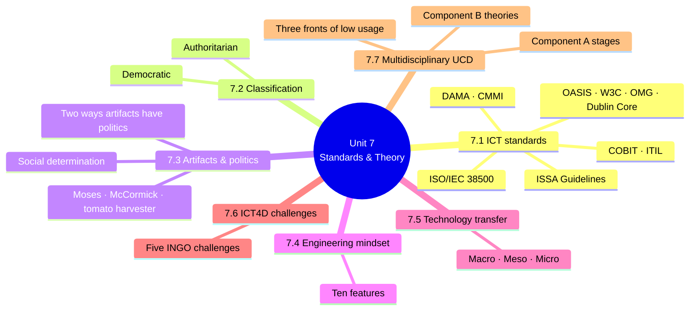
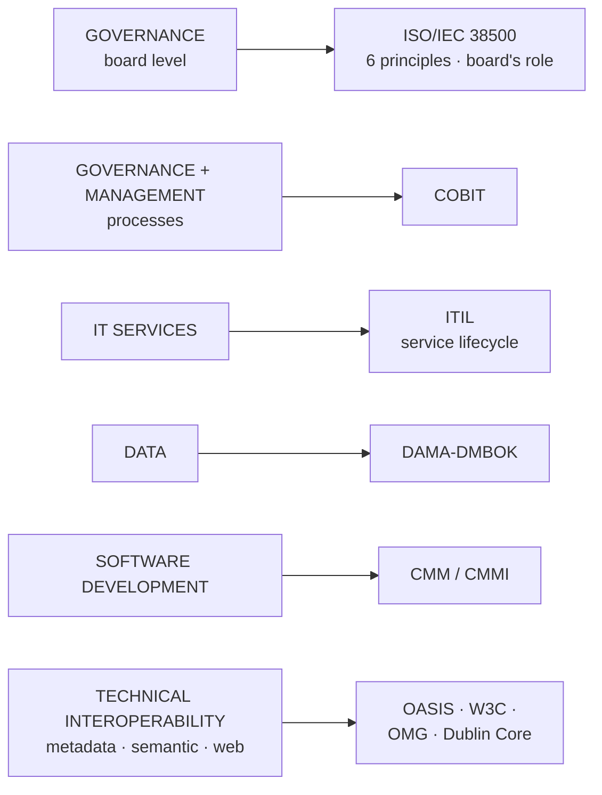
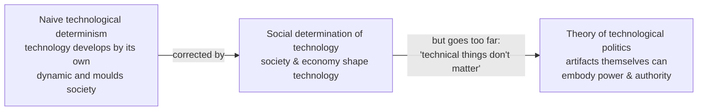
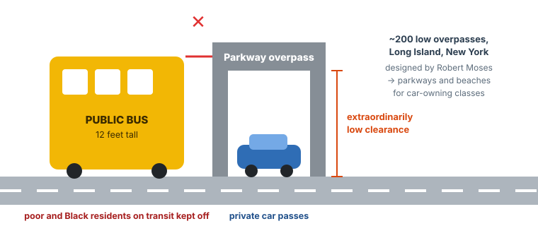
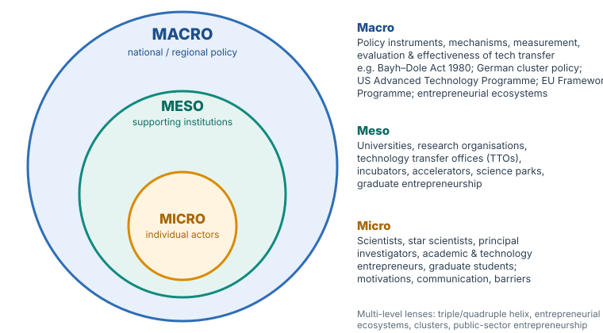
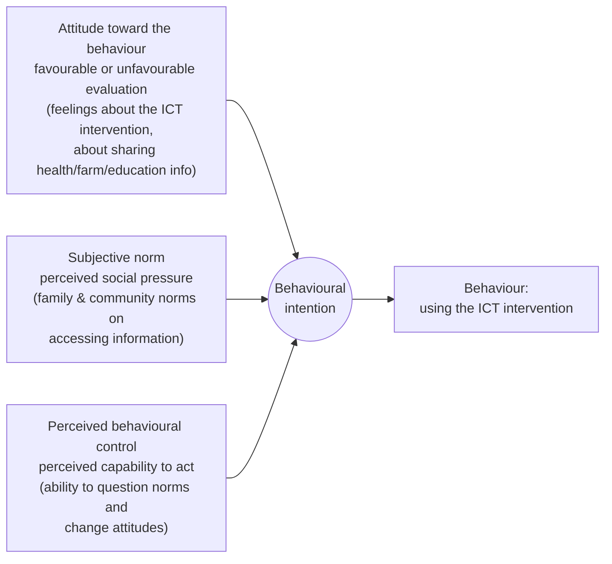

# Unit 7 — ICT Standards and Theoretic Concerns

*Courseware pages 90–116.*

## At a glance

The last unit steps back to ask **how ICT should be governed, what it does to power, and how to design it so people actually use it**:

| § | Topic | The big idea |
|---|---|---|
| 7.1 | **ICT standards** | International standards and frameworks (ISO/IEC 38500, COBIT, ITIL, DAMA, CMMI, OASIS, W3C, OMG, Dublin Core, ISSA) for governing and managing ICT |
| 7.2 | **Classification of technologies** | Mumford: **authoritarian** vs **democratic** technologies; the claim that every new invention brings freedom |
| 7.3 | **Artifacts and politics** | Technologies can **embody power and authority**, by design (Moses' bridges) or by their nature |
| 7.4 | **Engineering mentality** | **Ten features** of experiences that build an engineering mindset |
| 7.5 | **Technology transfer** | **Macro, meso and micro** perspectives, with the studies behind them |
| 7.6 | **Challenges in ICT4D** | **Five** challenges for INGOs |
| 7.7 | **Multidisciplinary approach** | Why rural ICT interventions fail, and a **user-centred design framework** built on three theories |

## Learning outcomes

At the end of the lecture, the learner should be able to:

1. Identify and explain the functions of ten Information and Communication Technology (ICT) Standardization Organizations
2. Mention and explain the two classification of technologies
3. Isolate Ten (10) critical features of high-quality engineering experiences that help students develop and strengthen an Engineering Mindset
4. State some six stern advice commonly given those who propose the notion that technical artifacts have political qualities

!!! warning "Courseware note — counts that don't match"
    - **Outcome 1 ("ten" organisations):** §7.1 names **nine** standards/frameworks in its first list (ISO, COBIT, ITIL, DAMA, OASIS, W3C, OMG, Dublin Core, CMM/CMMI). You reach **ten** by counting **ISO/IEC 38500** separately from ISO in general, or by adding the **ISSA Guidelines**. This page explains all of them.
    - **Outcome 4 ("six stern advice"):** §7.3 lists **five** (i–v). Learn the five.
    - **Self-test Q2 ("six challenges"):** §7.6 lists **five** INGO challenges. The source article is titled *"The five key challenges in implementing ICT for development"*.
    - **Self-test Q3 ("Micro, Meso and micro"):** should read **Macro, Meso and Micro**.
    - Outcomes do not mention §7.5–7.7, but self-test Q1–Q3 do, so they are examinable.

---

## Introduction

!!! warning "Courseware note"
    The courseware has an "Introduction" heading with **no text**. The following short introduction is written for this site.

Units 1–6 showed what ICT can do and why projects succeed or fail. Unit 7 adds four lenses:

1. **Governance:** international **standards** help organisations manage ICT consistently (§7.1).
2. **Power:** technologies are not neutral. Their design can **settle political questions** and favour some groups over others (§7.2–7.3).
3. **People and institutions:** the **mindset** of those who build technology (§7.4), the **levels** at which technology moves from research to use (§7.5), and the **organisations** (INGOs) that deploy ICT4D (§7.6).
4. **Design for adoption:** a **multidisciplinary, user-centred, theory-based** framework for ICT interventions in rural areas (§7.7).

---

## 7.1 ICT standards

> The growing extent of ICT application globally has motivated the development of standards and frameworks, notably by the International Organization for Standardization (ISO), Control Objectives for Information and Related Technology (COBIT®), IT Infrastructure Library® (ITIL®), Data Management International (DAMA), Organization for the Advancement of Structured Information Standards (OASIS), World Wide Web Consortium (W3C), Object Management Group (OMG), Dublin Core Metadata Initiative and Capability Maturity Model Integrated (CMM/CMMI). These standards and frameworks are generic and cover a very wide range of activities, and so are applicable in all kinds of business areas.

### The standards and what each covers

| # | Standard / organisation | Full name | Function (courseware) |
|---|---|---|---|
| 1 | **ISO** | International Organization for Standardization | Develops international standards, including ISO/IEC 38500 below |
| 2 | **ISO/IEC 38500** | Corporate governance of IT | **The starting point** for ICT governance and an institutional framework. Defines **six high-level principles** for **"good corporate governance of IT"**; focuses on the **role and responsibility of the board**. **Does not** address specific governance and management **processes** |
| 3 | **COBIT®** | Control Objectives for Information and Related Technology | A **generic, process-based** framework, increasingly accepted internationally, covering **overall ICT governance and management** |
| 4 | **ITIL®** | IT Infrastructure Library | An integrated set of **best-practice** recommendations for **managing the ICT service lifecycle** in line with business requirements |
| 5 | **DAMA (DAMA-DMBOK)** | Data Management International (Data Management Body of Knowledge) | A comprehensive guide covering **overall data management** activities |
| 6 | **CMM/CMMI** | Capability Maturity Model (Integrated) | Addresses **software application development** |
| 7 | **OASIS** | Organization for the Advancement of Structured Information Standards | **Technical standards**: interoperability, metadata, semantic and web-related technologies |
| 8 | **W3C** | World Wide Web Consortium | As above, especially **web** standards |
| 9 | **OMG** | Object Management Group | As above, including modelling standards |
| 10 | **Dublin Core** | Dublin Core Metadata Initiative | As above, especially **metadata** |
| (+) | **ISSA Guidelines on ICT** | International Social Security Association | Support **social security institutions** in applying **systematic, consistent ICT governance and management**, and give a **general framework** for applying standards; help identify frameworks **particularly relevant to social security** |

Which standard covers which layer of ICT activity.

!!! info "Beyond the notes — what these look like in practice"
    - **ISO/IEC 38500's six principles:** responsibility, strategy, acquisition, performance, conformance, human behaviour.
    - **CMMI** rates an organisation's processes on maturity **levels 1–5** (initial → optimising).
    - **W3C** produces HTML and CSS standards; **Dublin Core** defines 15 basic metadata elements (title, creator, date…) used by libraries and archives. This links to metadata standardisation in Unit 6 §6.3.4.

### Benefits, barriers and how to adopt

> These international standards and frameworks provide social security institutions with comprehensive and rigorous approaches to managing the complexities of ICT application (e.g. in large and critical-mission organizations). In addition, as they are increasingly adopted worldwide, their application would enable institutions to take advantage of global knowledge, experience and trained human resources.

| | Points |
|---|---|
| **Benefits** | **Comprehensive and rigorous** approaches to managing ICT complexity (e.g. in large, mission-critical organisations). Because they are adopted **worldwide**, institutions can use **global knowledge, experience and trained human resources** |
| **Barriers** | Corporate application needs **significant administrative effort** and often **changes in organisational culture and processes**. This **burden of transformation** often **blocks adoption** |
| **How to adopt** | As **medium-term capacity-building projects**, focused on **selected areas** that match the institution's **priorities** (especially implementing social security programmes and services) |
| **Limitation** | **Individually**, no standard covers **all aspects** of social security administration |

!!! tip "Exam angle"
    "Explain the functions of ten ICT standardisation organisations" calls for **name + full name + one-line function** for each. Group OASIS, W3C, OMG and Dublin Core under "technical standards: interoperability, metadata, semantic and web", but list them separately to reach the count.

---

## 7.2 Classification of technologies

> Lewis Mumford claimed that, from late stone age times in the Near East, right down to our own days, two technologies have recurrently existed side by side: a. Authoritarian b. Democratic

| | **Authoritarian technology** | **Democratic technology** |
|---|---|---|
| i | **System-centred** | **Man-centred** |
| ii | **Immensely powerful** | **Relatively weak** |
| iii | **But inherently unstable** | **But resourceful and durable** |

!!! example "Example"
    *(Interpretation, not from the courseware.)* A national grid powered by one huge dam is **system-centred and immensely powerful**, but if the dam or a key line fails, millions lose power (**unstable**). Household solar panels are **man-centred**, owned and controlled by users, and **weak** individually, but they keep working when others fail (**resourceful and durable**).

### The "boosters" and the opposite view

- Critics of **large-scale high-technology systems** are eager to interpret technical artifacts in **political language**.
- A long lineage of **boosters** insisted that the **"biggest and best"** of science and industry were the **best guarantees of democracy, freedom and social justice**. All of these have been called **democratising, liberating forces**:
    1. the **factory system**;
    2. the **automobile**;
    3. the **telephone**;
    4. **radio**;
    5. **television**;
    6. the **space programme**;
    7. **nuclear power**.
- **Daniel Boorstin**, in *The Republic of Technology*, praised **television** for "its power to **disband armies**, to **cashier presidents**, to create a whole new **democratic world**".
- "Scarcely a new invention comes along that someone does not proclaim it the **salvation of a free society**."

> It is no surprise to learn that technical systems of various kinds are deeply interwoven in the conditions of modern politics. … But to go beyond this obvious fact and to argue that certain technologies in themselves have political properties seems, at first glance, completely mistaken. We all know that people have politics, not things. To discover either virtues or evils in aggregates of steel, plastic, transistors, integrated circuits, and chemicals seems just plain wrong, a way of mystifying human artifice and of avoiding the true sources, the human sources of freedom and oppression, justice and injustice. Blaming the hardware appears even more foolish than blaming the victims when it comes to judging conditions of public life.

The common-sense objection:

- Technical systems are **interwoven with modern politics**: industrial production, warfare and communications have changed how power is exercised and what citizenship means.
- But saying technologies **in themselves** have political properties seems **mistaken**: **"people have politics, not things."**
- Finding virtue or evil in steel, plastic and transistors seems to **mystify** human artifice and **hide the human sources** of freedom, oppression, justice and injustice.
- **"Blaming the hardware appears even more foolish than blaming the victims."**

§7.3 answers this objection.

!!! example "Example — boosters today"
    The same claims were made for the internet and social media ("Twitter revolutions"). §7.6 notes that mobile phones and the Internet played a role in the 2011 revolutions in Northern Africa, but the same platforms were later used for surveillance and misinformation. That is why a booster's claim needs critical analysis.

---

## 7.3 Artifacts and politics

> In controversies about technology and society, there is no idea more provocative than the notion that technical things have political qualities. The issue is the claim that the machines, structures, and systems of modern material culture can be accurately judged not only for their contributions of efficiency and productivity, not merely for their positive and negative environmental side effects, but also for the ways in which they can embody specific forms of power and authority.

Technologies can be judged on **three** things:

1. **efficiency and productivity**;
2. **positive and negative environmental side effects**;
3. **the ways they embody specific forms of power and authority**. This is the provocative claim.

!!! info "Beyond the notes — source"
    This section comes from **Langdon Winner, "Do Artifacts Have Politics?" (1980)**. The courseware keeps Winner's first-person voice ("As far as I know…", "From such examples I would offer…").

### The "stern advice" given to those who say artifacts have politics

| # | Stern advice | Meaning |
|---|---|---|
| i | **What matters is not technology itself, but the social or economic system in which it is embedded** | Look at the society, not the machine |
| ii | This maxim is the central premise of a theory called the **social determination of technology**, and it has an **obvious wisdom** | Society shapes technology |
| iii | It is a needed **corrective** to those who focus uncritically on **"the computer and its social impacts"** but fail to look at the **social circumstances** of technology's **development, deployment and use** | Don't treat the computer as the actor |
| iv | It is an **antidote to naive technological determinism**: the idea that technology develops **solely from an internal dynamic** and then, **unmediated**, **moulds society** to fit its patterns | Technology doesn't drive itself |
| v | Those who have not recognised how technologies are **shaped by social and economic forces** "have not gotten very far" | Social analysis is essential |

### Shortcomings of the corrective

Taken literally, the social-determination view suggests:

| | Shortcoming |
|---|---|
| a | **Technical things do not matter at all**: once you find the social origins and power holders behind a technological change, you have explained everything |
| b | It **comforts social scientists**: technology is nothing special, so they can use their standard models of power (**interest-group politics, bureaucratic politics, Marxist models of class struggle**) |
| c | Social determination of technology becomes **no different from** social determination of **welfare policy or taxation** |
| d | **But** technology has taken on a **special fascination** for historians, philosophers and political scientists. Standard social-science models **only go so far** in explaining it |
| e | Much modern social and political thought contains a **theory of technological politics**, "an odd mongrel" crossbred with liberal, conservative and socialist philosophies |
| f | The theory of technological politics draws attention to: (i) the **momentum of large-scale socio-technical systems**; (ii) the **response of modern societies to technological imperatives**; (iii) the all-too-common **adaptation of human ends to technical means** |

The argument of §7.3 in three positions.

### Two ways artifacts can contain political properties

| Way | Description | How troublesome |
|---|---|---|
| **1. Design settles an issue** | The **invention, design or arrangement** of a specific device or system **becomes a way of settling an issue** in a particular community | **Straightforward** and easily understood (§7.3.1) |
| **2. Inherently political technologies** | Man-made systems that **appear to require**, or are **strongly compatible with**, particular kinds of **political relationships** | **Much more troublesome**; closer to the heart of the matter |

**Definitions used:**

- **"Politics"**: arrangements of **power and authority** in human associations, and the **activities** within those arrangements.
- **"Technology"**: **all of modern practical artifice**: smaller or larger pieces or systems of hardware.

!!! info "Beyond the notes — inherently political technologies"
    Winner's examples (not in the courseware) are the **atomic bomb**, which he argues requires a centralised, hierarchical chain of command to manage safely, and **solar energy**, which he says is more compatible with decentralised, democratic arrangements. This matches Mumford's authoritarian vs democratic classification in §7.2.

### 7.3.1 Technical arrangements as forms of order

> Histories of architecture, city planning, and public works contain many examples of physical arrangements that contain explicit or implicit political purposes.

**Case 1: Robert Moses' low overpasses (Long Island, New York)**

- Many overpasses on Long Island parkways are **extraordinarily low**. The **two hundred or so** low overpasses were **deliberately designed** for a social effect.
- **Robert Moses** (the builder), from **social-class bias and racial prejudice**, wanted **"upper" and "comfortable middle" class** whites with **cars** to use the parkways freely for recreation and commuting.
- **Poor people and Black people**, who normally used **public transit**, were kept off because **twelve-foot buses could not pass under the overpasses**.

{ .diagram }

Moses' low bridges: the political choice was built into the concrete.

!!! info "Beyond the notes — a debated example"
    Later historians (notably Bernward Joerges, 1999) questioned parts of the Moses story, e.g. whether buses were already barred from parkways by regulation, so that the bridges were not the only cause. The **principle** the courseware draws (design can settle political questions) is widely accepted. In the exam, use the courseware's account.

**Case 2: Haussmann's Paris boulevards.** **Baron Haussmann's** broad thoroughfares, engineered at **Louis Napoleon's** direction to **prevent street fighting** like that of the **revolution of 1848**.

**Case 3: 1960s–70s campus architecture.** "Grotesque" concrete buildings and **huge plazas** on American campuses, built in the **late 1960s and early 1970s** to **defuse student demonstrations**.

**Case 4: McCormick's moulding machines (Chicago, mid-1880s)**

- At **Cyrus McCormick's reaper plant**, **pneumatic moulding machines** (new and **largely untested**) were added to the foundry at about **$500,000**.
- It looked like **modernisation and efficiency**, but **Cyrus McCormick II** was fighting the **National Union of Iron Molders**. He saw the machines as a way to **"weed out the bad element among the men"**: the **skilled workers** who had organised the union.
- The machines, run by **unskilled labour**, made **inferior castings at higher cost**.
- After **three years** they were **abandoned**, but they had served their purpose: **the destruction of the union**.

**Lessons from Moses and McCormick:**

- **Technical arrangements precede the use** of the things in question.
- Technologies can obviously be **used** to enhance power (e.g. **television used to sell a candidate**), but the deeper point is about **design**.
- We see technologies as **neutral tools** used well or badly, but rarely ask whether a device was **designed to produce consequences logically and temporally prior to any of its professed uses**.
- Moses' bridges carried cars; McCormick's machines made castings. **Both encompassed purposes far beyond their immediate use.**
- If our moral and political language covers only **tools and uses**, and not **designs and arrangements**, "we will be **blinded** to much that is intellectually and practically crucial".

**No conspiracy needed: disability access**

- Recognising politics in technology **does not require conscious conspiracies or malice**.
- The **disability movement in the US in the 1970s** showed how **buses, buildings, sidewalks, plumbing fixtures** made it impossible for many disabled people to move freely, **systematically excluding them from public life**.
- These designs arose more from **long-standing neglect** than from intention. Once the issue was raised, **justice required a remedy**, and artifacts are being **redesigned and rebuilt**.

**Beyond "intended" and "unintended": the tomato harvester**

- Some of the most important cases **transcend "intended" and "unintended"**: technical development is so **biased in one direction** that it regularly produces **breakthroughs for some** and **crushing setbacks for others**.
- "The **technological deck has been stacked** long in advance to favour certain social interests."

| Tomato harvester facts | |
|---|---|
| Developed by | Researchers at the **University of California**, from the **late 1940s** |
| How it works | Harvests in **a single pass**: cuts plants, shakes fruit loose, **sorts electronically** into gondolas holding up to **25 tons** for canning |
| Replaced | **Hand-picking** crews passing through fields **three or four times** |
| Growers | About **4,000** (early 1960s) → about **600** (1973), with a **substantial increase in tons produced** |
| Jobs | About **32,000** jobs eliminated by the late 1970s |
| Outcome | Productivity gains for **very large growers** at the **sacrifice of other rural communities** |
| Lawsuit | **California Rural Legal Assistance** (for farm workers and others) charged that the University spent **tax money** on projects benefiting a **few private interests** against **farm workers, small farmers, consumers and rural California**. The University replied that accepting this "would require **elimination of all research** with any potential practical application" |
| No plot | **William Friedland and Amy Barton** **exonerate** the developers. Instead, **scientific knowledge, technological invention and corporate profit reinforce each other** in entrenched patterns. **Land-grant colleges'** agricultural R&D has tended to favour **large agribusiness** |
| Key point | Opponents get labelled **"antitechnology" or "antiprogress"**, but the harvester is **not merely a symbol** of a social order that rewards some and punishes others: **it is an embodiment of that order** |

### Two kinds of choices about technology

| Choice | What is decided | Courseware examples |
|---|---|---|
| **"Yes or no"** | Whether to **develop and adopt** the thing at all, i.e. whether it joins society as **operating equipment**. Reasons for and against are as important as for **a new law** | **Food additives, pesticides, highways, nuclear reactors, dam projects**; **ABM** (anti-ballistic missile), **SST** (supersonic transport) |
| **Design features** | Specific features of design or arrangement **after** the decision to go ahead | A power line's **route** and **tower design**; a computer system's **components, programs, modes of access**; adding **electronic sorters** to the tomato harvester |

- Research shows how **innocuous-seeming design features** in mass transit, water projects and industrial machinery **mask social choices** of profound significance.
- **David Noble** studied two automated machine-tool systems, **record/playback** and **numerical control**. Their components are similar, but the **choice of design** has crucial consequences for **management–labour struggles** on the shop floor. Seeing it only as cost-cutting or efficiency **misses the decisive element**.

### Conclusions

> The things we call "technologies" are ways of building order in our world.

1. Many devices and systems allow **different ways of ordering human activity**.
2. Consciously or not, **societies choose structures** for technologies that shape how people **work, communicate, travel and consume** for a **very long time**.
3. In these decisions, people are **differently situated**, with **unequal power** and **unequal awareness**.
4. **The greatest latitude of choice exists the very first time** a technology is introduced. Choices become **fixed in material equipment, economic investment and social habit**, so the original flexibility **vanishes** once commitments are made.
5. So technological innovations are **like legislative acts or political foundings**: they set a framework for public order **lasting generations**.
6. The same care given to **political rules, roles and relationships** must be given to **highways, television networks and small features of new machines**.
7. Issues that divide or unite people are settled not only in politics proper but in **"tangible arrangements of steel and concrete, wires and transistors, nuts and bolts"**.

!!! example "Example — artifacts with politics in ICT4D"
    - A university registration portal that works only on smartphones with paid data, and only during working hours, **excludes** poorer students without anyone intending it (**neglect**, like disability access).
    - A national ID system designed around fingerprints fails for manual labourers with worn fingerprints. Design **settles who gets services**.
    - A choice between closed proprietary e-government software and open standards decides, **at first introduction**, who will control and maintain it for decades (**greatest latitude at the start**).

!!! tip "Exam angle"
    For "analyse the politics of this artifact" questions:

    1. Is it **design settling an issue** (way 1) or **inherently political** (way 2)?
    2. Was the effect **intended** (Moses, McCormick), from **neglect** (disability access), or **"stacked deck"** (tomato harvester)?
    3. Is the decision a **yes/no** choice or a **design-feature** choice?
    4. Who **gains** and who **loses** power?
    5. **When** can it be changed? Most easily **at first introduction**.

---

## 7.4 Engineering mentality

> One of the primary goals of engineering education is to promote the development of an engineering mindset. It could be referred to as 'engineering practices' or 'engineering habits of mind', the engineering mindset refers to the values, attitudes, and thinking skills associated with engineering. A typical engineering mindset think on how to make things to work.

- **Engineering mindset** = the **values, attitudes and thinking skills** of engineering. Also called **engineering practices** or **engineering habits of mind**. It thinks about **how to make things work**.
- The **ten critical features** of high-quality engineering experiences come from **Cunningham (2018)** and **Cunningham & Kelly (2017)**.

| # | Feature | Courseware explanation and example |
|---|---|---|
| i | **Consideration of problems in context** | Engineers solve **specific real-world problems**. Building a tall tower from **straws and paper clips** is fun but **lacks purpose**. Designing a device that **keeps medicine cold during transport in a disaster area** is rich in context. Consider **background, client needs, implications** |
| ii | **Usage of a specific problem-solving process** | An **engineering design process (EDP)** distinguishes engineering from **"tinkering" or "making"**. Discrete steps **scaffold** learning; plan, test and improve **instead of trial and error**; naming phases focuses each day's goals |
| iii | **Investigation of the properties and uses of materials** | Thoughtful material choices; explore **properties, advantages and disadvantages**; learners get a **wide selection of materials** and **time to explore** them |
| iv | **Consideration of constraints and criteria that require trade-offs** | Design to **specifications**. The strongest material may be **heavy**; simple and elegant may be **expensive**. State **criteria for success** and **constraints**, e.g. a **parachute** that falls slowly **but** packs small |
| v | **Envisioning of multiple solutions** | No single **"correct"** solution; **brainstorm, compare designs, recommend** to a client. Encourages **innovation, risk-taking**, comfort with **open-ended problems** |
| vi | **Application of science and math knowledge** | Engineers combine **math and science** with **creativity**. Activities tied to school science (**magnetism, Newton's laws, needs of living things**) are authentic and compelling |
| vii | **Evaluation of designs and making improvements** | **Test** designs and use feedback to **revise**; emphasise the **iterative** nature of design |
| viii | **Persistence and learning from failure** | Each challenge has unique criteria and constraints; rarely a simple solution. **Failure is an opportunity to revise and improve** |
| ix | **Working effectively in teams** | Engineering is **rarely solitary**; diverse opinions and skills; learn to **communicate and negotiate** |
| x | **Envisioning oneself as an engineer** | Success with the design process builds **agency**; learners **identify as capable problem-solvers** and pursue engineering |

> Learning individuals need multiple scaffolded experiences over time to develop this mindset. As they gain experience and maturity, use of the engineering mindset will become more routine and more complex.

!!! tip "Exam angle"
    Memory aid **"CPM-CMS-EPT-E"**: **C**ontext, **P**rocess, **M**aterials · **C**onstraints, **M**ultiple solutions, **S**cience & math · **E**valuate, **P**ersist, **T**eams · **E**nvision self. Link to ICT4D: features i (context), iv (trade-offs) and vii (evaluate) are exactly what rural ICT projects lack in §7.7.

---

## 7.5 Macro, meso and micro perspectives of technology transfer

**Background:**

- Research on technology transfer has **grown significantly**, mainly from a **macro** perspective, building a knowledge and evidence base that has **shaped policy and practice**.
- There is a **growing focus on meso and micro** aspects:
    - **individual actors**: scientists, principal investigators, policymakers, TTO actors;
    - **supporting institutions**: universities, professional research organisations, technology and knowledge transfer offices.
- This research reveals **fine-grained nuances** of how technology transfer works in different **geographical and organisational contexts**.

{ .diagram }

The three levels of technology transfer, with the courseware's examples.

| Level | Focus (courseware) | Examples |
|---|---|---|
| **Macro** | Long tradition; draws on **economics, management, innovation, public policy, strategic management, entrepreneurship**. **Mechanisms (formal and informal), measurement, evaluation, effectiveness**; effectiveness of **policy instruments** at national, regional or sector level | **Bayh–Dole Act 1980** (US law on university-to-industry transfer); policy studies in the US and Europe |
| **Meso** | **Supporting institutions** | **Technology transfer offices (TTOs)**; **incubators, accelerators, graduate entrepreneurship**; **science parks** (multi-level) |
| **Micro** | **Individual actors and their experiences** | **Use of TTOs**; institutional dimensions of **R&D collaborations**; **motivations, communications and barriers** to university collaboration; **academic entrepreneurs, scientists, star scientists, principal investigators, technology entrepreneurs, graduate students** |

**Multi-level perspectives** that link all three: the **triple and quadruple helix**, **entrepreneurial ecosystems**, **clusters**, **public-sector entrepreneurship**.

!!! info "Beyond the notes — key terms"
    - **Technology transfer:** moving knowledge or technology from where it is created (e.g. a university lab) to where it is used (e.g. a company or community).
    - **Bayh–Dole Act (1980):** a US law letting universities own and license patents from federally funded research, which led to the growth of university TTOs.
    - **Triple helix:** university–industry–government collaboration. The **quadruple helix** adds civil society or users.
    - **Spin-off / spin-out:** a company created to commercialise a university's research.

### 7.5.1 Macro perspectives

| Study | Context | Key findings and implications |
|---|---|---|
| **Lehmann & Menter (2017)** | **German cluster policy**, regional focus | Cluster policy is favoured as a way to create wealth ("it pays"). They show **direct and indirect effects**, and the **key role of universities** creating regional knowledge that firms commercialise. Needs **incentives** for universities to engage, and **regional transfer infrastructure**. Policymakers must consider **meso and micro impacts** and **unintended consequences**. Policy must address **real barriers**, beat the **status quo**, and be **sustainable without government direction** |
| **R&D subsidies** (general) | Favoured macro response | Incentivising or subsidising R&D that exploits university knowledge; studies show subsidies **positively impact private firms** |
| **Smith et al. (2017)** | **US Advanced Technology Programme** | Funding had a **positive, significant effect on long-term firm survival**. Policies must deliver **long-term** benefits, though **political/temporal pressure** demands **short-term** results |
| **EU Framework Programme** study | Collaborative EU-funded research (academics + SMEs + MNCs across member states) | The **combination of collaborators**, **consortium design and incentives** decide innovation outcomes. Firms must consider **size, mix and capabilities** of partners; policy must reflect **diverse needs** of actors |
| **Nicotra et al. (2017)** | **Entrepreneurial ecosystem** framework | A framework of **eco-factors and eco-outputs** to test **causal effects** and overcome measurement deficits. Validate **beyond Silicon Valley**. **Danger: blind imitation** of successful ecosystems' programmes without understanding causes |

### 7.5.2 Meso and micro perspectives

| Study | Context | Key findings and implications |
|---|---|---|
| **van Stijn et al. (2017)** | **University–start-up interaction**, **Route 128, Boston** | Identified **14 interaction practices**. Universities can support **market development**, but **near-to-market** start-ups may be **better served outside the university**. Universities must decide the **scope** of start-up support (near-market vs **science-based**) and keep **organisational flexibility** |
| **Ben-Hafaïedh et al. (2017)** | **Academic spin-off team composition**, **Italian** data | A **dual configuration (academic + practitioner)** gives the **best commercial performance**. Academics should be open to **commercial collaboration**; practitioners must pick spin-offs with **real potential**; policy should encourage such teams |
| **Kolb & Wagner (2017)** | **University spin-offs**, **single university** | A **framework of needs**; **four categories** of spin-out groups needing different support. Universities and TTOs must balance **generic vs tailored** support, with implications for resources, structures and skills; contributes to the debate on TTO **standardisation vs specialisation**. Micro studies give **rich nuances** |
| **Ratzinger et al. (2017)** | **Digital start-ups**, large sample, **human-capital** view | Founders' **higher education** affects reaching **equity investment milestones** (micro, meso and macro implications). **Students:** value of degrees and openness to **other disciplines**. **Universities:** university-wide **entrepreneurship education** (core or extracurricular) and skills. **Investors:** consider founders' **education and background** |

!!! example "Example — a Nigerian university lens"
    A university wants its researchers' solar-dryer invention to reach farmers.

    - **Macro:** national innovation policy (e.g. research grants, patent law, tax incentives).
    - **Meso:** the university's technology transfer office, an incubator or a technology hub.
    - **Micro:** the lecturer's motivation, whether a business-minded partner joins the team (Ben-Hafaïedh's dual team), and the students who help build it.

---

## 7.6 The challenges in implementing ICT for development

> Information and Communications Technology (ICT) represents significant opportunity to create lasting change but also challenges and possible threats.

**Figure 7.1** (p.106) shows a group of young Africans working on laptops around tables in a technology hub. Caption: *"ICT presents many opportunities for development but also challenges and potential threats."*

**Opportunities:**

- **Rapid penetration of mobile access** has improved the lives of the poor in **rural and urban** areas; availability will expand and **cost will fall**.
- Mobile telephony and broadband support new products and services and **breakthrough ideas in agriculture, health, education and access to finance**, and help **local and international trade**.
- New ways of **communicating and lobbying across borders**, e.g. mobile phones and the Internet in the **revolutions across Northern Africa in 2011**.
- ICT4D literature is overwhelming, with many exciting examples. ICT is **changing the landscape whether we like it or not**.

**Why INGOs are well positioned (in theory):**

- Through **field programmes and local partners**, they **understand the poor** and work closely with **district and national government** and, increasingly, **business** at all levels.
- Through **international programme teams**, they can **test, share and develop knowledge networks**: spread learning, build on successes, avoid pitfalls.

**But there are five challenges and possible threats:**

| # | Challenge | Courseware explanation |
|---|---|---|
| 1 | **Sustainability and scale** | ICT use has been **ad hoc**: **many small pilots, very few large-scale, sustainable programmes**. Needs **new collaboration** (internal and external) and a **new approach to scaling** for **material impact**, coordinating **INGOs, tech companies, private sector, universities, government (central and local) and development partners** |
| 2 | **Lack of knowledge** | Many INGOs lack the **knowledge, expertise and organisational capacity** to exploit ICT. IT is seen as a **thorny back-office issue**, and ICT has a **questionable reputation** from past **unsuccessful or costly** initiatives |
| 3 | **Pace of change** | Existing **structures, staffing and ways of operating** have strong **momentum**. It is easy to use ICT for **incremental** improvement of current approaches, but **very difficult** to adopt **fundamentally new ways of working** needing shifts in **strategy, competence, skills and structure** |
| 4 | **Funding** | **Cyclical donor funding** and pressure to **minimise administrative costs** make it hard to **plan and resource** ICT as a **core capacity** |
| 5 | **Changing roles and norms** | ICT challenges the **assumptions INGOs were founded on**. INGOs bridged gaps between the poor and the affluent world in **understanding, information, access, communication and resources**. These gaps are **less clear or compelling** now, because ICT has changed them, directly and indirectly |

!!! tip "Exam angle"
    Memory aid **"S-K-P-F-R"**: **S**ustainability & scale, **K**nowledge, **P**ace of change, **F**unding, **R**oles & norms. If asked for "six", give these five and say the courseware lists five (the source article is titled "The five key challenges…").

!!! note "In plain terms — challenge 5"
    INGOs used to be the main channel through which the world learned about poor communities and through which help arrived. Now a farmer can post a video directly, receive remittances by mobile money, and talk to buyers abroad. If INGOs do not rethink their role, ICT may make parts of it unnecessary.

---

## 7.7 A multidisciplinary approach to ICT development

> Despite large-scale investment in ICT in developing countries, information poverty has not been addressed, particularly for rural users. This material votes for adopting a multidisciplinary design approach when developing ICT interventions and proposes employing a user-centered design framework as a tool to help achieve higher user acceptance and efficient information transfer.

- After **two decades of aggressive investment** by IT companies in rural areas, stakeholders believe ICT can bring **positive change** by offering **relevant information services** to **reduce information poverty**, helping rural users make decisions that improve **wellbeing** and **economic and social development**.
- **But** comparing investment with impact, the results **do not make a convincing case**.
- ICT interventions in **rural India** (e-governance, agriculture, education, health care) reported **low usage and low acceptance** on **three fronts**:

| Front | Problem (courseware) |
|---|---|
| **1. Content** | Applications were **too general** to be useful, and information was **inadequately presented**. E.g. the **Gyandoot** and **n-Logue kiosk** projects won grants and awards, but users found the information **not relevant** and of **no value**. There was **no formal protocol to update and evaluate content relevance**. Interventions had **poorly designed content**, **weak communication strategies**, and **no mechanism to measure changes** in users' lives |
| **2. Fragmented, single-discipline development** | Socially complex, infrastructurally weak rural contexts need solutions from **several disciplines**, but there is **no formal platform** to bring them into the development cycle. Technology developers are **unaware of local requirements**, so **infrastructure availability** and **local maintenance** get little attention, and the **maintenance burden falls on local operators or NGOs**. (i) **Industrial design** could help understand context and gather requirements; (ii) **content developers** lack knowledge of the **social environment and information needs**; (iii) how content is **developed, maintained and accessed** locally gets "scanty attention". The **social sciences** have much knowledge of rural life, but there is **little evidence it is applied** |
| **3. Little evaluation** | Few agencies **evaluate after the project** or study **user adoption**. Rarely asked: (i) **how the intervention changed users' lives**; (ii) **how users benefited**, or how far it addressed **information poverty**. The literature has only a **smattering of evaluation reports** |

**Two challenges to address:**

1. How can we **design and develop ICT interventions for socially complex environments**, **maximise information dissemination** and so **increase user adoption**?
2. How can **knowledge from multiple disciplines** (social sciences, computer science, industrial design, marketing research) be **incorporated into the ICT development cycle**?

!!! note "In plain terms"
    These three fronts are design–reality gaps (Unit 3): **information** (content not relevant), **staffing and skills / management** (wrong disciplines, no maintenance), and no measurement (the DRG model itself is a measurement tool). The fix is **participatory, user-centred** design (Unit 5), done **by a mix of disciplines**, and **evaluated**.

### 7.7.1 Call for user-centred development

- **User-centred design (UCD)** can address both challenges in an integrated way, improving information dissemination and **increasing adoption**.
- UCD **optimises the design around how users can, want or need to work**, **rather than forcing users to change** to fit the system.
- UCD is the framework in which **knowledge from different disciplines converges** while addressing **stakeholders' needs**.

**Why these four disciplines:**

| Discipline | Contribution |
|---|---|
| **Social science** | Understanding **societal issues** at community and individual levels in rural areas |
| **Computer science** | Developing **interactive device software and hardware** |
| **Industrial design** | Designing the **user interface** and **usability testing**; **context-specific solutions** to socio-cultural issues |
| **Marketing** | **Economic sustainability** and **technology adoption** |

### 7.7.2 Proposed user-centred design framework for ICT development

The framework **adapts an ISO standard UCD cycle** and integrates methods and theories from these disciplines. It has **two components**:

{ .diagram }

The two-component UCD framework, drawn from §7.7.2.

#### Component A: user-centred phase of the design and development cycle

Three stages that together allow **empirical validation** of the approach.

**(i) Exploratory research:**

- identify the **target user group, user needs, characteristics and social norms**; assess users' **knowledge level** with a **baseline survey**;
- formulate the **design brief**: **information content, form, interaction requirements**;
- obtain data on **four contextual design factors**: **socio-cultural**, **technological**, **economic** and **users' past ICT experiences**;
- identify the **responsibilities of stakeholders**.

**(ii) Creative design action:**

- design, develop and iterate a prototype called the **Knowledge Aggregation Platform (KAP)**;
- the KAP gives the team **hands-on user experience** and lets them **evaluate design strategies with users** from the start;
- **social cues from persuasive technology** shape the **information communication strategies, physical environment and physical design**;
- the KAP is **iterated constantly** from **user feedback**, creating a **dynamic evaluation mechanism** with **short design cycles**;
- feedback is collected on **Rogers' (1995) five product innovation attributes**:
    1. **relative advantage**;
    2. **compatibility**;
    3. **complexity**;
    4. **trialability**;
    5. **observability**.

**(iii) Evaluative research** at two levels:

1. **Measuring adoption** through a **longitudinal study** of KAP users, comparing **baseline** data (exploratory phase) with **intervention** data. Findings document the basis for new rural interventions and **guidelines for future design**.
2. **Evaluating adoption** against the **five innovation attributes**, highlighting the **critical factors** behind high or low adoption.

!!! info "Beyond the notes — longitudinal and cohort studies; Rogers' attributes"
    The courseware itself defines a **longitudinal study** as an observational study with **repeated observations of the same items over a long period**, and a **cohort** as a group sharing a common characteristic or experience in a defined period (e.g. having received the intervention).

    Rogers' attributes in plain terms:

    | Attribute | Question users ask |
    |---|---|
    | Relative advantage | Is it better than what I do now? |
    | Compatibility | Does it fit my values, needs and habits? |
    | Complexity | Is it hard to understand or use? (lower is better) |
    | Trialability | Can I try it before committing? |
    | Observability | Can I see others benefiting from it? |

#### Component B: theoretical framework

- Explains the **selection and application of the theories** guiding Component A.
- **Advantage of theory-based development:** a **scientific platform for aggregating knowledge** and **empirical validation**.
- Three theories, one per stage:

| Stage | Theory | Role |
|---|---|---|
| **(a) Exploratory** | **Theory of planned behaviour (TPB)** | Identify **social norms and user needs** to develop **information content**. The questionnaire is built on TPB's three factors |
| **(b) Creative design** | **Persuasive technology** | **Social cues** to design communication strategies that **shape existing beliefs and practices** |
| **(c) Evaluative** | **Diffusion theory** (Rogers) | **Innovation attributes** to evaluate the intervention in the **longitudinal study** against the baseline |

- These theories have mostly been applied to ICT in the **Western world**; there is **rare evidence** of their use in **rural contexts**, which could yield **new perspectives**.

**Theory of planned behaviour (TPB):**

- A widely applied framework for understanding **health-related behaviours**: **physical fitness, low-fat diets, condom use for AIDS prevention, wearing a safety helmet**.
- **Three variables combine to form a behavioural intention:**

Theory of planned behaviour as applied in the exploratory stage. The final "behaviour" box is added to show what the intention leads to.

**Persuasive technology:**

- **Any interactive computing system designed to change people's attitudes or behaviour.**
- A viable strategy for changing **social and health-related attitudes in the West**. Applications range from **reducing energy consumption** to **reminding patients to take medication** to **persuading young females to avoid early pregnancy**.
- So far used mainly in **Western countries** and for **urban users**; **no evidence** yet for rural developing areas.
- In this framework it is used in **communication strategies, physical environment and physical system design**, to **shape social norms**, raise **behavioural intention** and increase **perceived behavioural control**.

**Diffusion theory (evaluative stage):**

- **Innovation attributes** evaluate the intervention in the **longitudinal study**, compared with the **baseline**.
- Results measure **improvement in information dissemination**, indicate **user adoption**, and show the role of the intervention in **wellbeing**. These lessons become **guidelines for future ICT development**.

**How A and B fit together:**

- They are **interlinked**: B provides the **theoretical foundation** for each stage of A.
- **B is dynamic**: it gives the **freedom to incorporate theory appropriate to the case** and a platform to **aggregate knowledge** from different disciplines.
- **Advantage:** a source of **principles for design innovation** on complex development issues. E.g. **social science theories** guide investigation of rural users.
- **Modularity** gives proper emphasis to theory at **each stage**, generating the **scientific knowledge** for future ICT development, which is often overlooked because development is **not theory-driven**.

!!! warning "Courseware note"
    The section ends: "The details of both components and how they can be applied in ICT development are described next." Nothing follows. The framework is fully summarised above.

!!! example "Example — applying the framework in Nigeria"
    **Goal:** an SMS/voice service giving antenatal advice to pregnant women in rural Kebbi.

    1. **Exploratory (TPB):** baseline survey of knowledge. *Attitude:* do women see phone advice as useful? *Subjective norm:* do husbands and mothers-in-law approve of women seeking health information by phone? *Perceived control:* do women have phones, airtime and the freedom to use them? Record the four contextual factors.
    2. **Creative design (persuasive technology):** prototype a KAP, e.g. voice messages in Hausa from a trusted local health worker, with reminders before clinic days. Iterate with feedback on Rogers' attributes (is it **compatible** with household norms, simple, **trialable**?).
    3. **Evaluative (diffusion):** follow the cohort for a year; compare clinic attendance and knowledge with the baseline; evaluate on the five attributes; write guidelines.

---

## Key terms

ISO/IEC 38500
:   The starting-point standard for ICT governance: six high-level principles for good corporate governance of IT, focused on the board. It does not cover specific processes.

COBIT / ITIL / DAMA-DMBOK / CMMI
:   Frameworks for ICT governance and management / IT service lifecycle / data management / software development maturity.

OASIS, W3C, OMG, Dublin Core
:   Bodies setting technical standards for interoperability, metadata, semantic and web technologies.

ISSA Guidelines on ICT
:   Guidance for social security institutions on systematic ICT governance and on applying relevant standards.

Authoritarian vs democratic technology (Mumford)
:   System-centred, immensely powerful but unstable / man-centred, relatively weak but resourceful and durable.

Social determination of technology
:   The view that what matters is the social or economic system in which technology is embedded.

Naive technological determinism
:   The idea that technology develops by its own internal dynamic and, unmediated, moulds society.

Theory of technological politics
:   Attention to the momentum of large socio-technical systems, technological imperatives, and the adaptation of human ends to technical means.

Inherently political technologies
:   Man-made systems that appear to require, or be strongly compatible with, particular political relationships.

Engineering mindset
:   The values, attitudes and thinking skills associated with engineering ("engineering habits of mind").

Engineering design process (EDP)
:   A multi-step process (plan, test, improve) that distinguishes engineering from tinkering.

Technology transfer (macro/meso/micro)
:   Policy and national/regional level / supporting institutions (TTOs, incubators, science parks) / individual actors.

TTO
:   Technology transfer office.

Information poverty
:   Lack of access to relevant information needed for decisions that improve wellbeing.

User-centred design (UCD)
:   Optimising a design around how users can, want or need to work, rather than forcing users to adapt.

Knowledge Aggregation Platform (KAP)
:   The prototype ICT intervention iterated with users in the creative design stage.

Theory of planned behaviour
:   Attitude + subjective norm + perceived behavioural control → behavioural intention.

Persuasive technology
:   Any interactive computing system designed to change attitudes or behaviour.

Diffusion of innovations (Rogers)
:   Adoption depends on relative advantage, compatibility, complexity, trialability and observability.

Longitudinal study / cohort
:   Repeated observation of the same items over a long period / a group sharing a characteristic or experience in a defined period.

---

## Unit summary

- **ICT standards:** ISO (ISO/IEC 38500: six principles, the board's role), COBIT (governance and management), ITIL (service lifecycle), DAMA-DMBOK (data management), CMM/CMMI (software development), and OASIS, W3C, OMG, Dublin Core (interoperability, metadata, semantic, web). ISSA guidelines for social security. Benefits: rigour, global knowledge. Barriers: administrative effort, culture change. Adopt as **medium-term capacity building** in priority areas.
- **Mumford:** **authoritarian** (system-centred, powerful, unstable) vs **democratic** (man-centred, weak, resourceful, durable). Boosters hailed every big technology as liberating (Boorstin on TV). The common objection: "people have politics, not things".
- **Artifacts and politics:** technologies can **embody power and authority**.
    - **Five pieces of stern advice** (social determination) and their **shortcomings** (technical things "don't matter", social scientists comforted, theory of technological politics).
    - **Two ways artifacts have politics:** design settles an issue; inherently political technologies.
    - **Cases:** Moses' ~200 low bridges vs 12-ft buses; Haussmann's boulevards (1848); campus plazas; McCormick's $500,000 machines that broke the union; disability access (neglect); the tomato harvester (4,000 → 600 growers, 32,000 jobs, CRLA lawsuit, "stacked deck").
    - **Yes/no vs design choices**; David Noble. Technologies build order; the greatest latitude is at first introduction; they are like legislation.
- **Engineering mindset:** ten features: context, process, materials, constraints/trade-offs, multiple solutions, science and math, evaluate and improve, persistence, teams, envisioning oneself as an engineer.
- **Technology transfer:**
    - **Macro**: policy (Bayh–Dole; Lehmann & Menter; Smith et al.; EU Framework; Nicotra et al.).
    - **Meso**: institutions (TTOs, incubators, science parks).
    - **Micro**: individuals (van Stijn, Ben-Hafaïedh, Kolb & Wagner, Ratzinger).
- **ICT4D challenges for INGOs:** sustainability and scale; lack of knowledge; pace of change; funding; changing roles and norms.
- **Multidisciplinary approach:** rural ICT fails on **content**, **fragmented development** and **lack of evaluation**. **UCD framework:** Component A (exploratory → creative design with KAP → evaluative longitudinal study) supported by Component B (**TPB**, **persuasive technology**, **diffusion theory**), with social science, computer science, industrial design and marketing.

---

## Quick-check questions

Which standard is described as "the starting point" for adopting ICT governance practices, with six high-level principles focused on the board?

<ul class="quiz-options">
  <li>COBIT</li>
  <li>ITIL</li>
  <li data-correct>ISO/IEC 38500</li>
  <li>CMMI</li>
</ul>

§7.1. It does not address specific processes; COBIT, ITIL and others cover those.

Which framework focuses on managing the ICT service lifecycle in line with business requirements?

<ul class="quiz-options">
  <li>DAMA-DMBOK</li>
  <li data-correct>ITIL</li>
  <li>Dublin Core</li>
  <li>OMG</li>
</ul>

§7.1: ITIL is "an integrated set of best practice recommendations" for the ICT service lifecycle. DAMA covers data management; Dublin Core and OMG cover technical/metadata standards.

According to Mumford, authoritarian technology is…

<ul class="quiz-options">
  <li>man-centred, relatively weak, but resourceful and durable</li>
  <li data-correct>system-centred, immensely powerful, but inherently unstable</li>
  <li>system-centred, weak and durable</li>
  <li>man-centred, powerful and unstable</li>
</ul>

§7.2. The first option describes democratic technology.

"What matters is not technology itself, but the social or economic system in which it is embedded" is the premise of…

<ul class="quiz-options">
  <li>naive technological determinism</li>
  <li data-correct>the social determination of technology</li>
  <li>the theory of planned behaviour</li>
  <li>diffusion theory</li>
</ul>

§7.3, stern advice i–ii. It is an antidote to naive technological determinism.

Robert Moses' low overpasses on Long Island were designed to…

<ul class="quiz-options">
  <li>save construction costs</li>
  <li>prevent street fighting</li>
  <li data-correct>keep 12-foot public buses, and so poor and Black transit users, off the parkways</li>
  <li>defuse student demonstrations</li>
</ul>

§7.3.1. Preventing street fighting = Haussmann's Paris boulevards; defusing demonstrations = 1960s–70s campus plazas.

Why did Cyrus McCormick II install pneumatic moulding machines in the 1880s?

<ul class="quiz-options">
  <li>To produce better castings at lower cost</li>
  <li data-correct>To weed out the skilled workers who had organised the union</li>
  <li>To meet rising demand for reapers</li>
  <li>Because the old process was illegal</li>
</ul>

§7.3.1: the machines made inferior castings at higher cost and were abandoned after three years, but they had destroyed the union.

After the tomato harvester was introduced, the number of tomato growers fell from about 4,000 to about…

<ul class="quiz-options">
  <li>3,200</li>
  <li>2,000</li>
  <li data-correct>600</li>
  <li>32</li>
</ul>

§7.3.1: from about 4,000 (early 1960s) to about 600 (1973), and about 32,000 jobs were eliminated by the late 1970s.

According to the courseware's conclusions, when is the latitude of choice about a technology greatest?

<ul class="quiz-options">
  <li>After it has been widely adopted</li>
  <li data-correct>The very first time it is introduced</li>
  <li>When it becomes obsolete</li>
  <li>When it is legally regulated</li>
</ul>

§7.3.1: choices become fixed in equipment, investment and habit, so the original flexibility vanishes once commitments are made.

Asking learners to design a device that keeps medicine cold in a disaster area, instead of a straw tower, illustrates which engineering-mindset feature?

<ul class="quiz-options">
  <li>Investigation of materials</li>
  <li data-correct>Consideration of problems in context</li>
  <li>Working in teams</li>
  <li>Envisioning oneself as an engineer</li>
</ul>

§7.4 i. The straw tower "lacks purpose"; the medicine cooler is a problem "embedded in rich context".

Technology transfer offices, incubators and science parks belong mainly to which level?

<ul class="quiz-options">
  <li>Macro</li>
  <li data-correct>Meso</li>
  <li>Micro</li>
  <li>None</li>
</ul>

§7.5: meso = supporting institutions. Macro = policy (e.g. Bayh–Dole); micro = individual actors.

Ben-Hafaïedh et al. (2017) found that academic spin-offs perform best commercially when the entrepreneurial team is…

<ul class="quiz-options">
  <li>purely academic</li>
  <li>purely practitioner</li>
  <li data-correct>a dual configuration of academics and practitioners</li>
  <li>led by graduate students</li>
</ul>

§7.5.2.

"Cyclical donor funding and pressure to minimise administrative costs" describes which INGO challenge?

<ul class="quiz-options">
  <li>Sustainability and scale</li>
  <li>Pace of change</li>
  <li data-correct>Funding</li>
  <li>Changing roles and norms</li>
</ul>

§7.6, challenge 4.

The Gyandoot and n-Logue kiosk projects illustrate which front of low usage?

<ul class="quiz-options">
  <li data-correct>Content too general and not relevant to users</li>
  <li>Lack of funding</li>
  <li>Too much evaluation</li>
  <li>Excessive multidisciplinarity</li>
</ul>

§7.7, front 1: despite grants and awards, users found the information not relevant.

In the theory of planned behaviour, "perceived social pressure to perform the behaviour" is…

<ul class="quiz-options">
  <li>attitude toward the behaviour</li>
  <li data-correct>subjective norm</li>
  <li>perceived behavioural control</li>
  <li>observability</li>
</ul>

§7.7.2. Attitude = favourable/unfavourable evaluation; perceived behavioural control = perceived capability. Observability is a Rogers attribute.

Which is NOT one of Rogers' five product innovation attributes used in the framework?

<ul class="quiz-options">
  <li>Relative advantage</li>
  <li>Trialability</li>
  <li>Compatibility</li>
  <li data-correct>Affordability</li>
</ul>

§7.7.2: relative advantage, compatibility, complexity, trialability, observability.

In the UCD framework, which theory supports the creative design stage?

<ul class="quiz-options">
  <li>Theory of planned behaviour</li>
  <li data-correct>Persuasive technology</li>
  <li>Diffusion theory</li>
  <li>Social determination of technology</li>
</ul>

§7.7.2: TPB → exploratory; persuasive technology → creative design; diffusion → evaluative.

---

## Self-test assessment (from the courseware)

**1. ICT interventions deployed in rural India, which offer services such as e-governance, agriculture, education, and health care, reported low usage and low acceptance of applications by users on three fronts. Mention the three of them and explain.**

??? success "Model answer"
    Despite large investment, information poverty persists for rural users. Rural Indian ICT interventions showed low usage and acceptance on three fronts:

    1. **Irrelevant, poorly presented content.** Applications were **too general**, and information was **inadequately presented**. The **Gyandoot** and **n-Logue kiosk** projects won grants and awards, yet users found the information **not relevant** to daily life. There was **no formal protocol to update and evaluate content relevance**, communication strategies were **weak**, and nothing **measured changes** in users' lives.
    2. **Fragmented, single-discipline development.** Rural contexts are **socially complex and infrastructurally weak**, and solutions need **several disciplines**, but there is **no formal framework** to combine them. Technology developers **lack local contextual knowledge**, so **infrastructure** and **local maintenance** are neglected and the **burden falls on local operators or NGOs**. Content developers do not know users' **social environment and information needs**. How content is developed, maintained and accessed locally gets **scanty attention**. Social-science knowledge of rural life is **rarely applied**.
    3. **Little or no evaluation.** Few agencies **evaluate after deployment** or study **user adoption**. They rarely ask **how the intervention changed users' lives** or **how far it reduced information poverty**, and evaluation reports are scarce.

    *(Response proposed: a multidisciplinary **user-centred design framework** supported by TPB, persuasive technology and diffusion theory.)*

**2. What are [the] significant challenges and possible threats faced [by] large established INGOs while deploying ICT for rural development?**

??? success "Model answer"
    *(The question says "six"; the courseware lists five.)* INGOs are well placed (field programmes, partners, links with government and business, international knowledge networks), but face:

    1. **Sustainability and scale:** ICT use has been **ad hoc**, with many **small pilots** and **few large-scale, sustainable** programmes. Scaling needs new **collaboration** among INGOs, tech firms, the private sector, universities, central and local government, and development partners.
    2. **Lack of knowledge:** many INGOs lack the **knowledge, expertise and organisational capacity**; ICT is seen as a **back-office** problem with a **questionable reputation** from costly failures.
    3. **Pace of change:** strong **momentum** in structures and staffing means ICT is used for **incremental** improvement, while **fundamentally new ways of working** (new strategy, skills, structures) are very hard.
    4. **Funding:** **cyclical donor funding** and pressure to **minimise administrative costs** make it hard to **plan and resource ICT as a core capacity**.
    5. **Changing roles and norms:** ICT changes the **gaps** INGOs were founded to bridge (**understanding, information, access, communication, resources**), challenging their **founding assumptions**.

**3. Briefly describe the Macro, Meso and Micro perspectives of technology transfer.**

??? success "Model answer"
    - **Macro:** the longest tradition, drawing on economics, management, innovation, public policy, strategic management and entrepreneurship. It studies the **mechanisms (formal and informal), measurement, evaluation and effectiveness** of technology transfer, and the effectiveness of **policy instruments** at national, regional or sector level. *Examples:* evaluations of the US **Bayh–Dole Act 1980**; **German cluster policy** (Lehmann & Menter, 2017); the US **Advanced Technology Programme** and firm survival (Smith et al., 2017); **EU Framework Programme** consortia; **entrepreneurial ecosystems** (Nicotra et al., 2017).
    - **Meso:** **supporting institutions**: **technology transfer offices**, **incubators, accelerators, graduate entrepreneurship**, **science parks**, universities and research organisations. *Examples:* university–start-up interaction practices (van Stijn et al., 2017); generic vs tailored TTO support for spin-offs (Kolb & Wagner, 2017).
    - **Micro:** **individual actors and their experiences**: academic entrepreneurs, scientists, **star scientists**, principal investigators, technology entrepreneurs, graduate students. It covers motivations, communication and barriers to collaboration. *Examples:* academic–practitioner **dual teams** perform best (Ben-Hafaïedh et al., 2017); founders' **higher education** and investment milestones (Ratzinger et al., 2017).

    Multi-level lenses such as the **triple/quadruple helix**, **entrepreneurial ecosystems**, **clusters** and **public-sector entrepreneurship** link the three levels.

---

## Practice exercises

**Exercise 1.** Match each need to a standard or framework from §7.1: (a) board-level responsibility for IT; (b) running an IT help desk and service lifecycle; (c) improving software development process maturity; (d) managing data quality and data governance; (e) describing archive records with standard metadata.

??? success "Answer"
    (a) ISO/IEC 38500 · (b) ITIL · (c) CMM/CMMI · (d) DAMA-DMBOK · (e) Dublin Core. *(COBIT also fits (a)–(b) at the overall governance and management level.)*

**Exercise 2.** Classify each case as **design settles an issue (intended)**, **neglect**, or **stacked deck**: (a) Moses' bridges; (b) buildings without ramps; (c) the tomato harvester; (d) McCormick's moulding machines; (e) Haussmann's boulevards.

??? success "Answer"
    (a) intended · (b) neglect · (c) stacked deck (no plot; research patterns favour agribusiness) · (d) intended · (e) intended.

**Exercise 3.** For each scenario, name the engineering-mindset feature it shows: (a) a team tests a water filter, finds it clogs, and redesigns it; (b) students must design a phone stand that costs under ₦500 and holds a 7-inch phone; (c) a student keeps going after three failed prototypes; (d) a class compares four different bridge designs before recommending one.

??? success "Answer"
    (a) evaluation of designs and making improvements · (b) constraints and criteria that require trade-offs · (c) persistence and learning from failure · (d) envisioning multiple solutions.

**Exercise 4.** Place each study at its main level (macro, meso, micro): Lehmann & Menter; Smith et al.; Nicotra et al.; van Stijn et al.; Ben-Hafaïedh et al.; Kolb & Wagner; Ratzinger et al.

??? success "Answer"
    Macro: Lehmann & Menter, Smith et al., Nicotra et al. (and the EU Framework study). Meso/micro: van Stijn et al., Ben-Hafaïedh et al., Kolb & Wagner (micro, single university, with meso TTO implications), Ratzinger et al. (micro and meso, with macro implications).

**Exercise 5.** Draw the UCD framework from memory: three Component A stages with two activities each, and the theory from Component B that supports each stage.

??? success "Checklist"
    - [ ] Exploratory research: target users, needs, norms; baseline survey; design brief; 4 contextual factors ← **TPB**
    - [ ] Creative design action: KAP prototype; persuasive cues; iterate with feedback on Rogers' 5 attributes ← **persuasive technology**
    - [ ] Evaluative research: longitudinal study (baseline vs intervention); evaluate on 5 attributes ← **diffusion theory**
    - [ ] Arrow showing iteration; B supports A

---

## Sample exam questions

*In the style of the real paper. Each question is about 20 marks. Try writing a full answer before revealing the model answer.*

### Question 1

**1a.** Explain the functions of **five** ICT standards or standardisation bodies named in the courseware. (8 marks)

??? success "Model answer"
    Any five (about 1.6 marks each: name, full name, function):

    - **ISO/IEC 38500:** the **starting point** for ICT governance; **six high-level principles** for good corporate governance of IT; focuses on the **board's role and responsibility**; does not cover specific processes.
    - **COBIT** (Control Objectives for Information and Related Technology): a **generic, process-based** framework, increasingly accepted internationally, for **overall ICT governance and management**.
    - **ITIL** (IT Infrastructure Library): **best-practice** recommendations for **managing the ICT service lifecycle** in line with business requirements.
    - **DAMA-DMBOK** (Data Management International): a comprehensive guide to **overall data management** activities.
    - **CMM/CMMI** (Capability Maturity Model Integrated): addresses **software application development**.
    - **OASIS / W3C / OMG / Dublin Core:** **technical standards** for **interoperability, metadata, semantic and web-related** technologies (W3C for the web; Dublin Core for metadata).
    - **ISSA Guidelines on ICT:** help **social security institutions** apply systematic, consistent ICT governance and pick relevant standards.

**1b.** Explain **two** benefits and **two** barriers to adopting these standards in an institution, and state the courseware's advice on how to adopt them. (5 marks)

??? success "Model answer"
    - **Benefits (1 each):** **comprehensive, rigorous** approaches to managing ICT complexity in large, mission-critical organisations; because they are adopted **worldwide**, institutions gain **global knowledge, experience and trained human resources**.
    - **Barriers (1 each):** **significant administrative effort**; need for **changes in organisational culture and processes**. The **burden of transformation** often blocks adoption. Also, **no single standard covers everything**.
    - **Advice (1):** adopt them as **medium-term capacity-building projects**, focused on **selected areas** that match the institution's **priorities**.

**1c.** A Nigerian pension agency has frequent IT outages, no clear board oversight of IT, unreliable member data, and an in-house development team that delivers buggy software. Recommend a standard or framework for **each** of the four problems, justify each, and explain how the agency should phase adoption. (7 marks)

??? success "Model answer"
    | Problem | Recommendation (1.5 each = 6) |
    |---|---|
    | No board oversight of IT | **ISO/IEC 38500**: six principles; defines the **board's role and responsibility** for IT governance (with **COBIT** for detailed governance and management processes) |
    | Frequent outages | **ITIL**: manages the **ICT service lifecycle** (incident, problem and change management) in line with business needs |
    | Unreliable member data | **DAMA-DMBOK**: covers **overall data management** (data quality, governance) |
    | Buggy in-house software | **CMMI**: improves **software development** process maturity |

    **Phasing (1):** do not adopt everything at once. The courseware warns of the **administrative burden and culture change**, so treat adoption as **medium-term capacity building**, starting with the highest-priority area (e.g. ITIL for outages affecting pension payments, and ISO/IEC 38500 for governance), then extending.

### Question 2

**2a.** Explain Lewis Mumford's two classifications of technology. (4 marks)

??? success "Model answer"
    Mumford claimed that from late Stone Age times in the Near East to today, **two technologies have existed side by side**: *(1)*

    - **Authoritarian:** **system-centred, immensely powerful, but inherently unstable**. *(1.5)*
    - **Democratic:** **man-centred, relatively weak, but resourceful and durable**. *(1.5)*

**2b.** "People have politics, not things." Using the courseware, explain the stern advice given to those who claim technical artifacts have political qualities, its shortcomings, and the **two** ways artifacts can contain political properties. (8 marks)

??? success "Model answer"
    **Stern advice (3):** what matters is **not technology itself but the social or economic system** in which it is embedded. This is the premise of the **social determination of technology**. It is a **corrective** to those who study "the computer and its social impacts" without examining social circumstances, and an **antidote to naive technological determinism** (technology developing by its own dynamic and moulding society). Those who ignore social and economic shaping "have not gotten very far".

    **Shortcomings (2):** taken literally, it implies **technical things do not matter at all**: once the social origins are found, everything is explained. It **comforts social scientists**, who can use standard models (interest groups, bureaucratic politics, Marxist class struggle) and treat technology like **welfare or tax policy**. Yet technology has a **special fascination**, and the **theory of technological politics** highlights the **momentum of large systems**, **technological imperatives**, and the **adaptation of human ends to technical means**.

    **Two ways (3):** (1) the **invention, design or arrangement** of a device **settles an issue** in a community, e.g. **Moses' low bridges** keeping 12-ft buses off Long Island parkways; (2) **inherently political technologies** that **require or are strongly compatible with** particular political relationships.

**2c.** A federal university introduces a new online course-registration portal. It works only on smartphones with mobile data, it is open only from 9 a.m. to 4 p.m., and it automatically de-registers students with outstanding fees. Analyse the politics of this artifact using the courseware's concepts. (8 marks)

??? success "Model answer"
    1. **Design settles an issue (2):** like Moses' bridges, **design features** decide **who gets access**. Students without smartphones or data, or who work during the day, are effectively excluded, while the professed use is just "registration". The consequences are "**logically and temporally prior to any of its professed uses**".
    2. **Intended, neglect or stacked deck? (2):** automatic de-registration for fees looks **intended** (it enforces payment, like McCormick's machines serving a hidden purpose). The smartphone-only design may come from **neglect**, as with disability access, because designers assumed all students are like them. Either way, the **deck is stacked** against poorer students.
    3. **Yes/no vs design choices (2):** the "yes" decision to go online is reasonable; the political choices lie in **design features** (device support, hours, automatic penalties), just as the tomato harvester's **electronic sorters** changed its social effects.
    4. **Timing and remedy (2):** the **greatest latitude of choice is at first introduction**. Before the design becomes fixed in investment and habit, the university should add a **web/USSD option**, **24-hour access**, and a **grace period**, treating the design with the **care given to rules and laws**. The design is a form of **order** in the university.

### Question 3

**3a.** Explain **five** critical features of high-quality engineering experiences that build an engineering mindset. (5 marks)

??? success "Model answer"
    Any five, 1 mark each with an explanation:

    - **Problems in context:** solve real problems (a medicine cooler for a disaster area, not a straw tower), considering background, client needs and implications.
    - **Specific problem-solving process:** a multi-step **engineering design process**, not trial-and-error tinkering.
    - **Properties and uses of materials:** explore and choose materials thoughtfully.
    - **Constraints and criteria with trade-offs:** strongest may be heaviest; simple may be expensive (parachute example).
    - **Multiple solutions:** brainstorm, compare and recommend; there is no single correct answer.
    - **Science and math:** apply them with creativity (magnetism, Newton's laws).
    - **Evaluate and improve:** test and iterate.
    - **Persistence and learning from failure.**
    - **Teamwork:** communicate and negotiate.
    - **Envisioning oneself as an engineer:** agency and identity.

**3b.** Distinguish the macro, meso and micro perspectives of technology transfer, citing **one** study from the courseware for each. (7 marks)

??? success "Model answer"
    - **Macro (2.5):** policy, mechanisms, measurement and effectiveness of tech transfer at national, regional or sector level. *E.g.* **Lehmann & Menter (2017)**: German cluster policy works partly through universities' regional knowledge but needs incentives, infrastructure and attention to unintended consequences. *(Or Smith et al. on the US ATP and firm survival; Nicotra et al. on ecosystems; Bayh–Dole.)*
    - **Meso (2):** supporting institutions: TTOs, incubators, accelerators, science parks. *E.g.* **Kolb & Wagner (2017)**: four categories of spin-offs need varied support, so TTOs must balance generic and tailored support. *(Or van Stijn et al.)*
    - **Micro (2.5):** individual actors' experiences: scientists, PIs, academic entrepreneurs, students. *E.g.* **Ben-Hafaïedh et al. (2017)**: dual academic–practitioner teams give the best spin-off performance. *(Or Ratzinger et al.)*

**3c.** An international NGO has run 15 small ICT pilots in rural West Africa over ten years: SMS health tips, solar kiosks and tablet-based teaching. None has scaled. Its IT staff only maintain office computers. Donor grants last two years each. Some community leaders now say they can reach donors directly through WhatsApp and no longer need the NGO.

Identify **four** of the courseware's challenges in this case and recommend a response to each. (8 marks)

??? success "Model answer"
    | Challenge (1 each) | Evidence | Response (1 each) |
    |---|---|---|
    | **Sustainability and scale** | 15 small pilots, none scaled | Choose the most promising pilot and scale it with **partners**: telecoms, government health and education ministries, universities, private sector |
    | **Lack of knowledge** | IT staff maintain only office computers | Build in-house ICT4D expertise (hire or train programme-level ICT specialists); learn from other INGOs' knowledge networks |
    | **Funding** | Two-year donor cycles | Make ICT a **core, multi-year budget line**; seek longer-term or blended funding; plan total cost of ownership |
    | **Changing roles and norms** | Leaders reach donors directly via WhatsApp | Redefine the NGO's role: from intermediary to **facilitator, capacity-builder and convenor**, supporting communities' direct voice |
    | *(alt.)* **Pace of change** | Old structures persist | Strategic review to change structures and skills, not just add tools incrementally |

### Question 4

**4a.** Explain the **three** fronts on which ICT interventions in rural India showed low usage and acceptance. (6 marks)

??? success "Model answer"
    *(2 marks each; see Self-test Q1.)* (1) **Content** too general, poorly presented, irrelevant (Gyandoot, n-Logue), with no update/evaluation protocol. (2) **Fragmented single-discipline development**: no platform to combine disciplines; developers lack local knowledge; maintenance burden falls on local operators/NGOs; social science unused. (3) **Little evaluation** of how interventions changed lives or reduced information poverty.

**4b.** Describe the proposed user-centred design framework, explaining its two components and how each theory supports a stage. Explain the three variables of the theory of planned behaviour. (8 marks)

??? success "Model answer"
    **Overview (1):** adapts an **ISO standard UCD cycle**, integrating **social science, computer science, industrial design and marketing**; UCD fits the design to how users **can, want or need** to work.

    **Component A (3):**

    - **Exploratory research:** target users, needs, norms; baseline survey; design brief; four contextual factors (socio-cultural, technological, economic, past ICT experience); stakeholder roles.
    - **Creative design action:** iterate a **Knowledge Aggregation Platform** prototype with users, using persuasive cues; feedback on Rogers' five attributes.
    - **Evaluative research:** **longitudinal** study comparing baseline and intervention groups; evaluation on the five attributes.

    **Component B (2):** theory foundation. **TPB → exploratory**; **persuasive technology → creative design**; **diffusion theory → evaluative**. B is dynamic and modular.

    **TPB variables (2):** **attitude toward the behaviour** (favourable or unfavourable evaluation); **subjective norm** (perceived social pressure from family and community); **perceived behavioural control** (perceived capability to perform the behaviour). Together they form **behavioural intention**.

**4c.** A state government wants farmers in remote villages to use a new voice-based market-price service, but a pilot found few users. Explain how you would use **Rogers' five innovation attributes** to diagnose why adoption is low, suggesting one design change for each. (6 marks)

??? success "Model answer"
    | Attribute (about 1.2 each) | Diagnostic question | Possible design change |
    |---|---|---|
    | **Relative advantage** | Is it better than asking traders or neighbours? | Add prices from several markets plus buyer contacts, so it beats word of mouth |
    | **Compatibility** | Does it fit farmers' language, schedule and phones? | Local-language voice menus; works on basic phones; calls at evening times |
    | **Complexity** | Is it hard to navigate? | Fewer menu levels; one-key access to the farmer's own crops |
    | **Trialability** | Can farmers try it free first? | Free trial month; demonstration days at markets |
    | **Observability** | Can others see the benefit? | Testimonials from respected farmers; display price boards at village centres |

    Collect this feedback in short cycles during **creative design** and evaluate it in the **longitudinal** study against the baseline.
